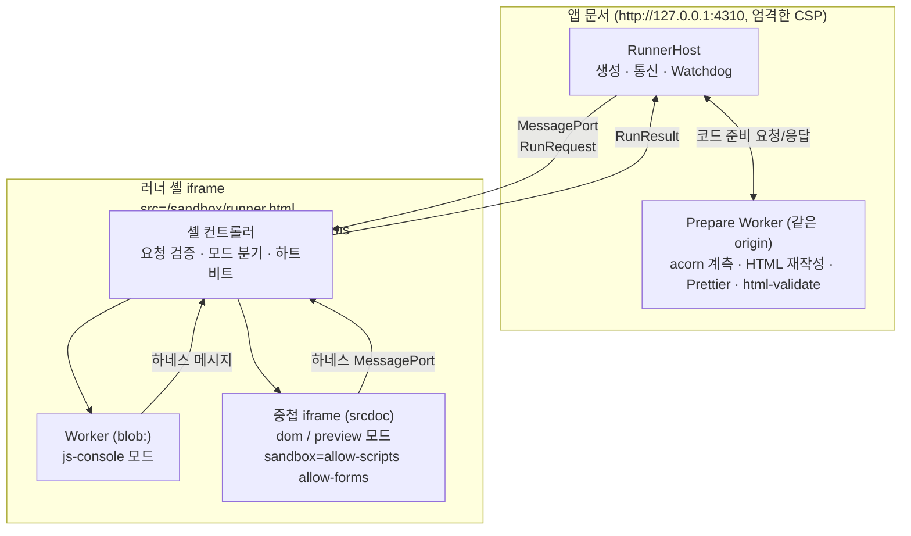
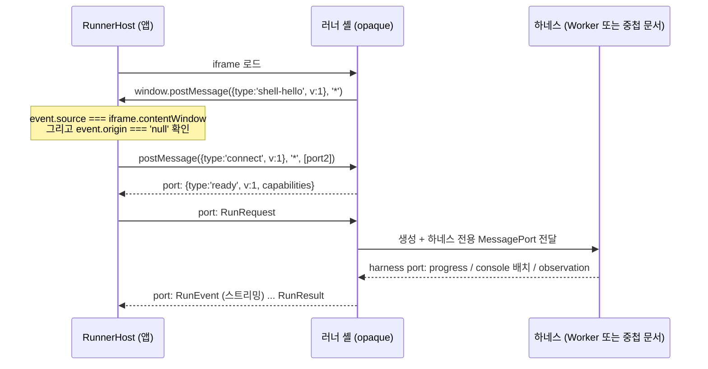
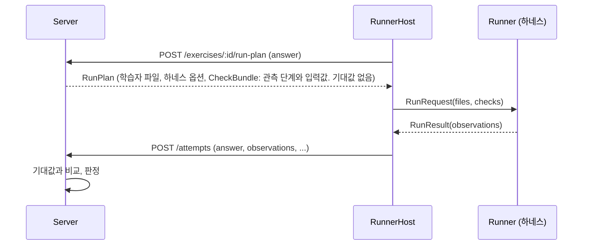
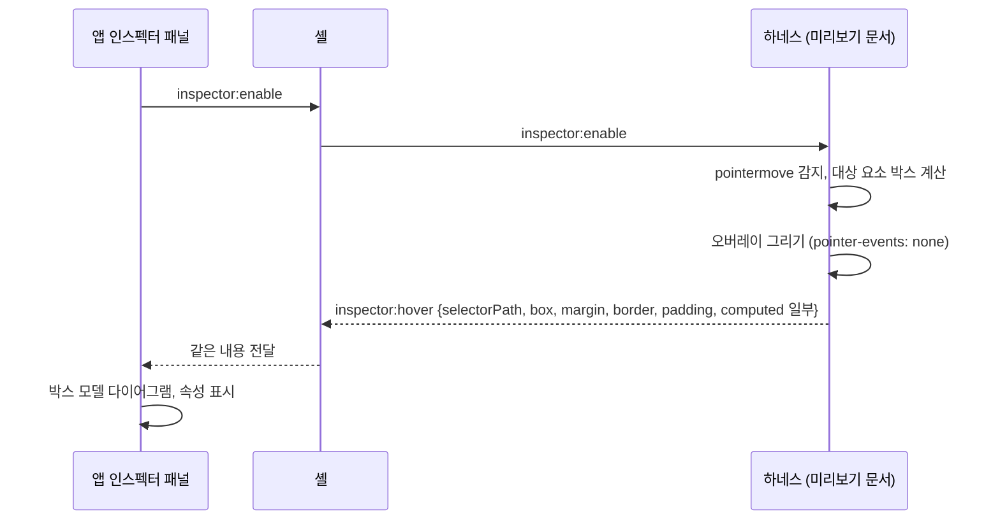

# 코드 실행 샌드박스 설계

학습자가 작성한 HTML/CSS/JavaScript를 브라우저 안에서 안전하게 실행하고, 콘솔 출력·오류·체크 관측값을 돌려주는 러너(`Runner`)를 설계합니다.
위협 모델, 격리 구조, 메시지 프로토콜, 무한 루프·메모리·비동기 처리, 테스트 하네스, 콘텐츠 빌드 시 검증 방법, 보안 테스트 스위트를 다룹니다.

- 상태: 승인됨 (2026-11-14)
- 작성: ProgInOne 팀
- 최종 수정: 2026-11-14 (M4 `packages/runner` v0.1 구현 반영: [v0.1 구현 노트](#v01-구현-노트-m4))
- 관련 문서: [PRD](/docs/product/prd.md), [결정 기록](/docs/decisions.md), [용어집](/docs/glossary.md), [시스템 아키텍처 설계](/docs/design/system-architecture.md), [콘텐츠·문제 시스템 설계](/docs/design/content-and-exercises.md), [학습 엔진 설계](/docs/design/learning-engine.md), [UI/UX 설계](/docs/design/ui-ux.md)

## 배경과 범위

ProgInOne의 실습 문제는 학습자 코드를 실제로 실행해야 채점할 수 있습니다.
실행 결과 예측 문제의 정답도 저장된 값이 아니라 실제 실행 결과로 판정합니다(FR-EX-07).
학습자 코드와 AI가 생성한 코드는 모두 신뢰할 수 없는 입력입니다(NFR-07).

실행 위치는 브라우저로 한정합니다([시스템 아키텍처 설계](/docs/design/system-architecture.md)의 비목표: 서버 측 코드 실행 환경 없음).
같은 컴퓨터에서 로컬 서버(`127.0.0.1:4310`)가 학습 기록과 AI 호출 권한을 갖고 있으므로, 샌드박스의 가장 중요한 임무는 **학습자 코드가 앱 자신과 로컬 서버에 손대지 못하게 하는 것** 입니다.

이 문서의 범위:

- 브라우저 안의 격리 구조와 보안 정책(sandbox 속성, CSP, Permissions Policy)
- 실행 모드 3종과 각 모드의 실행 방식
- `RunnerHost` ↔ 러너 셸 ↔ 하네스 사이의 메시지 프로토콜
- 콘솔 캡처, 값 직렬화, 오류 위치 매핑
- 무한 루프, 메모리, 출력 폭주, 비동기 완료 판정
- 체크 실행(관측 모델), DOM/CSS 측정, 뷰포트 전환
- 미리보기, 박스 모델 인스펙터(P1), 포맷팅 위치
- 콘텐츠 빌드와 AI 생성 문제 검증을 위한 실행 방법
- 보안 테스트 스위트

범위 밖:

- 체크의 콘텐츠 작성 형식과 기대값 판정 규칙: [콘텐츠·문제 시스템 설계](/docs/design/content-and-exercises.md)
- 에디터 UI, 콘솔 패널 UI: [UI/UX 설계](/docs/design/ui-ux.md)
- 서버의 채점·숙련도 반영: [학습 엔진 설계](/docs/design/learning-engine.md)

## 목표와 비목표

### 샌드박스 목표

- **앱과 로컬 서버 보호**: 학습자 코드는 앱의 DOM·저장소·쿠키, 로컬 서버 API, 네트워크에 접근할 수 없어야 합니다(FR-CODE-04).
- **UI 응답성**: 무한 루프나 과도한 실행이 있어도 메인 UI는 계속 응답하고, 실행은 시간 제한(기본 3초)으로 중단됩니다(FR-CODE-05, NFR-03).
- **실제 브라우저 의미론**: 학습자가 배우는 동작은 실제 브라우저 동작과 같아야 합니다. 별도 JS 엔진이나 가짜 DOM을 쓰지 않습니다.
- **정확한 피드백**: 콘솔 출력은 값의 구조를 보존하고, 오류는 학습자 파일 기준 줄 번호로 보여줍니다(FR-CODE-02).
- **결정론적 채점 입력**: 같은 코드와 같은 체크는 같은 관측값을 냅니다(타이밍 의존 코드는 가상 타이머로 통제).
- **빠른 실행**: 실행 시작부터 콘솔 첫 출력까지 500ms 이내(NFR-02).
- **같은 러너를 어디서나 재사용**: 학습 화면, 숨김 채점, AI 생성 문제 검증, 콘텐츠 빌드 검증이 모두 같은 러너 코드를 씁니다.

### 샌드박스 비목표

- **악의적인 숙련 공격자로부터의 완전한 방어.** 사용자는 자기 컴퓨터의 학습자 본인 1명입니다. 학습자가 개발자 도구로 정답을 엿보거나 채점을 속이는 것은 "자기 자신을 속이는 행위"로 보고 막지 않습니다. 단, 실수나 학습 내용(예: 프로토타입 수정 실습)으로 하네스가 깨지는 것은 막습니다.
- **브라우저 엔진 취약점 방어.** 렌더러 탈출 같은 브라우저 버그는 브라우저의 프로세스 샌드박스에 맡깁니다.
- **정확한 메모리 상한 강제.** 브라우저는 iframe이나 Worker의 힙 크기를 제한하는 API를 제공하지 않습니다. 탐지와 복구만 합니다.
- **서버 측 언어(Node.js 등) 실행.** 이후 과정 확장 시 별도 설계합니다.
- **실제 `localStorage`/쿠키 제공(MVP).** MVP는 메모리 기반 대체 구현(shim)을 씁니다. 실제 저장소가 필요한 v1.x 단원은 [검토한 대안](#별도-사이트-러너-v1x-후보)에서 다룹니다.

## 설계

### 개요



핵심 결정:

1.  **러너 셸은 서버가 고유 CSP 헤더와 함께 제공하는 별도 문서(`/sandbox/runner.html`)이고, `sandbox="allow-scripts allow-forms"` iframe에 로드합니다.**
    `allow-same-origin`이 없으므로 셸은 opaque origin이 되고, 앱 origin의 DOM·저장소·쿠키에 접근할 수 없습니다.
1.  **앱 문서가 직접 `srcdoc` iframe을 만들지 않습니다.**
    HTML 표준상 `about:srcdoc` 문서는 부모의 정책 컨테이너(CSP 포함)를 복제해 상속하므로, 앱이 직접 `srcdoc`을 쓰면 앱 CSP를 학습자 코드 실행에 맞게 느슨하게 만들어야 합니다.
    셸을 별도 응답으로 제공하면 앱 CSP는 엄격하게 유지하고, 셸 CSP는 학습자 코드 실행에 맞게 따로 정할 수 있습니다.
1.  **순수 JS 실행(`js-console`)은 셸 안의 Worker에서** 합니다. `Worker.terminate()`는 무한 루프 중이어도 즉시 중단되므로 시간 제한이 확실합니다.
1.  **DOM이 필요한 실행(`dom`, `preview`)은 셸 안의 중첩 `srcdoc` iframe에서** 합니다. 중첩 문서는 셸 CSP를 상속하므로 네트워크 차단이 그대로 적용됩니다.
    DOM 모드는 같은 스레드를 공유할 수 있으므로 **AST 기반 반복문 계측(loop guard)** 을 반드시 적용합니다.
1.  **채점은 관측 모델**로 합니다. 하네스는 "관측값"(함수 반환값, 계산된 스타일, 요소 위치 등)만 돌려주고, 기대값 비교는 서버가 합니다. 기대값(정답 키)은 기본적으로 브라우저에 보내지 않습니다.
1.  **코드 준비(계측, HTML 재작성, 포맷팅, 정적 검증)는 실행하지 않는 작업이므로 앱 origin의 Prepare Worker** 에서 합니다. 학습자 코드를 파싱만 하고 실행하지 않습니다.

### 위협 모델

#### 보호 대상 자산

| 자산 | 위치 | 가치 |
|---|---|---|
| 학습 기록, AI 대화, 설정 | user.db (로컬 서버 경유) | 장기 학습 데이터 |
| 세션 토큰 | 앱 origin 쿠키·메모리 | 로컬 API 접근 권한 |
| AI 호출 권한 | 로컬 서버 → Codex 자식 프로세스 | ChatGPT 구독 사용량 |
| 앱 UI 상태 | 앱 DOM, IndexedDB(작성 중 코드) | 작업 중인 코드 |
| 호스트 파일 시스템 | OS | 개인 파일 |
| UI 응답성 | 브라우저 메인 스레드 | 학습 지속성 |

#### 위협 행위자

| 행위자 | 의도 | 현실성 |
|---|---|---|
| 학습자의 실수 코드 | 없음 (무한 루프, 메모리 폭주, 거대한 출력) | **매우 높음.** 가장 흔한 경우 |
| 학습 내용 자체 | 없음 (프로토타입 수정, 전역 변수 덮어쓰기, `alert` 사용) | 높음 |
| AI가 생성한 코드 (예제, 참조 구현, 생성 문제) | 없음 또는 프롬프트 인젝션으로 유도된 이상 코드 | 중간 |
| 복사해 붙여 넣은 외부 코드 | 알 수 없음 (악성 스니펫 가능) | 낮음~중간 |
| 채점을 속이려는 학습자 | 자기 자신을 속임 | 낮음. 비목표 |

#### STRIDE 위협 표

| # | 범주 | 위협 | 영향 | 통제 | 잔여 위험 |
|---|---|---|---|---|---|
| T1 | Information disclosure | 학습자 코드가 `fetch`/`XMLHttpRequest`/`WebSocket`/`EventSource`/`sendBeacon`으로 로컬 서버(`127.0.0.1:4310`)의 API를 호출해 학습 기록을 읽음 | 학습 데이터 유출 | 셸 CSP `connect-src 'none'`. 서버는 모든 `/api` 요청에 세션 토큰 헤더를 요구하고 `Origin: null`을 거부 | 낮음 |
| T2 | Tampering / Elevation | 같은 경로로 상태 변경 API(백업 복원, 설정 변경, AI 호출) 실행 | 데이터 손상, 구독 사용량 소모 | T1과 동일 + `form-action 'none'` + 서버의 상태 변경 요청 헤더 검사 | 낮음 |
| T3 | Information disclosure | 이미지·CSS·폰트·미디어 요청으로 로컬 서비스에 GET 요청(블라인드 요청) 또는 외부로 정보 전송 | 로컬 서비스 탐색, 외부 전송 | `img-src data: blob:`, `style-src 'unsafe-inline'`, `font-src data:`, `media-src data: blob:`. 외부 호스트 미허용 | 낮음 |
| T4 | Elevation | 학습자 코드가 `parent`/`top`의 DOM·`localStorage`·쿠키에 접근 | 세션 토큰 탈취, UI 조작 | `allow-same-origin` 미부여 → opaque origin. 교차 origin 접근은 `SecurityError` | 매우 낮음 |
| T5 | Spoofing | `top.location` 변경, 팝업(`window.open`)으로 피싱 화면 표시 | 사용자 혼란 | `allow-top-navigation*`, `allow-popups` 미부여 | 매우 낮음 |
| T6 | Tampering | 중첩 iframe 자기 탐색(`location.href = 'http://127.0.0.1:4310/...'`, `<meta http-equiv=refresh>`)으로 로컬 서버 GET 요청 | 로컬 API 응답 노출(본인 화면 안) | 셸 CSP `frame-src 'none'`(검증 필요, [미결 사항](#샌드박스-미결-사항)), 서버의 토큰 헤더 요구(탐색 요청은 커스텀 헤더를 붙일 수 없음) | 낮음 |
| T7 | Tampering | 폼 제출로 로컬 서버에 POST | 상태 변경 | `form-action 'none'`, 서버 토큰 헤더 | 매우 낮음 |
| T8 | Elevation | 다운로드 유도로 실행 파일 저장 | 호스트 파일 오염 | `allow-downloads` 미부여 | 매우 낮음 |
| T9 | Information disclosure / Tampering | 클립보드 읽기·쓰기 | 클립보드 내용 유출·오염 | iframe `allow` 속성으로 `clipboard-read`, `clipboard-write` 등 강력한 기능을 명시적으로 거부 | 매우 낮음 |
| T10 | Denial of service | 무한 루프·재귀로 메인 스레드 정지 | UI 정지, 작업 손실 | Worker 모드: `terminate()`. DOM 모드: 반복문 계측 + 셸 하트비트 + Watchdog. Chromium 데스크톱의 sandboxed 프레임 프로세스 분리 | 중간(비 Chromium 브라우저에서 계측 우회 시) |
| T11 | Denial of service | 메모리 폭주(`new Array(1e9)`, 끝없는 `push`) | 탭 또는 렌더러 충돌 | Worker 오류 이벤트 감지, 하트비트 상실 감지 → 셸 재생성. 작업 중 코드는 IndexedDB에 즉시 저장되어 손실 최소화 | 중간(브라우저가 메모리 상한 API를 제공하지 않음) |
| T12 | Denial of service | 콘솔 출력 폭주(`console.log` 100만 회), 거대한 메시지 | postMessage 큐 폭주, UI 정지 | 하네스에서 항목 수·바이트 상한, 16ms 배치 전송, 초과분 집계만 전송 | 낮음 |
| T13 | Denial of service | `alert`/`confirm`/`prompt`로 실행 블로킹 | 실행 정지, 사용자 혼란 | `allow-modals` 미부여 → 네이티브 모달 무시. 하네스가 비블로킹 대체 구현 제공 | 매우 낮음 |
| T14 | Tampering (하네스 위조) | 학습자 코드가 `Array.prototype`, `JSON`, `console`, `MessagePort.prototype.postMessage`를 덮어써서 관측값을 조작하거나 하네스를 깨뜨림 | 잘못된 채점, 실습 중 하네스 오작동 | 하네스 시작 시 내장 함수 참조 확보(intrinsics capture), 하네스 포트를 클로저에 보관, 셸은 지정된 포트로 온 메시지만 수용, 서버가 관측값 스키마 검증 | 낮음(의도적 위조는 비목표) |
| T15 | Spoofing | 학습자 코드가 `parent.postMessage(...)`로 셸에 가짜 결과 전송 | 잘못된 채점 | 셸은 `window` 메시지 이벤트로 결과를 받지 않고 하네스 전용 `MessagePort`로만 받음 | 매우 낮음 |
| T16 | Elevation | `eval`/`new Function`/문자열 `setTimeout`으로 반복문 계측 우회 | T10 우회 | 셸 CSP에 `'unsafe-eval'` 미포함 → 런타임 문자열 코드 실행 차단 | 낮음 |
| T17 | Elevation | 서비스 워커 등록, 공유 워커, 브로드캐스트 채널로 지속성 확보 | 실행 종료 후에도 코드 잔존 | opaque origin은 서비스 워커 등록 불가(검증 대상), 셸·중첩 문서는 매 실행 후 폐기 | 낮음 |
| T18 | Elevation | 호스트 파일 접근, 프로세스 실행 | 호스트 장악 | 웹 플랫폼에 해당 API 없음. 파일 선택기(`showOpenFilePicker`)는 opaque origin·사용자 활성화 조건으로 사실상 불가하며 Permissions Policy로도 차단 | 매우 낮음 |
| T19 | Elevation | Codex App Server에 직접 접근 | AI 오남용 | Codex는 stdio로만 서버와 통신하며 네트워크 포트를 열지 않음(WebSocket 전송 미사용) | 매우 낮음 |
| T20 | Tampering | AI가 만든 마크다운·HTML이 앱 문서에 삽입되어 스크립트 실행 | 앱 origin에서 XSS | 러너 범위 밖. 앱의 마크다운 렌더러는 원시 HTML을 렌더링하지 않음([시스템 아키텍처 설계](/docs/design/system-architecture.md)) | 낮음 |

### 격리 아키텍처

#### 러너 셸 iframe

앱이 생성하는 iframe은 하나의 고정 형태입니다.

```html
<iframe
  src="http://<shellId>.localhost:<port>/sandbox/runner.html?v=1"
  sandbox="allow-scripts allow-forms"
  allow="clipboard-read 'none'; clipboard-write 'none'; camera 'none'; microphone 'none';
         geolocation 'none'; fullscreen 'none'; display-capture 'none'; usb 'none';
         serial 'none'; bluetooth 'none'; payment 'none'; screen-wake-lock 'none'"
  referrerpolicy="no-referrer"
  title="코드 실행 결과"
></iframe>
```

sandbox 토큰 선택 근거(MDN의 `iframe` 문서 기준):

| 토큰 | 부여 | 이유 |
|---|---|---|
| `allow-scripts` | ✅ | 학습자 코드 실행에 필수 |
| `allow-same-origin` | ❌ | 없으면 문서가 "항상 동일 출처 정책을 통과하지 못하는 특수 origin"으로 취급됨. 앱과 같은 서버에서 로드되므로 이 토큰과 `allow-scripts`를 함께 주면 sandbox 속성 자체를 제거할 수 있어 무의미해짐 |
| `allow-forms` | ✅ | 이 토큰이 없으면 폼 제출이 일어나지 않아 `submit` 이벤트 실습(`event.preventDefault()`)을 할 수 없음. 실제 전송은 CSP `form-action 'none'`으로 막음(동작은 PoC로 확인, [미결 사항](#샌드박스-미결-사항)) |
| `allow-modals` | ❌ | `alert`/`confirm`/`prompt`가 실행을 블로킹하지 않도록. 하네스가 대체 구현 제공 |
| `allow-popups` | ❌ | `window.open`, `target=_blank`가 조용히 실패 |
| `allow-downloads` | ❌ | 다운로드 차단 |
| `allow-top-navigation*` | ❌ | 앱 화면 탐색 차단 |
| `allow-pointer-lock`, `allow-presentation`, `allow-storage-access-by-user-activation` | ❌ | 불필요 |

`allow` 속성(Permissions Policy)은 sandbox 프레임이 교차 origin이라 대부분 기본 거부되지만, 정책이 바뀌어도 안전하도록 명시적으로 `'none'`을 지정합니다.

**셸마다 다른 사이트에서 로드합니다(M1-B PoC 결과로 추가).**
셸 iframe의 `src`는 셸을 만들 때마다 새로 정한 하위 도메인 `http://<shellId>.localhost:<port>/sandbox/runner.html`입니다(`<shellId>`는 무작위 소문자 영숫자).
같은 서버·같은 포트이지만 사이트(scheme + 등록 가능 도메인)가 앱(`127.0.0.1`)과도, 이전 셸과도 다릅니다.

- Firefox(Fission)는 사이트 단위로 프로세스를 나눕니다. 셸이 앱과 같은 사이트면 sandbox iframe도 앱과 같은 프로세스에 있어, 계측을 빠져나간 무한 루프가 앱 탭을 영구히 멈춥니다. 다른 사이트면 앱은 계속 응답하고 Watchdog이 복구합니다([PoC 결과](#m1-b-poc-결과-2026-11-14)).
- Chromium은 sandbox iframe을 별도 프로세스로 옮기지만, 같은 사이트의 새 셸을 **아직 멈춰 있는 이전 프로세스에 다시 배치** 합니다. 그래서 Watchdog이 셸을 버린 직후 만든 새 셸도 응답하지 않습니다(8초 이상). 셸마다 사이트를 바꾸면 새 셸은 새 프로세스에서 즉시 동작하고, 이전 프로세스는 프레임이 없어져 회수됩니다.
- `*.localhost`는 Chromium과 Firefox가 브라우저 안에서 루프백으로 해석합니다. 실제 Safari에서의 해석은 확인하지 못했으므로, 셸이 3초 안에 `shell-hello`를 보내지 않으면 같은 사이트 경로(`/sandbox/runner.html`)로 대체합니다.
- 서버는 `Host`가 `*.localhost:<port>`인 요청에는 `/sandbox/runner.html`만 응답하고, `/api`를 포함한 나머지 경로는 거부합니다(`Host` 허용 목록). 앱 CSP의 `frame-src`는 `'self' http://*.localhost:<port>`입니다.
- `allow-same-origin`은 여전히 주지 않습니다. 셸은 opaque origin이며, 하위 도메인은 프로세스 배치만을 위한 것입니다.

#### 셸의 CSP

서버는 `/sandbox/runner.html` 응답에만 다음 헤더를 붙입니다(개발 모드에서는 Vite 미들웨어가 같은 헤더를 붙임).

```text
Content-Security-Policy:
  default-src 'none';
  script-src 'unsafe-inline' blob:;
  worker-src blob:;
  style-src 'unsafe-inline';
  img-src data: blob:;
  font-src data:;
  media-src data: blob:;
  connect-src 'none';
  frame-src 'none';
  child-src 'none';
  form-action 'none';
  base-uri 'none';
  manifest-src 'none';
  object-src 'none'
```

- **`'unsafe-inline'`은 의도적입니다.** 학습자 코드는 인라인 스크립트로 실행되므로 필요합니다. 셸 안의 스크립트 제한은 보안 목표가 아닙니다. 보안 목표는 **네트워크(`connect-src`, `img-src` 등), 탐색(`frame-src`, `form-action`, `base-uri`), 문자열 코드 실행(`'unsafe-eval'` 미포함)** 입니다.
- 해시·nonce를 쓰지 않는 이유: CSP Level 2 이후 `script-src`에 해시나 nonce가 있으면 `'unsafe-inline'`이 무시되는데, 중첩 `srcdoc` 문서가 이 정책을 그대로 상속하므로 학습자 인라인 스크립트가 막힙니다.
  셸 자신의 하네스 코드도 인라인으로 번들합니다(`'self'`를 쓰지 않음. opaque origin 문서에서 `'self'` 매칭 동작을 신뢰하지 않기 위함).
- **`'unsafe-eval'` 미포함**: `eval`, `new Function`, 문자열 인자 `setTimeout`/`setInterval`이 차단됩니다. 반복문 계측 우회를 막고, 학습 측면에서도 권장하지 않는 기능입니다. 이 사실은 관련 레슨과 오류 메시지 번역에서 안내합니다.
- **`frame-src 'none'`**: 학습자 HTML의 `<iframe src=...>`과 중첩 문서의 자기 탐색을 막는 것이 목적입니다. PoC에서 Chromium·Firefox·WebKit 모두 `frame-src 'none'` 아래에서 중첩 `srcdoc` iframe 생성이 허용되고, 학습자의 `<iframe src="http://...">`(S10)와 중첩 문서의 `http:` 자기 탐색(S11)은 서버 요청 없이 차단됨을 확인했습니다.
- 앱 문서의 CSP는 `frame-src 'self' http://*.localhost:<port>`만 허용해 셸 로드(서브도메인 셸과 대체 경로)를 가능하게 하고, 나머지는 엄격하게 유지합니다([D-018](/docs/decisions.md) 확정).

CSP 상속 규칙(HTML 표준 정책 컨테이너 규칙 기준):

| 문서 | 정책 출처 |
|---|---|
| 앱 문서 | 서버 응답 헤더 (엄격) |
| 러너 셸 (`/sandbox/runner.html`) | 서버 응답 헤더 (위 셸 CSP). 별도 HTTP 응답이므로 앱 정책을 상속하지 않음 |
| 중첩 `srcdoc` 문서 | 부모(셸)의 정책 컨테이너를 복제해 상속 → 셸 CSP 적용. 문서 안 `<meta>` CSP는 추가로만 적용됨(완화 불가) |
| `blob:` Worker | blob URL을 만든 환경(셸)의 정책 컨테이너를 복제 → 셸 CSP 적용. 단 **Firefox는 Worker 안의 `EventSource`에 상속된 `connect-src`를 적용하지 않습니다**(PoC S5-w). 하네스가 Worker 전역에서 `EventSource`·`Worker`·`SharedWorker`를 제거해 막습니다 |
| 학습자 문서 안의 `<meta>` CSP | 셸이 학습자 문서 맨 앞에 `worker-src 'none'`을 주입합니다. 학습자 Worker가 루프를 돌거나(S42) Firefox의 `EventSource` 결함을 이용하는 경로를 막습니다. MVP 커리큘럼에 학습자 Worker는 없습니다 |

#### 왜 중첩 iframe인가

DOM 모드에서 학습자 HTML을 셸 문서에 직접 쓰지 않고 중첩 `srcdoc` iframe을 쓰는 이유:

- 학습자 HTML이 표준 HTML 파서로 처음부터 파싱되어 스크립트 실행 순서, `document.currentScript`, `DOMContentLoaded`, `load` 이벤트가 실제 웹페이지와 같습니다.
  `document.write`로 셸 문서를 교체하거나 `innerHTML` 후 스크립트를 다시 만드는 방식은 이 의미론을 깨뜨립니다.
- 셸 컨트롤러는 학습자 코드와 별도 문서·별도 전역 객체에 있으므로, 학습자 코드가 셸의 전역을 오염시킬 수 없습니다.
- 매 실행마다 중첩 iframe만 버리고 새로 만들면 깨끗한 전역 상태가 보장됩니다.
- 중첩 iframe에도 `sandbox="allow-scripts allow-forms"`를 붙여 셸과도 다른 opaque origin이 되게 합니다.

#### 프로세스 분리와 메인 스레드

- Chromium 문서에 따르면 데스크톱 Chromium 127.0.6483.0 이후 opaque origin을 쓰는 sandboxed 문서는 부모와 **별도 프로세스** 로 옮겨집니다. Android는 부분 사이트 격리를 쓰는 경우에만 분리됩니다.
  PoC에서 Chrome 157과 Playwright Chromium 141(new headless)로 확인했습니다. Playwright의 기본 headless shell은 분리하지 않으므로 CI는 `channel: 'chromium'`을 써야 합니다.
- Firefox 142(Fission 켬)는 **사이트 단위** 로만 나눕니다. 같은 사이트의 sandboxed iframe은 앱과 같은 프로세스여서 앱 탭이 멈추고, 다른 사이트의 셸은 분리됩니다. 그래서 셸을 셸마다 다른 사이트에서 로드합니다([러너 셸 iframe](#러너-셸-iframe)).
- WebKit 26(Playwright)은 사이트와 관계없이 분리하지 않았습니다. 실제 Safari는 확인하지 못했으며, 같은 스레드를 공유한다고 가정합니다.
- 그러므로 **반복문 계측은 모든 브라우저에서 1차 방어선** 이고, Watchdog은 프로세스가 분리된 경우의 2차 방어선입니다.
- 계측이 정상 동작해도 분리되지 않은 브라우저에서는 `loopBudgetMs`(1초) 동안 앱 화면이 멈춥니다(PoC S27: Firefox 같은 사이트·WebKit에서 앱 rAF 최대 간격 약 1,000ms). Chromium 계열과 셸마다 다른 사이트를 쓰는 Firefox에서는 멈추지 않습니다.

| 상황 | 1차 방어 | 2차 방어 |
|---|---|---|
| `js-console` 모드 무한 루프 (모든 브라우저) | 셸이 `maxDurationMs` 후 `worker.terminate()` | Host Watchdog이 셸 응답 없음 감지 시 셸 iframe 폐기 |
| DOM 모드 무한 루프 (Chromium 데스크톱, Firefox + 셸별 사이트) | 반복문 계측 오류 | 셸 하트비트 상실 → Host가 셸 iframe 폐기 후 **새 사이트** 에 새 셸 생성 |
| DOM 모드 무한 루프 (메인 스레드 공유 브라우저: WebKit/Safari) | 반복문 계측 오류 | 없음(메인 스레드가 멈추면 Watchdog도 멈춤, 탭을 닫아야 복구). 계측 우회 경로를 CSP로 최대한 차단 |

### 실행 모드

| 모드 | 용도 | 실행 장소 | DOM | 시간 제한 방법 |
|---|---|---|---|---|
| `js-console` | 순수 JS 실행, 콘솔 출력, 실행 결과 예측, 함수 구현·버그 수정 테스트 | 셸 내부 `blob:` Worker | 없음 | `Worker.terminate()` (확실) |
| `dom` | DOM 조작, 이벤트, HTML 구조·CSS 레이아웃 체크 | 셸 내부 중첩 `srcdoc` iframe | 있음 | 반복문 계측 + Watchdog |
| `preview` | 학습자가 보는 실시간 미리보기 | 셸 내부 중첩 `srcdoc` iframe (보이는 셸) | 있음 | 반복문 계측 + Watchdog |

- JavaScript 기초 과정의 문제 대부분은 `js-console` 모드입니다. 가장 안전한 모드가 가장 많이 쓰이도록 문제 유형을 설계합니다.
- `dom` 모드와 `preview` 모드는 같은 실행 경로를 쓰고, 차이는 화면 표시 여부와 인스펙터·뷰포트 도구 활성화 여부입니다.
- 채점용 실행은 항상 **보이지 않는 별도 셸** 에서 새로 실행합니다. 학습자가 보고 있는 미리보기 상태(스크롤, 입력값)를 건드리지 않고, 미리보기에서 학습자가 조작한 상태가 채점에 섞이지 않게 하기 위함입니다.

#### 엄격 모드 기본 적용

결정 [D-026](/docs/decisions.md)에 따라 학습자 JavaScript는 모두 **엄격 모드(strict mode)** 로 실행합니다. `js-console` 파일, DOM 모드의 인라인 스크립트와 `on*` 이벤트 핸들러 속성, 레슨의 `<RunnableExample>`, 콘텐츠 실행 검증(`content-cli check --run`)이 모두 같은 준비 단계를 거치므로 같은 규칙이 적용됩니다.

- 이유: 요즘 JavaScript(모듈, 클래스 본문)는 항상 엄격 모드입니다. 비엄격 모드에서는 `let` 없이 `nickname = "코코";`라고 쓰면 조용히 전역 변수가 생겨, 선언을 빠뜨린 코드가 채점을 통과합니다. 엄격 모드에서는 `ReferenceError: nickname is not defined`가 납니다.
- 방법: 준비 단계(`instrumentJs`)가 원본 1번 줄 맨 앞에 `'use strict';`를 **줄바꿈 없이** 붙입니다. 줄 번호는 그대로이고, 접두사는 1번 줄 0열의 삽입 기록으로 남아 반복문 계측과 같은 열 보정(`originalColumn`)으로 원래 열로 돌아갑니다. 작은따옴표를 쓰는 이유는 `onclick="..."` 속성 값 안에 그대로 넣을 수 있기 때문입니다.
- 접두사를 붙인 코드를 acorn으로 파싱하므로, 엄격 모드에서만 문법 오류인 코드(`with`, `010` 같은 8진수 리터럴, 중복 매개변수)도 실행 전에 잡힙니다. 학습자에게 보여 주는 문구와 위치는 [엔진 문법 검사](#문법-오류)가 브라우저에서 받아 옵니다(예: Chrome `Octal literals are not allowed in strict mode.`).
- 엄격 모드에서 달라지는 점 중 학습자가 만날 만한 것: 선언하지 않은 변수에 대입하면 `ReferenceError`, 일반 함수 호출의 `this`는 `undefined`(최상위 `this`는 여전히 전역 객체), 읽기 전용 속성에 대입하면 `TypeError`.
- 체크 하네스가 만드는 노출 스크립트와 `argsExpr`(콘텐츠가 쓴 인수 식)에는 접두사를 붙이지 않습니다. 학습자 코드가 아니기 때문입니다.

#### `js-console` 모드 실행 순서

1.  Host가 Prepare Worker로 코드 준비를 요청합니다: 구문 검사(acorn), 체크용 노출 스크립트 생성.
    구문 오류가 있으면 학습자 코드를 실행하지 않고, [엔진 문법 검사](#문법-오류)로 브라우저의 원래 메시지와 위치를 받아 `RunResult(status: 'error', phase: 'syntax')`로 반환합니다.
1.  Host가 셸에 `RunRequest`를 보냅니다.
1.  셸은 다음 blob을 만듭니다: 하네스 프렐류드, 학습자 파일별 blob(파일 하나당 blob URL 하나), 노출 스크립트.
1.  셸이 프렐류드 blob으로 `new Worker(url)`을 만들고 시작 메시지를 보냅니다.
1.  Worker의 하네스는 내장 함수 참조를 확보하고 `console`, 타이머, `alert`류를 설치한 뒤 `importScripts(학습자 blob URL...)`로 학습자 코드를 실행합니다.
    `importScripts`는 파일마다 별도 스크립트로 실행되므로 오류 스택의 줄 번호가 각 학습자 파일 기준이 됩니다.
1.  `importScripts(노출 스크립트)`로 체크에 필요한 식별자를 하네스에 넘깁니다([학습자 식별자 접근](#학습자-식별자-접근)).
1.  하네스가 비동기 완료를 기다린 뒤([비동기 완료 판정](#비동기-완료-판정)) 체크를 실행하고 결과를 보냅니다.
1.  셸은 결과를 Host에 전달하고 Worker를 종료합니다. 시간 제한 초과 시 셸이 즉시 `terminate()`하고 `status: 'timeout'`을 보냅니다.

> PoC 확인: opaque origin 셸에서 `blob:` Worker 생성과 Worker 안의 `blob:` `importScripts`가 Chromium·Chrome·Firefox·WebKit에서 모두 동작했습니다. 스택의 blob URL로 학습자 파일과 줄 번호(파일 기준)를 복원할 수 있었습니다(PoC B5).

#### `dom` / `preview` 모드 실행 순서

1.  Host가 Prepare Worker로 코드 준비를 요청합니다.
    - HTML을 `parse5`로 파싱해 문서 구조를 재작성합니다.
        - `<link rel="stylesheet" href="style.css">` → 해당 파일 내용의 `<style data-file="style.css">`
        - `<script src="app.js">` → 해당 파일 내용의 인라인 `<script data-file="app.js">`
        - 프로젝트 밖을 가리키는 외부 URL은 그대로 두되 CSP로 차단되며, 경고를 미리 표시합니다.
    - 모든 JS(인라인 스크립트, 외부 파일, `onclick` 같은 이벤트 핸들러 속성)를 acorn으로 파싱하고 반복문 계측을 삽입합니다.
    - 하네스 스크립트(한 줄)와 `<meta http-equiv="Content-Security-Policy" content="worker-src 'none'">`를 문서 맨 앞(doctype 바로 뒤, 같은 줄)에 삽입합니다.
    - 각 인라인 스크립트의 본문은 `__pg.w(i)` 호출로 바꾸고, 계측된 본문은 `RunRequest`로 따로 보냅니다. 하네스의 `__pg.w(i)`는 **학습자 문서 안에서** 본문으로 `blob:` URL을 만들고 `document.write('<script src="blob:...">')`로 같은 위치에 씁니다(**blob 전달**).
      파서가 삽입한 외부 스크립트이므로 실행 순서, `DOMContentLoaded`, 최상위 `let`/`const` 공유가 원래 인라인 스크립트와 같습니다(PoC B6, 세 엔진).
      이렇게 하는 이유: WebKit은 opaque origin 문서의 인라인 스크립트 오류를 `"Script error."`(줄 0, `error` 없음)로 가립니다. 같은 문서가 만든 `blob:` 스크립트의 오류는 가리지 않습니다(PoC B5·B6·S31). 덤으로 모든 브라우저에서 오류 줄 번호가 스크립트 기준이 됩니다.
    - 위치 매핑 표는 스크립트 순번 → 원본 파일과 시작 줄만 기록합니다.
    - `<body>` 끝에 노출 스크립트를 삽입합니다.
1.  Host가 셸에 `RunRequest`를 보내면, 셸이 중첩 iframe을 만들고 `srcdoc`에 준비된 문서를 넣습니다.
1.  하네스가 셸에서 전달받은 `MessagePort`로 진행 상황과 결과를 보냅니다.
1.  `load` 이벤트 이후 비동기 완료를 기다리고, 체크 단계(`steps`)를 순서대로 실행합니다.
1.  셸이 결과를 Host에 전달합니다. 채점용 실행이면 중첩 iframe을 즉시 폐기합니다.

### 메시지 프로토콜

#### 채널 구성



- 앱 → 셸 첫 메시지는 opaque origin이 대상이라 `targetOrigin`으로 `'*'`만 쓸 수 있습니다(MDN `postMessage` 문서: opaque origin인 `data:` 컨텍스트에는 `'*'`가 필요).
  보내는 내용(포트, 학습자 코드)에 비밀이 없으므로 허용합니다. 대신 **연결 이후 모든 통신은 전송된 `MessagePort`로만** 합니다.
- 앱이 받는 첫 메시지(`shell-hello`)는 `event.source === shellIframe.contentWindow`와 `event.origin === 'null'`을 모두 확인합니다.
  opaque origin은 `"null"`로 직렬화되므로(HTML 표준) origin 비교만으로는 발신자를 특정할 수 없습니다. **`event.source` 비교가 핵심 검증** 입니다.
- 셸 ↔ 하네스도 전용 `MessagePort`로만 통신합니다. 셸은 `window`의 `message` 이벤트로 오는 결과를 무시합니다(T15).
- 모든 수신 메시지는 zod 스키마로 검증하고, 실패하면 버리고 진단 로그를 남깁니다.

#### 버전과 상관 ID

- 모든 메시지는 `v`(프로토콜 버전, 정수)를 가집니다. 셸의 `ready`에 포함된 버전이 Host와 다르면 Host는 셸을 캐시 무효화 쿼리(`?v=`)로 다시 로드합니다.
- 실행 관련 메시지는 `runId`(UUID)를 가집니다. Host는 현재 진행 중인 `runId`가 아닌 메시지를 버립니다(취소된 이전 실행의 늦은 메시지 방지).

#### 스키마 스케치

정식 정의는 `packages/runner`의 zod 스키마가 원천입니다.

```ts
const Limits = z.object({
  maxDurationMs: z.number().int().min(100).max(10_000).default(3_000),
  quietMs: z.number().int().min(0).max(1_000).default(50),
  loopBudgetMs: z.number().int().min(50).max(5_000).default(1_000),
  maxConsoleEntries: z.number().int().max(5_000).default(1_000),
  maxEntryBytes: z.number().int().max(100_000).default(10_000),
  maxObservationBytes: z.number().int().max(256_000).default(64_000), // 관측값 하나(체크 단계 하나)의 직렬화 크기
  checkTimeoutMs: z.number().int().min(100).max(10_000).default(3_000), // 체크 단계 하나(callFunction 등)의 제한
  maxOutputBytes: z.number().int().max(5_000_000).default(1_000_000),
});

const RunFile = z.object({
  path: z.string().regex(/^[a-z0-9][a-z0-9._/-]{0,63}$/i), // 예: index.html, js/app.js
  language: z.enum(['html', 'css', 'js']),
  content: z.string().max(200_000),
});

const RunRequest = z.object({
  v: z.literal(1),
  type: z.literal('run'),
  runId: z.string().uuid(),
  mode: z.enum(['js-console', 'dom', 'preview']),
  purpose: z.enum(['interactive', 'grading', 'verification']),
  files: z.array(RunFile).min(1).max(20),
  entry: z.string(),                         // js-console: 실행할 JS 파일 순서의 첫 파일, dom: index.html
  limits: Limits,
  timers: z.enum(['real', 'virtual']).default('real'),
  viewport: z.object({ width: z.number().int(), height: z.number().int() }).optional(),
  stdin: z.array(z.string()).max(100).optional(),  // prompt() 대체 입력 큐
  checks: CheckBundle.optional(),            // 관측 단계 목록 (기대값 없음)
  prepared: PreparedCode,                    // Prepare Worker 산출물: 계측된 코드, 위치 매핑 표
});

const RunResult = z.object({
  v: z.literal(1),
  type: z.literal('result'),
  runId: z.string().uuid(),
  status: z.enum(['completed', 'error', 'timeout', 'loop_limit', 'crashed', 'aborted']),
  durationMs: z.number(),
  console: z.array(ConsoleEntry),
  consoleTruncated: z.boolean(),
  droppedConsoleEntries: z.number().int(),
  errors: z.array(RunError),
  observations: z.array(Observation),
  pendingAtEnd: z.object({ timers: z.number().int(), intervals: z.number().int() }),
});

const ConsoleEntry = z.object({
  seq: z.number().int(),
  level: z.enum(['log', 'info', 'warn', 'error', 'debug', 'table', 'dir', 'alert', 'confirm', 'prompt']),
  args: z.array(SerializedValue),
  at: z.number(),                            // 실행 시작 기준 ms
  source: SourcePosition.optional(),         // 호출 위치 (가능한 경우)
});

const RunError = z.object({
  phase: z.enum(['syntax', 'runtime', 'unhandled_rejection', 'loop_limit', 'harness']),
  name: z.string(),                          // TypeError, ReferenceError ...
  message: z.string(),
  position: SourcePosition.optional(),       // { file, line, column }
  stack: z.array(SourcePosition).optional(), // 학습자 파일 프레임만
});
```

스트리밍 이벤트(`RunEvent`)는 콘솔 배치(`console-batch`), 진행 상태(`started`, `script-done`, `settled`), 하트비트(`heartbeat`)입니다. 이와 별도로 셸은 실행과 무관한 미리보기 알림(`notice`)과 미리보기 문서 제목(`title`)을 보냅니다([미리보기](#미리보기)).
UI는 콘솔을 실시간으로 그리고, 채점은 최종 `RunResult`만 씁니다.

### 콘솔 캡처와 값 직렬화

#### 캡처 대상

`console.log`, `info`, `warn`, `error`, `debug`, `table`, `dir`, `group`/`groupEnd`, `count`, `time`/`timeEnd`, `assert`, `clear`를 대체 구현합니다.
원래 `console` 메서드도 호출해 개발자 도구에서도 보이게 하되, 출력 폭주 시에는 원래 메서드 호출을 생략합니다.

#### 직렬화 형식 (`SerializedValue`)

구조화 복제(structured clone)는 함수, 심볼, DOM 노드, 순환 구조를 학습자에게 보여줄 형태로 전달하지 못하므로, 하네스가 자체 태그 기반 형식으로 직렬화합니다.

| 값 | 표현 |
|---|---|
| `undefined`, `null`, 불리언 | `{ t: 'undefined' }`, `{ t: 'null' }`, `{ t: 'boolean', v }` |
| 숫자 | `{ t: 'number', v }`. `NaN`, `Infinity`, `-Infinity`, `-0`은 문자열 태그(`v: 'NaN'` 등)로 보존 |
| BigInt | `{ t: 'bigint', v: '123' }` |
| 문자열 | `{ t: 'string', v, truncated? }` |
| 심볼 | `{ t: 'symbol', description }` |
| 함수 | `{ t: 'function', name, kind: 'function' \| 'arrow' \| 'class' \| 'async' \| 'generator' \| 'native', preview }` (preview는 소스 앞 80자) |
| 배열 | `{ t: 'array', items, length, holes?, truncated? }` |
| 일반 객체 | `{ t: 'object', className, entries: [[key, value]], truncated? }` |
| `Map` / `Set` | `{ t: 'map', entries }`, `{ t: 'set', items }` |
| `Date` / `RegExp` | `{ t: 'date', iso }` (유효하지 않으면 `'Invalid Date'`), `{ t: 'regexp', source, flags }` |
| `Error` | `{ t: 'error', name, message, position? }` |
| `Promise` | `{ t: 'promise' }` (상태는 동기적으로 알 수 없으므로 표시하지 않음) |
| 접근자 속성 | `{ t: 'getter' }`. **getter를 호출하지 않습니다**(부수 효과 방지) |
| DOM 노드 | `{ t: 'dom', nodeName, id?, classes?, preview }` (`outerHTML` 앞 200자) |
| 순환 참조 | `{ t: 'circular', refId }` (처음 나온 위치에 `refId` 부여) |
| 직렬화 불가·오류 | `{ t: 'unserializable', reason }` |

제한값:

| 항목 | 기본값 |
|---|---|
| 중첩 깊이 | 6 (초과 시 `{ t: 'object', className, collapsed: true }`) |
| 컬렉션 항목 수 | 100 (초과 시 `truncated: true`, `length` 유지) |
| 문자열 길이 | 8,000자 (`maxEntryBytes`보다 작아야 잘린 문자열이 항목 상한에 걸려 통째로 버려지지 않음. PoC S35) |
| 항목 하나의 직렬화 크기 | 10KB (`maxEntryBytes`) |
| 실행당 콘솔 항목 수 | 1,000 (`maxConsoleEntries`) |
| 관측값 하나(체크 단계 하나)의 크기 | 64KB (`maxObservationBytes`) |
| 실행당 전체 출력(콘솔 + 관측값) | 1MB (`maxOutputBytes`) |

시간 제한은 실행 목적에 따라 다릅니다. 이 값은 [콘텐츠·문제 시스템 설계](/docs/design/content-and-exercises.md#채점-위치와-정답-키-비노출)의 채점 제한과 같습니다.

| 목적(`purpose`) | `maxDurationMs` (실행 전체) | `checkTimeoutMs` (체크 단계 하나) |
|---|---|---|
| `interactive` (실행 버튼) | 3초 | 3초 |
| `grading` (제출) | 10초 (문제 하나의 모든 체크 포함) | 3초 |
| `verification` (빌드·생성 검증) | 10초 | 3초 |

- 상한을 넘으면 이후 항목은 버리고 개수만 집계합니다(`droppedConsoleEntries`). UI는 "출력이 너무 많아 1,000개만 표시합니다"를 보여줍니다.
- 콘솔 항목은 16ms마다 배치로 전송합니다. 반복문 안의 `console.log` 100만 회도 메시지 수가 실행 시간에 비례해 제한됩니다.
- 프록시(`Proxy`) 객체는 열거 과정에서 트랩이 실행될 수 있습니다. 하네스는 트랩 오류를 잡아 `unserializable`로 표시합니다.

#### 표시 형식과 정답 비교 형식

- 콘솔 패널의 표시 형식(**ProgInOne 콘솔 형식**)은 Node.js `util.inspect`와 비슷한 규칙을 씁니다. 예: `{ a: 1, b: [1, 2] }`, `Map(1) { "a" => 1 }`. 최상위 문자열 인자는 따옴표 없이, 중첩된 문자열은 큰따옴표로 표시합니다. 이 형식은 실행 결과 예측 문제의 기대 출력 형식과 같습니다([콘텐츠·문제 시스템 설계](/docs/design/content-and-exercises.md#predict_output-실행-결과-예측)).
- 실행 결과 예측 문제의 **정답 비교용 정규 문자열** 은 `SerializedValue`에서 결정론적으로 생성합니다. 정규화 규칙(공백, 따옴표, 줄 단위 비교)은 [콘텐츠·문제 시스템 설계](/docs/design/content-and-exercises.md)가 정의하며, 이 문서의 직렬화 형식이 입력입니다.
- 브라우저 개발자 도구의 표시 형식은 브라우저마다 다르므로 정답 기준으로 쓰지 않습니다. 학습자에게는 "ProgInOne 콘솔 표시 형식"을 레슨 초반에 소개합니다.

### 오류와 줄 번호 매핑

#### `js-console` 모드

- 학습자 파일마다 blob URL을 만들고 `importScripts`로 실행하므로, 스택 프레임의 URL이 파일을 식별하고 줄 번호는 파일 기준입니다.
- 하네스는 `blob URL → 파일 경로` 표로 스택 프레임을 변환하고, 하네스 내부 프레임은 제거합니다.
- 스택 문자열 형식은 엔진마다 다르므로(V8, SpiderMonkey, JavaScriptCore) 세 형식을 모두 해석하는 파서를 둡니다. 해석에 실패하면 위치 없이 메시지만 보여줍니다.

#### DOM 모드

- blob 전달 덕분에 오류의 `filename`과 스택 프레임은 스크립트별 `blob:` URL이고 줄 번호는 스크립트 기준입니다. 하네스가 `blob URL → index.html#scriptN` 표로 바꾸고, 위치 매핑 표로 원본 파일의 줄로 옮깁니다.
- 참고(PoC B5): 인라인 그대로 실행하면 Chromium·Firefox는 `ErrorEvent.lineno`를 문서 기준 줄로 보고했고, `//# sourceURL`이 있어도 `ErrorEvent`의 줄은 바뀌지 않았습니다. WebKit은 줄 0과 `"Script error."`만 줬습니다. 그래서 `sourceURL`은 쓰지 않습니다.
- 인라인 이벤트 핸들러 속성(`onclick="..."`)의 오류는 WebKit에서 여전히 가려집니다. 레슨은 `addEventListener`를 기본으로 가르치고, 이 경우 WebKit에서는 "오류가 발생했지만 브라우저가 위치를 알려주지 않았습니다" 안내를 보여줍니다.
- 반복문 계측과 엄격 모드 접두사(`'use strict';`)는 **줄바꿈을 추가하지 않고 같은 줄에 삽입** 합니다. 줄 번호는 보존되고 열 번호만 밀리므로, 열 번호는 계측 삽입 기록으로 보정합니다(오차가 있으면 열 번호를 생략).

#### 오류 메시지

- 브라우저 원문 메시지를 그대로 보여주고, 자주 나오는 오류(예: `x is not defined`, `Cannot read properties of undefined`)에는 한국어 해설 카드를 덧붙입니다. 해설 매핑 표는 UI/UX 설계에서 정의합니다. 해설은 같은 오류의 Firefox·Safari 문구(예: `Can't find variable: x`, `x is undefined`, `too much recursion`)에도 똑같이 붙습니다([D-074](/docs/decisions.md)).
- 구문 오류도 브라우저 원문입니다([문법 오류](#문법-오류)). 영어 원문과 한국어 해설을 함께 보여줍니다.

#### 문법 오류

결정 [D-030](/docs/decisions.md)에 따라 학습자에게 보여 주는 `SyntaxError`의 문구와 위치는 **브라우저 엔진이 직접 낸 것**입니다. 예전에는 준비 단계의 acorn 문구(`Unexpected token`, `Assigning to rvalue`)가 그대로 보여서, 레슨이 가르치는 Chrome 문구(`missing ) after argument list`, `Invalid left-hand side in assignment`)와 달랐습니다. 학습자가 실제 개발자 도구에서 보게 될 문구와 같아야 오류 읽기 학습이 전이됩니다.

1.  준비 단계(acorn)가 학습자 스크립트 하나라도 파싱하지 못하면, 그 실행은 학습자 코드를 하나도 실행하지 않고 끝납니다(예전과 같음). acorn의 오류는 대체용으로 남겨 둡니다.
1.  Host는 대신 **엔진 문법 검사**(`syntaxOnly: true`인 `dom` 모드 `RunRequest`)를 셸에 보냅니다. 문서는 `<!doctype html>`과 파싱에 실패한 스크립트마다 `__pg.w(i)` 하나뿐이고, 스크립트는 평소처럼 blob 전달로 들어갑니다. 실행 모드가 `js-console`이어도 검사는 문서에서 합니다. Worker의 `importScripts`는 문법 오류의 위치를 주지 않고 메시지 앞에 `Failed to execute 'importScripts'…`를 붙이지만, 문서의 `blob:` 스크립트는 `ErrorEvent`에 스크립트 기준 줄·열을 줍니다. 파서는 같은 엔진이라 문구가 같습니다.
1.  검사 스크립트(`syntaxCheckScript`)는 원본 앞에 같은 줄로 `'use strict';throw 0;`를 붙입니다(D-026의 엄격 모드 유지). 문법 오류가 있는 스크립트는 시작하지 않으므로 아무것도 실행되지 않고, 혹시 엔진이 받아들이더라도(파서 사이의 차이) 첫 문장이 `throw`라 학습자 코드는 실행되지 않습니다. 함수 선언은 끌어올려지지만 호출되지 않습니다. 그래서 반복문 계측도 필요 없습니다.
    `on*` 속성 값은 브라우저가 핸들러를 컴파일하는 방식처럼 함수 본문으로 감쌉니다: `throw 0;(function(event){'use strict';` + 값 + `\n});`.
1.  하네스는 평소처럼 `error` 이벤트를 `src:<id>` 위치로 기록합니다. Host(`nativeSyntaxErrors`)는 검사 스크립트마다 `SyntaxError` 이름의 오류를 찾아, 메시지는 그대로 쓰고 위치는 삽입 기록으로 학습자 파일·줄·열로 되돌린 뒤 `phase: 'syntax'`로 바꿉니다. 핸들러 감싸기의 닫는 줄에서 보고된 위치는 값의 마지막 줄로 줄이고 열을 뺍니다. WebKit처럼 열을 0으로 주면 열을 뺍니다.
1.  엔진이 오류를 보고하지 않으면(검사가 시간 초과되었거나, 엔진이 코드를 받아들여 `throw 0`에 걸림) acorn의 문구와 위치를 그대로 씁니다. 검사가 `aborted`면 결과도 `aborted`입니다.

- 셸은 검사 문서를 보이지 않게(투명, 화면 안) 만들고, 직전 미리보기(`preview`) 문서를 지우지 않습니다. 입력 중 잠깐 생긴 문법 오류로 미리보기가 깜빡이지 않게 하기 위함입니다.
- 보안: 새 평가 경로가 없습니다. 검사 스크립트는 일반 실행과 같은 샌드박스 문서에서 같은 blob 전달로 실행되고, 셸 CSP(`'unsafe-eval'` 없음)도 그대로입니다.
- 브라우저마다 문구가 다릅니다. 예를 들어 `console.log('hi'`는 Chromium과 Firefox에서 `missing ) after argument list`, WebKit(Safari)에서 `Unexpected end of script`였습니다. 레슨은 Chrome 문구로 설명하고 다른 브라우저의 문구가 다를 수 있다고 안내합니다. E2E는 Chromium 문구만 검사합니다.
- 비용: 문법 오류가 있을 때만 셸 실행이 한 번 더 듭니다(빈 문서와 정착 대기, 보통 100ms 안팎).

### 무한 루프 대응

#### `js-console` 모드

- 셸이 `maxDurationMs` 타이머를 설정하고 만료 시 `worker.terminate()`를 호출합니다. MDN에 따르면 `terminate()`는 Worker가 작업을 마칠 기회를 주지 않고 즉시 중단합니다.
- 셸 메인 스레드는 학습자 코드와 분리되어 있으므로 이 타이머는 학습자 코드에 막히지 않습니다.
- 무한 루프 위치를 알려주기 위해 `js-console` 모드에도 반복문 계측을 적용합니다. 계측이 먼저 동작하면 `status: 'loop_limit'`과 줄 번호를, 계측을 빠져나간 경우(예: 긴 동기 재귀가 아닌 단일 내장 함수 호출)에는 `terminate()`로 `status: 'timeout'`을 반환합니다.

#### DOM 모드의 반복문 계측 (loop guard)

Prepare Worker가 acorn으로 AST를 만들고 모든 반복문에 시간 검사를 삽입합니다.

대상 노드: `ForStatement`, `WhileStatement`, `DoWhileStatement`, `ForInStatement`, `ForOfStatement`.

변환 예:

```js
// 원본 (3번째 줄)
while (true) { count++; }

// 계측 후 (같은 3번째 줄)
var __lg3_5 = __pg.enter(3, 5); while (true) { if (__pg.tick(__lg3_5)) break; count++; }
```

- `__pg.enter(line, col)`은 진입 시각을 기록하고 핸들을 반환합니다.
- `__pg.tick(handle)`은 반복 횟수를 세고, 256회마다 `performance.now()`를 확인합니다. 진입 후 `loopBudgetMs`(기본 1초)를 넘으면 반복을 중단하고, 하네스가 `RunError(phase: 'loop_limit', position: {line, col})`를 기록합니다.
- 중단 방식은 `break` 대신 **전용 예외를 던지는 방식** 을 기본으로 합니다. `break`는 이후 코드를 계속 실행시켜 학습자에게 혼란을 주기 때문입니다. 예외는 하네스가 인식하는 고유 클래스이며, 학습자의 `try/catch`가 잡아도 하네스가 `tick` 단계에서 이미 오류를 기록했으므로 결과에 반영됩니다. 잡힌 뒤에도 같은 반복문이 계속되면 `tick`이 다시 예외를 던집니다.
- 본문이 블록이 아닌 반복문(`while (x) x--;`)은 블록으로 감싼 뒤 삽입합니다.
- 레이블이 있는 반복문, 생성기 함수 안의 반복문, `async` 함수 안의 반복문도 같은 방식으로 처리합니다. `for await`도 대상입니다.
- 하네스의 `__pg` 객체는 `Object.freeze`하고 쓰기 불가능한 전역 속성으로 정의해 학습자 코드가 덮어쓸 수 없게 합니다.

계측하지 않는 경로와 대응:

| 경로 | 대응 |
|---|---|
| `eval`, `new Function`, 문자열 `setTimeout` | 셸 CSP에 `'unsafe-eval'`이 없어 실행 자체가 차단됨 |
| 인라인 이벤트 핸들러 속성(`onclick="..."`) | Prepare Worker가 HTML 재작성 시 속성 값을 함수 본문으로 파싱해 같은 방식으로 계측 |
| 무한 재귀 | 엔진이 `RangeError: Maximum call stack size exceeded`를 던짐 |
| 계측된 반복문이 아닌 긴 동기 작업(예: `'x'.repeat(1e9)`, 거대 배열 `sort`) | 계측 불가. 대부분 메모리 오류로 끝남. Watchdog과 셸 재생성으로 복구 |
| 학습자가 만든 Worker 안의 루프 | 별도 스레드이므로 UI를 멈추지 않음. 중첩 iframe 폐기 시 함께 정리됨 |
| 짧은 반복의 무한 비동기 체인(`setTimeout` 재귀, `setInterval`) | UI를 멈추지 않음. `maxDurationMs`에서 실행을 종료(채점 모드)하거나 계속 실행(미리보기) |
| 끝나지 않는 마이크로태스크 체인(`Promise.resolve().then(f)`의 재귀) | 이벤트 루프가 마이크로태스크를 계속 처리해 사실상 무한 루프와 같음. 하네스가 `queueMicrotask`/`then` 콜백 연쇄 깊이를 직접 추적하기는 어려우므로 Watchdog에 의존. 메인 스레드 공유 브라우저에서는 잔여 위험으로 기록 |

#### Watchdog

- 셸은 실행 중 250ms마다 Host에 하트비트를 보냅니다.
- Host Watchdog은 `maxDurationMs + 1,000ms`가 지나거나 하트비트가 1,500ms 동안 없으면 셸 iframe을 DOM에서 제거하고 새 셸을 만듭니다. 결과는 `status: 'crashed'` 또는 `'timeout'`입니다.
- Watchdog이 셸을 폐기하면 UI는 "실행이 응답하지 않아 중단했습니다"와 함께 반복문 계측이 놓친 가능성이 있는 코드 위치(마지막 하트비트 시점의 진행 정보)를 보여줍니다.
- 새 셸은 항상 **새 사이트**(새 `<shellId>`)로 만듭니다. Chromium에서 iframe을 제거해도 돌던 프로세스는 즉시 멈추지 않고(측정: 3.5~11.5초 뒤 회수), 같은 사이트로 만든 새 셸은 그 프로세스에 배치되어 응답하지 않기 때문입니다(PoC Q4/Q5).
- 새 셸이 3초 안에 `ready`를 보내지 않으면 다시 새 사이트로 만들고, 그래도 실패하면 "실행 환경을 다시 준비하는 중" 상태를 보여줍니다.

### 메모리 제한

- 브라우저에는 iframe 또는 Worker의 메모리 상한을 설정하는 API가 없습니다. `performance.measureUserAgentSpecificMemory()`는 교차 출처 격리(cross-origin isolation)가 필요해 이 구조에서 쓸 수 없습니다.
- 따라서 **예방이 아니라 탐지와 복구** 를 합니다.
    - PoC(S32/S33): `while (true) a.push(new Array(1e6).fill(1))`은 모든 브라우저에서 반복문 계측이 1초에 멈췄고 앱 탭은 살아 있었습니다. Chrome의 DOM 모드에서만 셸이 응답을 멈춰 Watchdog이 동작했고, 셸별 사이트를 쓰면 다음 실행이 정상이었습니다.
    - Worker 모드: 메모리 부족으로 Worker가 죽으면 `error` 이벤트 또는 응답 없음으로 탐지하고 `status: 'crashed'`로 보고합니다.
    - DOM 모드: 렌더러 충돌이나 응답 없음을 하트비트 상실로 탐지하고 셸을 재생성합니다.
    - 거대한 할당은 엔진이 `RangeError: Invalid array length` 등으로 막는 경우가 많고, 이는 일반 런타임 오류로 보고됩니다.
- 출력 측 상한(콘솔, 관측값 크기)은 하네스가 강제하므로 postMessage를 통한 메모리 폭주는 막습니다.
- 앱 탭 전체가 충돌하는 최악의 경우에도 작성 중 코드는 IndexedDB에 즉시 저장되므로(시스템 아키텍처의 상태 관리 원칙) 최근 입력만 잃습니다.
- 잔여 위험: 메인 스레드 공유 브라우저에서 DOM 모드 메모리 폭주는 앱 탭을 함께 충돌시킬 수 있습니다. 이 위험은 문서화하고, Chromium 계열 브라우저를 권장 브라우저로 안내합니다.

### 비동기 완료 판정

학습자 코드가 `setTimeout`, `Promise`, 이벤트 핸들러를 쓰면 "스크립트 실행 끝"이 "프로그램 끝"이 아닙니다.

하네스는 다음을 추적합니다.

- 대기 중인 `setTimeout` 수, 활성 `setInterval` 수 (대체 구현으로 등록·해제를 셈)
- `requestAnimationFrame` 대기 수 (DOM 모드)
- 처리되지 않은 Promise 거부(`unhandledrejection`)

완료 판정 규칙:

1.  최상위 스크립트 실행이 끝나면(DOM 모드는 `load` 이후) 판정을 시작합니다.
1.  대기 중인 타이머와 rAF가 0이고, 마지막 콘솔 출력이나 타이머 콜백 이후 `quietMs`(기본 50ms)가 지나면 **정착(settled)** 으로 보고 체크를 실행합니다.
1.  활성 `setInterval`이 남아 있거나 타이머가 계속 생기면 `maxDurationMs`까지 기다립니다. 도달하면:
    - `interactive` 실행: 실행을 계속 유지하고(미리보기·콘솔이 계속 갱신), 상태 표시에 "실행 중(타이머 n개)"을 보여줍니다. 사용자가 중지할 수 있습니다.
    - `grading`/`verification` 실행: 그 시점에 체크를 실행하고 종료합니다. `pendingAtEnd`에 남은 타이머 수를 기록합니다.
1.  마이크로태스크는 매크로태스크 사이에 모두 처리되므로, 정착 판정 자체를 `setTimeout` 콜백 안에서 하면 앞선 마이크로태스크는 모두 끝난 상태입니다.

#### 가상 타이머

- 기본은 실제 타이머(`timers: 'real'`)입니다. 이벤트 루프 순서(`setTimeout` vs `Promise`) 학습은 실제 타이머로 정확하게 관찰됩니다.
- 다음 경우 체크 번들이 `timers: 'virtual'`을 지정합니다.
    - 긴 지연(예: `setTimeout(f, 5000)`)을 포함하는 문제를 제한 시간 안에 채점해야 할 때
    - 디바운스·스로틀처럼 시간 경과를 시뮬레이션해야 하는 실습
    - 타이밍 때문에 결과가 흔들릴 수 있는 체크
- 가상 타이머는 `@sinonjs/fake-timers`를 하네스에 번들해 사용합니다. `setTimeout`/`setInterval`, `Date`, `performance.now`, `requestAnimationFrame`만 가상화하고, `queueMicrotask`와 Promise는 가상화하지 않습니다(마이크로태스크는 실제 엔진이 처리해 실행 순서 의미론을 보존).
- 체크 단계의 `advance { ms }`로 시간을 진행합니다.
- 실습 중 미리보기는 항상 실제 타이머입니다. 가상 타이머는 채점과 검증에서만 씁니다. 이로 인한 체감 차이(예: 실제로는 5초 뒤 바뀌는 화면)를 체크 실패 메시지에서 설명합니다.

### 브라우저 기능 대체 구현 (shim)

opaque origin과 sandbox 제약 때문에 일부 API는 실제 웹페이지와 다르게 동작합니다. 학습에 필요한 것은 하네스가 대체 구현을 제공합니다.

| API | sandbox에서의 실제 동작 | 하네스 처리 |
|---|---|---|
| `localStorage`, `sessionStorage` | opaque origin에서 접근 시 `SecurityError` (MDN: origin이 유효한 scheme/host/port 튜플이 아닌 경우) | 메모리 기반 `Storage` 대체 구현을 `window`에 정의. 실행 간 유지가 필요한 실습은 Host가 문제별 저장소 스냅샷을 주고받음(`storageSnapshot` 필드, P1) |
| `document.cookie` | opaque origin에서 동작하지 않음(정확한 동작은 확인 필요) | 쿠키 문자열 파서를 가진 대체 구현(`path`, `max-age`, `expires` 해석). 실제 쿠키와의 차이(전송되지 않음, `HttpOnly` 불가)를 레슨에서 명시 |
| `indexedDB` | opaque origin에서 사용 불가 | MVP 미지원. 사용 시 "이 환경에서는 지원하지 않습니다" 오류 |
| `alert(msg)` | `allow-modals`가 없어 표시되지 않음 | `console` 항목(`level: 'alert'`)으로 기록하고 UI가 비블로킹 토스트로 표시 |
| `confirm(msg)` | 표시되지 않음 | `stdin` 큐의 다음 값을 불리언으로 해석, 없으면 `true`. 기록 남김 |
| `prompt(msg, def)` | 표시되지 않음 | `stdin` 큐의 다음 값, 없으면 `def ?? null`. 학습 화면에서는 실행 전에 "입력값"을 미리 적는 입력 패널 제공 |
| `fetch` | CSP로 차단 | 차단 오류를 한국어로 설명. v1.x Fetch API 단원은 하네스가 제공하는 **모의 응답 테이블**(`mockFetch` 체크 설정)로 실습 |
| `window.open` | 조용히 실패 (`null`) | 콘솔에 안내 경고 |

- 대체 구현은 레슨에서 "ProgInOne 실습 환경의 차이"로 투명하게 안내합니다. 실제 동작과 다른 부분을 숨기지 않습니다.
- 실제 `localStorage`와 쿠키를 다뤄야 하는 v1.x 단원은 [별도 사이트 러너](#별도-사이트-러너-v1x-후보) 도입 여부를 그때 결정합니다.

### 테스트 하네스와 체크 실행

#### 관측 모델

하네스는 기대값을 모르고 **관측값만 수집** 합니다. 기대값 비교는 서버의 채점기가 합니다([시스템 아키텍처 설계](/docs/design/system-architecture.md)의 "서버 판정 + 브라우저 실행").



관측 단계(체크 번들의 구성 요소) 초안:

| 단계 | 입력 | 관측값 | 모드 |
|---|---|---|---|
| `callFunction` | 함수 이름, 인자(`SerializedValue[]`), 옵션(`observeArgsAfter`, `timeoutMs`) | 반환값 또는 던진 오류, 호출 중 콘솔, (옵션) 호출 후 인자 상태(원본 변경 여부 확인용) | 둘 다 |
| `readGlobal` | 식별자 이름 | 값 | 둘 다 |
| `consoleOutput` | 없음 (암묵적) | 전체 콘솔 항목 | 둘 다 |
| `domQuery` | 선택자, 읽을 항목(`count`, `exists`, `text`, `attr:<name>`, `tagName`, `value`, `checked`, `outerHTMLShape`) | 값 목록 | dom |
| `computedStyle` | 선택자, 속성 목록, 의사 요소(선택) | 요소별 계산된 값 | dom |
| `boxRect` | 선택자 목록 | 요소별 `getBoundingClientRect()` 값, 스크롤 크기 | dom |
| `dispatch` | 선택자, 이벤트(`click`, `input`(값), `change`, `submit`, `keydown`(키), `focus`, `blur`) | 디스패치 성공 여부, 처리 중 오류 | dom |
| `setViewport` | 너비, 높이 | 적용된 뷰포트 크기 | dom |
| `advance` | ms | 없음 (가상 타이머 진행) | 둘 다 |
| `waitSettled` | 최대 ms | 정착 여부 | 둘 다 |
| `a11y` | 규칙 집합(선택) | axe-core 위반 목록(규칙 ID, 대상 선택자) | dom |

- 단계는 배열 순서대로 실행되어 "클릭 → 정착 대기 → 텍스트 관측" 같은 시나리오를 표현합니다.
- 서버는 각 관측값을 문제의 기대값·허용 범위·관계 규칙(예: "A가 B의 왼쪽")과 비교합니다. 관계 계산(`boxRect` 결과로 왼쪽/위/중앙 정렬/간격 판단)도 서버 채점기가 합니다.
- **예외: 클라이언트 평가 체크.** 관측 단계로 표현하기 어려운 소수의 체크는 기대값을 포함한 검증 코드를 하네스에서 실행할 수 있습니다(`clientEvaluated: true`). 이 경우 정답 키가 브라우저에 노출되므로 콘텐츠 작성 시 사용을 최소화하고, 콘텐츠 빌드 리포트에서 집계합니다.

#### 학습자 식별자 접근

클래식 스크립트의 최상위 `function` 선언은 전역 객체의 속성이 되지만, 최상위 `let`/`const`/`class` 선언은 전역 객체 속성이 아니라 전역 렉시컬 환경에만 존재합니다.
하네스는 `eval` 없이(CSP로 금지) 이 식별자에 접근하기 위해, 체크에 필요한 이름 목록으로 **노출 스크립트** 를 생성해 학습자 스크립트 뒤에 실행합니다.

```js
// 체크 번들이 add, counter를 요구할 때 Prepare Worker가 생성하는 노출 스크립트
__pg.expose({
  add: typeof add === 'undefined' ? __pg.MISSING : add,
  counter: typeof counter === 'undefined' ? __pg.MISSING : counter,
});
```

- 같은 전역 렉시컬 환경을 공유하는 별도 클래식 스크립트이므로 `let`/`const` 식별자에 접근할 수 있습니다.
- 식별자가 없으면 `MISSING`으로 관측되고, 서버는 "함수 `add`를 찾을 수 없습니다"라는 구체적 피드백을 줍니다.
- `typeof`는 TDZ(초기화 전 접근) 상태의 `let`/`const`에는 `ReferenceError`를 던지므로 노출 스크립트를 `try/catch`로 감쌉니다.
- ES 모듈(`type="module"`) 실습은 v1.x에서 `export`를 요구하고 하네스가 `import()`로 blob 모듈을 불러오는 방식으로 확장합니다.

#### 하네스 무결성

학습 내용 자체가 내장 객체를 수정하는 경우(예: 프로토타입 단원에서 `Array.prototype`에 메서드 추가)가 있으므로, 하네스는 학습자 코드의 전역 변경에 영향을 받지 않아야 합니다.

- **내장 함수 확보**: 하네스는 학습자 코드보다 먼저 실행되어 필요한 내장 함수의 참조를 확보합니다.
  예: `const { keys, getOwnPropertyDescriptor, getPrototypeOf } = Object`, `const arrayPush = Function.prototype.call.bind(Array.prototype.push)`, `const send = port.postMessage.bind(port)`, `const now = performance.now.bind(performance)`.
  직렬화기와 메시지 전송은 확보한 참조만 사용합니다.
- **포트 은닉**: 하네스 전용 `MessagePort`는 클로저 안에만 두고 전역에 노출하지 않습니다.
- **하네스 전역의 고정**: `__pg`는 `Object.defineProperty(globalThis, '__pg', { value, writable: false, configurable: false })`와 `Object.freeze`로 정의합니다.
- **수신 측 검증**: 셸은 하네스 포트로 온 메시지만 받고, 스키마·크기를 검증합니다. 서버는 관측값을 다시 스키마로 검증합니다.
- **한계**: 같은 realm에서 실행되는 이상 완전한 무결성(SES 수준)은 보장하지 않습니다. 의도적 위조는 비목표이며, 실수로 인한 오염만 방어 대상입니다.

#### DOM/CSS 측정과 뷰포트

- `computedStyle`은 `getComputedStyle(el)`의 값을 그대로 관측합니다. 색상은 `rgb()` 형식으로 정규화되어 나오므로 서버 비교 규칙이 정규화된 값을 기준으로 합니다.
- `boxRect`는 `getBoundingClientRect()`를 읽습니다. 이 호출은 레이아웃을 동기적으로 강제하므로 별도 프레임 대기 없이 측정할 수 있습니다.
- **뷰포트 전환**: 셸이 중첩 iframe 요소의 `width`/`height`를 바꿔 학습자 문서의 뷰포트 크기를 바꿉니다. 미디어 쿼리는 iframe 뷰포트 기준으로 평가됩니다.
  전환 후 하네스는 `resize` 이벤트를 받고 `setTimeout(0)` 두 번 뒤에 측정합니다(`requestAnimationFrame`은 보이지 않는 iframe에서 지연될 수 있어 쓰지 않음).
- 채점용 셸은 보이지 않게 두되 **뷰포트 안** 에 둡니다: `position: fixed; left: 0; top: 0; opacity: 0; pointer-events: none; z-index: -1`과 명시적 크기. 화면 밖 배치(`left: -10000px`)는 WebKit에서 중첩 문서의 `setTimeout`이 3초 넘게 멈춰 채점이 시간 초과됩니다(PoC Q6). `display: none`은 레이아웃이 없으므로 금지합니다.
- 폰트 차이로 인한 측정 오차를 줄이기 위해 하네스는 실습 문서의 기본 폰트를 번들된 폰트로 고정하는 기본 스타일시트를 주입합니다(학습자 CSS가 덮어쓸 수 있음). 채점 규칙은 픽셀 단위 일치 대신 허용 오차를 씁니다.

#### html-validate와 axe-core의 실행 위치

| 도구 | 필요 입력 | 실행 위치 | 이유 |
|---|---|---|---|
| html-validate | HTML 문자열 (실행 불필요) | **서버**(채점), **Prepare Worker**(편집 중 실시간 린트) | 정적 분석이므로 샌드박스가 필요 없음. 서버에서 실행하면 채점 규칙과 결과가 한 곳에 모임 |
| axe-core | 렌더링된 DOM | **하네스**(`a11y` 단계) | 실제 렌더링된 문서가 필요함 |

- axe-core는 크기가 크므로(수백 KB) `a11y` 단계가 있는 실행에만 포함합니다. 셸은 네트워크로 받을 수 없으므로(`connect-src 'none'`) Host가 `RunRequest`와 함께 axe-core 소스를 한 번 전달하고, 셸이 메모리에 캐시해 중첩 문서에 인라인으로 주입합니다.

### 미리보기

- **갱신 시점**: HTML/CSS 변경은 마지막 입력 후 300ms 디바운스로 자동 갱신합니다. JS 변경도 기본적으로 자동 갱신하되, 구문이 유효할 때만 실행합니다(입력 중 미완성 코드 실행 방지). 설정에서 "JS는 ⌘Enter로만 실행"을 선택할 수 있습니다.
- **이중 버퍼링**: 새 중첩 iframe을 숨긴 상태로 만들고, `load` 후 기존 iframe과 교체해 깜빡임을 없앱니다.
- **스크롤 유지**: 하네스가 교체 직전 스크롤 위치를 보고하고, 새 문서에서 같은 위치로 복원합니다(문서 높이가 바뀌면 최대값으로 제한).
- **오류 표시**: 미리보기 위에 반투명 오류 배너를 띄우고 해당 줄로 이동하는 버튼을 제공합니다. 문서는 마지막 성공 상태를 유지하지 않고 현재 코드를 그대로 보여줍니다(실제 브라우저와 같은 경험).
- **링크 이동과 폼 제출**: 학습자 문서의 탐색은 셸 CSP(`frame-src 'none'`, `form-action 'none'`)가 막으므로, 그대로 두면 미리보기가 브라우저 오류 화면으로 바뀝니다. `preview` 모드에서만 하네스가 학습자 코드보다 먼저 `window`에 캡처 단계 `click`·`submit` 리스너를 달아, 링크(`a[href]`, `area[href]`. `javascript:`는 제외)와 실제 폼 제출(신뢰된 `submit`, `method="dialog"` 제외)을 시작 전에 취소합니다. `#…` 조각 링크도 취소합니다: `srcdoc` 문서는 조각을 부모(셸) URL 기준으로 해석해 조각 링크마저 문서를 떠나기 때문입니다. 조각 링크는 대신 대상 요소(`id`, 없으면 `name`, `#`·`#top`은 맨 위)로 스크롤하고 안내는 띄우지 않습니다. 학습자 핸들러는 평소처럼 실행되고, 이벤트의 `preventDefault`·`defaultPrevented`·`returnValue`는 학습자 자신의 취소만 반영하도록 그 이벤트에서만 가립니다. 학습자 핸들러가 취소하지 않았으면 하네스가 (조각 링크가 아닐 때) 셸에 `pg-notice`를 보내고, 셸은 호스트에 `notice`(`navigation-blocked`, 0.5초에 한 번까지)를 전달하며, 앱은 미리보기 위 라이브 영역(`role="status"`)에 "미리보기에서는 링크 이동과 폼 제출이 실제로 일어나지 않아요."를 보여 줍니다. 실행이 끝난 뒤에도 미리보기 문서는 계속 조작되므로 이 알림은 실행과 무관한 메시지입니다. 샌드박스 플래그·CSP는 바꾸지 않습니다(탐색을 더 일찍 멈출 뿐). 채점용 `dom` 모드는 가로채지 않습니다: `preventDefault()`를 빠뜨린 폼은 실제 브라우저처럼 문서가 바뀌고 `NavigationError`로 실패해야 하기 때문입니다(실패를 정하는 시점은 [실행 동작](#실행-동작)의 "취소되지 않은 폼 제출"). 한계: 인라인 핸들러의 `return false`는 `preventDefault` 호출 없이 취소하므로 안내가 함께 뜨고, `location` 대입과 `form.submit()`·`<meta refresh>`는 가로채지 않습니다. 이런 이동으로 문서가 떠나면(하네스의 `pagehide` 알림 `pg-left` 또는 하네스 인사 뒤 iframe의 두 번째 `load`), 셸은 오류 화면 대신 그 미리보기 iframe의 `srcdoc`을 스크립트 없는 안내 문서("미리보기는 다른 페이지로 이동할 수 없어요.")로 바꾸며 같은 알림을 보냅니다. 다음 실행이 학습자 문서를 다시 그립니다([D-074](/docs/decisions.md)).
- **탭 제목**: 미리보기에는 브라우저 탭이 없어 `<title>`·`document.title`을 다루는 문제의 결과를 볼 곳이 없습니다. `preview` 모드에서만(문법 검사 제외) 하네스가 학습자 코드보다 먼저 `Document.prototype`의 `title` getter와 `MutationObserver`를 잡아 두고, `DOMContentLoaded`·`load` 때와 문서가 바뀐 뒤(문서 전체를 `childList`·`characterData`·`subtree`로 관찰하므로 `<title>` 수정, `document.title =` 대입, 스크립트가 넣거나 뺀 `<title>`을 모두 봄) 제목을 읽습니다. 바뀐 내용은 0.1초 단위로 묶고, 앞서 보낸 값과 다를 때만 셸에 `window.postMessage`로 `pg-title`(`{ type: 'pg-title', title }`)을 보냅니다. 셸은 화면에 있는 미리보기 문서(`pg-notice`·`pg-left`와 같은 출처 검사)에서 온 문자열만 받아, 제어 문자를 공백으로 바꾸고 공백을 접고 200자(UTF-16 단위, 서로게이트 쌍은 자르지 않음)에서 자른 뒤 0.1초에 한 번까지(묶음의 마지막 값은 반드시) 호스트에 `title`(`{ v, type: 'title', title }`, 스키마 `max(200)`)로 전달합니다. 새 실행이 시작되면 이전 문서의 보내지 않은 제목은 버리고, 문서가 떠나 안내 문서로 바뀌면 빈 제목을 보냅니다. 앱은 미리보기 위 탭 모양 막대에 텍스트로만 그립니다(UI는 [UI/UX 설계 PreviewFrame](/docs/design/ui-ux.md)). 학습자 코드도 `pg-title`을 보낼 수 있지만 자기 미리보기의 표시 제목만 바뀔 뿐이고, 채점용 `dom` 문서의 메시지는 셸이 받지 않습니다(보안 스위트 S50). 채점과는 무관한 표시 기능이라 제목을 확인하는 체크는 그대로 관측 단계로 합니다([D-082](/docs/decisions.md)).
- **뷰포트 프리셋**(P1): 375/768/1280. 미리보기 셸의 중첩 iframe 크기를 바꾸고 축소 비율(`transform: scale`)로 패널에 맞춥니다. 축소는 셸 바깥(앱 쪽 iframe 컨테이너)에서 적용해 학습자 문서의 레이아웃 계산에 영향을 주지 않게 합니다.

### 박스 모델 인스펙터 (P1)



- 오버레이는 하네스가 문서 최상단에 붙이는 단일 요소에 `attachShadow({ mode: 'closed' })`로 그려 학습자 CSS의 영향을 받지 않게 합니다. 요소에는 `pointer-events: none`과 최대 `z-index`를 줍니다.
- 인스펙터는 미리보기 셸에서만 동작하고, 채점용 셸에는 포함하지 않습니다(오버레이가 관측값에 섞이는 것 방지).
- 요소 클릭으로 고정 선택, `Esc`로 해제. 키보드 접근을 위해 패널에서 DOM 트리를 탐색하는 방식도 제공합니다(UI/UX 설계에서 상세화).

### 코드 포맷팅

- Prettier standalone(파서 플러그인: babel, estree, html, postcss)을 **Prepare Worker** 에서 실행합니다. 코드를 파싱만 하고 실행하지 않으므로 샌드박스가 필요 없고, 앱 메인 스레드를 막지 않습니다.
- 서버에서 실행하지 않는 이유: 오프라인에서도 즉시 동작해야 하고, 왕복 지연을 없애기 위함입니다.
- Prettier 플러그인은 크므로 처음 포맷 요청 때 지연 로드합니다.

### 콘텐츠 빌드와 AI 생성 문제의 실행 검증

콘텐츠 빌드(`pnpm content:check`)와 런타임 AI 생성 문제 검증은 학습자 화면과 **같은 러너 코드** 로 실행해야 채점 결과가 일치합니다.

| 방식 | 장점 | 단점 |
|---|---|---|
| **Playwright 헤드리스 Chromium으로 동일 러너 실행** (채택) | 학습자 런타임과 같은 엔진·같은 하네스·같은 직렬화. DOM/CSS 체크까지 검증 가능 | 브라우저 설치 필요(CI는 Playwright 공식 이미지), 실행이 상대적으로 느림 |
| QuickJS(WASM, `quickjs-emscripten`) | 진짜 메모리 상한과 인터럽트 핸들러, 빠르고 결정론적, Node 안에서 실행 | DOM 없음, V8과 다른 엔진(오류 메시지·스택·일부 내장 동작 차이), 하네스를 별도로 구현해야 함 |
| Node `vm` | 간단 | Node 공식 문서가 "보안 메커니즘이 아니며 신뢰할 수 없는 코드 실행에 쓰지 말라"고 명시. AI 생성 코드에 사용 불가 |

채택안의 동작:

1.  `tools/content-cli`가 빌드된 러너(셸 HTML과 하네스)를 정적으로 제공하는 임시 로컬 서버를 띄웁니다(셸 CSP 헤더 포함).
1.  Playwright로 같은 앱 구조의 최소 호스트 페이지를 열고, 그 안의 `RunnerHost`에 `RunRequest(purpose: 'verification')`를 보냅니다.
1.  각 문제에 대해 다음을 검증합니다.
    - 참조 구현이 자신의 모든 체크를 통과하는가 (서버 채점기 로직을 Node에서 직접 호출해 판정)
    - 객관식의 정답 선택지가 실제 실행 결과와 일치하고, 오답 선택지는 실제로 불일치하는가
    - 실행 결과 예측 문제의 기대 출력이 실제 실행과 같은가 (불일치 시 저장된 값이 아니라 실행 결과로 갱신 제안)
    - 파라메트릭 템플릿의 모든 매개변수 조합이 정상 실행되는가
    - "버그 수정" 문제의 시작 코드는 실제로 체크에 실패하는가
1.  병렬 실행을 위해 셸을 여러 개 띄우고, 문제당 실행 시간과 실패를 리포트로 남깁니다.

런타임 AI 생성 문제 검증은 학습자가 화면에 있을 때 요청되므로, 앱 안의 숨김 셸에서 `purpose: 'verification'`으로 같은 검증을 수행합니다.
백그라운드 대량 생성이 필요해지면 서버에서 Playwright를 쓰는 방안을 그때 검토합니다(서버 의존성 증가 때문에 MVP 제외).

### 성능 목표와 예산

목표: 실행 시작(사용자 입력)부터 콘솔 첫 출력까지 500ms 이내(NFR-02, 일반 예제 기준).

| 단계 | 예산 | 방법 |
|---|---|---|
| Prepare Worker: 파싱·계측·HTML 재작성 | 30ms | acorn은 수백 줄 코드에 수 ms. Prepare Worker는 앱 시작 시 미리 생성 |
| Host → 셸 메시지 | 5ms | 셸은 미리 로드해 둔 **예열 셸 풀**(대화형 1개, 채점용 1개) 사용 |
| Worker 생성과 하네스 초기화 | 50ms | 하네스 번들 최소화(가상 타이머·axe는 필요할 때만) |
| 중첩 iframe 생성과 파싱 (DOM 모드) | 100ms | `srcdoc` 직접 주입, 외부 자원 없음 |
| 학습자 코드 실행과 첫 콘솔 배치 | 16ms + 실행 시간 | 첫 배치는 즉시 전송, 이후 16ms 배치 |
| 합계 (여유 포함) | 약 200~300ms | |

- 실행이 끝난 셸은 재사용하지 않고 폐기 후 새 셸을 예열합니다(전역 상태 오염 방지). 단, 셸 자체는 학습자 코드가 직접 실행되는 곳이 아니므로(Worker·중첩 iframe에서 실행) 셸 재사용은 성능 측정 후 허용할 수 있습니다.
- Playwright 테스트에서 이 예산을 측정하는 성능 테스트를 둡니다(CI에서 회귀 감지용, 임계값은 여유 있게).

### 패키지 구성

`packages/runner`의 구성 (시스템 아키텍처의 모노레포 구조 기준):

```text
packages/runner/
├── src/
│   ├── protocol/          # zod 스키마: RunRequest, RunResult, RunEvent, CheckBundle, SerializedValue
│   ├── host/              # RunnerHost: 셸 풀, 연결, Watchdog, 이벤트 스트림 (앱에서 사용)
│   ├── prepare/           # acorn 계측, parse5 HTML 재작성, 위치 매핑, 노출 스크립트 생성
│   ├── shell/             # runner.html과 셸 컨트롤러 (빌드 시 단일 HTML로 인라인)
│   ├── harness/           # 하네스: intrinsics 확보, console, 직렬화, 타이머 추적, shim, 관측 단계
│   └── format/            # SerializedValue → 표시 문자열 (콘솔 UI와 정답 비교 공용)
└── test/
    ├── unit/              # 직렬화, 계측 변환, 위치 매핑
    └── browser/           # Playwright: 보안 스위트, 모드별 실행, 성능
```

- `shell`과 `harness`는 빌드 시 하나의 자체 완결 HTML(`runner.html`)로 묶입니다. 외부 스크립트를 로드하지 않습니다.
- `format`은 서버 채점기도 사용하므로 DOM 의존성이 없어야 합니다.

### 보안 테스트 스위트

Playwright로 실행하며, CI 필수 항목입니다. 각 케이스는 "차단되었는가"와 "부작용이 없었는가"(서버 요청 로그, 앱 상태)를 함께 확인합니다.
테스트용 서버는 모든 요청을 기록하고, 샌드박스에서 온 요청이 하나라도 기록되면 실패로 판정합니다.

| # | 공격 코드 (요약) | 모드 | 기대 결과 |
|---|---|---|---|
| S1 | `fetch('http://127.0.0.1:4310/api/v1/settings')` | 둘 다 | CSP 위반으로 거부, 서버 요청 0건 |
| S2 | `fetch('/api/v1/settings')` (상대 경로) | dom | 거부, 서버 요청 0건 |
| S3 | `new XMLHttpRequest()`로 같은 요청 | 둘 다 | 거부 |
| S4 | `new WebSocket('ws://127.0.0.1:4310')` | 둘 다 | 거부 |
| S5 | `new EventSource('/api/v1/...')` | dom | 거부 |
| S6 | `navigator.sendBeacon('http://127.0.0.1:4310/x', 'd')` | dom | `false` 또는 거부, 요청 0건 |
| S7 | `new Image().src = 'http://127.0.0.1:4310/api/v1/backups'` | dom | `img-src` 위반, 요청 0건 |
| S8 | `<link rel="stylesheet" href="http://127.0.0.1:4310/x.css">` | dom | `style-src` 위반 |
| S9 | CSS `background: url(http://127.0.0.1:4310/x)` | dom | `img-src` 위반 |
| S10 | `<iframe src="http://127.0.0.1:4310/">` | dom | `frame-src` 위반 |
| S11 | `location.href = 'http://127.0.0.1:4310/api/v1/settings'` | dom | 탐색 차단(또는 서버가 401로 거부하고 데이터 미노출) |
| S12 | `<meta http-equiv="refresh" content="0;url=http://127.0.0.1:4310/api">` | dom | S11과 동일 |
| S13 | `<form method="post" action="http://127.0.0.1:4310/api/v1/backups/x/restore">` 제출 | dom | `form-action` 위반, 요청 0건. `submit` 이벤트 핸들러는 실행됨 |
| S14 | `parent.document.body`, `top.document.cookie` 접근 | dom | `SecurityError` |
| S15 | `parent.localStorage.getItem('x')` | dom | `SecurityError`. 앱 저장소 변화 없음 |
| S16 | `localStorage.setItem('k','v')` | 둘 다(dom 우선) | shim에 저장, 앱 origin 저장소 변화 없음 |
| S17 | `top.location = 'https://example.com'` | dom | 차단, 앱 URL 불변 |
| S18 | `window.open('https://example.com')` | dom | `null`, 새 창 없음 |
| S19 | `<a href="data:text/plain,x" download>` 프로그램 클릭 | dom | 다운로드 없음 |
| S20 | `alert('x'); confirm('y'); prompt('z')` | 둘 다 | 블로킹 없음, 콘솔에 `alert`/`confirm`/`prompt` 항목 |
| S21 | `navigator.clipboard.writeText('x')` / `readText()` | dom | 거부(Permissions Policy) |
| S22 | `document.body.requestFullscreen()`, `requestPointerLock()` | dom | 거부 |
| S23 | `navigator.serviceWorker.register('/sw.js')` | dom | 거부(opaque origin) |
| S24 | `eval('1+1')`, `new Function('return 1')`, `setTimeout('x()', 0)` | 둘 다 | `EvalError`(CSP), 설명 카드 표시 |
| S25 | `import('http://127.0.0.1:4310/x.js')` | dom | `script-src` 위반 |
| S26 | `while (true) {}` | js-console | `maxDurationMs` 내 종료(`loop_limit` 또는 `timeout`), 메인 UI 프레임 지연 100ms 미만 |
| S27 | `while (true) {}` | dom | `loop_limit`, 줄 번호 3이면 3으로 보고, UI 응답 유지 |
| S28 | `setTimeout(() => { for (;;) {} }, 0)` | dom | `loop_limit` |
| S29 | `<button onclick="while(1){}">` + `dispatch click` | dom | `loop_limit` |
| S30 | `do {} while (true)`, `for (const x of gen()) {}`(무한 생성기), 레이블 반복문 | dom | 모두 `loop_limit` |
| S31 | `function f(){ f() } f()` | 둘 다 | `RangeError` 보고 |
| S32 | `const a = []; while (true) a.push(new Array(1e6).fill(1))` | js-console | `crashed` 또는 `loop_limit`, 새 셸로 복구, 다음 실행 정상 |
| S33 | 같은 메모리 폭주 | dom | 복구되며 앱 탭 유지 (Chromium 기준. 다른 브라우저는 결과 기록만) |
| S34 | `for (let i = 0; i < 1e6; i++) console.log(i)` | 둘 다 | 출력 1,000개 + `droppedConsoleEntries`, UI 응답 유지 |
| S35 | `console.log('x'.repeat(1e8))` | 둘 다 | 항목 잘림(`truncated`), 메모리 정상 |
| S36 | `parent.postMessage({ type: 'result', v: 1, observations: [...] }, '*')` | dom | 셸이 무시, 실제 결과만 반영 |
| S37 | `Array.prototype.push = () => 0; JSON.stringify = () => '{}'; Object.keys = () => []` 후 `callFunction` 체크 | 둘 다 | 관측값 정확 |
| S38 | `MessagePort.prototype.postMessage = function(){}` | 둘 다 | 결과 정상 전송 |
| S39 | `globalThis.__pg = null`, `delete __pg` | 둘 다 | 변경 실패, 계측 정상 동작 |
| S40 | `Promise.reject(new Error('x'))` (처리 안 함) | 둘 다 | `unhandled_rejection` 오류 보고 |
| S41 | `setInterval(() => console.log(1), 10)` | 둘 다 | 채점 모드: `maxDurationMs`에서 종료, `pendingAtEnd.intervals = 1` |
| S42 | 사용자 정의 Worker 안의 `while(true){}` | dom | 실행 종료 시 중첩 iframe 폐기와 함께 정리, CPU 점유 지속 없음 |
| S43 | 매우 큰 `RunRequest`(파일 20개 × 200KB 초과) | — | Host·셸의 스키마 검증에서 거부 |
| S44 | `<base href="http://evil.example/">` | dom | `base-uri` 위반 |

- 브라우저 매트릭스: CI는 Chromium으로 전체를 실행합니다. Firefox·WebKit은 `pnpm test:e2e:compat`(`PW_COMPAT`)으로 정책·계측 계열과 핵심 흐름을 실행하며, 지금은 CI가 아니라 릴리스 전 점검에서 돌립니다(D-064, [호환성 점검](/docs/reviews/2026-11-16-m7-compatibility.md)). 엔진마다 다른 오류 문구·열은 Chromium에서만 검사하고, WebKit의 S48(메인 스레드 공유)은 건너뜁니다.
- CI의 Chromium은 Playwright의 `channel: 'chromium'`(new headless)을 씁니다. 기본 headless shell은 sandbox iframe을 별도 프로세스로 나누지 않아 실제 Chrome과 결과가 다릅니다. Firefox는 출시판과 같게 `fission.autostart`를 켭니다(Playwright Firefox 기본값은 꺼짐).
- PoC에서 추가된 항목:

| # | 공격 코드 (요약) | 모드 | 기대 결과 |
|---|---|---|---|
| S45 | Worker 안에서 `new EventSource(...)` | js-console | 하네스가 제거해 `EventSource` 없음, 요청 0건 (Firefox는 제거하지 않으면 요청이 나감) |
| S46 | 학습자 문서에서 `new Worker(blob)` 안의 `EventSource`·무한 루프 | dom | `worker-src 'none'` 위반, 요청 0건, CPU 점유 없음 |
| S47 | 셸 iframe 밖에 둔 채점 셸의 타이머·측정 | dom | 뷰포트 안 투명 배치에서 정상 |
| S48 | 계측 없는 DOM 무한 루프 후 다음 실행 | dom | 앱 응답 유지, Watchdog 후 새 사이트 셸에서 다음 실행 정상 (Chromium·Firefox) |
| S49 | `preventDefault()` 없는 `submit` 처리기로 폼 제출(`requestSubmit`, 제출 버튼 클릭) 후 관측 단계 | dom | 매 실행 `NavigationError`, 제출 뒤 관측 없음(결정론). 취소·`return false`·`method="dialog"`·다른 `target`·신뢰되지 않은 `submit`은 정상 완료 |
| S50 | 미리보기 문서가 `parent.postMessage({ type: 'pg-title', title })`를 문자열이 아닌 값, 아주 긴 문자열, 500번 반복으로 보냄. 채점(`dom`) 문서도 같은 메시지를 보냄 | preview, dom | 문자열만 전달, 200자에서 자름, 0.1초에 한 번까지(마지막 값은 전달). 자기 미리보기의 탭 제목만 바뀌고 채점 문서의 메시지는 무시 ([D-082](/docs/decisions.md)) |
- 메인 UI 응답성 측정: 테스트 페이지가 앱 메인 스레드에서 `requestAnimationFrame` 간격을 기록하고, 공격 실행 중 최대 간격을 검사합니다.

## 검토한 대안

### 앱 문서가 직접 `srcdoc` iframe 생성

- **장점**: 서버 경로 불필요, 구현이 가장 단순.
- **단점**: HTML 표준상 `about:srcdoc` 문서는 부모의 정책 컨테이너를 복제해 상속하므로 앱 CSP가 그대로 적용됩니다. 학습자 인라인 스크립트를 실행하려면 앱 CSP에 `'unsafe-inline'`을 넣어야 하고, 이는 앱 자체의 XSS 방어를 약화시킵니다.
- **결론**: 미채택. 서버가 고유 CSP로 제공하는 셸 문서를 사용합니다.

### 별도 사이트 러너 (v1.x 후보)

러너를 다른 사이트에서 제공하는 방식입니다. 예: 앱은 `http://127.0.0.1:4310`, 러너는 `http://localhost:4311`.
사이트(scheme + 등록 가능 도메인) 판단에서 포트는 무시되므로 같은 호스트의 다른 포트는 같은 사이트입니다. 다른 사이트가 되려면 호스트 이름이 달라야 합니다(`127.0.0.1` vs `localhost`).

- **장점**: 진짜 교차 사이트이므로 사이트 격리를 지원하는 브라우저에서 별도 프로세스가 됩니다. `allow-same-origin`을 줘도 앱과 다른 origin이라 안전하므로, 러너 문서가 **실제 `localStorage`와 쿠키** 를 쓸 수 있습니다(Web Storage·쿠키 단원).
- **단점**: 두 번째 포트와 서버, `localhost`의 IPv4/IPv6 해석 차이, 러너 origin 저장소의 실행 간 정리 필요, 개발 환경 구성 복잡도 증가.
- **결론**: MVP는 opaque origin + shim으로 충분합니다. 브라우저 JS의 Web Storage·쿠키 단원(v1.x) 착수 시 실제 저장소의 학습 가치와 비용을 비교해 다시 결정합니다.
- **M1-B PoC 후 부분 채택**: 프로세스 분리 효과만 필요하므로 두 번째 포트·서버 없이 같은 서버의 `*.localhost` 하위 도메인을 셸마다 쓰고, `allow-same-origin`은 주지 않습니다([러너 셸 iframe](#러너-셸-iframe)). 실제 저장소가 필요한 v1.x 결정은 그대로 남습니다.

### WebContainers

- **장점**: 브라우저 안에서 Node.js 실행, 향후 Node 과정에 활용 가능.
- **단점**: 교차 출처 격리(COOP/COEP) 필요, 상용 이용 조건 확인 필요, HTML/CSS/JS 학습에는 과도한 크기와 복잡도.
- **결론**: 미채택. Node.js 과정 추가 시 별도 검토합니다.

### QuickJS-wasm 런타임을 학습자 실행 환경으로 사용

- **장점**: 진짜 메모리 상한(`setMemoryLimit`)과 인터럽트 핸들러로 확실한 중단, 결정론적 실행, 같은 스레드에서도 안전.
- **단점**: DOM이 없어 dom/preview 모드에 쓸 수 없음. V8·SpiderMonkey·JavaScriptCore와 다른 엔진이라 오류 메시지·스택·일부 내장 동작이 학습자가 실제 브라우저에서 보는 것과 다름. "실제 브라우저 의미론" 목표에 어긋남.
- **결론**: 미채택. 서버 측 대량 검증이 필요해질 때 순수 JS 검증 보조 수단으로 재검토할 수 있습니다.

### SES(Hardened JavaScript) / ShadowRealm

- **장점**: 같은 스레드에서 전역 분리, 내장 객체 고정(`lockdown`)으로 하네스 무결성 강화.
- **단점**: 같은 스레드라 무한 루프를 막지 못함. `lockdown`은 학습 내용(프로토타입 수정 실습)과 충돌. ShadowRealm은 표준화 진행 중이며 주요 브라우저의 기본 지원을 확인하지 못함.
- **결론**: 미채택. 하네스 무결성은 내장 함수 확보와 관측 모델로 충분합니다.

### Node `vm` 또는 서버 측 실행

- **결론**: 금지. Node 공식 문서는 `node:vm` 모듈이 보안 메커니즘이 아니며 신뢰할 수 없는 코드를 실행하는 데 쓰지 말라고 명시합니다. 서버 측 실행은 로컬 서버의 파일·네트워크 권한을 학습자 코드에 노출할 위험이 있습니다.

### 반복문 계측 없이 Watchdog만 사용

- **장점**: 코드 변환이 없어 열 번호 오차 없음.
- **단점**: 메인 스레드를 공유하는 브라우저에서는 Watchdog 자체가 멈춰 탭 전체가 정지합니다. 루프 위치를 알려줄 수 없습니다.
- **결론**: 미채택. 계측 + Watchdog 이중 방어를 씁니다.

## 교차 관심사

### 보안

- [위협 모델](#위협-모델)과 [보안 테스트 스위트](#보안-테스트-스위트)를 참고합니다.
- 이 설계는 로컬 서버 측 통제에 의존합니다: **모든 `/api` 요청(GET 포함)에 세션 토큰 헤더 요구**, `Origin: null` 거부, `Host` 허용 목록. 탐색 요청(S11, S12)은 커스텀 헤더를 붙일 수 없으므로 GET 요청도 헤더를 요구해야 방어가 완성됩니다.
- 셸 CSP 헤더와 iframe 속성은 보안 설정이므로 변경 시 보안 테스트 스위트 전체 통과를 요구하고, 코드 리뷰 체크리스트에 포함합니다.
- 의존성(acorn, parse5, Prettier, axe-core, fake-timers)은 실행 코드를 파싱하거나 샌드박스 안에 주입되므로 버전을 고정하고 업데이트 시 스위트를 다시 실행합니다.

### 개인정보

- 샌드박스는 네트워크가 차단되어 학습자 코드가 외부로 데이터를 보낼 수 없습니다.
- 실행 결과(콘솔, 관측값)는 시도 기록으로 user.db에 저장됩니다. 대용량 출력은 상한으로 잘리므로 DB 비대화를 막습니다.

### 관측성

- `RunResult`의 `status`, `durationMs`, 오류 단계(`phase`)를 시도 기록과 함께 저장합니다.
- Watchdog 발동, 셸 재생성, 하네스 내부 오류(`phase: 'harness'`)는 클라이언트 오류 보고 경로로 서버 로그에 남깁니다. 하네스 내부 오류는 버그 신호이므로 진단 화면에서 집계합니다.
- 개발 모드에서는 셸·하네스 메시지를 개발자 도구 콘솔에 추적 출력하는 디버그 플래그를 제공합니다.

### 성능

- [성능 목표와 예산](#성능-목표와-예산)을 참고합니다.
- Prepare Worker와 예열 셸 풀로 첫 실행 지연을 줄입니다.

### 접근성

- 셸 iframe에는 의미 있는 `title`을 붙입니다.
- 실행 결과(통과/실패, 오류)는 앱 쪽 라이브 영역(`aria-live="polite"`)으로 알립니다. 셸 내부 내용은 스크린 리더 사용자에게 미리보기 문서로 탐색 가능하게 둡니다.
- 미리보기 iframe은 키보드 포커스 진입·탈출이 가능해야 하며, 탈출 단축키(`Esc` 후 `Tab`)를 UI에서 안내합니다.

### 테스트

- 단위(Vitest): 직렬화(모든 값 유형, 순환, 깊이·크기 제한), 표시 형식, 계측 변환(대상 노드별 스냅샷, 줄 번호 보존), 위치 매핑, 노출 스크립트 생성.
- 브라우저(Playwright): 모드별 실행, 비동기 완료 판정, 가상 타이머, 관측 단계, 뷰포트 전환, 보안 스위트, 성능 예산.
- 계약: `RunRequest`/`RunResult` 스키마 하위 호환 테스트(프로토콜 버전을 올리지 않는 변경은 기존 메시지를 계속 수용).

## M1-B PoC 결과 (2026-11-14)

PoC 코드와 실행 방법, 테스트별 근거는 [`poc/sandbox/`](/poc/sandbox/README.md)에 있습니다.
측정 환경은 macOS, Playwright 1.56.1(Chromium 141 new headless, Firefox 142 + Fission, WebKit 26), Google Chrome 157입니다.

### 결론

- 서버가 고유 CSP로 제공하는 러너 셸 + `sandbox="allow-scripts allow-forms"` + `blob:` Worker / 중첩 `srcdoc` + 관측 모델이라는 D-018의 구조는 네 브라우저 프로젝트에서 동작했습니다.
- 같은 사이트 셸 기준 252개 테스트 중 251개가 통과했습니다. 나머지 1개(Chrome S33)는 아래 3번 문제로 시간 초과되었습니다.
- 셸별 하위 도메인 기준으로는 180개 테스트가 모두 통과했습니다.
- 대신 다음 네 가지를 설계에 반영했습니다. 모두 PoC로 효과를 확인했습니다.
    1. **셸별 사이트**: 셸을 `http://<shellId>.localhost:<port>/sandbox/runner.html`에서 로드합니다([러너 셸 iframe](#러너-셸-iframe)).
    1. **blob 전달**: DOM 모드의 인라인 스크립트를 학습자 문서 안에서 만든 `blob:` 스크립트로 실행합니다([`dom` / `preview` 모드 실행 순서](#dom--preview-모드-실행-순서)).
    1. **학습자 Worker 차단**: DOM 문서에 `worker-src 'none'`을 주입하고, Worker 모드 하네스는 `EventSource`·`Worker`·`SharedWorker`를 제거합니다.
    1. **채점 셸 배치**: 화면 밖이 아니라 뷰포트 안 `opacity: 0`에 둡니다.

### 발견한 문제

| # | 발견 | 브라우저 | 반영 |
|---|---|---|---|
| 1 | Worker 안 `EventSource`가 상속된 `connect-src 'none'`을 무시해 요청이 서버에 도달(`Origin: null`). 서버의 토큰·Origin 검사가 데이터 노출은 막음 | Firefox | Worker 전역에서 제거, 학습자 문서 `worker-src 'none'` (S45, S46) |
| 2 | 같은 사이트 셸에서 계측 없는 무한 루프가 앱 탭을 영구히 멈춤 | Firefox, WebKit | 셸별 사이트로 Firefox 해결. WebKit은 해결 불가(잔여 위험) |
| 3 | Watchdog 뒤 같은 사이트 새 셸이 멈춘 이전 프로세스에 배치되어 8초 넘게 무응답 | Chromium, Chrome | 셸별 사이트 (S48) |
| 4 | opaque origin 문서의 인라인 스크립트 오류가 `"Script error."`로 가려짐 | WebKit | blob 전달 |
| 5 | 화면 밖 셸의 중첩 문서 타이머가 멈춤 | WebKit | 뷰포트 안 투명 배치 (S47) |
| 6 | 계측이 동작해도 루프 예산(1초) 동안 앱 화면이 멈춤 | Firefox 같은 사이트, WebKit | Firefox는 셸별 사이트로 해결. WebKit 잔여 |
| 7 | 문자열 절단(10,000자)이 항목 상한(10KB)보다 커서 큰 문자열 항목이 통째로 버려짐 | 공통 | 문자열 8,000자 |
| 8 | Playwright 기본 headless shell은 sandbox iframe을 분리하지 않음. Playwright Firefox는 Fission 꺼짐 | 테스트 환경 | CI 설정 고정 |

### 미결 사항 답변

1.  **`blob:` Worker와 Worker 안 `blob:` `importScripts`**: 네 브라우저 모두 동작합니다. 스택의 blob URL로 파일과 파일 기준 줄을 복원했습니다(B1, B5).
1.  **`frame-src 'none'`과 중첩 `srcdoc`**: 중첩 `srcdoc`은 생성되고, 학습자 `<iframe src>`(S10), `location` 탐색(S11), `<meta refresh>`(S12)는 서버 요청 0건으로 막혔습니다. S11·S12는 Chromium에서 중첩 문서가 빈 오류 문서로 바뀌어 결과가 `timeout`으로 끝나므로, 탐색 시도는 "실행 중 페이지 이동이 차단됨" 오류로 번역합니다.
1.  **`allow-forms` + `form-action 'none'`**: `submit` 이벤트와 핸들러는 실행되고 전송은 0건입니다(B4, S13).
1.  **Firefox·Safari의 프로세스 배치**: Firefox(Fission)는 사이트 단위로 분리해 같은 사이트 셸은 앱과 같은 프로세스, 다른 사이트 셸은 별도 프로세스였습니다. WebKit 26은 사이트와 관계없이 앱과 같은 스레드였습니다. DOM 모드 메모리 폭주는 계측이 먼저 멈춰 앱 탭이 죽지 않았습니다(S33). 실제 Safari는 확인하지 못했습니다.
1.  **멈춘 iframe 제거 시 루프 중단**: Chromium은 즉시 멈추지 않습니다. 셸별 사이트를 쓰면 이전 프로세스가 3.5~11.5초 뒤 회수되고 그동안 앱과 다음 실행은 정상입니다. 같은 사이트로 새 셸을 만들면 그 프로세스가 30초 넘게 살아 있었습니다. 학습자 Worker는 중첩 iframe 제거 후 약 2초 뒤 정리되었고, `worker-src 'none'`이면 생성 자체가 막힙니다(S42).
1.  **화면 밖 iframe의 스로틀링**: Chromium·Firefox는 화면 밖에서도 `setTimeout(0)` 평균 약 5ms, 레이아웃 측정 정상이었습니다. WebKit은 화면 밖 중첩 문서의 타이머가 3초 넘게 멈췄고, 뷰포트 안 `opacity: 0` 배치에서는 정상이었습니다. WebKit은 보이는 경우에도 `setTimeout(0)`이 평균 약 22ms라 비동기 정착 판정 예산에 여유를 둡니다(Q6).
1.  **`ErrorEvent.lineno`와 `sourceURL`**: Chromium·Firefox는 문서 기준 줄을 보고했고 `//# sourceURL`은 `ErrorEvent`의 줄을 바꾸지 않았습니다. WebKit은 줄 0과 `"Script error."`만 줬습니다. blob 전달로 세 엔진 모두 스크립트 기준 줄과 오류 객체를 얻었습니다(B5, B6).
1.  **opaque origin의 `document.cookie`**: Chromium·Firefox는 읽기·쓰기 모두 `SecurityError`입니다. WebKit은 예외 없이 빈 문자열을 읽고 쓰기는 무시합니다. 하네스는 쿠키 대체 구현(shim)을 둘 때 이 차이를 덮어써야 합니다. 셸 문서 자체는 세 엔진 모두 `SecurityError`였습니다(S16).
1.  **서비스 워커 등록**: 세 엔진 모두 `SecurityError`로 거부되었습니다(S23).
1.  **Vite 개발 서버의 경로별 CSP**: 브라우저 동작이 아니므로 PoC 범위 밖입니다. M3 기반 구축에서 확인합니다.

### 그 밖의 측정값

- `js-console` 계측 없는 `while (true) {}`: `terminate()`로 약 2.3초(`maxDurationMs` + 셸 여유 300ms)에 종료, 앱 rAF 최대 간격 10~18ms(S26).
- 콘솔 100만 회 출력: 1,000개 표시 + 999,000개 버림, 앱 rAF 최대 간격 18ms 이하(S34).
- `eval`·`new Function`은 `EvalError`, 문자열 `setTimeout`은 예외 없이 무시됩니다. 학습자에게는 "문자열로 된 코드는 실행되지 않습니다" 안내가 필요합니다(S24).
- `top.pg` 같은 앱 전역 접근은 `SecurityError`, `window.opener`는 `null`입니다(S14).

## v0.1 구현 노트 (M4)

`packages/runner`의 첫 구현(M4)에서 이 설계와 다르게 하거나 아직 하지 않은 것을 기록합니다. 나머지는 위 설계대로입니다.

### 실제 패키지 구성

| 경로 | 역할 |
|---|---|
| `src/protocol/` | 러너 전송 메시지(`RunRequest`, `RunEvent`, 셸·하네스 채널), 실행 가능성 검사를 더한 `runnablePlanSchema`, 목적별 기본 제한값. 채점기와 공유하는 계약(`RunPlan`, `CheckBundle`, `ObservationStep`, `Observation`, `RunResult`, `SerializedValue`, `parseRunResult`)은 `@proginone/run-contract`(`packages/run-contract`의 `run-protocol.ts`)에 있고 러너는 그것을 그대로 씁니다 |
| `src/prepare/` | acorn 반복문 계측, parse5 기반 HTML 재작성(원문 오프셋 편집), 노출 스크립트, 오류 위치 역매핑 |
| `src/harness/` | 하네스(내장 함수 확보, 직렬화, 콘솔, 타이머 추적, 대체 구현, 반복문 가드, 관측 단계) |
| `src/shell/` | 셸 컨트롤러와 `runner.html` 빌드(`@proginone/runner/shell-build`, Node 전용) |
| `src/host/` | `createRunnerHost()`: 셸 생성·연결, Watchdog, 위치 역매핑 |
| `apps/server/src/http/runner.ts` | `GET /sandbox/runner.html`(셸 CSP 헤더). 개발 모드에서도 서버가 제공합니다 |
| `e2e/tests/sandbox.spec.ts` | 보안 스위트(Playwright, Chromium) |
| `e2e/tests/sandbox-grading.spec.ts` | 계약 테스트: `exercise-kit`의 `buildRunPlan` → 실제 러너 → `gradeSubmission` |

단위 테스트는 설계의 `test/unit/` 대신 저장소 규칙대로 각 모듈 옆(`*.test.ts`)에 둡니다. `format/`(표시 형식)은 콘솔 패널·예측 문제 채점과 함께 만듭니다.

### 셸·하네스 빌드

- 셸과 하네스는 TypeScript 모듈이고, 서버가 처음 요청을 받을 때 esbuild로 묶어 `runner.html` 하나로 만든 뒤 프로세스 동안 캐시합니다(약 100ms). 패키지에 별도 빌드 단계를 두지 않는 저장소 규칙을 지키면서 하네스를 타입 검사·단위 테스트하기 위해서입니다.
- 하네스는 한 줄로 축소되어야 하며(학습자 문서 줄 번호 보존), `</script`·`<!--`가 없어야 합니다. 빌드가 이를 검사하고 위반하면 실패합니다.
- 하네스에는 zod가 들어가지 않습니다(약 18KB). 셸은 수신 메시지 검증에 zod를 쓰며, 사용하지 않는 zod 로캘을 빼서 약 240KB입니다.
- zod는 `new Function`으로 검증기를 컴파일할 수 있는지 시험하는데, 셸 CSP에서는 이 시험이 CSP 위반 보고를 남깁니다. 셸 번들은 시작할 때 `jitless`를 설정합니다.

### 프로토콜

- **샌드박스 계약은 `@proginone/shared`가 원천입니다.** 설계의 "정식 정의는 `packages/runner`의 zod 스키마" 대신, `exercise-kit`과 `runner`가 모두 `shared`에만 의존할 수 있어서 계약을 `shared`에 두었습니다(M4-4). 러너는 `RunPlan`을 입력으로 받고, `ObservationStep`을 실행해 `Observation`(`{ op, id, status, error? }` 봉투 + 단계별 필드)을 만들고, 셸 → 호스트 경계에서 결과를 `parseRunResult`(깊이·`__proto__` 검사 후 스키마)로 검증합니다. 서버도 같은 함수로 다시 검증합니다.
- 호스트가 Prepare 단계를 거쳐 셸에 보내는 `RunRequest`에는 원본 파일 대신 **준비된 코드만** 들어갑니다(`scripts`: `{ id, code }`, `expose`, DOM 모드의 `document`·`harnessAt`, 엔진 문법 검사의 `syntaxOnly`). `js-console`은 `entry` 파일을 먼저, 나머지 JS 파일을 계획 순서대로 실행합니다.
- 하네스는 오류 위치를 `src:<id>`(계측된 코드 기준) 또는 `orig:<id>`(원본 기준, 반복문 가드)로 보고하고, **호스트가** 학습자 파일·줄·열로 되돌립니다. 위치 매핑 표가 학습자 realm에 들어가지 않아 하네스가 작고 변조에 덜 노출됩니다. 열 번호는 계측 삽입 기록으로 보정합니다.
- 단계 실행 규칙: 시간 초과는 `status: 'timeout'`, 단계 자체의 실패(잘못된 선택자, 관측값 크기 초과)는 `status: 'error'`와 `error`, 아직 없는 단계(`advance`, `a11y`)와 실행 시간 안에 실행하지 못한 단계는 `status: 'skipped'`입니다. 이때도 단계별 필수 필드는 빈 값으로 채워 스키마를 지킵니다. 이벤트 핸들러 오류는 단계 실패가 아니라 `dispatch`의 `ok: false, reason: 'HANDLER_ERROR'`와 `error`입니다.
- `callFunction`: 인수(`SerializedValue`)를 하네스 realm 값으로 되살려 넘기고(`Map`·`Set`·`Date`·순환 포함), `argsExpr`는 노출 스크립트 안의 함수로 만들어 호출마다 새 배열을 받습니다(식 하나인지 acorn으로 확인, 런타임 문자열 평가 없음). 결과는 `outcome`(`returned`·`threw`·`missing`·`not_callable`, TDZ는 `missing`), `value`/`thrown`, `returnIsArg`(반환값과 같은 참조인 인수 위치), `observeArgsAfter`일 때 `argsAfter`, 호출 중 콘솔(`console`)입니다.
- `consoleOutput`은 그 시점까지의 콘솔 전체 스냅샷입니다. 콘솔 상한으로 이미 제한되므로 관측값 크기 상한(`maxObservationBytes`)을 적용하지 않습니다.
- 단계가 있는 실행은 하네스가 따로 정착을 기다리지 않습니다. 묶음의 첫 단계(`waitSettled`)가 대기 시간을 정하고, 남은 실행 시간은 모두 단계에 씁니다. 단계가 없는 실행만 하네스가 `maxDurationMs`까지 정착을 기다립니다.
- 직렬화는 공유 `SerializedValue`를 따릅니다: 배열의 빈 칸은 `holes` 개수와 그 자리의 `undefined`, 순환은 조상 컨테이너에만 `refId`를 붙이고 참조를 `circular`로 표시합니다(Node `<ref *1>`·`[Circular *1]`과 같음). 같은 객체가 형제로 두 번 나오는 것은 순환이 아닙니다.
- 셸 CSP가 막은 요청(지시어, URI)은 결과가 아니라 `RunEvent`의 `blocked` 이벤트로 보냅니다(`RunResult`는 공유 계약 그대로). UI가 "네트워크 요청은 차단됩니다"를 설명할 때 씁니다.
- 콘솔 항목 위치(`ConsoleEntry.source`)는 아직 채우지 않습니다.

### 실행 동작

- **노출 스크립트는 값이 아니라 읽기 함수를 넘깁니다.** 값을 한 번 복사하면 클릭이나 타이머 뒤에 실행되는 관측 단계가 바뀌기 전 값을 봅니다. 읽기 함수는 학습자 전역 스코프에서 정의되어 현재 값, 선언 안 됨, TDZ를 구별해 돌려줍니다.
- **반복문 가드는 한 번 걸리면 이후 모든 가드 반복문을 즉시 멈춥니다.** `try { while (true) {} } catch { while (true) {} }`처럼 오류를 잡고 다시 반복하면 반복문마다 1초씩 멈추고, Chromium에서는 셸 스레드가 하트비트 제한(1.5초)을 넘겨 Watchdog이 셸을 버렸습니다. 실행은 이미 `loop_limit`이므로 이후 반복은 의미가 없습니다.
- **학습자 문서가 페이지를 떠나면(`pagehide`) 즉시 `NavigationError`로 끝냅니다.** Chromium은 막힌 `location` 이동·`<meta refresh>`·폼 전송 뒤 중첩 문서를 오류 페이지로 바꾸므로, 기다리면 `maxDurationMs` 뒤 `timeout`이 됩니다. 폼 전송 실습의 `submit` 핸들러는 그 전에 실행됩니다. 실습은 `event.preventDefault()`를 쓰므로 영향이 없습니다.
- **채점(`dom` 모드)에서 취소되지 않은 폼 제출은 그 자리에서 `NavigationError`로 끝냅니다(v0.3, [D-053](/docs/decisions.md)).** `pagehide`는 이동 작업이 실행될 때 오므로, 그 전에 남은 관측 단계가 끝나면 같은 오답이 통과하고 늦게 끝나면 실패했습니다(같은 답을 다섯 번 채점해 두 번 통과). 하네스는 학습자 코드보다 먼저 `window`에 캡처 단계 `submit` 리스너를 달고, 신뢰된 `submit`마다 마이크로태스크를 예약합니다. 마이크로태스크는 디스패치(모든 학습자 핸들러)가 끝난 뒤, 이동 작업보다 먼저 실행되어, 미리 잡아 둔 `Event.prototype.defaultPrevented` getter로 실제 취소 여부를 읽습니다. 취소되지 않았고 문서를 떠나는 제출이면 `runtime` 오류 `NavigationError`("…폼을 전송할 수 없습니다. submit 이벤트 처리기에서 event.preventDefault()로 폼 전송을 막았는지 확인하세요.")를 기록하고 실행을 바로 끝냅니다. 남은 관측 단계는 실행하지 않으므로 결과(실행 상태 `error`, 채점 결과 `error`, 관측 목록)가 매번 같습니다. 떠나지 않는 제출은 건너뜁니다: 스크립트의 `dispatchEvent(new Event('submit'))`(신뢰되지 않음, 전송 없음), `method="dialog"`, 자기 문서가 아닌 `target`(샌드박스에 `allow-popups`·`allow-top-navigation`이 없음). 인라인 `return false`도 취소로 셉니다. 샌드박스 플래그·CSP는 그대로이고(전송은 여전히 `form-action 'none'`이 막음) 판정 시점만 앞당깁니다. 이벤트가 없는 `form.submit()`과 `location` 대입은 여전히 `pagehide`로 잡습니다. 보안 스위트 S49.
- `type="module"` 인라인 스크립트는 구문 오류로 거부합니다(계측 경로가 없음).
- 구문 오류는 두 모드 모두 학습자 코드를 실행하지 않고 돌려줍니다(문구와 위치는 [엔진 문법 검사](#문법-오류)). DOM 모드에서도 스크립트 하나의 구문 오류가 나머지 실행을 막습니다.
- `interactive` 실행도 `maxDurationMs`에서 끝냅니다(남은 타이머 수는 `pendingAtEnd`). "계속 실행" 미리보기는 미리보기 화면과 함께 만듭니다. `preview` 모드는 실행이 끝난 뒤 중첩 문서를 다음 실행까지 화면에 남깁니다.
- `setViewport`는 `resize` 이벤트를 최대 300ms만 기다립니다. 보이지 않는 채점 셸에서는 Chromium이 이 이벤트를 보내지 않는 경우가 있었고, 크기와 미디어 쿼리 결과는 이벤트 없이도 정확했습니다.
- `confirm()`은 `stdin`이 없으면 `true`, 있으면 `false`·`no`·`n`·`0`·`아니오`·`취소`·빈 문자열을 `false`로 읽습니다.
- 셸은 정상인 동안 실행마다 재사용합니다(학습자 코드는 셸이 아니라 Worker·중첩 문서에서 실행되고 매번 폐기됨). Watchdog이 셸을 버린 뒤에만 새 사이트로 새 셸을 만듭니다. 예열 셸 풀은 학습 화면과 함께 만듭니다.
- Prepare 단계는 앱 메인 스레드에서 실행합니다. Prepare Worker는 에디터·Prettier와 함께 만듭니다.

### 아직 없는 것 (v0.1 범위 밖)

가상 타이머와 `advance` 단계, `a11y` 단계(axe-core; 두 단계는 `skipped`로 보고), 쿠키 대체 구현, 여러 파일 연결(`<script src>`·`<link href>`를 프로젝트 파일로 인라인), 미리보기 이중 버퍼링·스크롤 유지, 박스 모델 인스펙터, 성능 예산 테스트, Prepare Worker. 각각 필요한 화면·단원과 함께 추가합니다.

### 보안 스위트 실행 방식과 결과

- 앱 화면이 아직 러너를 쓰지 않으므로, 테스트가 호스트 모듈을 번들해 프로덕션 앱 페이지에 `page.evaluate`로 넣습니다. 프로덕션에 숨은 테스트 경로를 두지 않기 위해서입니다. 앱 문서와 CSP, 서버의 셸 응답, 셸·하네스는 실제 빌드입니다.
- DevTools로 평가한 코드는 페이지 CSP를 받지 않아 zod의 `new Function` 시험이 통과하고, 그 뒤 컴파일된 검증기가 앱 CSP에서 실패합니다. 테스트 번들만 zod `jitless`를 먼저 설정합니다. 정상적으로 로드한 앱에서는 zod가 CSP를 올바르게 감지합니다.
- 누출 판정은 테스트가 띄운 탐지용 HTTP 서버(다른 로컬 서비스 대역)의 요청 기록과, 페이지 전체(셸·Worker 포함)에서 **응답까지 받은** 요청 기록으로 합니다. Chromium은 Worker의 XHR처럼 CSP로 막힌 요청도 시작 이벤트를 보내므로 시작 이벤트만으로는 판정하지 않습니다. 마찬가지로 Worker 안 `new WebSocket()`, `navigator.sendBeacon()`(`true` 반환), 학습자 문서의 `new Worker()`는 예외 없이 만들어진 뒤 막히므로, 이들은 반환값이 아니라 위반 보고와 서버 기록으로 판정합니다.
- CI는 Chromium만 필수로 실행합니다. 네트워크·격리 항목은 시나리오마다 따로가 아니라 모드별 묶음 실행 하나에 모아 확인합니다. 메모리 폭주(S32·S33)는 브라우저 메모리를 수 GB 쓰므로 CI에 넣지 않았고(PoC 결과 참고), S42는 학습자 Worker 생성 자체를 막는 S46으로 대신합니다. 계측 없는 무한 실행(S26 후반, S48)은 끝나지 않는 마이크로태스크 체인으로 재현합니다. S35는 CI 메모리를 고려해 `1e7`자 문자열로 확인합니다.
- 로컬 참고 실행(2026-11-14, Playwright 1.65.1 Firefox + Fission, WebKit): 48개 중 39개 통과. 네트워크·격리·누출 검사는 모두 통과했습니다. 실패는 엔진 차이로, 테스트 기대값이 Chromium 기준인 항목입니다: 오류 열 번호 기준(Firefox·WebKit), 재귀 오류 이름(Firefox `InternalError`), `window.open`이 `null` 대신 예외(Firefox), 인라인 스크립트 최상위 오류의 열(WebKit). 또 두 엔진은 막힌 `location` 이동에서 `pagehide`가 없어 `timeout`으로 끝났고(서버 요청은 0건), 계측 없는 무한 마이크로태스크 뒤 다음 실행(S48)이 테스트 제한 안에 복구되지 않았습니다. WebKit은 PoC에서 확인한 잔여 위험이고, Firefox의 S48은 미결 사항 4로 남깁니다.

## 샌드박스 미결 사항

M1-B PoC 이후 남은 항목입니다.

1.  실제 Safari에서 셸별 사이트(`*.localhost`) 해석, 프로세스 배치, 인라인 스크립트 오류 가림이 Playwright WebKit과 같은지. Safari 자동화(`safaridriver`)를 설정해 확인합니다.
1.  셸 CSP 헤더를 Vite 개발 서버에서 경로별·`Host`별로 붙이는 방법(미들웨어 플러그인)의 동작. M3에서 확인합니다.
1.  WebKit에서 인라인 이벤트 핸들러 속성(`onclick="..."`)의 오류 위치를 얻는 방법. 필요하면 Prepare 단계에서 속성을 `addEventListener` 호출로 바꾸는 변환을 검토합니다.
1.  끝나지 않는 마이크로태스크 체인과 계측 밖의 긴 내장 함수 호출을 Chromium·Firefox에서 Watchdog이 같은 방식으로 복구하는지 측정합니다(Q4와 같은 경로로 예상). M4 구현의 로컬 실행에서 Chromium은 복구했고, Firefox(Fission)는 테스트 제한 안에 복구되지 않았습니다.

## 다른 설계 문서와의 연결

정합성 검토(2026-11-13)에서 다음과 같이 맞췄습니다.

- [시스템 아키텍처 설계](/docs/design/system-architecture.md): 러너 셸은 서버가 셸 CSP 헤더와 함께 제공하는 `/sandbox/runner.html`입니다. 로컬 서버는 GET을 포함한 모든 `/api` 요청에 세션 토큰 헤더를 요구하고 `Origin: null`을 거부합니다. 앱 문서 CSP는 `frame-src 'self' http://*.localhost:<port>`를 포함하고, `*.localhost` 호스트에는 러너 경로만 제공합니다.
- [콘텐츠·문제 시스템 설계](/docs/design/content-and-exercises.md#체크-종류와-관측-단계의-대응): 저작용 체크 종류(`call`, `console`, `dom` 등)는 이 문서의 관측 단계로 컴파일되며, 기대값 비교는 서버가 합니다. 실행 결과 예측의 정답 비교는 `SerializedValue`에서 만든 ProgInOne 콘솔 형식을 씁니다. 클라이언트 평가 체크는 예외로만 허용합니다.
- [UI/UX 설계](/docs/design/ui-ux.md#콘솔-패널): 콘솔 패널은 `SerializedValue` 표시(접기·펼치기), 출력 잘림 안내, `alert`/`confirm`/`prompt` 대체 표시, `prompt` 입력값 패널, 실행 상태를 표현합니다.
- [학습 엔진 설계](/docs/design/learning-engine.md#관측값): `timeout`·`loop_limit`·`error`는 학습자 코드의 결과로 오답 처리하고, `crashed`·`aborted`는 숙련도·FSRS에 반영하지 않습니다.

## 참고 자료

- [MDN: `<iframe>` 요소와 `sandbox` 속성][mdn-iframe]
- [HTML Standard: 정책 컨테이너 상속(`about:srcdoc`, 로컬 스킴, Worker)과 origin 직렬화][html-browsers]
- [W3C Content Security Policy Level 3][csp3] (`<meta>` 정책은 다른 정책과 함께 적용됨)
- [Chromium: Process Model and Site Isolation][chromium-process] (데스크톱 127.0.6483.0 이후 sandboxed opaque origin 문서의 별도 프로세스 배치)
- [MDN: `Window.postMessage()`][mdn-postmessage]
- [MDN: `Window.localStorage`의 예외][mdn-localstorage]
- [MDN: `Worker.terminate()`][mdn-terminate]
- [Node.js: `node:vm`][node-vm]
- [acorn][acorn], [parse5][parse5], [@sinonjs/fake-timers][fake-timers], [axe-core][axe-core], [html-validate][html-validate], [Prettier][prettier], [quickjs-emscripten][quickjs]

[mdn-iframe]: https://developer.mozilla.org/en-US/docs/Web/HTML/Reference/Elements/iframe
[html-browsers]: https://html.spec.whatwg.org/multipage/browsers.html
[csp3]: https://www.w3.org/TR/CSP3/
[chromium-process]: https://chromium.googlesource.com/chromium/src/+/main/docs/process_model_and_site_isolation.md
[mdn-postmessage]: https://developer.mozilla.org/en-US/docs/Web/API/Window/postMessage
[mdn-localstorage]: https://developer.mozilla.org/en-US/docs/Web/API/Window/localStorage
[mdn-terminate]: https://developer.mozilla.org/en-US/docs/Web/API/Worker/terminate
[node-vm]: https://nodejs.org/api/vm.html
[acorn]: https://github.com/acornjs/acorn
[parse5]: https://github.com/inikulin/parse5
[fake-timers]: https://github.com/sinonjs/fake-timers
[axe-core]: https://github.com/dequelabs/axe-core
[html-validate]: https://html-validate.org/
[prettier]: https://prettier.io/
[quickjs]: https://github.com/justjake/quickjs-emscripten
