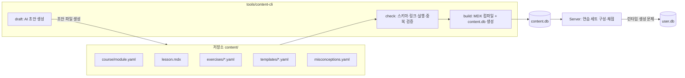
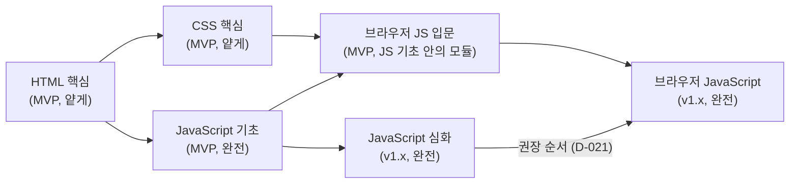
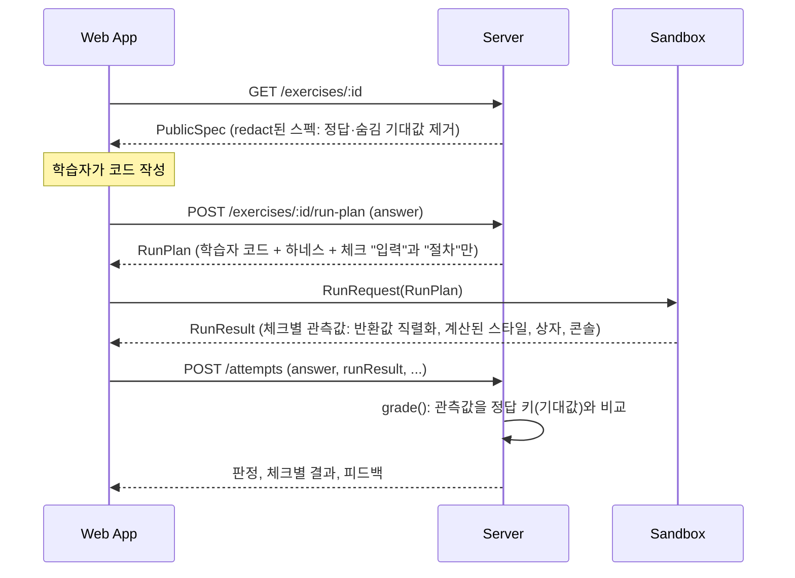
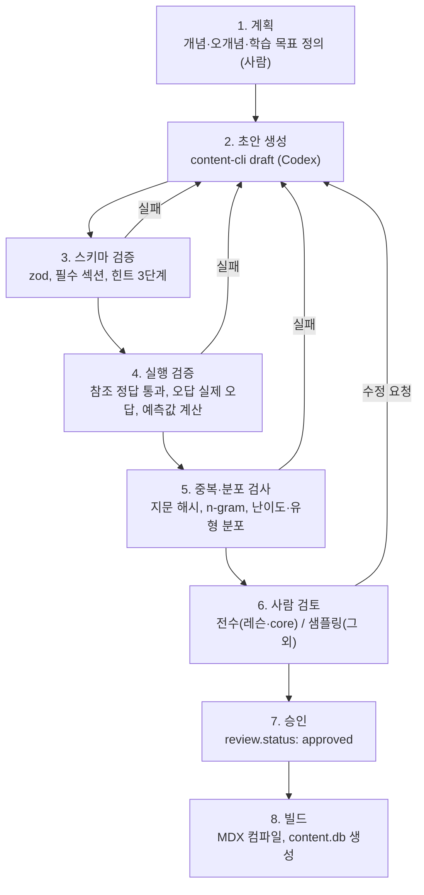
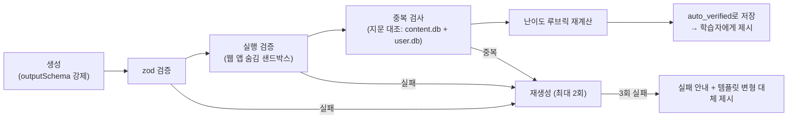
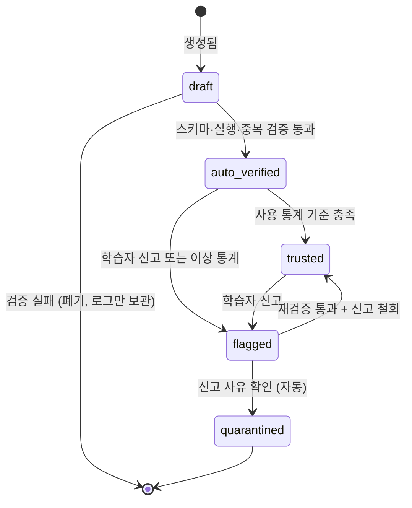

# 콘텐츠·문제 시스템 설계

ProgInOne의 커리큘럼 구조, 레슨 본문 형식, 문제 유형과 채점 방식, 파라메트릭 템플릿, 콘텐츠 제작·검증 파이프라인을 정의합니다.
"무엇을 어떤 순서로 가르치고, 어떤 문제로 확인하며, 그 콘텐츠를 어떻게 만들고 검증하는가"에 답하는 문서입니다.

- 상태: 초안
- 작성: ProgInOne 팀
- 최종 수정: 2026-11-13
- 관련 문서: [PRD](/docs/product/prd.md), [결정 기록](/docs/decisions.md), [용어집](/docs/glossary.md), [시스템 아키텍처 설계](/docs/design/system-architecture.md), [데이터 모델 설계](/docs/design/data-model.md), [학습 엔진 설계](/docs/design/learning-engine.md), [코드 실행 샌드박스 설계](/docs/design/code-execution-sandbox.md), [AI 시스템 설계](/docs/design/ai-system.md), [UI/UX 설계](/docs/design/ui-ux.md)

## 배경과 범위

ProgInOne의 학습 효과는 콘텐츠의 양과 질에 달려 있습니다.
플랫폼 기능이 완성되어도 단원마다 문제가 두세 개뿐이거나, 설명이 얕거나, 정답이 틀린 문제가 섞여 있으면 학습 도구로서 실패합니다.
결정 [D-003](/docs/decisions.md)은 JavaScript를 완전한 품질로, HTML/CSS를 핵심 위주로 다루기로 했고, [D-004](/docs/decisions.md)는 사전 제작 문제은행 + 파라메트릭 템플릿 + 런타임 AI 생성의 혼합 전략을 정했습니다.

이 문서가 다루는 범위:

- 커리큘럼 설계 원칙과 과정별 커리큘럼 초안 (MVP와 v1.x)
- 레슨 본문의 표준 구조와 MDX 컴포넌트
- `content/` 디렉터리 구조와 원본 파일 형식
- 문제 유형 레지스트리와 유형별 스펙·채점 알고리즘
- 실습 문제의 체크(Check) 명세 언어
- 파라메트릭 템플릿 엔진
- 난이도 루브릭과 문제 수 산정
- 콘텐츠 제작·검증·빌드 파이프라인
- 런타임 AI 생성 문제의 검증과 상태 전이
- 콘텐츠 버전 관리와 학습 기록 호환

이 문서가 다루지 않는 범위:

- 테이블과 컬럼 상세: [데이터 모델 설계](/docs/design/data-model.md)
- 숙련도 계산, 연습 세트 구성 알고리즘, 복습 스케줄: [학습 엔진 설계](/docs/design/learning-engine.md)
- 샌드박스 격리 방식과 실행 프로토콜: [코드 실행 샌드박스 설계](/docs/design/code-execution-sandbox.md)
- AI 프롬프트, 출력 스키마, 제공자 호출: [AI 시스템 설계](/docs/design/ai-system.md)
- 문제 화면의 시각 디자인: [UI/UX 설계](/docs/design/ui-ux.md)

## 목표와 비목표

### 콘텐츠 시스템 목표

- **충분한 양**: JavaScript 기초의 모든 개념이 PRD [FR-EX-09](/docs/product/prd.md)의 문제 수 목표를 충족합니다.
- **다양한 유형**: 한 개념을 서로 다른 유형(이해·코드 이해·실습)으로 확인할 수 있어 숙련 단계 게이트([FR-LRN-03](/docs/product/prd.md))를 만족시킬 수 있습니다.
- **검증된 정답**: 코드가 관련된 모든 정답은 저장된 값이 아니라 실제 실행으로 확인됩니다.
- **결정론적 채점 우선**: MVP 문제 유형은 모두 AI 없이 채점됩니다.
- **오개념 진단**: 오답이 "무엇을 잘못 알고 있는지"를 가리킬 수 있습니다.
- **제작 효율**: AI 보조 초안과 자동 검증으로, 사람이 하는 일을 "검토와 판단"으로 줄입니다.
- **추적 가능성**: 모든 콘텐츠는 git으로 버전 관리되고, 문제마다 출처와 검증 이력이 남습니다.
- **기록 호환**: 콘텐츠를 고치거나 재구성해도 학습 기록이 끊기지 않습니다.

### 콘텐츠 시스템 비목표

- **앱 안의 콘텐츠 편집기(CMS)**: 콘텐츠는 저장소의 파일로 편집합니다. 웹 UI 편집기는 만들지 않습니다.
- **다국어 콘텐츠**: 콘텐츠는 한국어 단일 언어입니다. 코드 식별자와 코드 주석은 영어를 허용합니다.
- **외부 콘텐츠 형식 호환**(SCORM, xAPI, QTI 등): 단일 사용자 로컬 앱에 필요하지 않습니다.
- **AI 채점에 의존하는 핵심 경로**: 서술형 AI 채점(P2)은 숙련도 반영 가중치를 낮게 두며, 단원 통과 조건에 쓰지 않습니다.
- **런타임 콘텐츠 생성으로 핵심 경로 채우기**: 핵심 학습 경로는 AI 없이 완결되어야 합니다([D-004](/docs/decisions.md)).
- **픽셀 단위 시각 비교 채점**: CSS 문제는 계산된 스타일과 레이아웃 관계로 채점합니다. 스크린샷 비교는 하지 않습니다.

## 설계

### 콘텐츠 시스템 개요



- 사람이 읽고 고치는 **원본** 은 `content/`의 YAML·MDX 파일입니다.
- `content-cli`가 원본을 검증하고 `content.db`로 빌드합니다. 서버는 `content.db`만 읽습니다.
- 런타임 AI 생성 문제는 같은 스키마를 따르지만 `user.db`에 저장합니다([시스템 아키텍처 설계](/docs/design/system-architecture.md#데이터베이스-분리-원칙)).

## 커리큘럼 설계

### 커리큘럼 설계 원칙

1.  **학습 목표에서 출발합니다(백워드 설계).**
    모든 단원은 "이 단원을 마치면 학습자는 ~할 수 있다" 형태의 관찰 가능한 학습 목표 2~5개를 가집니다.
    문제는 학습 목표를 확인하기 위해 존재하며, 모든 학습 목표는 최소 3개 이상의 문제로 확인됩니다.
1.  **개념은 선수 관계 그래프(DAG)를 이룹니다.**
    단원 순서는 트리(과정 → 모듈 → 단원)로 표현하지만, 숙련도와 재학습 경로는 개념 DAG를 따릅니다.
    한 개념은 여러 단원에 등장할 수 있고(나선형), 숙련도는 개념 단위로 하나만 존재합니다.
    선수 관계는 "직접 필요한 것"만 기록합니다. 추이적 관계(A→B→C일 때 A→C)는 중복 기록하지 않습니다.
1.  **단원 크기는 15~40분입니다.**
    레슨 본문 읽기 5~15분 + 연습 세트 10~25분이 기준입니다.
    40분을 넘으면 단원을 나눕니다. 한 단원의 핵심 개념은 1~4개로 제한합니다.
1.  **나선형 반복(Spiral)으로 배치합니다.**
    핵심 개념은 처음에 단순한 형태로 소개하고, 뒤 단원에서 더 깊은 형태로 다시 등장시킵니다.
    예: "함수"는 기초 모듈에서 선언·호출·반환으로, 심화 과정에서 일급 함수·클로저·`this`로 다시 다룹니다.
    다시 등장할 때는 앞 개념을 `<ConceptLink>`로 연결하고, 연습 세트에 앞 개념의 복습 문제를 섞습니다.
1.  **동기를 유지하기 위해 "만들 수 있는 것"을 일찍 보여줍니다.**
    순수 문법만 오래 이어지지 않도록, JavaScript 기초 중간에 DOM 기초를 짧게 끼워 화면이 바뀌는 경험을 일찍 제공합니다.
1.  **흔한 오개념을 먼저 조사하고 설계합니다.**
    각 개념은 알려진 오개념 목록을 갖고, 레슨 본문의 "흔히 발생하는 실수" 섹션과 객관식 오답 선택지가 이 목록에서 나옵니다.
1.  **브라우저 동작을 이해하게 합니다.**
    HTML/CSS는 태그·속성 암기가 아니라 "브라우저가 문서를 어떻게 해석하고 그리는가"(DOM 트리, 박스 모델, 캐스케이드)를 중심으로 구성합니다.

### 과정 구성과 순서

트랙은 "웹 프론트엔드 기초" 하나이며, 권장 학습 순서는 다음과 같습니다.



순서의 근거:

- **HTML을 먼저 짧게 배웁니다.** JavaScript의 DOM 실습과 결과 미리보기를 이해하려면 문서 구조에 대한 최소한의 감각이 필요합니다. 완전 초보자에게 "결과가 바로 보이는" HTML은 진입 장벽이 가장 낮습니다.
- **CSS는 HTML 직후에 두되, JavaScript 기초와 병행할 수 있게 합니다.** JavaScript 기초의 대부분은 CSS에 의존하지 않으므로, 잠금 없이([FR-CUR-05](/docs/product/prd.md)) 학습자가 원하는 순서를 고를 수 있습니다.
- **JavaScript 기초 끝에 "브라우저 JS 입문" 모듈을 둡니다.** 기초 문법을 화면과 연결해 동기를 유지하고, 브라우저 JavaScript 과정의 선행 경험을 제공합니다.
- **MVP 이후에는 JavaScript 심화를 브라우저 JavaScript보다 먼저 제작하고 권장합니다**([D-021](/docs/decisions.md)).
    - 이벤트 처리와 Fetch는 클로저·`this`·Promise·async/await 이해를 전제로 합니다. 심화를 먼저 배우면 브라우저 과정에서 같은 개념을 다시 설명하지 않아도 됩니다.
    - 화면을 다루는 동기는 MVP의 "브라우저 JS 입문" 모듈이 먼저 채웁니다. JS 심화의 예제와 응용 프로젝트에도 DOM을 쓰는 실습을 섞어 동기를 유지합니다.
    - 잠금은 없으므로([FR-CUR-05](/docs/product/prd.md)) 학습자는 브라우저 과정을 먼저 열 수 있습니다. 이 경우 선수 개념 경고가 표시됩니다.

### 과정별 규모 요약

| 과정 | 범위 | 모듈 | 단원 | 개념 | 목표 문제 수 (사전 제작 + 템플릿 변형 원본) |
|---|---|---|---|---|---|
| HTML 핵심 | MVP | 3 | 8 | 24 | 약 70 |
| CSS 핵심 | MVP | 4 | 10 | 30 | 약 90 |
| JavaScript 기초 | MVP | 10 | 45 | 118 | 약 860 (단원 평가 포함) |
| JavaScript 심화 | v1.x | 7 | 26 | 약 70 | 약 650 |
| 브라우저 JavaScript | v1.x | 6 | 20 | 약 55 | 약 450 |
| **MVP 합계** | | **17** | **63** | **172** | **약 1,020** |
| **v1.x 포함 합계** | | **30** | **109** | **약 297** | **약 2,120** |

- 문제 수는 [문제 수 산정 방식](#문제-수-산정-방식)에 따른 목표치이며, 템플릿 하나는 "1개 문제"로 셉니다(변형은 무한히 만들 수 있으므로 합계에 넣지 않습니다).
- HTML/CSS 핵심은 개념당 2~4문제의 얕은 구성입니다. v1.x에서 HTML/CSS를 확장할 때 단원을 추가합니다.

### HTML 핵심 커리큘럼 (MVP)

과정 slug: `html`.
목표: 의미 있는 구조의 HTML 문서를 작성하고, 브라우저가 이를 DOM 트리로 해석한다는 것을 이해합니다.

| 모듈 | 단원 | 핵심 개념 | 목표 문제 |
|---|---|---|---|
| `html.basics` 웹 문서의 구조 | `html.basics.how-web-works` 브라우저는 무엇을 하는가 | 클라이언트·서버, HTML/CSS/JS의 역할 분담, 렌더링 개요 | 6 |
| | `html.basics.document` HTML 문서의 뼈대 | 요소·태그·속성, 중첩 규칙, `<!doctype>`·`head`·`body`, DOM 트리 개념 | 10 |
| | `html.basics.text` 텍스트와 제목 | 제목 계층, 문단, 강조(`strong`/`em`)의 의미 | 8 |
| `html.content` 콘텐츠 요소 | `html.content.links-images` 링크와 이미지 | `a`·`href`·상대/절대 경로, `img`·`alt` | 9 |
| | `html.content.lists-tables` 목록과 표 | `ul`/`ol`/`li`, 표 구조(`thead`/`tbody`/`th`) | 8 |
| | `html.content.forms` 폼 기초 | `form`·`input` 종류·`label` 연결·`button` | 10 |
| `html.semantics` 의미와 구조 | `html.semantics.landmarks` 시맨틱 태그 | `header`/`nav`/`main`/`section`/`article`/`footer`, `div`와의 차이 | 10 |
| | `html.semantics.review` 단원 평가: 프로필 페이지 만들기 | 종합 (HTML 구조 구현 실습 포함) | 10 |

대표 오개념:

- `html.mc.tag-is-element`: 태그와 요소를 같은 것으로 봄(여는 태그만 요소라고 생각함).
- `html.mc.heading-for-size`: 글자를 크게 하려고 `h1`~`h6`을 고름(제목 계층이 아닌 크기 수단으로 사용).
- `html.mc.alt-optional`: `alt`를 장식용 선택 속성으로 생각함.
- `html.mc.semantic-is-style`: 시맨틱 태그가 모양을 바꾼다고 생각함.

### CSS 핵심 커리큘럼 (MVP)

과정 slug: `css`.
목표: 선택자와 캐스케이드로 스타일이 결정되는 원리를 이해하고, 박스 모델과 Flexbox로 기본 레이아웃을 만듭니다.

| 모듈 | 단원 | 핵심 개념 | 목표 문제 |
|---|---|---|---|
| `css.basics` CSS의 원리 | `css.basics.intro` CSS 연결과 규칙 구조 | 규칙·선언·속성·값, `link`/`style`/인라인 | 7 |
| | `css.basics.selectors` 선택자 | 타입·클래스·ID·자손·그룹 선택자, 의사 클래스(`:hover`) | 10 |
| | `css.basics.cascade` 캐스케이드와 명시도 | 명시도 계산, 순서, 상속되는 속성과 아닌 속성 | 10 |
| `css.box` 박스 모델 | `css.box.model` 박스 모델 | content/padding/border/margin, `box-sizing` | 10 |
| | `css.box.display` display와 흐름 | block/inline/inline-block, 일반 흐름 | 8 |
| `css.styling` 꾸미기 | `css.styling.units-colors` 단위와 색 | `px`/`%`/`rem`/`em`/`vw`, 색 표기 | 8 |
| | `css.styling.typography` 글꼴과 텍스트 | `font-*`, `line-height`, `text-align` | 7 |
| `css.layout` 레이아웃 기초 | `css.layout.flex-basics` Flexbox 기초 | 주축·교차축, `justify-content`, `align-items`, `gap` | 12 |
| | `css.layout.responsive` 반응형 기초 | 뷰포트 메타, 미디어 쿼리, 모바일 우선 | 8 |
| | `css.layout.review` 단원 평가: 카드 목록 레이아웃 | 종합 (CSS 레이아웃 구현 실습 포함) | 10 |

대표 오개념:

- `css.mc.last-rule-wins`: 명시도와 무관하게 항상 뒤에 쓴 규칙이 이긴다고 생각함.
- `css.mc.width-includes-padding`: `content-box`에서도 `width`가 패딩·테두리를 포함한다고 생각함.
- `css.mc.margin-on-inline`: 인라인 요소에 세로 `margin`이 적용된다고 생각함.
- `css.mc.justify-is-horizontal`: `justify-content`가 항상 가로 정렬이라고 생각함(`flex-direction: column`에서 혼동).
- `css.mc.all-props-inherit`: 모든 속성이 상속된다고 생각함.

### JavaScript 기초 커리큘럼 (MVP, 완전한 품질)

과정 slug: `js-basics`.
목표: 값·연산·제어 흐름·함수·배열·객체로 작은 문제를 해결하는 프로그램을 작성하고, 오류 메시지를 읽고 스스로 디버깅하며, DOM과 이벤트로 간단한 인터랙티브 페이지를 만듭니다.

표기:

- **개념** 열은 개념 slug의 마지막 부분입니다. 전체 slug는 `js.<영역>.<개념>`입니다(예: `js.ops.strict-equality`). 개념 slug는 과정이 아니라 언어 네임스페이스(`js.`)를 쓰므로, JavaScript 심화에서 같은 개념을 이어서 다룰 수 있습니다.
- **문제** 열은 해당 단원 연습 세트의 목표 문제 수(사전 제작 + 템플릿 원본)입니다. ★는 핵심 단원(20~30문제 이상)입니다.
- **오개념** 열은 해당 단원에서 반드시 다루는 대표 오개념입니다. 전체 목록은 `misconceptions.yaml`에서 관리합니다.

#### 모듈 1. 시작하기 (`js-basics.start`)

| 단원 | 개념 | 문제 | 대표 오개념 |
|---|---|---|---|
| `first-program` 첫 프로그램 | `basics.console-log`, `basics.statements`, `basics.comments` | 12 | `console.log`가 값을 "반환"한다고 생각함 |
| `reading-errors` 오류 메시지 읽기 | `errors.error-messages`, `errors.error-types` | 12 | 오류가 나면 그 줄만 문제라고 생각함(원인은 앞줄일 수 있음) |

근거: 초보자가 가장 먼저 좌절하는 지점은 오류입니다. 오류 메시지 구조(종류·메시지·줄 번호)를 첫 모듈에서 가르치면 이후 모든 실습에서 스스로 디버깅할 수 있습니다.

#### 모듈 2. 값과 변수 (`js-basics.values`)

| 단원 | 개념 | 문제 | 대표 오개념 |
|---|---|---|---|
| `variables` 변수와 상수 ★ | `values.let`, `values.const`, `values.assignment`, `values.identifiers` | 22 | `=`를 수학의 "같다"로 읽음 / `const`는 값을 절대 바꿀 수 없다고 생각함(객체 내부 변경은 가능, 모듈 9에서 회수) |
| `data-types` 자료형 ★ | `types.primitives`, `types.number`, `types.string`, `types.boolean`, `types.typeof` | 24 | `"5"`와 `5`가 같은 값이라고 생각함 / `typeof null`이 `"null"`이라고 생각함 |
| `null-undefined` 비어 있는 값 | `types.undefined`, `types.null` | 14 | `null`과 `undefined`를 완전히 같은 것으로 봄 |
| `var-and-tdz` `var`와 선언 전 사용 | `values.var`, `values.tdz` | 12 | `let`도 `var`처럼 선언 전에 `undefined`라고 생각함 |

#### 모듈 3. 연산자와 형 변환 (`js-basics.operators`)

| 단원 | 개념 | 문제 | 대표 오개념 |
|---|---|---|---|
| `arithmetic` 산술 연산 ★ | `ops.arithmetic`, `ops.precedence`, `ops.remainder`, `ops.increment`, `ops.compound-assignment` | 22 | `%`를 백분율로 생각함 / `i++`와 `++i`의 반환값이 같다고 생각함 |
| `comparison` 비교 연산 ★ | `ops.strict-equality`, `ops.loose-equality`, `ops.relational` | 24 | `"10" < "9"`가 `false`라고 생각함(문자열 사전순 비교) / `NaN === NaN`이 `true`라고 생각함 |
| `logical` 논리 연산 ★ | `ops.logical-and-or-not`, `ops.short-circuit`, `ops.nullish` | 24 | `&&`/`||`가 항상 `true`/`false`를 반환한다고 생각함 / `??`와 `||`가 같다고 생각함 |
| `explicit-conversion` 명시적 형 변환 | `conv.to-number`, `conv.to-string`, `conv.to-boolean`, `conv.nan` | 20 | `Number("12px")`가 `12`라고 생각함(`parseInt`와 혼동) |
| `implicit-coercion` 암묵적 형 변환 ★ | `conv.truthy-falsy`, `conv.plus-concat`, `conv.equality-coercion` | 26 | `"0"`, `[]`가 falsy라고 생각함 / `"3" + 1`이 `4`라고 생각함 |
| `operators-review` 단원 평가 | (종합) | 15 | — |

근거: 형 변환은 별도 모듈로 떼지 않고 연산자 직후에 둡니다. 비교·논리 연산을 배우는 순간 형 변환 문제가 바로 생기기 때문에, "왜 이런 결과가 나왔는가"를 같은 맥락에서 설명하는 편이 기억에 오래 남습니다.

#### 모듈 4. 조건문 (`js-basics.control`)

| 단원 | 개념 | 문제 | 대표 오개념 |
|---|---|---|---|
| `if-else` if와 else ★ | `control.if`, `control.else-if`, `control.block` | 22 | `else if` 체인에서 여러 블록이 실행된다고 생각함 / 조건에 `=`를 써도 비교된다고 생각함 |
| `switch` switch 문 | `control.switch`, `control.fallthrough` | 12 | `break` 없이도 해당 case만 실행된다고 생각함 |
| `ternary` 조건 연산자 | `control.ternary` | 10 | 삼항 연산자를 문(statement)처럼 써서 부수 효과만 내려고 함 |
| `control-review` 단원 평가 | (종합) | 15 | — |

#### 모듈 5. 반복문 (`js-basics.loops`)

| 단원 | 개념 | 문제 | 대표 오개념 |
|---|---|---|---|
| `while` while 반복 | `loops.while`, `loops.do-while`, `loops.infinite` | 16 | 조건이 반복 본문 중간에도 계속 검사된다고 생각함 |
| `for` for 반복 ★ | `loops.for`, `loops.loop-variable`, `loops.accumulator-pattern` | 26 | 반복 횟수를 하나씩 틀림(off-by-one) / 누적 변수를 반복 안에서 초기화함 |
| `break-continue` 반복 제어 | `loops.break`, `loops.continue` | 14 | `break`가 바깥 반복까지 모두 끝낸다고 생각함 |
| `nested-loops` 중첩 반복 | `loops.nested` | 14 | 안쪽 반복 변수가 바깥 반복마다 초기화되지 않는다고 생각함 |
| `loops-review` 단원 평가 | (종합) | 15 | — |

#### 모듈 6. 함수 (`js-basics.functions`)

| 단원 | 개념 | 문제 | 대표 오개념 |
|---|---|---|---|
| `function-basics` 함수 선언과 호출 ★ | `fn.declaration`, `fn.call`, `fn.params-args`, `fn.return` | 28 | 함수를 선언하면 실행된다고 생각함 / `console.log`와 `return`을 같은 것으로 봄 |
| `return-and-side-effects` 반환값과 부수 효과 | `fn.side-effects`, `fn.undefined-return`, `fn.pure` | 18 | `return` 뒤 코드도 실행된다고 생각함 / 반환문이 없으면 `null`을 반환한다고 생각함 |
| `expressions-and-arrows` 함수 표현식과 화살표 함수 ★ | `fn.expression`, `fn.arrow`, `fn.hoisting` | 22 | 화살표 함수 본문에 중괄호를 쓰고도 값이 반환된다고 생각함 / 함수 표현식도 선언 전에 호출할 수 있다고 생각함 |
| `default-and-rest` 기본값과 나머지 매개변수 | `fn.default-params`, `fn.rest-params` | 14 | 인수를 덜 넘기면 오류가 난다고 생각함 |
| `scope-basics` 스코프 기초 ★ | `scope.block`, `scope.function`, `scope.global`, `scope.shadowing` | 24 | 블록 안 `let` 변수를 블록 밖에서 쓸 수 있다고 생각함 / 매개변수 재할당이 바깥 변수를 바꾼다고 생각함 |
| `callbacks-intro` 함수를 값으로 다루기 | `fn.first-class`, `fn.callback` | 18 | 콜백을 넘길 때 `fn()`처럼 호출해서 넘김 |
| `functions-review` 단원 평가 | (종합) | 20 | — |

근거: 함수는 JavaScript 기초의 중심이므로 7개 단원으로 가장 많이 나눕니다. 스코프 기초는 여기서 블록·함수 스코프까지만 다루고, 클로저는 JavaScript 심화에서 나선형으로 다시 다룹니다. 콜백 입문은 바로 다음 모듈들(배열 고차 함수, 이벤트)의 선수 개념입니다.

#### 모듈 7. 문자열 (`js-basics.strings`)

| 단원 | 개념 | 문제 | 대표 오개념 |
|---|---|---|---|
| `string-basics` 문자열 다루기 | `str.index-length`, `str.immutability`, `str.template-literal` | 18 | `str[0] = "A"`로 문자열이 바뀐다고 생각함 / 마지막 인덱스가 `length`라고 생각함 |
| `string-methods` 문자열 메서드 ★ | `str.search`, `str.slice`, `str.case-trim`, `str.split-join` | 22 | 문자열 메서드가 원본을 바꾼다고 생각함 / `slice`의 끝 인덱스가 포함된다고 생각함 |

#### 모듈 8. 배열 (`js-basics.arrays`)

| 단원 | 개념 | 문제 | 대표 오개념 |
|---|---|---|---|
| `array-basics` 배열 기초 | `arr.literal-index`, `arr.length`, `arr.element-update` | 20 | 범위 밖 인덱스 접근이 오류를 낸다고 생각함 |
| `array-mutation` 배열 바꾸기 ★ | `arr.push-pop`, `arr.shift-unshift`, `arr.splice`, `arr.mutating-vs-not` | 22 | `push`가 새 배열을 반환한다고 생각함 / `splice`와 `slice`를 혼동 |
| `array-iteration` 배열 순회 | `arr.for-of`, `arr.foreach` | 18 | `forEach`에서 `return`하면 반복이 멈춘다고 생각함 / `for...in`으로 배열 값을 순회함 |
| `array-hof` 고차 함수: map·filter·reduce ★ | `arr.map`, `arr.filter`, `arr.find`, `arr.some-every`, `arr.reduce`, `arr.chaining` | 32 | `map`이 원본 배열을 바꾼다고 생각함 / `map` 콜백에서 `return`을 빠뜨림 / `reduce` 초기값 생략의 영향을 모름 |
| `array-search-sort` 찾기와 정렬 | `arr.includes-indexof`, `arr.sort`, `arr.slice-concat` | 18 | `[10, 9, 1].sort()`가 숫자 순으로 정렬된다고 생각함 / `sort`가 새 배열을 반환한다고 생각함 |
| `arrays-review` 단원 평가 | (종합) | 20 | — |

#### 모듈 9. 객체 (`js-basics.objects`)

| 단원 | 개념 | 문제 | 대표 오개념 |
|---|---|---|---|
| `object-basics` 객체 기초 ★ | `obj.literal`, `obj.dot-bracket`, `obj.add-delete`, `obj.methods-intro` | 24 | `obj.key`와 `obj[key]`(변수)를 같은 것으로 봄 / 없는 속성 접근이 오류를 낸다고 생각함 |
| `reference-vs-value` 참조와 복사 ★ | `obj.reference`, `obj.copy-shallow`, `obj.equality`, `obj.const-mutation` | 28 | 객체를 다른 변수에 할당하면 복사된다고 생각함 / 내용이 같은 두 객체가 `===`로 같다고 생각함 / 얕은 복사가 중첩 객체까지 복사한다고 생각함 |
| `object-iteration` 객체 순회 | `obj.keys-values-entries`, `obj.for-in`, `obj.in-optional-chaining` | 18 | `undefined` 값을 가진 속성과 없는 속성을 구별하지 못함 |
| `destructuring-and-spread` 구조 분해와 전개 ★ | `obj.destructuring`, `arr.destructuring`, `obj.spread` | 22 | 구조 분해가 원본에서 속성을 제거한다고 생각함 |
| `error-handling` 오류 처리 기초 | `errors.throw`, `errors.try-catch`, `errors.finally` | 16 | `try/catch`가 문법 오류까지 잡는다고 생각함 / `catch` 후 나머지 `try` 블록이 이어서 실행된다고 생각함 |
| `objects-review` 단원 평가 | (종합) | 20 | — |

근거: 참조와 복사는 JavaScript 기초에서 가장 많은 버그를 만드는 개념이므로 독립 단원으로 둡니다. 모듈 2의 "`const`는 절대 못 바꾼다" 오개념을 여기서 회수합니다(나선형). 오류 처리는 객체(오류 객체의 `name`/`message`)를 배운 뒤에 두고, 모듈 1의 "오류 메시지 읽기"와 연결합니다.

#### 모듈 10. 브라우저 JS 입문 (`js-basics.browser-intro`)

| 단원 | 개념 | 문제 | 대표 오개념 |
|---|---|---|---|
| `dom-basics` DOM 다루기 기초 | `dom.document-tree`, `dom.query-selector`, `dom.text-content`, `dom.class-style` | 20 | `querySelector`가 일치하는 모든 요소를 반환한다고 생각함 / 스크립트가 요소보다 먼저 실행되어 `null`이 되는 상황을 모름 |
| `events-intro` 이벤트 입문 | `dom.add-event-listener`, `dom.event-object`, `dom.input-value` | 18 | `addEventListener("click", handler())`처럼 호출 결과를 넘김 / `input.value`가 숫자라고 생각함 |
| `final-project` 최종 프로젝트: 할 일 목록 | (종합 프로젝트, 다단계) | 8 | — |

근거: 기초 과정 끝에 화면을 다루는 경험을 넣어 동기를 유지하고, 지금까지 배운 배열·객체·함수를 실제로 조합하게 합니다. 최종 프로젝트는 5~8개 마일스톤 체크로 나눈 응용 실습입니다.

#### JavaScript 기초 규모 요약

| 항목 | 값 |
|---|---|
| 모듈 | 10 |
| 단원 | 45 (단원 평가 7, 프로젝트 1 포함) |
| 개념 | 118 |
| 목표 문제 수 | 약 860 (단원 평가 120 포함) |
| 개념당 평균 문제 | 약 6.3 (단원 평가·복습 출제 제외) |

### JavaScript 심화 커리큘럼 (v1.x, 단원 수준)

과정 slug: `js-advanced`.
목표: 실행 컨텍스트·스코프 체인·`this`·프로토타입·비동기 모델을 이해하고, 비동기 코드를 올바르게 작성하고 디버깅합니다.

| 모듈 | 단원 |
|---|---|
| `js-advanced.scope` 스코프와 클로저 | 렉시컬 스코프와 스코프 체인 · 호이스팅과 실행 컨텍스트 · 클로저 ★ · 클로저 활용(카운터, 메모이제이션, 모듈 패턴) |
| `js-advanced.this` this | 호출 방식에 따른 `this` ★ · 화살표 함수와 `this` · `call`/`apply`/`bind` |
| `js-advanced.objects` 객체 심화 | 프로토타입과 프로토타입 체인 ★ · 클래스 문법 · 상속과 `super` · getter/setter와 속성 서술자 |
| `js-advanced.functional` 함수형 패턴 | 불변성과 순수 함수 · 고차 함수 만들기 · 커링과 합성 |
| `js-advanced.async` 비동기 | 동기와 비동기 · 콜백과 콜백 지옥 · Promise ★ · Promise 체이닝과 오류 처리 · `Promise.all`/`allSettled`/`race` · async/await ★ · 이벤트 루프와 태스크·마이크로태스크 큐 ★ |
| `js-advanced.modules` 모듈과 도구 | ES 모듈 `import`/`export` · 엄격 모드와 주요 함정 |
| `js-advanced.data` 데이터 구조 | `Map`/`Set` · 이터러블과 이터레이터 · JSON 직렬화 |

단원 26개, 개념 약 70개, 목표 문제 약 650개입니다. 이벤트 루프 단원은 실행 순서 배열·결과 예측 문제를 중심으로 구성합니다.

### 브라우저 JavaScript 커리큘럼 (v1.x, 단원 수준)

과정 slug: `browser-js`.
목표: DOM과 이벤트 모델을 깊이 이해하고, 네트워크·저장소 API를 사용해 데이터를 다루는 인터랙티브 웹페이지를 만들며, 기초적인 브라우저 보안 위협을 피합니다.

| 모듈 | 단원 |
|---|---|
| `browser-js.dom` DOM 심화 | DOM 트리 탐색 · 요소 생성·삽입·삭제 ★ · 속성과 `dataset` · 레이아웃 정보 읽기 |
| `browser-js.events` 이벤트 심화 | 이벤트 전파(캡처·버블링) ★ · 이벤트 위임 ★ · 기본 동작 막기와 폼 처리 · 키보드·포인터 이벤트 |
| `browser-js.network` 네트워크 | HTTP 기초 · Fetch API ★ · JSON 응답 처리와 오류 · 로딩·오류 상태 UI |
| `browser-js.storage` 저장소 | Web Storage(`localStorage`/`sessionStorage`) · 쿠키 기초 |
| `browser-js.security` 브라우저 보안 기초 | XSS와 `innerHTML`의 위험 ★ · 동일 출처 정책과 CORS 개념 · 안전한 입력 처리 |
| `browser-js.projects` 응용 프로젝트 | 검색 가능한 목록 앱 · API 데이터 대시보드 |

단원 20개, 개념 약 55개, 목표 문제 약 450개입니다.
Fetch 실습은 샌드박스의 네트워크가 차단되므로([샌드박스 설계](/docs/design/code-execution-sandbox.md)) 하네스가 제공하는 가짜 `fetch`(문제에 정의된 응답을 돌려주는 모의 서버)로 진행합니다.

## 레슨 본문 설계

### 레슨 본문 표준 섹션

모든 단원의 레슨 본문은 아래 12개 섹션을 이 순서로 가집니다.
섹션은 MDX의 `<Section kind="...">` 컴포넌트로 표시하며, 빌드 검증이 섹션 순서와 필수 여부를 검사합니다.

| 순서 | 섹션 (`kind`) | 내용 | 분량 기준 |
|---|---|---|---|
| 1 | 학습 목표 (`objectives`) | "이 단원을 마치면 ~할 수 있습니다" 형태의 관찰 가능한 목표 2~5개. `course.yaml`·`module.yaml`의 목표와 연결 | 3~5줄 |
| 2 | 선수 개념 확인 (`prerequisites`) | 선수 개념 링크와 학습자의 현재 숙련도 표시(자동). 선택적으로 확인 문제 1~2개 | 자동 생성 + 문제 0~2 |
| 3 | 개념 소개 (`intro`) | 왜 필요한가. 이 개념이 없으면 어떤 문제가 생기는지 구체적 상황으로 시작 | 1~3문단 |
| 4 | 원리 (`principle`) | 동작 원리를 단계적으로 설명. 필요하면 다이어그램·표 | 개념 중요도에 따라 다름 |
| 5 | 코드 예제 (`examples`) | 실행 가능한 예제 2~5개. 단순 → 복잡 순서. 최소 1개는 예측 후 실행 | 예제 2~5 |
| 6 | 실행 결과 해설 (`walkthrough`) | 예제가 왜 그 결과를 내는지 줄 단위로 해설. 값의 변화를 표로 추적 | 예제당 1~2문단 |
| 7 | 흔히 발생하는 실수 (`pitfalls`) | `misconceptions.yaml`의 오개념 각각에 대해 "잘못된 생각 → 실제 동작 → 올바른 이해" | 오개념당 1블록 |
| 8 | 실전 사용 사례 (`in-practice`) | 실제 웹 개발에서 이 개념을 쓰는 장면 1~2개 | 1~2문단 + 코드 |
| 9 | 이해도 확인 (`check`) | 본문 중간·끝의 인라인 확인 문제. 정답 후 바로 이어서 읽기 | 문제 2~4 |
| 10 | 응용 실습 (`practice`) | 연습 세트로 넘어가는 진입점. 연습 세트 구성은 학습 엔진이 결정 | 자동 생성 |
| 11 | 핵심 요약 (`summary`) | 3~7개 요점. 각 요점은 한 문장 | 3~7줄 |
| 12 | 다음 학습 연결 (`next`) | 다음 단원과 이 단원의 관계, 이 개념을 다시 만나게 될 곳 | 1~3줄 |

규칙:

- `examples`, `walkthrough`, `pitfalls`는 같은 개념에 대해 서로 교차 배치할 수 있습니다. 예: 예제 1 → 해설 1 → 예제 2 → 해설 2. 빌드 검증은 "각 섹션이 최소 1회 등장하고 `objectives`가 처음, `next`가 마지막"인지만 검사합니다.
- `prerequisites`와 `practice`는 데이터에서 자동 생성되므로 MDX에는 빈 `<Section>` 자리만 둡니다.
- 단원 평가와 프로젝트 단원은 `objectives`, `practice`, `summary`, `next`만 필수입니다.

### 개념 중요도별 설명 깊이

개념은 `importance` 속성(`core` / `standard` / `minor`)을 가지며, 레슨 본문의 깊이 기준이 달라집니다.

| 항목 | `core` (핵심) | `standard` (일반) | `minor` (소규모) |
|---|---|---|---|
| 예 | `ops.strict-equality`, `fn.return`, `obj.reference`, `arr.map` | `control.switch`, `str.case-trim` | `basics.comments`, `loops.do-while` |
| 원리 설명 | 다이어그램·값 추적 표 포함, 2가지 이상 관점의 설명 | 1가지 관점 + 예시 | 짧은 설명 |
| 예제 | 4~5개 (예측 후 실행 2개 이상) | 2~3개 | 1~2개 |
| 흔한 실수 | 오개념 3개 이상 | 1~2개 | 0~1개 |
| 실전 사례 | 필수 | 권장 | 생략 가능 |
| 개념당 문제 | 15~30 | 8~15 | 4~8 |
| 레슨 내 확인 문제 | 3~4 | 2 | 1 |

MVP JavaScript 기초 118개 개념의 중요도 분포 목표는 `core` 약 30개, `standard` 약 60개, `minor` 약 28개입니다.

### MDX 컴포넌트

레슨 본문은 MDX로 작성합니다.
허용되는 컴포넌트는 아래 목록뿐이며, 그 외의 JSX·`import`·`export`·표현식은 빌드에서 거부합니다(콘텐츠가 임의 코드를 실행하지 않도록).

| 컴포넌트 | 용도 | 주요 props |
|---|---|---|
| `<Section>` | 표준 섹션 표시 | `kind`: 섹션 종류 (필수) |
| `<RunnableExample>` | 실행 가능한 코드 예제 | `id` (필수, 단원 내 고유), `lang`: `js` / `html` / `css` / `web` (html+css+js 묶음), `predict`: 실행 전 결과 예측 입력을 요구할지 (`boolean`), `predictKind`: `console` / `value` / `choice`, `editable`: 학습자가 수정해 다시 실행할 수 있는지 (기본 `true`), `concepts`: 관련 개념 slug 목록, `highlight`: 강조할 줄 범위 (예: `"2-3"`) |
| `<InlineExercise>` | 본문 중간의 확인 문제 | `ref`: 문제 ID (필수). 문제 본체는 `exercises/*.yaml`에 있고 MDX에는 참조만 둡니다 |
| `<Callout>` | 알림 상자 | `kind`: `note` / `tip` / `warning` / `danger` / `deep-dive`, `title` (선택) |
| `<CompareTable>` | 두세 대상의 비교 표 | `columns`: 열 제목 목록, 행은 자식 `<Row label="...">`로 작성 |
| `<ConceptLink>` | 다른 개념으로의 링크 | `to`: 개념 slug (필수), 자식: 링크 텍스트. 빌드 시 존재 여부 검증. 화면에는 숙련 단계 배지 표시 |
| `<Pitfall>` | 흔한 실수 블록 | `misconception`: 오개념 ID (필수). 자식으로 `<Wrong>`, `<Actual>`, `<Right>` 세 부분 |
| `<ValueTrace>` | 줄 단위 변수 값 추적 표 | `code`: 예제 `id` 참조, `vars`: 추적할 변수 이름 목록. 값은 빌드 시 실행 계측으로 자동 생성 (손으로 쓰지 않음) |
| `<Diagram>` | Mermaid 다이어그램 | `alt` (필수, 대체 텍스트), 자식: Mermaid 소스 |
| `<Figure>` | 이미지 | `src`: `content/` 안의 상대 경로, `alt` (필수), `caption` |
| `<MdnLink>` | MDN 문서 링크 | `path`: MDN 경로 (예: `Web/JavaScript/Reference/Operators/Strict_equality`) |
| `<Reveal>` | 접힌 상세 설명 | `title`. 심화 내용이나 "왜?"에 대한 추가 설명 |
| `<Key>` | 단축키 표시 | 자식: 키 이름 |

`<RunnableExample predict>`의 동작:

1.  처음에는 코드만 보이고 실행 버튼이 비활성입니다. "실행하기 전에 결과를 예측해 보세요" 입력창이 있습니다.
1.  학습자가 예측을 입력하면(건너뛰기 가능) 실행 버튼이 활성화됩니다.
1.  실행 후 예측과 실제 결과를 나란히 보여줍니다. 예측이 틀렸으면 해당 예제의 `walkthrough`로 스크롤을 제안합니다.
1.  예측 결과는 학습 기록에 "본문 예측" 신호로 저장되며, 숙련도에는 낮은 가중치로만 반영합니다([학습 엔진 설계](/docs/design/learning-engine.md) 참고).

## content 디렉터리와 원본 형식

### 디렉터리 구조

```text
content/
├── pack.yaml                         # 콘텐츠 팩 메타데이터와 버전
├── concepts/
│   ├── js.yaml                       # 언어 네임스페이스별 개념 정의와 선수 관계
│   ├── html.yaml
│   └── css.yaml
├── misconceptions/
│   ├── js.yaml                       # 오개념 정의
│   ├── html.yaml
│   └── css.yaml
├── courses/
│   └── js-basics/
│       ├── course.yaml               # 과정 메타데이터, 모듈 순서
│       └── modules/
│           └── 06-functions/
│               ├── module.yaml       # 모듈 메타데이터, 단원 순서
│               └── lessons/
│                   └── 01-function-basics/
│                       ├── lesson.mdx          # 레슨 본문
│                       ├── lesson.yaml         # 단원 메타데이터 (목표, 개념, 예상 시간)
│                       ├── examples/           # RunnableExample 소스 (선택, 긴 예제용)
│                       │   └── greet.js
│                       ├── exercises/          # 사전 제작 문제
│                       │   ├── 001-mcq-return-vs-log.yaml
│                       │   └── 014-implement-sum.yaml
│                       └── templates/          # 파라메트릭 템플릿
│                           └── t01-predict-return.yaml
├── assets/                           # 공용 이미지
└── aliases.yaml                      # 이전 slug → 현재 slug 매핑
```

- 디렉터리 이름의 숫자 접두사(`06-`, `01-`)는 **정렬용** 입니다. slug에는 포함하지 않으며, 순서의 원천은 `course.yaml`·`module.yaml`의 목록입니다. 빌드는 두 순서가 다르면 경고합니다.
- 문제 파일명의 숫자는 단원 내 저작 순서일 뿐 의미가 없습니다.

### slug 규칙

| 대상 | 형식 | 예 |
|---|---|---|
| 과정 | `<course>` | `js-basics` |
| 모듈 | `<course>.<module>` | `js-basics.functions` |
| 단원 | `<course>.<module>.<lesson>` | `js-basics.functions.function-basics` |
| 개념 | `<lang>.<area>.<concept>` | `js.fn.return` |
| 오개념 | `<lang>.mc.<name>` | `js.mc.log-is-return` |
| 사전 제작 문제 | `<lesson-slug>.<type-abbr>-<name>` | `js-basics.functions.function-basics.mcq-return-vs-log` |
| 템플릿 | `<lesson-slug>.t.<name>` | `js-basics.functions.function-basics.t.predict-return` |
| 템플릿 변형 | `<template-slug>@<seed>` | `js-basics.functions.function-basics.t.predict-return@a91f2c` |
| 런타임 생성 문제 | `gen.<ULID>` | `gen.01JD3Z8Q6V2K9M4T7R1X5W0BNC` |
| 레슨 예제 | `<lesson-slug>#<example-id>` | `js-basics.functions.function-basics#greet` |

- 각 조각은 소문자, 숫자, 하이픈만 씁니다(`^[a-z0-9]+(-[a-z0-9]+)*$`).
- slug는 **한 번 공개되면 바꾸지 않는 것이 원칙** 입니다. 바꿔야 하면 `aliases.yaml`에 기록합니다([콘텐츠 버전 관리](#콘텐츠-버전-관리와-학습-기록-호환) 참고).
- 개념 slug가 과정이 아닌 언어 네임스페이스를 쓰는 이유: 같은 개념(예: `js.scope.block`)이 기초와 심화 과정에 모두 등장해도 숙련도는 하나로 유지되어야 하기 때문입니다.

### pack.yaml

```yaml
id: proginone-web-foundations
version: 2026.11.13.1            # YYYY.MM.DD.N
schemaVersion: 1                 # 원본 스키마 버전 (content-schema 패키지와 일치)
title: 웹 프론트엔드 기초
courses: [html, css, js-basics]  # 빌드에 포함할 과정 (v1.x에서 js-advanced, browser-js 추가)
```

### concepts/js.yaml

```yaml
- id: js.fn.return
  title: return과 반환값
  importance: core               # core | standard | minor
  summary: 함수가 호출한 곳으로 값을 돌려주고 실행을 끝내는 방법
  prerequisites: [js.fn.call]    # 직접 선수 개념만. 기본 strength: required
                                 # 약한 선수 관계는 { id: js.values.let, strength: helpful } 형태
  misconceptions: [js.mc.log-is-return, js.mc.code-after-return-runs]
  mdn: Web/JavaScript/Reference/Statements/return

- id: js.fn.call
  title: 함수 호출
  importance: core
  summary: 함수 이름 뒤에 괄호를 붙여 본문을 실행하는 것
  prerequisites: [js.fn.declaration]
```

빌드 검증: 선수 관계의 순환 금지, 모든 개념이 최소 1개 단원에 소속, 단원 순서상 선수 개념이 뒤 단원에서 처음 등장하면 경고.

### misconceptions/js.yaml

```yaml
- id: js.mc.log-is-return
  concept: js.fn.return
  statement: console.log로 출력하면 함수가 그 값을 반환한다고 생각한다.
  reality: console.log는 화면(콘솔)에 출력만 하고 undefined를 반환한다. 함수의 반환값은 return이 정한다.
  diagnosticHint: 반환값을 변수에 담아 다시 출력해 보면 차이가 보인다.
  remediation:                    # 이 오개념이 confirmed일 때 추천할 학습 자원
    lessonSection: js-basics.functions.function-basics#pitfalls
    exercises: [js-basics.functions.function-basics.mcq-return-vs-log]
```

### course.yaml과 module.yaml

```yaml
# courses/js-basics/course.yaml
id: js-basics
title: JavaScript 기초
summary: 값, 연산, 제어 흐름, 함수, 배열, 객체로 문제를 해결하는 프로그램을 작성합니다.
level: beginner
recommendedAfter: [html]          # 권장 선행 과정 (잠금 아님)
objectives:
  - 변수·연산자·조건문·반복문으로 간단한 계산 프로그램을 작성할 수 있다.
  - 함수를 설계하고 반환값과 부수 효과를 구분할 수 있다.
  - 배열·객체 데이터를 고차 함수로 변환할 수 있다.
  - 오류 메시지를 읽고 원인을 찾아 고칠 수 있다.
modules: [start, values, operators, control, loops, functions, strings, arrays, objects, browser-intro]
```

```yaml
# courses/js-basics/modules/06-functions/module.yaml
id: js-basics.functions
title: 함수
summary: 코드를 이름 붙은 재사용 단위로 묶고, 값을 주고받는 방법을 배웁니다.
lessons: [function-basics, return-and-side-effects, expressions-and-arrows, default-and-rest, scope-basics, callbacks-intro, functions-review]
assessment: functions-review       # 모듈 평가 단원
```

### lesson.yaml

```yaml
id: js-basics.functions.function-basics
title: 함수 선언과 호출
kind: lesson                      # lesson | assessment | project
importance: core                  # core | standard | minor (기본 standard). 첫 연습 세트 크기에 영향
estimatedMinutes: { read: 12, practice: 20 }
concepts:
  primary: [js.fn.declaration, js.fn.call, js.fn.params-args, js.fn.return]
  practiced: []                                  # 선택. 이 단원에서 새로 소개하지 않지만 주로 연습하는 개념
  reviewed: [js.values.let, js.ops.arithmetic]   # 연습 세트에 섞을 이전 개념
objectives:
  - 함수를 선언하고 원하는 인수로 호출할 수 있다.
  - 매개변수와 인수의 차이를 설명할 수 있다.
  - return과 console.log의 차이를 예측 문제로 구분할 수 있다.
practice:
  targetCount: 28                 # 목표 문제 수 (빌드가 실제 수와 비교해 경고)
  passRule: { minCorrect: 0.7, minDistinctTypes: 3, minLevel3Correct: 1 }
```

`passRule`의 정확한 판정은 [학습 엔진 설계](/docs/design/learning-engine.md)가 정의하며, 콘텐츠는 단원별로 값을 덮어쓸 수 있습니다.

### lesson.mdx 발췌

```mdx
<Section kind="objectives" />

<Section kind="prerequisites" />

<Section kind="intro">
같은 계산을 세 번 해야 한다고 해봅시다. 코드를 세 번 복사하면, 계산 방법이 바뀔 때 세 곳을 모두 고쳐야 합니다.
**함수**는 코드에 이름을 붙여 필요할 때마다 부를 수 있게 합니다.
</Section>

<Section kind="examples">
<RunnableExample id="log-vs-return" lang="js" predict predictKind="console" concepts={["js.fn.return"]}>
{`function double(n) {
  console.log(n * 2);
}
const result = double(4);
console.log(result);`}
</RunnableExample>
</Section>

<Section kind="pitfalls">
<Pitfall misconception="js.mc.log-is-return">
  <Wrong>화면에 8이 나왔으니 `double(4)`의 결과는 8이다.</Wrong>
  <Actual>`result`에는 `undefined`가 들어 있다.</Actual>
  <Right>값을 돌려주려면 `return n * 2;`를 써야 한다. `console.log`는 출력만 한다.</Right>
</Pitfall>
</Section>

<Section kind="check">
<InlineExercise ref="js-basics.functions.function-basics.mcq-return-vs-log" />
</Section>
```

`RunnableExample`의 코드를 JSX 템플릿 문자열로 넣는 대신 `examples/` 파일을 참조하는 `src` prop도 허용합니다(긴 예제용).

### 문제 파일 형식 (공통 필드)

모든 문제 YAML은 공통 필드와 유형별 `spec`을 가집니다.

```yaml
id: js-basics.functions.function-basics.mcq-return-vs-log
type: mcq_single
difficulty: 2                     # 1~5, 난이도 루브릭 참고
concepts:
  - { id: js.fn.return, weight: 1.0 }        # 주 개념
  - { id: js.basics.console-log, weight: 0.3 } # 부 개념
tags: [return, console]
estimatedSeconds: 60
usage: practice                   # practice | assessment | diagnostic | remedial | worked_example (기본 practice)
workedExampleStage: null          # usage: worked_example일 때 0 완전한 풀이 / 1 일부 빈칸 / 2 직접 풀기
variantGroup: null                # 선택. "사실상 같은 문제"끼리 같은 키. 같은 그룹은 한 세트에 1개만, 문제 수 집계도 1개. 템플릿 변형은 지정하지 않으면 템플릿 ID가 그룹 키
prompt: |                         # 문제 본문 (Markdown, 원시 HTML 금지)
  다음 코드를 실행한 뒤 `result`에 들어 있는 값은 무엇인가요?
code: |                           # 문제에 딸린 코드 (선택)
  function double(n) {
    console.log(n * 2);
  }
  const result = double(4);
spec: { ... }                     # 유형별 스펙 (아래 유형별 스펙 참고)
hints:                            # 정확히 3단계
  - 함수가 값을 돌려주는 방법은 무엇인지 떠올려 보세요.
  - "`double` 본문에 `return`이 있나요? `return`이 없는 함수는 무엇을 반환할까요?"
  - "`return`이 없으면 함수는 `undefined`를 반환합니다. `console.log`는 출력만 합니다."
explanation: |                    # 해설 (정답 확인 후 표시)
  `double`에는 `return`이 없으므로 호출 결과는 `undefined`입니다. ...
origin: authored                  # authored | template | generated
review:                           # 제작 이력 (빌드가 검사)
  status: approved                # draft | approved
  draftedBy: ai:codex             # human | ai:<provider>
  reviewedBy: human
```

- 정답 관련 필드(`spec` 내부의 `answer`, `correct`, `solution`, `checks`의 기대값 등)는 서버만 읽습니다. API는 문제를 클라이언트에 보낼 때 **유형별 `redact` 함수** 로 이 필드를 제거합니다([채점 위치와 정답 키 비노출](#채점-위치와-정답-키-비노출) 참고).
- `hints`는 정확히 3개여야 합니다(힌트 정책 [D-010](/docs/decisions.md)). 3단계 힌트는 정답 코드 전체를 포함하면 안 되며, 빌드가 참조 정답과의 유사도로 검사합니다.
- 저장 형식(테이블 구조)은 [데이터 모델 설계](/docs/design/data-model.md)를 참고합니다.

## 문제 유형 시스템

### 문제 유형 레지스트리

문제 유형은 플러그인입니다([FR-EX-01](/docs/product/prd.md)).
`packages/exercise-kit`이 유형의 데이터·채점·검증 정의를, `packages/exercise-ui`가 렌더러를 등록합니다.
서버, 웹, `content-cli`는 레지스트리만 거쳐 유형별 동작을 호출하므로, 새 유형 추가 시 다른 코드를 고치지 않습니다.

```ts
// packages/exercise-kit (I/O 없는 순수 정의)
export interface ExerciseTypeDef<Spec, PublicSpec, Answer> {
  id: ExerciseTypeId;              // 'mcq_single' | 'predict_output' | ...
  version: number;                 // spec 스키마 버전. 바뀌면 마이그레이션 함수 제공
  category: ExerciseCategory;      // 'recognition' | 'recall' | 'production'. 숙련도 증거 가중치 범주
  weightOverride?: number;         // 범주 기본 가중치를 유형별로 덮어씀 (예: true_false 0.5)
  specSchema: z.ZodType<Spec>;     // 원본 YAML·AI 생성 결과 검증
  answerSchema: z.ZodType<Answer>; // 클라이언트 제출 검증
  redact(spec: Spec): PublicSpec;  // 정답 키를 제거한 클라이언트용 스펙

  // 브라우저 샌드박스 실행이 필요한 유형만 구현. 서버가 실행 계획(하네스 포함)을 만든다.
  buildRunPlan?(spec: Spec, answer: Answer): RunPlan;

  // 결정론적 채점. run은 샌드박스 실행 결과(해당 시).
  grade(input: { spec: Spec; answer: Answer; run?: RunResult }): GradeResult;

  // 문제 자체가 올바른지 검증 (콘텐츠 빌드, 런타임 생성 검증에서 사용)
  verify(spec: Spec, ctx: VerifyContext): Promise<VerifyReport>;

  // 중복 검사용 지문
  fingerprint(spec: Spec, prompt: string, code?: string): Fingerprint;

  // 이 유형을 AI 생성으로 만들 수 있는지와 생성용 출력 스키마
  generation?: { enabled: boolean; outputSchema: z.ZodType<unknown> };
}

export interface GradeResult {
  correct: boolean;                // 숙련도에 "정답"으로 반영되는가
  score: number;                   // 0~1, 부분 점수 (피드백·통계용)
  feedback: FeedbackItem[];        // 사용자에게 보여줄 항목별 피드백
  misconceptionIds: string[];      // 이 답이 시사하는 오개념 (오개념 관측 근거)
  checkResults?: CheckResult[];    // 실습 유형의 체크별 결과
}

// packages/exercise-ui
registerRenderer('mcq_single', McqSingleRenderer); // props: { spec: PublicSpec, onSubmit, state }
```

공통 규칙:

- `correct`는 항상 이진 판정입니다. 부분 점수 `score`는 피드백과 통계에만 쓰고, 숙련도 반영 방식은 [학습 엔진 설계](/docs/design/learning-engine.md)가 정합니다.
- 채점은 결정론적이어야 합니다. 같은 `spec`·`answer`·`run`이면 항상 같은 결과입니다.
- 채점기는 사용자 입력을 신뢰하지 않습니다. `answerSchema`로 검증한 뒤 채점하고, 샌드박스 결과(`run`)도 스키마 검증을 거칩니다.
- 모든 렌더러는 키보드만으로 조작 가능해야 하고, 채점 결과를 `aria-live` 영역으로 알립니다([UI/UX 설계](/docs/design/ui-ux.md)).

### 유형 목록과 우선순위

| 유형 ID | 이름 | 분류 | 실행 필요 | 우선순위 |
|---|---|---|---|---|
| `mcq_single` | 단일 선택 | 개념 이해 | 선택 (코드 선택지 검증 시) | P0 |
| `mcq_multi` | 복수 선택 | 개념 이해 | 선택 | P0 |
| `true_false` | 참/거짓 | 개념 이해 | 아니요 | P0 |
| `fill_blank` | 빈칸 채우기 (텍스트·코드) | 개념 이해 / 실습 | 코드 모드만 | P0 |
| `predict_output` | 실행 결과 예측 | 코드 이해 | 예 | P0 |
| `parsons` | 코드 순서 배열 | 코드 이해 | 선택 (대체 정답 검증) | P0 |
| `find_bug_line` | 오류 줄 찾기 | 코드 이해 | 검증 시 | P0 |
| `implement_function` | 함수 구현 | 실습 | 예 | P0 |
| `fix_bug` | 버그 수정 | 실습 | 예 | P0 |
| `web_task` | 웹 실습 (HTML 구조·CSS·DOM 이벤트·마일스톤, v1.x에서 여러 파일) | 실습 / 응용 | 예 | **P0 (기본형: 단일 `index.html`, 미리보기 1개)** / P1 (여러 파일·뷰포트 전환·인스펙터) |
| `matching` | 연결하기 (용어↔설명, 코드↔설명) | 개념 이해 | 아니요 | P1 |
| `trace_variables` | 변수 값 추적 | 코드 이해 | 예 (기대값 자동 생성) | P1 |
| `find_false_statement` | 오류가 있는 설명 찾기 | 개념 이해 | 아니요 | P1 |
| `order_execution` | 실행 순서 배열 (비동기·이벤트 루프) | 코드 이해 | 예 | P1 |
| `explain_code` | 코드 동작 서술 (AI 루브릭 채점) | 코드 이해 | 아니요 | P2 |
| `refactor` | 리팩터링 | 실습 | 예 | P2 |

**`web_task` 기본형의 P0 승격**: MVP 콘텐츠에 HTML/CSS 핵심과 "브라우저 JS 입문"(DOM·이벤트)이 포함되어 있어, 객관식만으로는 학습 목표("만들 수 있다")를 확인할 수 없습니다.
따라서 단일 파일(`index.html`, `<style>`·`<script>` 포함)과 미리보기 1개, DOM·CSS 체크를 갖춘 `web_task` 기본형을 P0로 둡니다(PRD에 반영).
여러 파일, 반응형 뷰포트 전환, 박스 모델 인스펙터는 P1입니다.
JavaScript 기초의 최종 프로젝트도 `web_task`의 마일스톤 기능으로 구현하므로, 별도 프로젝트 유형(P2)이 MVP에 필요하지 않습니다.

PRD 요구 유형과의 대응:

| PRD 요구 | 대응 유형 |
|---|---|
| 용어와 설명 연결, 코드와 설명 연결 | `matching` |
| 개념 비교 | `mcq_single`/`mcq_multi` (`CompareTable` 기반 선택지) 또는 `matching` |
| 올바른 코드 선택 | `mcq_single` (코드 선택지, 실행 검증) |
| 코드의 문제점 분석, 오류 발생 원인 찾기 | `find_bug_line` (줄 + 원인 선택) |
| 코드 빈칸 완성 | `fill_blank` 코드 모드 |
| 잘못된 코드 수정 | `fix_bug` |
| 요구사항에 맞는 코드 작성, 테스트를 통과하는 프로그램 | `implement_function`, `web_task` |
| 여러 파일 실습, 주어진 코드 확장, 미니 프로젝트 | `web_task` (`files`, `milestones`) |
| 코드 실행 순서 배열 | `parsons` (작성 순서), `order_execution` (실행 순서) |

### 유형별 스펙

아래 스펙은 YAML 원본 기준 구조입니다.
정식 정의는 `packages/exercise-kit`의 zod 스키마가 원천입니다.
"정답 키"로 표시한 필드는 `redact`가 제거합니다.

#### mcq_single: 단일 선택

```yaml
spec:
  options:
    - id: a
      text: "`8`"
      misconception: js.mc.log-is-return   # 이 선택지를 고르면 시사되는 오개념 (선택)
      rationale: 화면 출력과 반환값을 혼동했습니다.   # 오답 피드백 (정답 키)
    - id: b
      text: "`undefined`"
    - id: c
      text: "`null`"
      misconception: js.mc.no-return-is-null
    - id: d
      text: 오류가 발생한다
  correct: b                               # 정답 키
  shuffle: true                            # 선택지 순서 섞기 (기본 true)
  codeOptions: false                       # 선택지가 코드인 경우 true → 실행 검증 대상
```

- 답안: `{ optionId: string }`
- 채점: `optionId === correct`. 부분 점수 없음.
- 오개념 매핑: 고른 오답에 `misconception`이 있으면 `misconceptionIds`에 포함합니다.
- 제약: 선택지 3~5개. "모두 정답", "정답 없음" 선택지는 금지(진단력이 낮음). `shuffle`은 시드(시도 ID)로 결정론적으로 섞어 재현 가능하게 합니다.
- 검증: `codeOptions: true`이면 각 선택지 코드를 `verifyChecks`(별도 체크 목록)로 실행해 정답 선택지만 통과하는지 확인합니다.
- UI: 선택지 카드, 숫자 키 `1`~`5`로 선택, `Enter`로 제출.

#### mcq_multi: 복수 선택

```yaml
spec:
  options: [ ... ]                         # mcq_single과 같은 구조
  correct: [a, c]                          # 정답 키, 1개 이상
  minSelect: 1
```

- 답안: `{ optionIds: string[] }`
- 채점: 선택 집합이 정답 집합과 정확히 같을 때만 `correct`.
  `score = max(0, (맞게 고른 수 − 잘못 고른 수) / 정답 수)`.
- 오개념 매핑: 잘못 고른 선택지와, 놓친 정답 선택지에 `missedMisconception`이 정의되어 있으면 포함합니다.
- UI: 체크박스 카드. "정답이 여러 개일 수 있습니다" 안내를 항상 표시(정답 개수는 알리지 않음).

#### true_false: 참/거짓

```yaml
spec:
  statement: "`const`로 선언한 배열에는 `push`를 할 수 없다."
  answer: false                            # 정답 키
  misconceptionIfWrong: js.mc.const-is-immutable
  requireReason: false                     # true면 이유 선택지를 추가로 고름 (찍기 방지)
  reasons:                                 # requireReason일 때
    - { id: r1, text: "const는 재할당만 막는다", correct: true }
    - { id: r2, text: "const는 값 내부 변경도 막는다", misconception: js.mc.const-is-immutable }
```

- 답안: `{ value: boolean, reasonId?: string }`
- 채점: `value === answer`이고, `requireReason`이면 이유도 정답이어야 `correct`. 참/거짓만 맞고 이유가 틀리면 `score = 0.5`.
- 이유: 참/거짓은 50% 확률로 찍을 수 있으므로, 숙련도 반영 가중치를 낮게 두고(학습 엔진), L2 이상에서는 `requireReason`을 권장합니다.

#### fill_blank: 빈칸 채우기

```yaml
spec:
  mode: text                               # text | code
  template: |                              # {{blank:id}} 위치가 빈칸
    function add(a, b) {
      {{blank:b1}} a + b;
    }
  blanks:
    - id: b1
      accept: ["return"]                   # 정답 키. 허용 답 목록
      acceptRegex: null                    # 선택. 정규식 허용 (정답 키)
      caseSensitive: true
      width: 8                             # 입력 칸 너비 힌트 (문자 수)
      misconceptionMap:                    # 특정 오답 → 오개념 (선택)
        "console.log": js.mc.log-is-return
  # mode: code 전용
  checks: []                               # 빈칸을 채운 전체 코드를 실행해 검증 (정답 키)
```

- 답안: `{ blanks: Record<blankId, string> }`
- 정규화(`text` 모드): 앞뒤 공백 제거, 연속 공백 1개로, 전각 문자 → 반각, 따옴표 종류 통일(`'`·`"`·`` ` ``는 `accept`에 문자열 리터럴로 적힌 경우 서로 동등). `caseSensitive: false`면 소문자화.
- 채점(`text` 모드): 빈칸별로 `accept` 또는 `acceptRegex`와 비교. 모든 빈칸이 맞으면 `correct`, `score = 맞은 빈칸 / 전체 빈칸`.
- 채점(`code` 모드): 빈칸을 채운 코드를 샌드박스에서 `checks`로 실행합니다. 모든 체크 통과 시 `correct`. `accept`는 실행 전 빠른 피드백용 참고값입니다. 이렇게 하면 `a + b` 대신 `b + a`처럼 동등한 답도 정답이 됩니다.
- UI: 코드 블록 안 인라인 입력, `Tab`으로 다음 빈칸 이동.

#### predict_output: 실행 결과 예측

```yaml
spec:
  lang: js                                 # js | web
  code: |
    const a = [1, 2, 3];
    const b = a;
    b.push(4);
    console.log(a.length);
  answerKind: console                      # console | value | error | choice
  expression: null                         # answerKind: value일 때 평가할 식 (예: "result")
  choices: null                            # answerKind: choice일 때 선택지 (정답은 실행으로 결정)
  expected: null                           # 정답 키. 원본에는 쓰지 않음 (빌드가 실행해서 채움)
  misconceptionByAnswer:                   # 특정 오답 → 오개념
    "3": js.mc.assignment-copies-object
```

- 답안: `answerKind`에 따라 `{ console: string }`, `{ value: string }`, `{ error: { thrown: boolean, name?: string } }`, `{ choiceId: string }`.
- **정답은 실행으로 결정합니다**([FR-EX-07](/docs/product/prd.md)). 원본에 기대값을 쓰지 않고, `content-cli build`가 샌드박스 러너로 실행한 결과를 `expected`로 content.db에 저장합니다. 런타임에는 서버가 저장된 `expected`와 비교합니다. 런타임 재실행은 하지 않습니다(결정론적 코드만 허용하므로 결과가 같음).
- 결정론 제약: `Math.random`, `Date.now`, `new Date()`, 타이머 순서에 의존하는 코드는 빌드 검증에서 거부하거나, 하네스가 고정 시드·고정 시계를 주입합니다(`deterministic: { seed, now }`).
- 정규화(`console`):
  1. 줄바꿈 `\r\n` → `\n`, 각 줄 끝 공백 제거, 마지막 빈 줄 제거.
  1. 기대 출력의 각 줄은 하네스가 **ProgInOne 콘솔 형식** 으로 직렬화한 값입니다. 최상위 문자열은 따옴표 없이, 배열·객체 내부 문자열은 큰따옴표로 표시합니다(예: `[1, "a"]`, `{ a: 1 }`).
  1. 학습자 답의 각 줄이 JavaScript 리터럴로 해석 가능하면(배열·객체·숫자·문자열), 파싱한 값으로 **구조 비교** 합니다. 따라서 `[1,'a']`, `[ 1, "a" ]`는 모두 정답입니다.
  1. 리터럴로 해석할 수 없는 줄은 공백 정규화 후 문자열 비교합니다.
- 정규화(`value`): 위의 리터럴 파싱 후 구조 비교. `"5"`와 `5`는 다른 값입니다(형 변환 학습에 중요).
- 정규화(`error`): 오류 발생 여부와 오류 이름(`TypeError` 등)만 비교. 메시지는 비교하지 않습니다(엔진마다 다름).
- 부분 점수: `console`에서 여러 줄일 때 `score = 맞은 줄 / 전체 줄`(순서 기준 줄 단위 비교). `correct`는 전체 일치일 때만.
- 오개념 매핑: 정규화된 오답이 `misconceptionByAnswer`의 키와 일치하면 포함합니다.
- UI: 코드(읽기 전용) + 출력 입력창(여러 줄). 제출 후 "실제로 실행" 버튼으로 실행 결과와 자신의 예측을 나란히 비교합니다.

#### parsons: 코드 순서 배열

```yaml
spec:
  lines:                                   # 정답 순서대로 작성 (정답 키는 순서 자체)
    - { id: l1, code: "function sum(arr) {" }
    - { id: l2, code: "let total = 0;", indent: 1 }
    - { id: l3, code: "for (const n of arr) {", indent: 1 }
    - { id: l4, code: "total += n;", indent: 2 }
    - { id: l5, code: "}", indent: 1 }
    - { id: l6, code: "return total;", indent: 1 }
    - { id: l7, code: "}" }
  distractors:                             # 어디에도 쓰이지 않는 줄 (정답 키)
    - { id: d1, code: "total = n;", misconception: js.mc.accumulator-overwrite }
  gradeIndent: true                        # 들여쓰기 수준도 채점할지
  alternatives: []                         # 허용되는 다른 순서 (id 목록의 목록)
  checks: []                               # 선택. 있으면 조립된 코드를 실행해 판정 (대체 순서 자동 허용)
```

- 답안: `{ order: { id: string, indent: number }[] }`
- 채점: `checks`가 있으면 조립 코드 실행 결과로 판정합니다(동등한 다른 순서도 정답). 없으면 `lines` 순서 또는 `alternatives` 중 하나와 정확히 일치해야 `correct`.
- 부분 점수: 정답 순서와의 최장 공통 부분 수열(LCS) 길이 / 정답 줄 수. 피드백은 "제자리에 있는 줄"을 표시합니다(정답 위치는 알려주지 않음).
- 오개념 매핑: 사용한 방해 줄의 `misconception`.
- UI: 두 열(줄 보관함 → 답안 영역) 드래그 정렬과 키보드 조작(`Space`로 잡기, 화살표로 이동, `Tab`/`Shift+Tab`으로 들여쓰기).

#### find_bug_line: 오류 줄 찾기

```yaml
spec:
  code: |
    const prices = [100, 200, 300];
    let total;
    for (const p of prices) {
      total += p;
    }
    console.log(total);
  bugLines: [2]                            # 정답 키. 원인 줄 (1부터). 여러 줄 허용
  symptom: "출력이 `NaN`입니다."            # 학습자에게 보여줄 증상
  causeOptions:                            # 원인 선택 (선택 사항)
    - { id: c1, text: "total이 초기화되지 않아 undefined + 100이 계산된다", correct: true }
    - { id: c2, text: "for...of는 배열에 쓸 수 없다", misconception: js.mc.for-of-objects-only }
  acceptLines: [2, 4]                      # 원인 줄로 인정하는 범위 (정답 키, 선택)
```

- 답안: `{ line: number, causeId?: string }`
- 채점: `line`이 `bugLines` 또는 `acceptLines`에 있고, `causeOptions`가 있으면 원인도 정답이어야 `correct`. 줄만 맞으면 `score = 0.5`.
- 검증: 빌드는 코드를 실행해 `symptom`과 실제 증상(출력, 오류)이 일치하는지 확인하고, 제공된 수정 예시(`fixedCode`, 정답 키)가 증상을 없애는지 확인합니다.
- UI: 줄 번호 클릭으로 선택, 원인 선택지.

#### implement_function: 함수 구현

```yaml
spec:
  starter:                                 # 시작 코드 (학습자에게 보임)
    files:
      - path: main.js
        content: |
          function sumOfEvens(numbers) {
            // 여기에 작성하세요
          }
  entry: sumOfEvens                        # 테스트가 호출할 export 이름
  solution:                                # 참조 구현 (정답 키)
    files:
      - path: main.js
        content: |
          function sumOfEvens(numbers) {
            return numbers.filter((n) => n % 2 === 0).reduce((a, n) => a + n, 0);
          }
  checks:                                  # 체크 명세 언어 (아래 참고)
    - kind: call
      id: basic
      visible: true                        # 학습자에게 입력·기대값 공개
      args: [[1, 2, 3, 4]]
      expect: { equals: 6 }
    - kind: call
      id: empty
      visible: true
      args: [[]]
      expect: { equals: 0 }
    - kind: call
      id: negatives
      visible: false                       # 숨김 테스트: 이름과 설명만 공개
      description: 음수 짝수도 더해야 합니다.
      args: [[-2, -3, 4]]
      expect: { equals: 2 }
    - kind: call
      id: no-mutation
      visible: false
      description: 입력 배열을 바꾸면 안 됩니다.
      args: [[2, 4]]
      expect: { argsUnchanged: true }
  staticRules:                             # 선택. 정적 규칙 (AST 검사)
    - { rule: forbid-identifier, value: var, message: "var 대신 let/const를 쓰세요." }
  limits: { timeoutMs: 3000 }
```

- 답안: `{ files: { path, content }[] }`
- 채점: 샌드박스 실행 결과의 체크별 통과 여부. **필수 체크 전부 통과** 시 `correct`.
- 부분 점수: 체크마다 `weight`(기본 1)와 선택 필드 `requirement`(문제 지시문의 어느 요구사항을 검사하는지, 예: `"빈 배열 처리"`)를 둘 수 있습니다. `score = 통과 체크 weight 합 / 전체 weight 합`. 피드백은 실패한 요구사항 이름으로 묶어 보여줍니다. 이 규칙은 체크를 쓰는 모든 유형(`fix_bug`, `web_task`, 코드 모드 `fill_blank`)에 같게 적용합니다.
- 정적 규칙: 서버가 학습자 코드를 파싱(acorn)해 검사합니다. 위반은 피드백으로 보여주되, 체크에 `required: true`가 붙은 규칙만 판정에 반영합니다.
- 오개념 매핑: 체크마다 `misconceptionIfFail`을 지정할 수 있습니다(예: `no-mutation` 실패 → `js.mc.array-methods-dont-mutate`).
- 검증: 참조 구현이 모든 체크를 통과해야 하고, 빈 시작 코드는 최소 1개 체크에 실패해야 합니다(테스트가 너무 약한 문제 방지).
- UI: 에디터 + 테스트 패널(공개 테스트는 입력·기대값·실제값, 숨김 테스트는 이름·통과 여부만). `⌘Enter`로 실행+채점.

#### fix_bug: 버그 수정

```yaml
spec:
  buggy:                                   # 학습자에게 주는 버그 코드
    files: [{ path: main.js, content: "..." }]
  entry: average
  solution: { files: [ ... ] }             # 정답 키
  checks: [ ... ]                          # implement_function과 같음
  bugDescription: "평균이 항상 0으로 나옵니다."   # 증상만 공개
  maxEditDistance: null                    # 선택. 수정 범위 제한 (토큰 기준, 재작성 방지)
  bugMisconception: js.mc.return-inside-loop  # 이 버그가 대표하는 오개념
```

- 답안·채점: `implement_function`과 같습니다.
- 추가 규칙: `maxEditDistance`가 있으면 원본과의 토큰 편집 거리가 이를 넘을 때 "코드를 새로 쓰지 말고 버그만 고쳐 보세요" 피드백을 주고 `score`를 0.8배 합니다(판정은 유지).
- 검증: 버그 코드는 최소 1개 체크에 실패하고, 정답 코드는 모두 통과해야 합니다.

#### web_task: 웹 실습

HTML 구조 구현, CSS 스타일·레이아웃 구현, DOM 이벤트 구현, 마일스톤형 프로젝트(P0 기본형), 여러 파일 실습(P1)을 하나의 유형으로 다룹니다.

```yaml
spec:
  focus: css                               # html | css | dom | project (UI 강조와 체크 기본값)
  starter:
    files:                                 # P0 기본형: index.html 하나(<style>·<script> 포함). 여러 파일은 P1
      - { path: index.html, content: "..." }
  solution: { files: [ ... ] }             # 정답 키 (참조 결과, "정답 예시와 비교" 표시에 사용)
  viewports: [1280]                        # 체크 실행 뷰포트. P1: [375, 768, 1280]
  checks:                                  # 체크 명세 언어
    - kind: css
      id: flex-row
      description: 카드 목록이 가로로 배치되어야 합니다.
      selector: .card-list
      expect: { computed: { display: { oneOf: [flex, grid] } } }
    - kind: layout
      id: cards-side-by-side
      description: 첫 번째와 두 번째 카드가 나란히 놓여야 합니다.
      a: ".card:nth-child(1)"
      b: ".card:nth-child(2)"
      relation: left-of
      viewport: 1280
  milestones:                              # 선택. 프로젝트형일 때 체크를 단계로 묶음
    - { id: m1, title: 할 일 입력창 만들기, checks: [has-input, has-button] }
    - { id: m2, title: 추가 버튼으로 목록에 항목 넣기, checks: [add-item] }
  mockFetch: []                            # 선택. 가짜 fetch 응답 (브라우저 JS 과정)
```

- 답안: `{ files: { path, content }[] }`. P0 기본형은 `index.html` 하나만 허용하고(빌드 검증), 여러 파일은 P1입니다.
- 채점: 체크 전부 통과 시 `correct`. 마일스톤이 있으면 마일스톤별 통과를 따로 기록하고, 모든 마일스톤 통과 시 `correct`.
- UI: 에디터(P1에서 파일 탭) + 실시간 미리보기 + 체크 목록. `focus: css`이면 미리보기를 크게, `focus: dom`이면 콘솔을 함께 표시합니다. "정답 예시 보기"는 정답 열람과 같은 정책(힌트 3단계 이후)을 따르며, 학습자 결과와 참조 결과를 나란히 렌더링합니다.

#### matching: 연결하기 (P1)

```yaml
spec:
  left:  [{ id: l1, text: "`===`" }, { id: l2, text: "`==`" }]
  right: [{ id: r1, text: "형 변환 없이 비교" }, { id: r2, text: "형 변환 후 비교" }, { id: r3, text: "할당" }]
  pairs: [[l1, r1], [l2, r2]]              # 정답 키. 오른쪽은 남는 항목(방해 항목) 허용
  misconceptionByPair: { "l1-r2": js.mc.strict-loose-same }
```

- 채점: 모든 쌍이 맞으면 `correct`, `score = 맞은 쌍 / 전체 쌍`. UI: 두 열 클릭 연결과 키보드 선택.

#### trace_variables: 변수 값 추적 (P1)

```yaml
spec:
  code: |
    let x = 1;
    for (let i = 0; i < 3; i++) {
      x = x * 2;
    }
  vars: [i, x]
  steps: auto                              # 빌드가 계측 실행으로 단계별 값 표를 생성 (정답 키)
  askAt: [{ line: 3, iteration: 2 }]       # 학습자에게 물을 칸 (나머지는 미리 채움)
```

- 채점: 물은 칸마다 `value` 정규화 규칙으로 비교. 모두 맞으면 `correct`.
- 표의 기대값은 사람이 쓰지 않고 빌드가 실행 계측(`<ValueTrace>`와 같은 계측기)으로 생성합니다.

#### find_false_statement: 오류가 있는 설명 찾기 (P1)

```yaml
spec:
  statements:
    - { id: s1, text: "`let`은 블록 스코프를 가진다." }
    - { id: s2, text: "`const` 객체의 속성은 바꿀 수 없다.", false: true, misconception: js.mc.const-is-immutable }
    - { id: s3, text: "`var`는 함수 스코프를 가진다." }
  # false: true 표시가 정답 키 (1개 이상)
```

- 채점: 거짓 문장 집합을 정확히 고르면 `correct`. 정답 확인 후 거짓 문장을 올바르게 고쳐 쓰게 하는 선택적 후속 질문(채점 없음)을 둡니다.

#### order_execution: 실행 순서 배열 (P1)

```yaml
spec:
  code: |
    console.log("A");
    setTimeout(() => console.log("B"), 0);
    Promise.resolve().then(() => console.log("C"));
    console.log("D");
  items: auto                              # console.log 출력 단위로 항목 생성 (빌드)
  expectedOrder: auto                      # 실행으로 결정 (정답 키)
```

- 채점: 순서가 정확히 일치하면 `correct`, 부분 점수는 LCS. 이벤트 루프 단원의 핵심 유형입니다.

#### explain_code: 코드 동작 서술 (P2)

- 학습자가 자연어로 코드 동작을 설명하면 AI Evaluator가 `rubric`(필수 포인트 목록, 금지 오해 목록)으로 채점합니다.
- `correct`는 필수 포인트를 모두 언급하고 금지 오해가 없을 때입니다. AI 채점이므로 숙련도 반영 가중치를 낮게 두고, 단원 통과 조건에 쓰지 않습니다.
- 출력 스키마와 프롬프트는 [AI 시스템 설계](/docs/design/ai-system.md)가 정의합니다.

#### refactor: 리팩터링 (P2)

- `implement_function`의 체크(동작 보존) + 정적 규칙(목표 패턴 강제, 예: "`for` 대신 `map` 사용") + 선택적 AI 리뷰(참고용, 판정 미반영)로 구성합니다.

## 체크 명세 언어

실습 유형(`implement_function`, `fix_bug`, `fill_blank` 코드 모드, `web_task`, `parsons`의 실행 판정)은 공통 **체크(Check)** 목록으로 정답 조건을 선언합니다.
체크는 데이터(YAML)이며 코드가 아닙니다. 하네스가 체크를 해석해 샌드박스 안에서 실행합니다.
체크를 데이터로 두는 이유는 ① AI가 생성해도 임의 코드를 실행하지 않고 ② 스키마로 검증할 수 있으며 ③ 학습자에게 보여줄 설명을 자동으로 만들 수 있기 때문입니다.

### 공통 필드

```yaml
- kind: call                 # 체크 종류 (아래 표)
  id: basic                  # 문제 내 고유 ID
  description: 짝수만 더합니다.   # 학습자에게 보이는 설명 (숨김 체크도 공개)
  visible: true              # 입력·기대값 공개 여부 (기본: call/console은 true, 그 외 false)
  required: true             # 판정에 필요한 체크인지 (기본 true). false면 "추가 도전" 표시
  misconceptionIfFail: null  # 실패 시 시사하는 오개념
  viewport: 1280             # web 체크의 실행 뷰포트 (기본: 문제의 첫 번째 viewport)
```

### 체크 종류

| `kind` | 대상 | 설명 |
|---|---|---|
| `call` | JS 함수 | `entry` 함수를 `args`로 호출하고 반환값·예외·인수 변경을 검사 |
| `console` | JS 전체 실행 | 프로그램 실행 시 콘솔 출력 비교 |
| `program` | JS 전체 실행 | 실행 후 전역 상태(지정한 변수 값)나 예외 여부 검사 |
| `dom` | HTML/DOM | 선택자로 요소를 찾아 존재·개수·텍스트·속성·구조 검사 |
| `event` | DOM 이벤트 | 이벤트를 시뮬레이션한 뒤 DOM 상태 검사 |
| `css` | CSS | 요소의 계산된 스타일(`getComputedStyle`) 검사 |
| `layout` | CSS 레이아웃 | 두 요소의 상자(`getBoundingClientRect`) 관계 검사 |
| `html-valid` | HTML | `html-validate` 규칙 검사 |
| `a11y` | HTML | `axe-core` 규칙 검사 |
| `static` | 코드 | AST 기반 정적 규칙 (서버 측 실행) |

### 체크 종류와 관측 단계의 대응

저작용 체크는 서버의 `buildRunPlan`이 [샌드박스 설계](/docs/design/code-execution-sandbox.md#관측-모델)의 **관측 단계** 로 컴파일합니다.
관측 단계에는 입력과 절차만 있고 기대값은 없습니다. 기대값 비교는 서버의 `grade()`가 합니다.

| 체크 `kind` | 관측 단계 | 서버 비교 |
|---|---|---|
| `call` | `callFunction` (+ `argsExpr`가 있으면 Prepare Worker가 만든 인수 스크립트) | 반환값·예외·인수 변경을 `expect`와 비교 |
| `console` | `consoleOutput` (암묵적), 필요 시 `waitSettled` | 콘솔 형식 정규화 후 줄 비교 |
| `program` | `readGlobal`, `waitSettled` | 전역 값·예외 비교 |
| `dom` | `domQuery` | 존재·개수·텍스트·속성 비교 |
| `event` | `dispatch` → `waitSettled`/`advance` → `domQuery` | 시나리오 후 DOM 상태 비교 |
| `css` | `setViewport`(필요 시) → `computedStyle` | 정규화된 계산 값 비교 |
| `layout` | `setViewport`(필요 시) → `boxRect` | 서버가 상자 좌표로 관계(왼쪽·위·정렬·간격) 판정 |
| `a11y` | `a11y` | 위반 규칙 ID 비교 |
| `html-valid` | 없음 (서버 또는 Prepare Worker에서 `html-validate` 실행) | 규칙 위반 비교 |
| `static` | 없음 (서버에서 AST 검사) | 규칙 위반 비교 |

### call 체크

```yaml
- kind: call
  id: throws-on-empty
  args: [[]]                         # 인수 목록 (JSON 직렬화 가능한 값)
  argsExpr: null                     # 선택. JSON으로 못 쓰는 인수를 식으로 (예: "new Map([[1,2]])"). eval이 아니라 Prepare Worker가 별도 클래식 스크립트로 생성해 실행
  expect:
    # 아래 중 정확히 하나
    equals: 0                        # 깊은 비교 (구조적 동등)
    strictEquals: null               # Object.is 비교 (NaN, -0 구분)
    closeTo: { value: 0.3, epsilon: 1e-9 }
    matches: { type: array, length: 3, contains: [2] }   # 부분 구조 일치
    throws: { name: TypeError }      # 예외 기대 (메시지는 선택: messageIncludes)
    returnsPromise: { resolvesTo: 42 }   # v1.x 비동기
    argsUnchanged: true              # 입력 인수가 변경되지 않았는지
    returnsNewReference: true        # 입력과 다른 참조를 반환했는지 (불변성 학습)
```

깊은 비교 규칙:

- 원시 값은 `Object.is`와 같되, `+0`과 `-0`은 같은 것으로 봅니다(`strictEquals`에서만 구분).
- 배열은 길이와 각 요소, 일반 객체는 자기 열거 가능 속성의 키 집합과 값을 비교합니다. 키 순서는 무시합니다.
- `Map`/`Set`/`Date`는 내용으로 비교합니다. 함수는 참조 비교만 가능하므로 기대값에 쓰지 않습니다.
- 순환 참조는 하네스가 감지해 실패 사유 `CIRCULAR_VALUE`로 보고합니다.
- 실패 피드백은 첫 번째 차이 경로를 보여줍니다(예: `결과[2].price: 기대 300, 실제 "300"`).

### console 체크

```yaml
- kind: console
  id: prints-greeting
  promptInputs: null                 # 선택. prompt() 호출에 차례로 돌려줄 입력값 목록 (RunRequest.stdin으로 전달)
  expect:
    lines: ["안녕하세요, 철수님", "3"]    # predict_output과 같은 정규화·구조 비교
    mode: exact                      # exact | contains | ordered-subset
    allowExtraTrailing: false
```

- `alert`/`confirm`/`prompt`는 하네스의 대체 구현으로 동작합니다([샌드박스 설계](/docs/design/code-execution-sandbox.md#브라우저-기능-대체-구현-shim)). 다만 콘텐츠는 입력이 필요하면 함수 인수나 DOM 입력을 우선 쓰고, `prompt()`는 초보자 교재와의 연결이 필요한 레슨 예제에만 씁니다.

### dom 체크

```yaml
- kind: dom
  id: has-three-items
  selector: "ul.todo > li"
  expect:
    count: 3                         # 또는 { min: 1, max: 5 }
    text: { equals: "우유 사기", trim: true }      # 첫 요소 텍스트 (all: true면 모든 요소)
    attr: { name: alt, present: true, notEmpty: true }
    tag: li
    parentSelector: ul               # 구조 관계
    order: ["header", "main", "footer"]   # 자식 요소 순서
```

### event 체크

```yaml
- kind: event
  id: add-item
  steps:                             # 순서대로 실행
    - { action: type, selector: "#todo-input", value: "우유 사기" }
    - { action: click, selector: "#add-btn" }
    - { action: wait, ms: 0 }        # 마이크로태스크·타이머 0 플러시
  expect:
    - { selector: "#todo-list li", count: 1 }
    - { selector: "#todo-list li", text: { equals: "우유 사기" } }
    - { selector: "#todo-input", value: "" }
```

- 지원 동작: `click`, `dblclick`, `type`(input 이벤트 발생), `change`, `keydown`(`key` 지정), `submit`, `focus`, `blur`, `wait`(가짜 타이머 진행).
- 하네스는 실제 `dispatchEvent`로 이벤트를 발생시키므로, 학습자가 이벤트 위임 등 어떤 방식으로 구현해도 동작이 같으면 통과합니다.

### css 체크

```yaml
- kind: css
  id: card-padding
  selector: .card
  all: true                          # 일치하는 모든 요소에 적용 (기본 false: 첫 요소)
  expect:
    computed:
      display: { oneOf: [flex, grid] }
      padding-top: { px: { min: 12, max: 20 } }      # 계산값을 px로 변환해 범위 비교
      color: { color: "#1f2937", deltaE: 3 }          # 색은 색 공간 거리로 비교
      font-weight: { numeric: { min: 600 } }
      box-sizing: { equals: border-box }
```

- 계산된 스타일만 비교하므로, 학습자가 `padding: 16px`, `padding: 1rem`, `padding-block: 16px` 중 무엇을 써도 결과가 같으면 통과합니다.
- 색은 `rgb()`로 정규화한 뒤 CIEDE2000 거리(`deltaE`)로 비교합니다.
- 길이는 `px` 단위 계산값과 허용 범위로 비교합니다. 반올림 오차를 위해 기본 허용 오차 0.5px를 둡니다.

### layout 체크

```yaml
- kind: layout
  id: stack-on-mobile
  a: ".card:nth-child(1)"
  b: ".card:nth-child(2)"
  relation: above                    # left-of | right-of | above | below | inside | same-row | same-column
  tolerancePx: 2
  viewport: 375
- kind: layout
  id: centered
  a: .hero-title
  container: .hero
  relation: centered-horizontally    # centered-horizontally | centered-vertically | fills-width
  tolerancePx: 4
- kind: layout
  id: gap
  a: ".card:nth-child(1)"
  b: ".card:nth-child(2)"
  gap: { axis: x, min: 12, max: 24 }
```

- 레이아웃 관계는 `getBoundingClientRect` 상자로 판정합니다. 픽셀 diff는 쓰지 않습니다(폰트 렌더링 차이에 취약).
- 뷰포트별 체크는 하네스가 샌드박스 iframe 크기를 바꿔 다시 측정합니다(P1에서 다중 뷰포트).
- 미리보기 폰트는 하네스가 고정 폰트 스택을 주입해 환경 차이를 줄입니다.

### html-valid와 a11y 체크

```yaml
- kind: html-valid
  id: valid-structure
  rules: [element-required-attributes, no-dup-id, element-permitted-content, heading-level]
  # 지정한 html-validate 규칙만 검사 (전체 규칙은 초보자에게 과함)
- kind: a11y
  id: images-have-alt
  rules: [image-alt, label, document-title]   # axe-core 규칙 ID
  impact: serious                    # 이 수준 이상 위반이 있으면 실패
```

- 두 도구 모두 샌드박스 안에서 실행합니다(브라우저 번들 사용).
- 오류 메시지는 초보자용 한국어 메시지로 매핑합니다(`packages/exercise-kit`의 규칙별 메시지 표).

### static 체크

```yaml
- kind: static
  id: no-var
  rule: forbid-identifier            # forbid-identifier | require-call | forbid-call | require-syntax | max-loops
  value: var
  message: var 대신 let 또는 const를 사용하세요.
  required: false
```

- 서버에서 acorn으로 파싱해 검사합니다. 실행하지 않으므로 샌드박스가 필요 없습니다.
- `require-call: map`처럼 "특정 방법으로 풀었는지"를 강제할 수 있지만, 동작 체크 없이 정적 규칙만으로 판정하지 않습니다.

### 채점 위치와 정답 키 비노출

[시스템 아키텍처 설계](/docs/design/system-architecture.md#채점-위치)의 결정(서버 판정 + 브라우저 실행)에 따라 다음 흐름을 씁니다.



- **샌드박스는 비교하지 않고 관측만 합니다.** 하네스는 체크의 입력·절차(인수, 선택자, 이벤트 단계, 측정할 속성)만 받고, 관측값(반환값의 직렬화, 계산된 스타일, 상자 좌표, 콘솔 줄)을 돌려줍니다. 기대값과의 비교는 서버의 `grade()`가 합니다.
- 따라서 숨김 테스트의 기대값은 클라이언트에 전달되지 않습니다. 공개(`visible: true`) 체크의 기대값만 `PublicSpec`에 포함됩니다.
- 예외: 학습자가 "실행"(채점 없이)만 누를 때는 공개 체크만 포함한 `RunPlan`을 쓰고, 웹 앱이 공개 기대값과 즉시 비교해 빠른 피드백을 줍니다. 판정 기록은 제출 시 서버 판정만 사용합니다.
- 관측값 직렬화는 [샌드박스 설계](/docs/design/code-execution-sandbox.md#직렬화-형식-serializedvalue)의 `SerializedValue`를 따르며, 크기 제한(관측값 하나 64KB, 실행 전체 1MB)과 시간 제한(체크 단계 하나 3초, 문제 하나의 채점 실행 전체 10초)을 둡니다.
- 이 비노출은 보안 목적이 아니라(단일 사용자) 힌트 정책([D-010](/docs/decisions.md))이 UI 실수나 개발자 도구 습관으로 무력화되지 않게 하는 설계 원칙입니다.

## 파라메트릭 템플릿

파라메트릭 템플릿은 하나의 문제 원본에서 매개변수만 바꾼 변형을 만들어, 같은 개념을 "외운 답 없이" 반복 연습하게 합니다([FR-EX-08](/docs/product/prd.md)).
복습에서 같은 문제를 다시 내지 않고 새 변형을 출제하는 데 핵심적으로 쓰입니다([D-009](/docs/decisions.md)).

### 템플릿 파일 형식

```yaml
id: js-basics.operators.implicit-coercion.t.plus-concat
type: predict_output
difficulty: 2
concepts: [{ id: js.conv.plus-concat, weight: 1.0 }]
params:
  a:   { kind: int, min: 1, max: 9 }
  b:   { kind: int, min: 1, max: 9 }
  op:  { kind: choice, values: ["+", "-", "*"] }
  wrapA: { kind: choice, values: [string, number] }
  name: { kind: identifier, pool: [x, y, total, count, value] }
constraints:
  - "wrapA === 'string'"             # 이 템플릿은 문자열이 섞인 경우만
  - "!(op === '-' && a < b)"        # 음수 결과 회피 (가독성)
render:
  prompt: 다음 코드의 출력은 무엇인가요?
  code: |
    const {{name}} = {{wrapA === 'string' ? '"' + a + '"' : a}} {{op}} {{b}};
    console.log({{name}});
spec:
  answerKind: console
  misconceptionByAnswer:
    computed: js.mc.plus-always-adds   # 특수 키: "산술 계산 결과"와 같은 오답이면 이 오개념
hints: [ ... ]                       # 템플릿 식을 쓸 수 있음
explanation: |
  `{{op}}`가 `+`일 때 한쪽이 문자열이면 문자열 연결이 일어납니다. ...
variantPolicy:
  maxVariants: 200                   # 생성 가능한 서로 다른 변형 상한 (빌드가 실제 공간 크기 계산)
  minDistinctFromRecent: 3           # 최근 3번 본 변형과 정답이 겹치지 않게
```

### 매개변수 종류

| `kind` | 속성 | 예 |
|---|---|---|
| `int` | `min`, `max`, `exclude` | 반복 횟수, 배열 원소 |
| `float` | `min`, `max`, `decimals` | 가격 계산 |
| `choice` | `values` | 연산자, 메서드 이름 |
| `identifier` | `pool` | 변수·함수 이름 (예약어 자동 제외) |
| `string` | `pool` 또는 `pattern` | 이름, 단어 |
| `intArray` | `length`, `min`, `max`, `unique`, `sorted` | 배열 입력 |
| `objectShape` | `fields` (이름 pool, 값 종류) | 객체 리터럴 |
| `derived` | `expr` (다른 매개변수로 계산) | `len = arr.length` |

### 결정론적 생성

1.  변형 ID는 `<template-slug>@<seed>`이고, `seed`는 64비트 값의 16진수 표현입니다.
1.  같은 시드는 항상 같은 매개변수 값을 만듭니다. 난수 생성기는 시드 기반 PRNG(`xoshiro128**`)이며, 매개변수 이름 순서대로 값을 뽑습니다.
1.  `constraints`를 만족하지 못하면 시드에서 파생한 다음 시드로 재시도합니다(최대 100회). 실패하면 빌드 오류입니다(제약이 너무 강함).
1.  `render`의 `{{ }}` 식은 **템플릿 전용 표현식 언어** 로 평가합니다(산술, 비교, 삼항, 문자열 연결, 매개변수 참조만 허용하는 작은 파서). JavaScript `eval`을 쓰지 않습니다.
1.  서버는 학습자에게 출제할 때 시드를 고르고, 시도 기록에 변형 ID를 저장합니다. 따라서 과거 풀이를 정확히 재현할 수 있습니다.

### 정답의 실행 계산

- 템플릿 변형의 정답은 미리 저장하지 않습니다. 변형이 처음 출제될 때 서버가 실행 계획을 만들고, 웹 앱이 **숨김 검증 실행** 으로 기대값을 계산해 서버에 보고하며, 서버가 변형별 기대값으로 캐시합니다.
- 숨김 검증 실행 결과는 학습자의 제출과 별도의 요청으로 보내고, 서버는 같은 변형에 대해 두 번 이상 계산된 기대값이 일치하는지 확인합니다.
- 빌드 시에는 `content-cli`가 템플릿마다 시드 50개(또는 공간 전체가 50 미만이면 전부)를 샘플링해 미리 실행하고, 다음을 검증합니다:
  - 모든 샘플이 오류 없이 실행되는가(예측 문제에서 의도된 오류는 제외)
  - 정답 분포가 지나치게 한쪽으로 쏠리지 않는가(예: 80% 이상의 변형이 같은 정답이면 경고)
  - `misconceptionByAnswer`의 오답이 실제 정답과 같아지는 변형이 없는가(같아지면 진단력 상실, 제약 추가 필요)
- 빌드 시 미리 계산한 샘플 기대값은 content.db에 저장해, 대부분의 출제에서 숨김 검증 실행을 생략합니다.

### 변형 동일성 판정

"사실상 같은 문제"를 여러 개로 세지 않기 위해 다음 규칙을 씁니다.

- **같은 템플릿의 변형은 문제 수 산정에서 1개로 셉니다**([FR-EX-09](/docs/product/prd.md)).
- 출제 시에는 같은 템플릿에서 정규화한 코드 지문(식별자 이름을 `$1`, `$2`로 바꾼 AST 해시)이 같거나 정답이 같은 변형을 "같은 변형"으로 보고, 최근 출제 이력과 겹치지 않게 고릅니다(`minDistinctFromRecent`).
- 서로 다른 템플릿이나 사전 제작 문제끼리의 중복은 [중복 검사](#중복-검사)가 다룹니다.

## 난이도와 문제 수

### 난이도 루브릭

난이도는 코드 길이가 아니라 **필요한 개념 수, 추론 단계, 구현량, 함정 여부** 로 판정합니다.
저작자(사람 또는 AI)는 아래 네 항목을 점수로 기록하고, 빌드가 점수로 난이도 범위를 계산해 선언된 `difficulty`와 다르면 경고합니다.

| 항목 | 0점 | 1점 | 2점 | 3점 |
|---|---|---|---|---|
| 필요한 개념 수 (`rubric.concepts`) | 1개 | 2개 | 3개 | 4개 이상 |
| 추론 단계 (`rubric.reasoning`) | 회상 | 한 단계 적용 | 여러 단계 추적 | 상태 변화·흐름을 머릿속에서 시뮬레이션 |
| 구현량 (`rubric.implementation`) | 없음 (선택·입력) | 한 줄·빈칸 | 함수 하나 | 여러 함수·파일·상호작용 |
| 함정 (`rubric.trap`) | 없음 | 흔한 오개념 1개 노림 | 오개념 2개 이상 또는 경계 조건 | 비직관적 언어 규칙 (형 변환 연쇄, 이벤트 루프 순서 등) |

| 난이도 | 의미 | 루브릭 합계 | 대표 유형 | 예 |
|---|---|---|---|---|
| L1 개념 확인 | 정의·규칙을 기억하는가 | 0~2 | 참/거짓, 단일 선택, 텍스트 빈칸 | "`typeof 42`의 결과는?" |
| L2 기본 적용 | 한 개념을 그대로 적용하는가 | 3~4 | 결과 예측, 코드 빈칸, 간단한 구현 | "배열 합을 구하는 함수의 빈칸 채우기" |
| L3 복합 개념 | 개념 2~3개를 조합하는가 | 5~6 | 결과 예측(함정), 함수 구현, 버그 수정, 파슨스 | "`filter`와 `reduce`로 조건부 합계 구현" |
| L4 실전 응용 | 요구사항을 해석해 해결하는가 | 7~9 | 함수 구현(경계 조건), 웹 실습, 다중 파일 | "입력값 검증이 있는 장바구니 합계 함수" |
| L5 심화·도전 | 새로운 상황으로 전이하는가 | 10 이상 | 프로젝트 마일스톤, 복합 버그 수정 | "할 일 목록에 필터와 편집 기능 추가" |

- 루브릭 점수는 원본 YAML의 `rubric` 필드에 기록합니다. 빌드는 합계 구간과 `difficulty`가 1단계 이상 어긋나면 경고, 2단계 이상이면 오류로 처리합니다.
- 경험적 난이도 보정(실제 정답률·시간으로 조정)은 [학습 엔진 설계](/docs/design/learning-engine.md)의 범위이며 P2입니다.

### 단원 연습 세트의 난이도 분포

단원별 문제 풀은 다음 분포를 목표로 합니다(문제 수 기준).

| 단원 종류 | L1 | L2 | L3 | L4 | L5 |
|---|---|---|---|---|---|
| 일반 단원 | 20% | 35% | 30% | 15% | 0~5% |
| 핵심 단원 (★) | 15% | 30% | 30% | 20% | 5% |
| 단원 평가 | 10% | 30% | 35% | 20% | 5% |
| HTML/CSS 핵심 (얕게) | 30% | 40% | 25% | 5% | 0% |

유형 분포 규칙:

- 단원 풀의 문제 유형은 최소 4종 이상입니다. 한 유형이 50%를 넘지 않습니다.
- 범주별 구성비(개념 확인·코드 이해·디버깅·구현·응용)는 PRD의 [문제 수량 기준](/docs/product/prd.md#문제-수량-기준)을 따릅니다. 이 표가 원천이며, `content-cli check`가 단원별로 검사합니다.
- 각 주 개념은 "개념 이해 유형" 1개 이상, "코드 이해 유형" 1개 이상, "실습 유형" 1개 이상(`minor` 개념은 실습 유형 생략 가능)을 가집니다. 숙련 단계 게이트(서로 다른 유형 2개 이상, L3 이상 1문제)를 충족할 수 있게 하기 위함입니다.
- 각 주 개념은 복습 출제용 템플릿 1개 이상을 가집니다(`minor` 제외). 템플릿이 없으면 복습 시 같은 문제가 반복될 수 있습니다.

### 문제 수 산정 방식

PRD [FR-EX-09](/docs/product/prd.md)의 목표를 다음과 같이 셉니다.

1.  **세는 단위**: 사전 제작 문제 1개 = 1, 템플릿 1개 = 1 (변형 수와 무관), 런타임 AI 생성 문제 = 0 (목표 산정에서 제외).
1.  **기준 단위는 단원입니다.** 단원 목표는 커리큘럼 표의 **문제** 열이며, PRD [문제 수량 기준](/docs/product/prd.md#문제-수량-기준)의 범위(JS 일반 10~20, JS 핵심 20~30, HTML/CSS 6~12) 안에 있어야 합니다.
1.  **단원별 수**: 단원의 주 개념들의 문제 합 + 단원 소속 복습용 문제(`reviewed` 개념 문제).
1.  **개념별 수는 최솟값만 검사합니다**: 문제의 주 개념(가중치 1.0)에만 셉니다. 부 개념(가중치 < 1.0)은 세지 않습니다.
    - JavaScript: `core` 개념 6, `standard` 개념 4, `minor` 개념 3.
    - HTML/CSS: 모든 개념 2.
    - 단원 목표가 주 개념 최솟값 합보다 크면, 남는 수는 개념 `importance` 비율(`minor` 1, `standard` 2, `core` 3)로 나눕니다.
1.  **단원 평가** = 10~20, 모듈의 주 개념을 고르게 포함(개념당 최소 1).
1.  **빌드 보고서**: `content-cli check`는 개념·단원별 "목표 / 실제 / 부족" 표와 난이도·유형 분포를 출력합니다. JavaScript 기초에서 목표 미달은 **오류**, HTML/CSS 핵심에서는 **경고** 입니다.
1.  **"더 풀기" 재고**: 학습자가 단원 풀을 소진해도 템플릿 변형과 런타임 생성으로 계속 문제를 제공할 수 있으므로, 사전 제작 수량은 "첫 학습 + 첫 2회 복습"에 충분한 양을 목표로 합니다.

## 콘텐츠 제작 파이프라인

결정 [D-004](/docs/decisions.md)에 따라, 초안은 AI가 대량으로 만들고 사람은 검토와 판단을 맡습니다.
약 1,000개(MVP)에서 2,100개(v1.x) 문제와 63~109개 레슨 본문을 사람이 모두 처음부터 쓰는 것은 현실적이지 않기 때문입니다.

### 제작 흐름



### 1단계: 계획 (사람)

- 단원마다 `lesson.yaml`(학습 목표, 주 개념, 목표 문제 수)과 개념·오개념 정의를 먼저 씁니다.
- 오개념 목록은 교육 연구 문헌, MDN의 흔한 실수, 커뮤니티 질문 빈도를 참고해 작성합니다. 이 목록이 레슨의 "흔한 실수"와 객관식 오답의 원천이므로, 초안 생성 전에 사람이 확정합니다.

### 2단계: 초안 생성 (`content-cli draft`)

```shell
pnpm content draft lesson js-basics.functions.function-basics
pnpm content draft exercises js-basics.functions.function-basics \
  --types mcq_single,predict_output,implement_function --count 12
pnpm content draft template js-basics.functions.function-basics --concept js.fn.return
```

- `content-cli`는 `packages/ai`의 `ProviderAdapter`로 Codex App Server를 호출합니다([AI 시스템 설계](/docs/design/ai-system.md)의 콘텐츠 저작 작업). 출력은 유형별 `generation.outputSchema`로 강제합니다(`outputSchema`).
- 입력 컨텍스트: 단원 메타데이터, 개념·오개념 정의, 이미 있는 문제의 지문 목록(중복 회피), 난이도·유형 분포 목표, 이 문서의 스타일 규칙 요약.
- 출력은 `review.status: draft`, `review.draftedBy: ai:codex`로 파일에 기록합니다. 사람이 직접 쓴 문제는 `draftedBy: human`입니다.
- AI에게 **기대값을 쓰게 하지 않습니다.** 예측 문제의 정답, 변수 추적 표, 실행 순서는 4단계에서 실행으로 채웁니다.
- 생성은 배치 단위(단원당 1회 10~15문제)로 하고, 실패한 문제만 다시 생성합니다.

### 3단계: 스키마 검증 (`content-cli check --schema`)

- zod 스키마(공통 필드 + 유형별 `specSchema`) 통과
- slug 형식, ID 고유성, 참조 무결성(개념·오개념·문제 참조가 존재하는가)
- 레슨: 필수 섹션과 순서, 허용된 MDX 컴포넌트만 사용, `alt` 필수
- 힌트 정확히 3개, 3단계 힌트와 참조 정답의 토큰 유사도 80% 미만(정답 누설 방지)
- 문제 본문·해설에 원시 HTML 없음

### 4단계: 실행 검증 (`content-cli check --run`)

`content-cli`는 Playwright로 헤드리스 Chromium을 띄우고, 웹 앱과 **같은 러너(`packages/runner`) 하네스** 로 실행합니다.
같은 러너를 쓰는 이유는 빌드 시와 학습 시의 실행 결과가 달라지지 않게 하기 위함입니다.

| 유형 | 검증 |
|---|---|
| `predict_output`, `trace_variables`, `order_execution` | 실행해 기대값 계산·저장. 결정론 검사(같은 코드 3회 실행 결과 동일) |
| `implement_function`, `fix_bug`, `fill_blank`(코드), `web_task` | 참조 정답이 모든 필수 체크 통과. 시작 코드(또는 버그 코드)는 최소 1개 체크 실패 |
| `mcq_*` (`codeOptions`) | 정답 선택지만 `verifyChecks` 통과, 오답 선택지는 실패 |
| `mcq_*` (일반) | `misconceptionByAnswer`·선택지의 오개념 ID 존재 확인 |
| `find_bug_line` | 버그 코드가 `symptom`과 일치하는 증상을 내고, `fixedCode`가 증상을 없앰 |
| `parsons` | 정답 순서(와 `alternatives`)로 조립한 코드가 `checks` 통과. 방해 줄을 넣으면 실패 |
| 템플릿 | 시드 샘플 50개 실행, 정답 분포·오개념 충돌 검사 |
| 레슨 `<RunnableExample>` | 오류 없이 실행(의도된 오류 예제는 `expectError` 표시), `<ValueTrace>` 값 생성 |

### 5단계: 중복·분포 검사

#### 중복 검사

문제마다 지문(fingerprint)을 계산합니다.

1.  **코드 지문**: 문제 코드(또는 참조 정답)를 acorn으로 파싱하고, 식별자를 등장 순서대로 `$1`, `$2`로 치환하고, 리터럴 값을 종류(`<num>`, `<str>`)로 치환한 뒤 AST를 직렬화해 SHA-256 해시를 냅니다. 같은 해시는 "구조가 같은 문제"입니다.
1.  **값 포함 코드 지문**: 리터럴 값은 유지한 해시. 같으면 "완전히 같은 문제"입니다.
1.  **본문 n-gram**: 문제 본문·선택지를 정규화(공백·조사 일부 제거)하고 문자 3-gram 집합을 만듭니다. Jaccard 유사도를 계산합니다.
1.  **의미 시그니처**: `(type, 주 개념, 정답 형태)` 조합. 예: `(predict_output, js.conv.plus-concat, console:"<str>")`.

판정:

| 조건 | 결과 |
|---|---|
| 값 포함 코드 지문 동일 | 오류 (완전 중복) |
| 구조 지문 동일 + 의미 시그니처 동일 | 경고: "템플릿으로 합치세요" |
| 본문 Jaccard ≥ 0.8 (코드 없는 문제) | 경고 |
| 본문 Jaccard ≥ 0.9 | 오류 |

임베딩 기반 유사도는 쓰지 않습니다(외부 의존, 비결정성). 필요하면 P2에서 검토합니다.

#### 분포 검사

[문제 수 산정 방식](#문제-수-산정-방식)의 목표 대비 실제 수, 난이도 분포, 유형 분포, 개념별 유형 커버리지를 보고합니다.

### 6단계: 사람 검토

자동 검증은 "실행상 올바름"만 보장합니다. 교육적 품질은 사람이 판단합니다.

| 대상 | 검토 방식 |
|---|---|
| 레슨 본문 전체 | **전수 검토** |
| `core` 개념의 문제 | **전수 검토** |
| 단원 평가 문제 | **전수 검토** |
| 그 외 문제 | **샘플링 검토**: 배치마다 최소 30% 무작위 + 자동 검증 경고가 있는 문제 전부. 샘플에서 결함률 10% 이상이면 해당 배치 전수 검토 |
| 템플릿 | 전수 검토 + 생성된 변형 5개 무작위 확인 |

`content-cli review`는 검토 대상 목록을 만들고, 터미널에서 문제를 렌더링해 승인/수정/거부를 기록합니다(`review.reviewedBy`, `review.reviewedAt`).
승인되지 않은(`draft`) 문제는 빌드에 포함되지 않습니다.

### 품질 체크리스트 (검토자용)

레슨:

- [ ] 학습 목표가 관찰 가능한 행동으로 쓰였는가 ("이해한다" 대신 "예측할 수 있다", "구현할 수 있다")
- [ ] 개념 소개가 "왜 필요한가"의 구체적 상황으로 시작하는가
- [ ] 예제가 단순 → 복잡 순서이고, 각 예제가 하나의 요점을 보여주는가
- [ ] 정의된 오개념이 모두 "흔한 실수"에 있는가
- [ ] 아직 배우지 않은 개념을 설명 없이 쓰지 않았는가 (선수 관계와 대조)
- [ ] 문장이 짧고, 한 문단이 한 가지 생각을 담는가
- [ ] 용어가 일관적인가 (예: "매개변수"와 "인자"를 섞지 않음, "인수" 사용)

문제:

- [ ] 문제 본문만 읽고 무엇을 해야 하는지 명확한가
- [ ] 정답이 하나로 확정되는가 (애매한 표현 없음)
- [ ] 오답 선택지가 그럴듯하고, 각각 특정 오개념을 대표하는가
- [ ] 힌트 1→2→3이 점진적이고, 3단계도 정답을 그대로 주지 않는가
- [ ] 해설이 "왜 정답인가"와 "왜 각 오답이 틀렸는가"를 설명하는가
- [ ] 선언된 난이도와 개념이 실제 문제와 맞는가
- [ ] 숨김 테스트의 `description`이 무엇을 검사하는지 알려주는가 (기대값은 숨기되 목적은 공개)
- [ ] 문화적·개인적으로 불편한 예시(이름, 상황)가 없는가

### 8단계: 콘텐츠 빌드 (`content-cli build`)

1.  원본 로드: `pack.yaml`에 포함된 과정의 모든 YAML·MDX 파일 읽기
1.  `aliases.yaml` 적용과 slug 무결성 검사
1.  3~5단계 검증 재실행 (캐시: 파일 해시가 바뀐 항목만 재실행)
1.  `review.status: approved`만 포함
1.  MDX 컴파일: 허용 컴포넌트 화이트리스트로 컴파일해 직렬화 가능한 형태(컴포넌트 트리 JSON)로 저장. 런타임 MDX 컴파일 없음([시스템 아키텍처 설계](/docs/design/system-architecture.md#성능))
1.  `<ValueTrace>`, 예측 문제 기대값, 템플릿 샘플 기대값 등 실행 산출물 저장
1.  `redact` 결과(`PublicSpec`)를 미리 계산해 함께 저장 (API 응답 속도)
1.  검색 색인 생성 (SQLite FTS5: 레슨 본문, 개념, 문제 본문)
1.  `content.db` 쓰기 및 `pack` 메타데이터(버전, 빌드 시각, 원본 git 커밋 해시, 항목 수) 기록
1.  빌드 보고서 출력 (수량·분포·경고)

`content.db`의 테이블 구조는 [데이터 모델 설계](/docs/design/data-model.md)를 참고합니다.

## 런타임 AI 문제 생성

학습자가 "더 풀기"에서 사전 제작 문제와 템플릿 변형을 다 본 뒤 추가 문제를 원하면 AI가 문제를 생성합니다([FR-EX-12](/docs/product/prd.md), P1).
사전 제작 파이프라인과 같은 스키마·검증을 쓰되, 사람 검토 대신 **사용 통계와 신고** 로 품질을 관리합니다.

### 생성 요청 조건

생성 요청은 서버의 생성 서비스가 학습자 모델에서 조건을 만들어 보냅니다. 학습자가 고르는 것은 유형과 난이도뿐입니다.

- 대상 개념, 현재 숙련도와 숙련 단계
- 최근 오답과 활성 오개념(`suspected`/`confirmed`)
- 최근 출제 난이도와 원하는 난이도(학습자 선택 또는 학습 엔진 권장)
- 원하는 유형(런타임 생성 허용 유형만: `mcq_single`, `mcq_multi`, `true_false`, `predict_output`, `fill_blank`, `implement_function`, `fix_bug`, `find_bug_line`)
- 같은 개념의 기존 문제 지문 목록(중복 회피용, 최대 50개)

`web_task`, `parsons`, 템플릿은 런타임 생성 대상에서 제외합니다(검증 비용과 실패 위험이 큼).

### 검증 파이프라인



- 실행 검증은 [템플릿 정답 계산](#정답의-실행-계산)과 같은 숨김 검증 실행 경로를 씁니다. 학습자가 생성을 요청한 화면이 열려 있으므로 브라우저 샌드박스를 쓸 수 있습니다.
- 생성된 문제는 user.db에 저장하고 `origin: generated`, 생성 요청 조건, 프롬프트 템플릿 버전, 모델 이름을 함께 기록합니다(저장 구조는 [데이터 모델 설계](/docs/design/data-model.md)).
- 화면에는 "AI 생성" 표시를 붙입니다.

### 검증 상태 전이



| 상태 | 의미 | 출제 여부 |
|---|---|---|
| `draft` | 생성 직후, 검증 전 | 아니요 |
| `auto_verified` | 자동 검증 통과 | 예 ("AI 생성" 표시) |
| `trusted` | 실사용에서 문제없음이 확인됨 | 예 (복습 출제 후보에도 포함) |
| `flagged` | 신고되었거나 통계가 이상함 | 아니요 (일시 중지) |
| `quarantined` | 결함 확정 | 아니요 (영구 제외, 기록은 보존) |

`auto_verified` → `trusted` 승격 기준:

- 2회 이상 출제되었고 신고 없음
- 1차 정답률이 0%도 100%도 아님(2회 이상 시도 시) — 항상 틀리거나 항상 맞으면 정답 오류나 너무 쉬운 문제일 가능성
- 학습자가 정답을 맞힌 뒤 해설에 "도움이 되지 않음"을 누르지 않음

`flagged` 자동 전환 조건(이상 통계):

- 숙련도가 `proficient` 이상인 개념의 문제를 학습자가 확신(`sure`)하고 틀리고, 해설을 본 직후 신고하지 않더라도 같은 문제에서 2회 연속 같은 오답 → 정답 키 오류 의심

### 문제 신고 처리

모든 문제(사전 제작 포함)에 "문제 신고" 버튼이 있습니다([FR-EX-11](/docs/product/prd.md)).

1.  학습자가 사유를 고릅니다: 정답이 틀림 / 문제가 애매함 / 힌트·해설이 틀림 / 너무 쉬움·어려움 / 기타(자유 입력).
1.  **AI 생성 문제**: 즉시 `flagged` → 사유가 "정답이 틀림" 또는 "문제가 애매함"이면 `quarantined`. 이 문제의 시도는 숙련도 계산에서 제외하고 학습 엔진이 영향받은 개념을 재계산합니다([학습 엔진 설계](/docs/design/learning-engine.md)).
1.  **사전 제작 문제**: content.db는 읽기 전용이므로 user.db에 신고를 기록하고, 해당 문제를 이 학습자에게 더 이상 출제하지 않습니다. 사유가 "정답이 틀림"이면 이 문제의 시도도 숙련도에서 제외합니다.
1.  `content-cli reports`는 user.db의 신고 목록을 읽어 콘텐츠 원본 수정 작업 목록으로 내보냅니다(개발자인 사용자가 원본을 고치고 다음 콘텐츠 빌드에 반영).

## 콘텐츠 버전 관리와 학습 기록 호환

### 버전 체계

- 콘텐츠 팩 버전은 `YYYY.MM.DD.N`입니다([시스템 아키텍처 설계](/docs/design/system-architecture.md#버전-관리와-릴리스)).
- 원본 스키마 버전(`schemaVersion`)은 콘텐츠 파일 형식의 버전입니다. 바뀌면 `content-cli migrate`로 원본을 일괄 변환합니다.
- 문제 유형의 `version`은 유형별 `spec` 형식의 버전입니다. content.db에는 유형 버전이 함께 저장되며, 서버는 구버전 스펙을 읽을 수 있는 변환 함수를 유지합니다.

### 문제 내용의 개정

문제 내용이 바뀌면 같은 ID의 과거 시도와 현재 문제가 달라집니다. 다음 규칙으로 구분합니다.

- 문제마다 **내용 해시**(정규화한 `prompt` + `code` + `spec`의 해시)를 content.db에 저장하고, 시도 기록에도 그 시점의 내용 해시를 저장합니다.
- **경미한 수정**(오탈자, 해설·힌트 수정): ID 유지. 과거 시도는 그대로 유효합니다.
- **정답에 영향을 주는 수정**(코드, 선택지, 체크 변경): ID 유지 + 원본에 `revision` 번호 증가. 과거 시도는 "이전 판"으로 표시되고, 학습 엔진은 숙련도 근거로 계속 사용하되 오답 노트의 "다시 풀기"는 새 판으로 제공합니다.
- **정답 키가 틀렸던 것을 바로잡는 수정**: `revision` 증가 + `invalidatesPrevious: true`. 이전 판의 시도는 숙련도 계산에서 제외하고 재계산합니다.
- 과거 풀이 비교 화면을 위해, 시도 기록에는 학습자 답안과 함께 출제 시점의 문제 스냅샷(PublicSpec + 내용 해시)을 저장합니다(세부는 [데이터 모델 설계](/docs/design/data-model.md)).

### slug 변경과 alias

slug는 바꾸지 않는 것이 원칙이지만, 커리큘럼 재구성(단원 분할·병합, 개념 이름 정정)이 필요할 수 있습니다.

```yaml
# content/aliases.yaml
- from: js.fn.returns            # 이전 slug
  to: js.fn.return               # 현재 slug
  since: 2026.12.01.1            # 이 콘텐츠 팩부터 적용
  kind: rename                   # rename | merge | split
- from: js-basics.functions.basics
  to: [js-basics.functions.function-basics, js-basics.functions.return-and-side-effects]
  kind: split
  primary: js-basics.functions.function-basics   # 진도 기록을 이어받을 대상
```

- `rename`: 서버가 user.db를 읽을 때 이전 slug를 현재 slug로 해석합니다. 앱 시작 시 콘텐츠 팩 버전이 바뀌었으면 user.db의 참조를 일괄 갱신하는 **데이터 마이그레이션** 을 실행합니다(사전 백업 후).
- `merge`: 여러 개념이 하나로 합쳐지면 숙련도·기억 상태를 근거 시도 기준으로 다시 계산합니다(단순 평균 금지).
- `split`: 개념이 나뉘면 기존 시도를 각 문제의 새 개념 태그로 재배분해 다시 계산합니다. 단원 진도는 `primary`가 이어받습니다.
- 콘텐츠에서 사라졌고 alias도 없는 ID를 참조하는 기록은 삭제하지 않고 "보관됨"으로 표시합니다([시스템 아키텍처 설계](/docs/design/system-architecture.md#데이터베이스-분리-원칙)).
- 빌드는 이전 콘텐츠 팩의 slug 목록(`content/.published-slugs.txt`, 빌드가 갱신)과 비교해, alias 없이 사라진 slug가 있으면 **오류** 를 냅니다.

## 검토한 대안

### 콘텐츠 원천: 파일(content-as-code) vs DB 직접 편집

| 대안 | 장점 | 단점 | 결론 |
|---|---|---|---|
| **저장소 파일 + 빌드** (채택) | git 이력·diff 리뷰, AI 초안을 파일로 받아 검토, CI에서 전체 검증, 콘텐츠 재생성 가능 | 편집에 앱 밖의 도구가 필요, 빌드 단계 필요 | 채택 ([D-004](/docs/decisions.md)) |
| 앱 안 CMS로 DB 직접 편집 | 즉시 반영, 비개발자 친화 | 버전 관리·리뷰 어려움, 검증 파이프라인을 앱 안에 구현해야 함, CMS 자체 개발 비용 | 미채택 (비목표) |
| 외부 헤드리스 CMS | 편집 UI 완성품 | 로컬·오프라인 원칙 위배, 외부 서비스 의존 | 미채택 |

### 레슨 형식: MDX vs Markdown + 지시자

| 대안 | 장점 | 단점 | 결론 |
|---|---|---|---|
| **MDX (허용 컴포넌트 화이트리스트)** (채택) | 컴포넌트 props를 타입으로 검증, React 렌더러와 자연스럽게 연결, 에디터 지원 | 임의 JS 실행 위험 → 화이트리스트 컴파일로 차단해야 함, 문법 오류가 친절하지 않음 | 채택 |
| Markdown + 지시자 (remark-directive, `:::callout`) | 단순, 안전(코드 실행 없음) | 중첩 구조·복잡한 props 표현이 어색, 타입 검증 약함 | 대안으로 유효. MDX 저작 비용이 크면 전환 검토 |
| 구조화 YAML/JSON만 사용 | 완전한 스키마 검증 | 긴 설명문을 쓰기 매우 불편, AI 초안도 부자연스러움 | 미채택 |

### 문제 원본 형식: YAML vs JSON vs TypeScript

| 대안 | 장점 | 단점 | 결론 |
|---|---|---|---|
| **YAML** (채택) | 여러 줄 코드·본문을 블록 스칼라로 깔끔하게, 주석 가능, 사람이 읽기 쉬움 | 들여쓰기 실수, 암묵적 타입 변환(`no` → false 등) | 채택. YAML 1.2 core 스키마로 파싱하고 zod로 검증해 타입 함정 차단 |
| JSON | 파싱 단순, 모호함 없음 | 여러 줄 문자열이 이스케이프 지옥, 주석 불가 | 미채택 |
| TypeScript 파일 | 타입 검사, 템플릿 로직을 코드로 | 콘텐츠가 임의 코드가 됨(AI 생성 시 위험), 비개발 형식 | 미채택 |

### 채점 방식: 실행 기반 vs 저장된 정답 비교

| 대안 | 장점 | 단점 | 결론 |
|---|---|---|---|
| **실행으로 정답 결정 + 빌드 시 고정** (채택) | AI·사람의 정답 오류 제거, 동등한 다른 답 허용 | 빌드에 브라우저 실행 필요, 결정론 제약 | 채택 ([FR-EX-07](/docs/product/prd.md)) |
| 저자가 쓴 기대값 비교 | 단순, 빌드 빠름 | AI가 쓴 기대값은 자주 틀림, 동등 답 처리 불가 | 미채택 |
| 매 채점 시 재실행 비교 | 항상 최신 엔진 기준 | 매 제출 왕복 증가, 결정론 코드에서는 이점 없음 | 미채택 (템플릿 첫 출제만 예외) |

### CSS 채점: 계산 스타일·레이아웃 관계 vs 시각 비교

| 대안 | 장점 | 단점 | 결론 |
|---|---|---|---|
| **계산 스타일 + 상자 관계** (채택) | 동등한 다른 CSS 허용, 실패 이유를 문장으로 설명 가능 | "보기에 맞는가"를 직접 검사하지 못함 | 채택 |
| 스크린샷 픽셀 비교 | 시각 결과를 직접 비교 | 폰트·안티앨리어싱 차이에 취약, 실패 이유 설명 불가 | 미채택 (비목표) |
| CSS 소스 문자열 비교 | 구현 쉬움 | 동등한 다른 답을 오답 처리, 학습 효과 저하 | 미채택 |

### 체크 표현: 선언적 데이터 vs 테스트 코드

| 대안 | 장점 | 단점 | 결론 |
|---|---|---|---|
| **선언적 체크(YAML)** (채택) | 스키마 검증, AI 생성 시 임의 코드 실행 없음, 학습자용 설명 자동 생성, 관측/비교 분리로 정답 키 비노출 | 표현력이 제한됨 → 체크 종류 확장 필요 | 채택 |
| 테스트 코드(Vitest/Jest 스타일 `expect`) | 표현력 무한, 익숙함 | 테스트 코드가 샌드박스 안에서 기대값을 들고 실행 → 정답 노출, AI 생성 코드 실행 위험 | 미채택. 단, 사전 제작 문제에 한해 `kind: script` 탈출구를 P2에서 검토 |

### 중복 검사: 구조 지문 + n-gram vs 임베딩

| 대안 | 장점 | 단점 | 결론 |
|---|---|---|---|
| **AST 지문 + n-gram** (채택) | 결정론적, 오프라인, 설명 가능 | 의미는 같고 표현이 다른 문제는 놓침 | 채택 |
| 임베딩 유사도 | 의미적 중복 탐지 | 외부 모델 의존, 임계값 조정 어려움, 비결정적 | P2 검토 |

### 런타임 생성 문제의 품질 관리: 통계·신고 vs AI 2차 검토

| 대안 | 장점 | 단점 | 결론 |
|---|---|---|---|
| **자동 검증 + 사용 통계 + 신고** (채택) | AI 호출 1회로 끝남, 실행 검증으로 정답 오류의 대부분 차단 | 애매한 문제 표현은 사용 전까지 발견 못함 | 채택 |
| 다른 역할 프롬프트로 2차 비평 | 표현 문제 일부 발견 | AI 호출·지연 2배, 같은 모델의 비평은 상관된 오류 | 선택 기능으로 P2 검토 ([AI 시스템 설계](/docs/design/ai-system.md)) |

## 교차 관심사

### 보안

- **콘텐츠는 코드를 실행하지 않습니다.** MDX는 허용 컴포넌트만 컴파일하고, 템플릿 식은 전용 파서로 평가하며, 체크는 데이터입니다. 실행되는 코드는 문제의 코드·학습자 코드·참조 정답뿐이며 모두 샌드박스에서 실행됩니다([샌드박스 설계](/docs/design/code-execution-sandbox.md)).
- **AI 생성 문제는 신뢰할 수 없는 입력입니다.** zod 검증, 원시 HTML 금지(마크다운 렌더러 sanitize), 실행은 샌드박스에서만 합니다.
- `content-cli`의 빌드 실행 검증도 Playwright 헤드리스 브라우저 안의 같은 샌드박스에서만 실행합니다. Node `vm`으로 실행하지 않습니다.
- `web_task`의 `mockFetch`는 하네스가 `fetch`를 대체하는 방식이며 실제 네트워크를 열지 않습니다.

### 개인정보

- 런타임 생성 요청에는 학습자의 숙련도·오답 요약·오개념 ID가 포함되지만, 학습자 코드 원문은 포함하지 않습니다(오답 분석은 튜터 작업의 범위). 전송 범위는 [AI 시스템 설계](/docs/design/ai-system.md)의 컨텍스트 빌더가 통제합니다.
- 콘텐츠 원본의 예시 인물 이름은 가상의 이름만 씁니다.

### 관측성

- `content-cli`는 빌드 보고서(JSON + 사람이 읽는 표)를 `content/.reports/`에 남기고, CI 아티팩트로 업로드합니다.
- 문제별 풀이 통계([FR-EX-10](/docs/product/prd.md))는 user.db에서 집계하며, `content-cli reports`가 "정답률 이상치·신고 많은 문제" 목록을 콘텐츠 개선 입력으로 내보냅니다.
- 런타임 생성은 요청 조건, 검증 실패 단계, 재시도 횟수를 AI 호출 기록과 연결해 남깁니다.

### 성능

- 문제 API 응답은 미리 계산된 `PublicSpec`을 반환해 20ms 이내를 목표로 합니다.
- 결정론적 비실행 유형(`mcq_*`, `true_false`, `fill_blank` 텍스트)의 채점은 서버에서 1ms 수준이며, PRD [NFR-01](/docs/product/prd.md)의 300ms 안에 충분히 들어옵니다.
- 실행 유형은 샌드박스 실행 시간이 지배적이며, 체크당 기본 제한 3초, 문제당 전체 10초입니다.
- 빌드 실행 검증은 파일 해시 캐시로 변경분만 다시 실행합니다. 전체 재검증은 CI에서만 합니다.

### 접근성

- 모든 문제 유형 렌더러는 키보드 전용 조작 방법을 가집니다(드래그 유형 포함).
- `<Figure>`, `<Diagram>`의 `alt`는 빌드 필수 항목입니다.
- 색으로만 정오를 표시하지 않고 아이콘·텍스트를 함께 씁니다([UI/UX 설계](/docs/design/ui-ux.md)).
- 코드 블록은 스크린 리더가 줄 번호와 함께 읽을 수 있는 구조로 렌더링합니다.

### 테스트

- 유형마다 `grade()` 단위 테스트: 정답, 대표 오답, 정규화 경계(공백·따옴표·전각), 부분 점수, 오개념 매핑.
- 유형마다 `redact()` 테스트: 정답 키 필드가 하나도 남지 않는지 스키마 기반으로 검사(정답 키 필드에 zod 메타데이터 `secret: true`를 붙이고 재귀 검사).
- 템플릿 엔진: 시드 결정론, 제약 재시도, 표현식 파서의 금지 구문 거부.
- 체크 해석기: 체크 종류별로 고정 HTML/JS 픽스처에 대한 관측값 스냅샷 테스트.
- 콘텐츠 전체: CI의 `content:check`가 모든 문제·템플릿·레슨 예제를 실행 검증합니다.

## 미결 사항

- **사람 검토 인력**: 검토자는 학습자 본인(입문자)일 가능성이 높습니다. 입문자는 교육적 품질은 판단할 수 있지만 기술적 정확성 판단은 어렵습니다. 기술적 정확성은 실행 검증에 더 의존하고, `core` 개념 레슨은 AI 교차 검토(다른 프롬프트로 사실 확인 목록 생성)를 보조 수단으로 쓰는 방안을 검토합니다.
- **문제 수 목표의 현실성**: JavaScript 기초 약 860문제 중 템플릿 비중을 30% 이상으로 높이면 제작 부담이 줄어듭니다. v0.1 시범판(4단원, 약 55문제)의 실제 저작 속도를 측정한 뒤 목표를 재조정합니다([PRD 단계별 출시](/docs/product/prd.md#단계별-출시)).
- **MDX 저작 비용**: AI 초안이 MDX 문법 오류를 자주 내면 Markdown + 지시자 형식으로 전환을 검토합니다(첫 모듈 저작 후 판단).

## 참고 자료

- [PRD](/docs/product/prd.md), [결정 기록](/docs/decisions.md), [용어집](/docs/glossary.md)
- [시스템 아키텍처 설계](/docs/design/system-architecture.md), [데이터 모델 설계](/docs/design/data-model.md), [학습 엔진 설계](/docs/design/learning-engine.md), [코드 실행 샌드박스 설계](/docs/design/code-execution-sandbox.md), [AI 시스템 설계](/docs/design/ai-system.md), [UI/UX 설계](/docs/design/ui-ux.md)
- [MDX][mdx], [html-validate][html-validate], [axe-core][axe-core], [acorn][acorn]
- 파슨스 문제: Parsons & Haden, "Parson's Programming Puzzles" (2006)
- 단계적 풀이 예제와 인지 부하: Sweller, Renkl의 worked example 연구
- 오개념 기반 진단 문항: concept inventory 설계 방법론

[mdx]: https://mdxjs.com/
[html-validate]: https://html-validate.org/
[axe-core]: https://github.com/dequelabs/axe-core
[acorn]: https://github.com/acornjs/acorn
