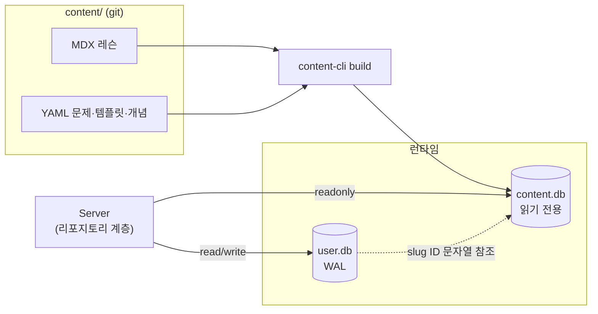
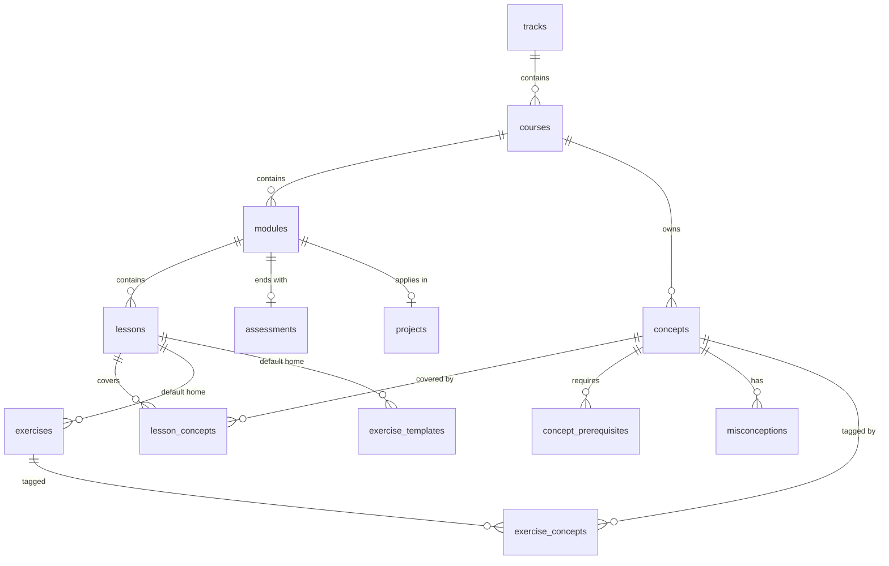
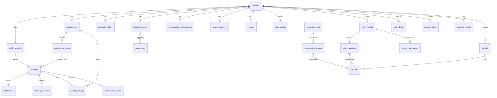

# 데이터 모델 설계

ProgInOne의 두 SQLite 데이터베이스(`content.db`, `user.db`)의 테이블, 식별자, 제약, 인덱스, 마이그레이션, 백업 설계를 정의합니다.
구현자는 이 문서만으로 Drizzle 스키마와 마이그레이션 초안을 작성할 수 있어야 합니다.

- 상태: 승인됨 (2026-11-14)
- 작성: ProgInOne 팀
- 최종 수정: 2026-11-15 (튜터 테이블 v0.1 구현 반영)
- 관련 문서: [PRD](/docs/product/prd.md), [결정 기록](/docs/decisions.md), [용어집](/docs/glossary.md), [시스템 아키텍처 설계](/docs/design/system-architecture.md), [학습 엔진 설계](/docs/design/learning-engine.md), [콘텐츠·문제 시스템 설계](/docs/design/content-and-exercises.md), [AI 시스템 설계](/docs/design/ai-system.md)

## 배경과 범위

[시스템 아키텍처 설계](/docs/design/system-architecture.md#데이터베이스-분리-원칙)는 데이터를 두 파일로 나눕니다.

- `content.db`: 콘텐츠 원본(`content/`)에서 빌드하는 읽기 전용 산출물입니다.
- `user.db`: 학습자 데이터의 유일한 원천입니다. 콘텐츠는 slug ID 문자열로만 참조합니다.

이 문서가 다루는 범위:

- 두 DB의 전체 테이블, 컬럼, 키, 인덱스, 제약
- ID, 시간, JSON 컬럼, 보관(soft delete) 규칙
- 콘텐츠 참조 무결성(고아 처리)
- 마이그레이션 정책
- 자동 백업, 복원, 무결성 검사([D-013](/docs/decisions.md))
- JSON 내보내기·가져오기 형식
- 대화 기록 보관과 전문 검색([D-014](/docs/decisions.md))

이 문서가 다루지 않는 범위:

- 숙련도·FSRS 계산 방식: [학습 엔진 설계](/docs/design/learning-engine.md)
- 문제 스펙(`spec_json`)의 유형별 내부 구조: [콘텐츠·문제 시스템 설계](/docs/design/content-and-exercises.md)
- AI 작업의 프롬프트와 출력 스키마: [AI 시스템 설계](/docs/design/ai-system.md)

## 목표와 비목표

### 데이터 모델 목표

- **학습 기록 무손실**: 콘텐츠 변경, 앱 업그레이드, 마이그레이션 실패에서도 학습 기록을 잃지 않습니다.
- **설명 가능성**: 숙련도·복습 일정의 모든 변화를 원인이 된 시도까지 추적할 수 있습니다.
- **재계산 가능성**: 파생 상태(`concept_mastery`, `concept_memory`, `exercise_stats`)는 원본 이벤트(`attempts`, `review_logs`)에서 다시 계산할 수 있습니다.
- **단순한 쿼리 경로**: 대시보드·복습 큐·오늘의 학습 같은 핵심 화면은 인덱스 하나 이상을 타는 단일 쿼리 또는 소수의 쿼리로 구성됩니다.
- **확장 여지**: 다른 과정·문제 유형·AI 제공자를 스키마 변경 없이 추가할 수 있습니다(유형별 데이터는 검증된 JSON 컬럼).

### 데이터 모델 비목표

- **다중 사용자 동시성**: `learner_id` 컬럼은 두지만, 행 수준 권한이나 사용자 간 격리는 구현하지 않습니다.
- **완전한 이벤트 소싱**: 모든 상태를 이벤트 재생으로만 얻지 않습니다. 원본 이벤트는 보관하되, 파생 상태는 테이블로 유지합니다.
- **두 DB 간 외래 키**: SQLite `ATTACH`로 조인할 수 있지만, 무결성은 앱 계층과 시작 시 검사로 보장합니다.
- **다운그레이드 마이그레이션**: 역방향 마이그레이션은 작성하지 않습니다. 백업 복원으로 대체합니다.
- **암호화 저장**: 로컬 단일 사용자 앱이므로 DB 파일 암호화는 하지 않습니다(OS 디스크 암호화에 위임).

## 설계

### 개요



- 서버는 `content.db`를 `readonly: true, fileMustExist: true`로 엽니다.
- 서버는 `user.db`를 WAL 모드로 엽니다.
- 리포지토리 계층은 두 DB의 결과를 앱 코드에서 결합합니다. 같은 요청에서 콘텐츠 조회는 메모리 캐시(LRU)를 거칩니다.

### 공통 규칙

#### 식별자 전략

| 대상 | 형식 | 예시 | 근거 |
|---|---|---|---|
| 콘텐츠 엔티티 | 점(`.`) 구분 slug, 소문자 kebab. 엔티티별 형식은 [콘텐츠·문제 시스템 설계](/docs/design/content-and-exercises.md#slug-규칙)가 원천 | `js-basics.functions.function-basics`(단원), `js.fn.arrow-this`(개념) | 사람이 읽을 수 있고, git diff·리뷰에서 의미가 보임. 콘텐츠 재빌드 후에도 같은 ID를 유지해 `user.db`의 참조가 깨지지 않음 |
| 사전 제작 문제 | `<단원 slug>.<유형 약어>-<짧은 이름>` | `js-basics.functions.function-basics.mcq-return-vs-log` | 문제를 다른 단원으로 옮겨도 ID는 바꾸지 않음(ID는 위치가 아니라 정체성) |
| 템플릿 변형 | `<템플릿 ID>@<seed>` (seed는 64비트 16진수) | `js-basics.functions.function-basics.t.predict-return@a91f2c` | 같은 시드 = 같은 변형. 결정론적으로 재생성 가능([콘텐츠·문제 시스템 설계](/docs/design/content-and-exercises.md#결정론적-생성)) |
| 사용자 데이터 행 | ULID (26자, Crockford Base32) | `01JD3Z8Q6V2K9M4T7R1X5W0BNC` | 시간순 정렬 가능해 `ORDER BY id`가 생성 순서와 같음. 내보내기·가져오기 시 충돌 없음. 자동 증가 정수와 달리 백업 병합이나 향후 동기화에서 안전 |
| AI 생성 문제 | `gen.` + ULID | `gen.01JD3Z...` | 사전 제작 문제와 같은 컬럼(`exercise_id`)에 들어가므로 접두사로 출처를 구분 |
| 학습자 | ULID. MVP는 단일 행 | | 다중 사용자 대비. 모든 학습 기록 테이블에 `learner_id` |

- slug 규칙: `^[a-z0-9]+(?:-[a-z0-9]+)*(?:\.[a-z0-9]+(?:-[a-z0-9]+)*)*$`, 최대 120자.
- slug는 한 번 공개되면 바꾸지 않습니다. 이름을 바꾸거나 합치거나 나눠야 하면 `content/aliases.yaml`에 기록하고([콘텐츠·문제 시스템 설계](/docs/design/content-and-exercises.md#slug-변경과-alias)), 빌드가 `content_id_aliases` 테이블을 생성합니다. 서버는 참조를 해석할 때 별칭을 먼저 확인합니다.
- ULID는 서버에서 `ulid` 패키지의 monotonic 팩토리로 생성합니다. 같은 밀리초 안에서도 정렬이 보장됩니다.

#### 시간 저장 형식

| 종류 | SQLite 타입 | 형식 | 예시 |
|---|---|---|---|
| 시각(instant) | `INTEGER` | Unix epoch **밀리초**(UTC) | `1763020800000` |
| 지속 시간 | `INTEGER` | 밀리초, 컬럼명 접미사 `_ms` | `active_ms` |
| 날짜(달력 일) | `TEXT` | `YYYY-MM-DD`, **학습자 로컬 시간대 기준** | `2026-11-13` |
| 시간대 | `TEXT` | IANA 이름 | `Asia/Seoul` |

- 시각 컬럼명은 `_at` 접미사를 씁니다(`created_at`, `due_at`).
- Drizzle에서는 `integer('created_at', { mode: 'timestamp_ms' })`를 씁니다.
- "하루"의 경계는 학습자 설정 시간대와 **하루 시작 시각(기본 04:00)** 으로 계산합니다. 자정 직후의 학습이 전날로 집계되도록 하기 위함입니다(Anki와 같은 관례). `daily_activity.date`와 목표 집계가 이 규칙을 따릅니다.
- FSRS 경과 일수 계산은 밀리초 시각에서 소수 일수로 계산합니다([학습 엔진 설계](/docs/design/learning-engine.md#라이브러리와-버전) 참고).

#### JSON 컬럼 원칙

유형마다 구조가 다른 데이터에만 JSON 컬럼을 씁니다.

- 컬럼명은 `_json` 접미사를 씁니다. SQLite 타입은 `TEXT`이며, Drizzle에서는 `text('spec_json', { mode: 'json' }).$type<T>()`로 선언합니다.
- **쓰기 전에 반드시 zod로 검증** 합니다. 스키마는 `packages/shared`(또는 `exercise-kit`, `content-schema`)에 있고, 리포지토리 계층의 `insert`/`update` 래퍼가 검증을 강제합니다.
- **읽을 때도 검증** 합니다(`safeParse`). 실패하면 행을 "손상됨"으로 로그에 남기고 해당 기능만 오류 상태로 표시합니다. 앱 전체를 멈추지 않습니다.
- JSON 객체에는 `v`(스키마 버전 정수) 필드를 넣습니다. 구조가 바뀌면 읽기 시 업그레이드 함수(`upgradeSpecV1toV2` 등)를 적용합니다. 대량 변환이 필요하면 데이터 마이그레이션으로 처리합니다.
- **조회 조건, 정렬, 조인에 쓰는 값은 JSON에 넣지 않고 일반 컬럼으로 둡니다.** 예외적으로 필요하면 생성 컬럼(`GENERATED ALWAYS AS (json_extract(...)) VIRTUAL`)과 인덱스를 추가합니다.
- `CHECK (json_valid(col))` 제약을 모든 JSON 컬럼에 붙입니다.

#### 불리언과 열거형

- 불리언: `INTEGER` 0/1, `CHECK (col IN (0,1))`. Drizzle `integer(..., { mode: 'boolean' })`.
- 열거형: `TEXT` + `CHECK (col IN (...))`. 값은 [용어집](/docs/glossary.md)의 코드 식별자를 씁니다. TypeScript 쪽은 `packages/shared`의 `as const` 배열에서 zod enum과 Drizzle `text({ enum })`을 함께 만듭니다.

#### 보관(soft delete) 정책

| 데이터 | 삭제 방식 | 이유 |
|---|---|---|
| 시도, 제출물, 힌트 이벤트, 리뷰 로그, 숙련도 근거 | **삭제하지 않음** (추가 전용) | 숙련도·FSRS 재계산과 설명 가능성의 원천 |
| 튜터 스레드·메시지 | `archived_at`으로 보관, 학습자가 명시적으로 삭제 요청 시에만 물리 삭제 | D-014: 원문 전체 보관 |
| AI 생성 문제 | `status = 'quarantined'`로 격리, 물리 삭제하지 않음 | 시도 기록이 참조하기 때문 |
| 연습 세트 | `status = 'abandoned'` | 통계에 포함 여부를 판단하기 위해 유지 |
| 코드 초안 | 제출 후에도 유지, 같은 문제의 최신 1개만 유지(덮어쓰기) | 저장 공간 절약. 제출 이력은 `submissions`에 있음 |
| 설정, 목표 | 덮어쓰기 (`goals`는 이력 유지, 아래 참고) | |
| 학습 데이터 초기화(FR-SET-07) | 백업 생성 후 학습 기록 테이블 전체 `DELETE` | 사용자의 명시적 요청 |

#### 콘텐츠 참조와 고아 처리

`user.db`의 다음 컬럼은 `content.db` ID를 참조하는 **논리적 외래 키** 입니다.
코드에서는 타입을 `ContentRef<'concept'>` 같은 브랜드 타입으로 구분합니다.

| user.db 컬럼 | 참조 대상 |
|---|---|
| `*.concept_id` | `concepts.id` |
| `*.lesson_id` | `lessons.id` |
| `*.course_id` | `courses.id` |
| `*.exercise_id` | `exercises.id`, 템플릿 변형 ID, 또는 `generated_exercises.id` |
| `*.misconception_id` | `misconceptions.id` 또는 AI 제안 오개념(`ai.` 접두사) |

앱 시작 시 콘텐츠 팩 버전이 바뀌었으면 **고아 참조 검사** 를 실행합니다.

1. `user.db`의 모든 콘텐츠 참조 ID를 고유 집합으로 수집합니다.
1. 각 ID를 `content_id_aliases`로 해석합니다. `rename`이면 `user.db`의 해당 값을 새 ID로 **갱신** 합니다(한 트랜잭션, 사전 백업 후). `merge`·`split`이면 참조를 갱신한 뒤(진도는 `is_primary` 대상이 이어받음) 해당 개념의 숙련도·기억 상태를 원본 시도에서 **재계산** 합니다([재계산](#재계산)).
1. 해석되지 않는 ID는 `orphan_refs` 테이블에 기록합니다. 행은 지우지 않습니다.
1. UI는 고아 참조를 가진 기록을 "보관된 콘텐츠"로 표시합니다. 숙련도 계산에서 고아 개념은 제외하되 기록은 유지합니다.

### content.db 설계

`content-cli build`가 매번 새로 만드는 파일입니다. 마이그레이션이 없습니다(전체 재생성).
스키마는 `packages/content-schema/src/db/`에 DDL(`ddl.ts`)과 읽기용 Drizzle 테이블(`schema.ts`)로 정의하고, 빌드 도구와 서버가 공유합니다(두 정의가 같은지 테스트로 확인). 빌드 도구(`tools/`)가 앱(`apps/`)에 의존하지 않도록 서버 대신 패키지에 둡니다.

M4 구현에서 아래 표에 더한 컬럼: `courses.objectives_json`, `lessons.read_minutes`·`objectives_json`, `exercises.prompt`·`code`·`misconception_ids_json`·`tags_json`, `misconceptions.diagnostic_hint`·`remedial_lesson_anchor`. `lessons.body_compiled`에는 검증된 MDX JSON 트리를 저장합니다([콘텐츠·문제 시스템 설계](/docs/design/content-and-exercises.md#mdx-컴포넌트)). `assessments`, `projects`, `exercise_templates`는 해당 콘텐츠가 생길 때 추가합니다.

#### content_meta

콘텐츠 팩 메타데이터. 단일 행 키-값입니다.

| 컬럼 | 타입 | Null | 설명 |
|---|---|---|---|
| `key` | TEXT | N | PK. `pack_version`, `schema_version`, `built_at`, `source_commit`, `content_hash` |
| `value` | TEXT | N | 값 |

- `schema_version`: content.db 스키마 버전(정수). 서버는 자신이 지원하는 범위가 아니면 시작을 거부합니다.
- `content_hash`: 모든 원본 파일의 SHA-256을 합친 해시. 변경 감지에 씁니다.

#### tracks, courses, modules, lessons

| 테이블 | 컬럼 | 타입 | Null | 기본값 | 설명 |
|---|---|---|---|---|---|
| `tracks` | `id` | TEXT | N | | PK, slug |
| | `title` | TEXT | N | | |
| | `summary` | TEXT | N | | |
| | `order_index` | INTEGER | N | | |
| `courses` | `id` | TEXT | N | | PK, slug (`js-basics`) |
| | `track_id` | TEXT | N | | FK → `tracks.id` |
| | `title` | TEXT | N | | |
| | `summary` | TEXT | N | | |
| | `language` | TEXT | N | | `html` / `css` / `javascript`. 러너·에디터 기본 언어 결정 |
| | `level` | TEXT | N | | `intro` / `basic` / `advanced` |
| | `depth` | TEXT | N | `'full'` | `full` / `core` (D-003: JS는 full, HTML/CSS는 core) |
| | `order_index` | INTEGER | N | | 트랙 내 권장 순서 |
| | `estimated_minutes` | INTEGER | N | | 빌드 시 단원 합계로 계산 |
| | `status` | TEXT | N | `'published'` | `published` / `preview` / `hidden` |
| `modules` | `id` | TEXT | N | | PK, slug (`js-basics.functions`) |
| | `course_id` | TEXT | N | | FK → `courses.id` |
| | `title`, `summary` | TEXT | N | | |
| | `order_index` | INTEGER | N | | |
| | `assessment_id` | TEXT | Y | | FK → `assessments.id` (모듈 종합 평가) |
| | `project_id` | TEXT | Y | | FK → `projects.id` |
| `lessons` | `id` | TEXT | N | | PK, slug |
| | `module_id` | TEXT | N | | FK → `modules.id` |
| | `title` | TEXT | N | | |
| | `summary` | TEXT | N | | 카드·검색용 1~2문장 |
| | `order_index` | INTEGER | N | | |
| | `importance` | TEXT | N | `'standard'` | `core` / `standard` / `minor`. 첫 연습 세트 크기와 통과 기준에 영향([학습 엔진 설계](/docs/design/learning-engine.md#단원-연습-세트)) |
| | `kind` | TEXT | N | `'lesson'` | `lesson` / `assessment` / `project` |
| | `pass_rule_json` | TEXT | Y | | 콘텐츠가 덮어쓴 `PassRule` 필드(`lesson.yaml`의 `practice.passRule`). NULL이면 엔진 기본값 |
| | `target_count` | INTEGER | Y | | 목표 문제 수(빌드 경고용) |
| | `estimated_minutes` | INTEGER | N | | 읽기 + 연습 예상 시간 |
| | `body_compiled` | TEXT | N | | 빌드 시 컴파일한 MDX(함수 본문 문자열) |
| | `body_text` | TEXT | N | | 검색·AI 컨텍스트용 평문 |
| | `sections_json` | TEXT | N | | 섹션 목차 `{ v, sections: [{ id, kind, title }] }`. `kind`는 학습 목표·원리·예제 등 표준 섹션 |
| | `content_hash` | TEXT | N | | 본문 해시. 변경 시 "업데이트됨" 표시 |

인덱스:

- `courses(track_id, order_index)`, `modules(course_id, order_index)`, `lessons(module_id, order_index)` 각각 UNIQUE.

#### concepts, concept_prerequisites, lesson_concepts

| 테이블 | 컬럼 | 타입 | Null | 기본값 | 설명 |
|---|---|---|---|---|---|
| `concepts` | `id` | TEXT | N | | PK, slug |
| | `course_id` | TEXT | N | | FK → `courses.id`. 개념의 "소속" 과정 |
| | `title` | TEXT | N | | |
| | `summary` | TEXT | N | | 1~2문장 정의. AI 컨텍스트에 사용 |
| | `importance` | TEXT | N | `'standard'` | `core` / `standard` / `minor`. 레슨 깊이, 문제 수 목표(FR-EX-09), 복습 우선순위 |
| | `introduced_in_lesson_id` | TEXT | N | | FK → `lessons.id`. 처음 가르치는 단원 |
| | `mdn_url` | TEXT | Y | | 참고 링크(FR-CUR-08) |
| `concept_prerequisites` | `concept_id` | TEXT | N | | FK → `concepts.id` |
| | `prerequisite_id` | TEXT | N | | FK → `concepts.id` |
| | `strength` | TEXT | N | `'required'` | `required` / `helpful`. 재학습 탐색은 `required`만 따름 |
| `lesson_concepts` | `lesson_id` | TEXT | N | | FK |
| | `concept_id` | TEXT | N | | FK |
| | `role` | TEXT | N | | `introduces` / `practices` / `reviews`. `lesson.yaml`의 `concepts.primary` → `introduces`, `concepts.practiced` → `practices`, `concepts.reviewed` → `reviews` |

제약과 인덱스:

- `concept_prerequisites`: PK `(concept_id, prerequisite_id)`, `CHECK (concept_id <> prerequisite_id)`. **순환 금지는 빌드 시 위상 정렬로 검증** 합니다(SQLite 제약으로 표현 불가).
- `concept_prerequisites(prerequisite_id)` 인덱스: "이 개념에 의존하는 개념" 역방향 조회용.
- `lesson_concepts`: PK `(lesson_id, concept_id)`, 인덱스 `(concept_id, role)`.

#### misconceptions

| 컬럼 | 타입 | Null | 설명 |
|---|---|---|---|
| `id` | TEXT | N | PK, slug (`js.mc.loose-equals-strict`, 형식은 [콘텐츠·문제 시스템 설계](/docs/design/content-and-exercises.md#slug-규칙)) |
| `concept_id` | TEXT | N | FK → `concepts.id` |
| `title` | TEXT | N | 짧은 이름: "`==`와 `===`를 같다고 생각함" |
| `description` | TEXT | N | 오개념 설명 |
| `correction` | TEXT | N | 바른 이해로 이끄는 설명(피드백에 사용) |
| `remedial_exercise_ids_json` | TEXT | N | 이 오개념을 겨냥하는 문제 ID 배열 |

인덱스: `misconceptions(concept_id)`.

#### exercises, exercise_concepts, exercise_templates

| 테이블 | 컬럼 | 타입 | Null | 기본값 | 설명 |
|---|---|---|---|---|---|
| `exercises` | `id` | TEXT | N | | PK |
| | `type` | TEXT | N | | `ExerciseType` id (`mcq_single`, `predict_output` 등) |
| | `difficulty` | INTEGER | N | | `CHECK (difficulty BETWEEN 1 AND 5)` |
| | `lesson_id` | TEXT | Y | | 기본 소속 단원(연습 세트 후보). 평가 전용 문제는 NULL 가능 |
| | `usage` | TEXT | N | `'practice'` | `practice` / `assessment` / `diagnostic` / `remedial` / `worked_example` |
| | `worked_example_stage` | INTEGER | Y | | 단계적 풀이 예제 단계: 0 완전한 풀이, 1 일부 빈칸, 2 직접 풀기. `usage = 'worked_example'`일 때만 |
| | `variant_group` | TEXT | Y | | "사실상 같은 문제"를 묶는 그룹 키. 같은 그룹은 연습 세트에 1개만 |
| | `spec_json` | TEXT | N | | 유형별 전체 스펙(정답 키·참조 구현·숨김 체크 기대값 포함). **서버 전용**. 구조는 [콘텐츠·문제 시스템 설계](/docs/design/content-and-exercises.md#유형별-스펙) |
| | `public_spec_json` | TEXT | N | | `PublicSpec`: 유형의 `redact(spec)` 결과를 빌드 시 미리 계산한 값. 클라이언트로 전송 가능 |
| | `leak_fingerprints_json` | TEXT | N | `'[]'` | 정답 누설 지문(정답 리터럴, 기대 출력, 참조 구현 핵심 줄의 정규화 해시). 빌드 시 생성. AI 힌트 후처리 검사용([AI 시스템 설계](/docs/design/ai-system.md)). **서버 전용** |
| | `hints_json` | TEXT | N | | 3단계 힌트 `{ v, levels: [h1, h2, h3] }` |
| | `explanation` | TEXT | N | | 해설(마크다운) |
| | `estimated_seconds` | INTEGER | N | | 예상 풀이 시간. 소요 시간 정규화에 사용 |
| | `origin` | TEXT | N | `'authored'` | `authored` / `template` (사전 제작 팩에는 `generated` 없음) |
| | `review_status` | TEXT | N | | `auto_verified` / `trusted`. 빌드 검증 통과 문제만 팩에 포함 |
| | `content_hash` | TEXT | N | | 중복 검사·변경 감지 |
| | `dedupe_signature` | TEXT | N | | 정규화 서명([콘텐츠·문제 시스템 설계](/docs/design/content-and-exercises.md) 참고) |
| `exercise_concepts` | `exercise_id` | TEXT | N | | FK |
| | `concept_id` | TEXT | N | | FK |
| | `weight` | REAL | N | | 주 개념 1.0, 부 개념 0.3~0.5 |
| | `is_primary` | INTEGER | N | | 0/1. 문제당 정확히 1개(빌드 검증) |
| `exercise_templates` | `id` | TEXT | N | | PK (`...tpl.<이름>`) |
| | `type`, `difficulty`, `lesson_id`, `usage` | | | | `exercises`와 같음 |
| | `template_json` | TEXT | N | | 매개변수 정의와 프롬프트·정답 생성 규칙 |
| | `variant_count_hint` | INTEGER | N | | 서로 의미 있게 다른 변형의 대략적 개수(문제 수 산정용) |
| | `concepts_json` | TEXT | N | | `[{ conceptId, weight, isPrimary }]` |

- 템플릿 변형은 **content.db에 미리 펼쳐 저장하지 않습니다.** 서버가 요청 시 `exercise-kit` 템플릿 엔진으로 결정론적으로 생성합니다. 변형 ID는 `<템플릿 ID>@<seed>`이며, 한 번 생성한 변형의 스펙과 실행으로 계산한 기대값은 `user.db`의 `variant_cache`에 저장합니다.
- 인덱스: `exercises(lesson_id, usage, difficulty)`, `exercises(type)`, `exercises(variant_group)`, `exercise_concepts(concept_id, is_primary)`, `exercise_templates(lesson_id)`.
- `spec_json`과 `public_spec_json`의 분리는 [시스템 아키텍처 설계](/docs/design/system-architecture.md#문제-제출-흐름-코드-실습)의 "정답 키를 클라이언트로 보내지 않는다" 원칙을 저장 수준에서 강제하기 위한 것입니다.

#### assessments, projects

| 테이블 | 컬럼 | 타입 | Null | 설명 |
|---|---|---|---|---|
| `assessments` | `id` | TEXT | N | PK |
| | `scope_type` | TEXT | N | `lesson` / `module` |
| | `scope_id` | TEXT | N | 단원 또는 모듈 ID |
| | `title` | TEXT | N | |
| | `exercise_ids_json` | TEXT | N | 고정 문제 목록(또는 아래 규칙과 병용) |
| | `selection_rule_json` | TEXT | Y | 개념별 문제 수·난이도 분포 규칙 |
| | `pass_ratio` | REAL | N | 통과 기준(예: 0.8) |
| `projects` | `id` | TEXT | N | PK |
| | `module_id` | TEXT | N | FK |
| | `title`, `summary` | TEXT | N | |
| | `steps_json` | TEXT | N | 단계별 요구사항·체크·관련 개념 |

#### content_id_aliases, content_search

| 테이블 | 컬럼 | 설명 |
|---|---|---|
| `content_id_aliases` | `old_id` TEXT, `new_id` TEXT, `alias_kind` TEXT(`rename`/`merge`/`split`), `is_primary` INTEGER(분할 시 진도를 이어받는 대상), `entity_kind` TEXT(`concept`/`lesson`/`exercise` 등), `since_pack_version` TEXT. PK `(old_id, new_id)` | 바뀐 slug의 매핑. `split`은 한 `old_id`에 여러 행 |
| `content_search` | FTS5 가상 테이블 `(entity_id UNINDEXED, kind UNINDEXED, title, body)`. `kind`: `lesson` / `concept` / `exercise` | 커맨드 팔레트(⌘K) 검색. 토크나이저는 아래 [전문 검색](#전문-검색-fts5) 참고 |

### user.db 설계

스키마는 `apps/server/src/db/user/schema.ts`, 마이그레이션은 `apps/server/src/db/user/migrations/`에 있습니다.
모든 학습 기록 테이블은 `learner_id TEXT NOT NULL REFERENCES learners(id)`를 가집니다. 아래 표에서는 반복을 줄이기 위해 생략합니다. 예외: `app_meta`, `variant_cache`, `exercise_snapshots`는 학습자와 무관한 캐시·메타이므로 `learner_id`가 없습니다.

구현 현황: 0000(M3)은 `app_meta`, `learners`, `settings`, 0001(M4)은 `lesson_progress`, `practice_sets`, `practice_set_items`, `attempts`, `submissions`, `hint_events`, `exercise_snapshots`, `concept_mastery`, `mastery_evidence`, `concept_memory`, `review_logs`, `pending_ratings`(M4에서 추가), `exercise_reports`, `daily_activity`를 만듭니다. 0002(M4)는 튜터 테이블, 0003(M5)은 `misconception_observations`, `remediation_suggestions`(M5에서 추가)를 만듭니다. 나머지 테이블은 해당 기능과 함께 추가합니다. 0001에서 표와 달라진 점: `lesson_progress.updated_at` 추가, `pending_ratings` 추가. 열거형·0/1·`json_valid` 외에 범위 `CHECK`(점수 0~1·0~100, 힌트 단계 0~3, `daily_activity.date` 형식)를 더했습니다.

#### 연결 설정 (PRAGMA)

서버가 `user.db`를 열 때 다음을 설정합니다.

```sql
PRAGMA journal_mode = WAL;
PRAGMA synchronous = NORMAL;      -- WAL에서 안전하고 충분히 빠름
PRAGMA foreign_keys = ON;
PRAGMA busy_timeout = 5000;
PRAGMA temp_store = MEMORY;
PRAGMA cache_size = -20000;       -- 약 20MB
```

종료 시 `PRAGMA wal_checkpoint(TRUNCATE)`, `PRAGMA optimize`를 실행합니다.

#### meta, learners, settings

| 테이블 | 컬럼 | 타입 | Null | 기본값 | 설명 |
|---|---|---|---|---|---|
| `app_meta` | `key` | TEXT | N | | PK. `created_at`, `last_content_pack_version`, `last_app_version`, `last_daily_backup_date`, `last_weekly_backup_week` |
| | `value` | TEXT | N | | |
| `learners` | `id` | TEXT | N | | PK, ULID |
| | `display_name` | TEXT | Y | | |
| | `timezone` | TEXT | N | 시스템 시간대 | IANA |
| | `day_start_hour` | INTEGER | N | `4` | 하루 경계 시각(0~23) |
| | `experience_level` | TEXT | N | `'none'` | 온보딩 답변: `none` / `some` / `basics` |
| | `onboarded_at` | INTEGER | Y | | |
| | `created_at` | INTEGER | N | | |
| `settings` | `learner_id` | TEXT | N | | PK 일부 |
| | `key` | TEXT | N | | PK 일부. 예: `theme`, `editor.autocomplete`, `practice.askConfidence`, `tutor.proactiveSuggestions`, `hints.policy`, `ai.model`, `ai.reasoningEffort` |
| | `value_json` | TEXT | N | | 값(zod 스키마는 키별로 `packages/shared/settings.ts`에 정의) |
| | `updated_at` | INTEGER | N | | |

- Drizzle 마이그레이션 이력은 Drizzle 기본 테이블(`__drizzle_migrations`)에 남습니다.
- 설정은 키-값 구조로 둡니다. 설정 항목 추가가 마이그레이션 없이 가능하고, 키별 zod 스키마와 기본값을 코드에 둡니다.

#### goals, daily_activity

| 테이블 | 컬럼 | 타입 | Null | 기본값 | 설명 |
|---|---|---|---|---|---|
| `goals` | `id` | TEXT | N | | PK, ULID |
| | `daily_minutes` | INTEGER | N | `30` | `CHECK (daily_minutes BETWEEN 5 AND 480)` |
| | `weekly_days` | INTEGER | N | `5` | `CHECK (weekly_days BETWEEN 1 AND 7)` |
| | `target_course_id` | TEXT | Y | | 완료 목표 과정 |
| | `target_date` | TEXT | Y | | `YYYY-MM-DD` |
| | `effective_from` | INTEGER | N | | 이 목표가 적용되기 시작한 시각 |
| | `effective_to` | INTEGER | Y | | NULL이면 현재 목표 |
| `daily_activity` | `date` | TEXT | N | | PK 일부. 로컬 날짜(하루 시작 시각 반영) |
| | `active_ms` | INTEGER | N | `0` | 실제 활동 시간(FR-GOAL-05) |
| | `attempts_count` | INTEGER | N | `0` | |
| | `correct_count` | INTEGER | N | `0` | |
| | `reviews_done` | INTEGER | N | `0` | 복습 세트에서 처리한 개념 수 |
| | `lessons_completed` | INTEGER | N | `0` | |
| | `goal_met` | INTEGER | N | `0` | 그날 적용 목표의 `daily_minutes` 달성 여부 |

- 목표를 바꾸면 기존 행의 `effective_to`를 채우고 새 행을 추가합니다. 과거 주간 달성률을 당시 목표로 계산하기 위함입니다.
- 부분 고유 인덱스 `goals(learner_id) WHERE effective_to IS NULL`로 현재 목표를 하나로 강제합니다.
- `daily_activity`는 `study_sessions`와 `attempts`에서 파생할 수 있는 집계 테이블입니다. 쓰기 경로에서 같은 트랜잭션으로 증가시키고, 불일치 시 재계산 명령(`content-cli`가 아닌 서버 관리 명령 `pnpm db:recompute`)으로 복구합니다.

#### study_sessions

| 컬럼 | 타입 | Null | 기본값 | 설명 |
|---|---|---|---|---|
| `id` | TEXT | N | | PK, ULID |
| `started_at` | INTEGER | N | | |
| `last_activity_at` | INTEGER | N | | 마지막 활동 하트비트 |
| `ended_at` | INTEGER | Y | | 비활성 10분 경과 또는 앱 종료 시 |
| `active_ms` | INTEGER | N | `0` | 비활성 2분 이상 구간을 뺀 시간 |
| `end_reason` | TEXT | Y | | `idle` / `app_closed` / `explicit` |
| `summary_id` | TEXT | Y | | FK → `session_summaries.id` |

- 활동 시간 계산 규칙은 [학습 엔진 설계](/docs/design/learning-engine.md#학습-시간-측정)에 있습니다. 클라이언트는 30초 간격 하트비트(`POST /activity/heartbeat`, 마지막 입력 시각 포함)를 보냅니다.
- 인덱스: `study_sessions(learner_id, started_at)`, 부분 인덱스 `study_sessions(learner_id) WHERE ended_at IS NULL`.

#### lesson_progress

| 컬럼 | 타입 | Null | 기본값 | 설명 |
|---|---|---|---|---|
| `lesson_id` | TEXT | N | | PK 일부 |
| `status` | TEXT | N | `'not_started'` | `not_started` / `reading` / `practicing` / `completed` |
| `last_section_id` | TEXT | Y | | 읽기 위치 복원 |
| `read_progress` | REAL | N | `0` | 0~1 본문 스크롤 진행률 |
| `practice_set_id` | TEXT | Y | | 진행 중인 단원 연습 세트 |
| `started_at` | INTEGER | Y | | |
| `completed_at` | INTEGER | Y | | |
| `content_hash_seen` | TEXT | Y | | 학습자가 본 본문 해시. 콘텐츠 갱신 표시용 |
| `updated_at` | INTEGER | N | | 마지막 읽기·연습 활동 시각. "이어서 학습"의 최근순 정렬에 사용(M4에서 추가) |

PK `(learner_id, lesson_id)`. 인덱스 `(learner_id, status)`.

#### practice_sets, practice_set_items

| 테이블 | 컬럼 | 타입 | Null | 기본값 | 설명 |
|---|---|---|---|---|---|
| `practice_sets` | `id` | TEXT | N | | PK, ULID |
| | `kind` | TEXT | N | | `lesson` / `review` / `weakness` / `assessment` / `remedial` / `extra` / `custom`(자유 연습, P1) / `diagnostic`(P1). 학습 맥락(`W_ctx`)과 힌트 잠금 여부를 정함 |
| | `scope_json` | TEXT | N | | 대상(단원 ID, 개념 ID 목록, 평가 ID 등) |
| | `status` | TEXT | N | `'active'` | `active` / `completed` / `abandoned` |
| | `pass_rule_json` | TEXT | Y | | 통과 기준(학습 엔진이 생성) |
| | `result_json` | TEXT | Y | | 완료 시 요약(정답 수, 통과 여부, 개념별 결과) |
| | `engine_version` | TEXT | N | | 세트를 구성한 학습 엔진 버전 |
| | `created_at`, `completed_at` | INTEGER | N/Y | | |
| `practice_set_items` | `id` | TEXT | N | | PK, ULID |
| | `practice_set_id` | TEXT | N | | FK → `practice_sets.id` ON DELETE CASCADE |
| | `position` | INTEGER | N | | 0부터 |
| | `exercise_id` | TEXT | N | | 문제·변형·생성 문제 ID |
| | `exercise_origin` | TEXT | N | | `authored` / `template` / `generated` |
| | `reason` | TEXT | N | | 선택 이유 코드(`new`, `review_due`, `weak_concept`, `remedial_prereq`, `difficulty_step_up` 등) |
| | `target_concept_id` | TEXT | Y | | 이 항목이 겨냥한 개념 |
| | `status` | TEXT | N | `'pending'` | `pending` / `answered` / `skipped` |
| | `final_attempt_id` | TEXT | Y | | 마지막 시도 |

- 연습 세트는 진행 중에 **적응적으로 항목을 추가** 할 수 있습니다(재학습 경로 등). 추가 항목은 `position`을 이어 붙입니다.
- 인덱스: `practice_sets(learner_id, kind, status)`, UNIQUE `practice_set_items(practice_set_id, position)`, `practice_set_items(exercise_id)`.

#### attempts, submissions, hint_events

`attempts`는 학습 기록의 핵심 원천 이벤트입니다. **추가 전용** 입니다.

| 컬럼 | 타입 | Null | 기본값 | 설명 |
|---|---|---|---|---|
| `id` | TEXT | N | | PK, ULID |
| `exercise_id` | TEXT | N | | |
| `exercise_origin` | TEXT | N | | `authored` / `template` / `generated` |
| `variant_group_key` | TEXT | N | | 시도 당시의 변형 그룹 키(`variant_group`, 없으면 템플릿 ID 또는 문제 ID). 반복 감쇠 `W_rep`와 단계 게이트의 변형 그룹 다양성 계산에 사용([학습 엔진 설계](/docs/design/learning-engine.md#증거-가중치)). 인덱스 `(learner_id, variant_group_key, created_at)` |
| `exercise_version_hash` | TEXT | N | | 시도 당시 문제의 내용 해시. `exercise_snapshots.content_hash`를 가리킴. 콘텐츠가 바뀐 뒤 해석과 풀이 비교에 사용 |
| `practice_set_item_id` | TEXT | Y | | FK. 자유 실행 등 세트 밖 시도는 NULL |
| `study_session_id` | TEXT | Y | | FK |
| `attempt_no` | INTEGER | N | | 같은 문제의 몇 번째 시도인지(학습자 전체 기준, 1부터) |
| `attempt_in_item` | INTEGER | N | | 같은 연습 세트 항목 안에서의 시도 번호 |
| `outcome` | TEXT | N | | `correct` / `partial` / `incorrect` / `error` (`error`는 실행 실패·시간 초과) |
| `score` | REAL | N | | 0~1. 부분 점수(체크 통과 비율 등) |
| `confidence` | TEXT | Y | | `sure` / `unsure` / `guess`. 입력을 끈 경우 NULL |
| `hint_level_max` | INTEGER | N | `0` | 이 시도 전까지 연 최고 힌트 단계 0~3 |
| `solution_viewed` | INTEGER | N | `0` | 정답을 본 뒤의 시도인지 |
| `tutor_assisted` | INTEGER | N | `0` | 이 문제 맥락에서 튜터와 대화한 뒤의 시도인지 |
| `started_at` | INTEGER | N | | 문제를 처음 본 시각(이 시도 기준) |
| `submitted_at` | INTEGER | N | | |
| `active_ms` | INTEGER | N | | 비활성 구간을 뺀 풀이 시간 |
| `misconception_ids_json` | TEXT | N | `'[]'` | 선택한 오답이 가리키는 오개념 ID |
| `grading_json` | TEXT | N | | 채점 상세(체크별 결과, 기대값·실제값 요약, 채점기 버전) |
| `is_review` | INTEGER | N | `0` | 복습 세트 안의 시도인지 |
| `engine_applied` | INTEGER | N | `1` | 학습 엔진이 반영했는지(재계산 대상 식별). 샌드박스 `crashed`/`aborted` 실행, 무효화된 문제(`invalidatesPrevious`), 격리된 생성 문제의 시도는 `0` |

인덱스:

- `attempts(learner_id, submitted_at)`: 최근 활동, 통계
- `attempts(learner_id, exercise_id, submitted_at)`: 문제별 이력, "과거 풀이와 비교"
- `attempts(practice_set_item_id)`
- `attempts(learner_id, outcome, submitted_at)`: 오답 노트

`submissions`는 시도의 답안 원본입니다. 코드 파일이 클 수 있어 분리합니다.

| 컬럼 | 타입 | Null | 설명 |
|---|---|---|---|
| `attempt_id` | TEXT | N | PK, FK → `attempts.id` |
| `answer_json` | TEXT | N | 유형별 답안(선택지 ID, 입력 텍스트, 순서 배열, 파일 목록 `{ path, content }[]`) |
| `run_result_json` | TEXT | Y | 샌드박스 `RunResult` 요약(콘솔 앞부분 최대 200줄, 오류, 체크 결과, 실행 시간, 종료 사유) |
| `answer_hash` | TEXT | N | 같은 답안 반복 제출 탐지 |

- 콘솔 출력은 잘라서 저장합니다(최대 64KB). 잘렸는지 `truncated` 플래그를 `run_result_json`에 둡니다.

`hint_events`는 힌트와 정답 열람 이벤트입니다.

| 컬럼 | 타입 | Null | 설명 |
|---|---|---|---|
| `id` | TEXT | N | PK, ULID |
| `exercise_id` | TEXT | N | |
| `practice_set_item_id` | TEXT | Y | |
| `kind` | TEXT | N | `hint` / `solution` / `ai_hint` |
| `level` | INTEGER | Y | 힌트 단계 1~3 (`solution`이면 NULL) |
| `created_at` | INTEGER | N | |

인덱스 `hint_events(learner_id, exercise_id, created_at)`.

#### code_drafts

| 컬럼 | 타입 | Null | 설명 |
|---|---|---|---|
| `exercise_id` | TEXT | N | PK 일부 (`learner_id`, `exercise_id`) |
| `files_json` | TEXT | N | `{ v, files: [{ path, content }], activePath }` |
| `updated_at` | INTEGER | N | 충돌 해결에 사용(최신 시각 우선) |
| `client_rev` | INTEGER | N | 클라이언트 증가 번호. 오래된 쓰기 무시 |

- 웹은 IndexedDB에 즉시 저장하고, 서버에는 2초 디바운스로 `PUT`합니다([시스템 아키텍처 설계](/docs/design/system-architecture.md#웹-앱-내부-구조)).

#### exercise_snapshots, variant_cache

`exercise_snapshots`는 **출제 시점의 문제 스냅샷** 입니다. 콘텐츠가 개정되거나 템플릿 엔진이 바뀐 뒤에도 "과거 풀이와 현재 풀이 비교"(FR-DASH-04)와 오답 노트가 학습자가 실제로 본 문제를 보여주기 위함입니다([콘텐츠·문제 시스템 설계](/docs/design/content-and-exercises.md#문제-내용의-개정)).

| 컬럼 | 타입 | Null | 설명 |
|---|---|---|---|
| `content_hash` | TEXT | N | PK. 문제 내용 해시(`exercises.content_hash`, 변형·생성 문제는 생성된 스펙의 해시) |
| `exercise_id` | TEXT | N | |
| `public_spec_json` | TEXT | N | 당시의 `PublicSpec` |
| `revision` | INTEGER | Y | 콘텐츠 개정 번호(사전 제작 문제) |
| `created_at` | INTEGER | N | |

- 같은 내용은 한 행만 저장합니다(내용 해시로 중복 제거). `attempts.exercise_version_hash`가 이 테이블을 가리킵니다.
- 행은 해당 내용 해시로 처음 시도가 기록될 때 같은 트랜잭션에서 만듭니다(`INSERT OR IGNORE`).

`variant_cache`는 템플릿 변형(`<템플릿 ID>@<seed>`)의 생성 결과 캐시입니다.

| 컬럼 | 타입 | Null | 설명 |
|---|---|---|---|
| `variant_id` | TEXT | N | PK 일부 |
| `template_hash` | TEXT | N | PK 일부. 템플릿 내용 해시. 템플릿이 바뀌면 다른 행 |
| `spec_json` | TEXT | N | 생성된 전체 스펙(서버 전용) |
| `public_spec_json` | TEXT | N | `PublicSpec` |
| `expected_json` | TEXT | Y | 실행으로 계산한 기대값(예측 문제의 출력, 체크 기대값). 실행이 필요한 변형은 첫 출제 전 숨김 검증 실행으로 채움 |
| `content_hash` | TEXT | N | 생성된 스펙의 해시 |
| `created_at` | INTEGER | N | |

- 캐시이므로 지워도 결정론적으로 다시 만들 수 있습니다. 단, 기대값은 다시 실행해야 하므로 지우지 않는 것을 기본으로 합니다.
- 인덱스 `variant_cache(variant_id)`.

#### concept_mastery, mastery_evidence

`concept_mastery`는 개념별 현재 숙련 상태입니다(파생 상태).

| 컬럼 | 타입 | Null | 기본값 | 설명 |
|---|---|---|---|---|
| `concept_id` | TEXT | N | | PK 일부 |
| `score` | REAL | N | `0` | 0~100 |
| `stage` | TEXT | N | `'not_started'` | `MasteryStage` |
| `evidence_weight_sum` | REAL | N | `0` | 누적 증거 가중치(신뢰도 표시용) |
| `distinct_types_correct_json` | TEXT | N | `'[]'` | 정답을 낸 문제 유형 목록(게이트 판정) |
| `max_difficulty_correct` | INTEGER | N | `0` | 정답을 낸 최고 난이도(가중치 반영 기준 충족 시) |
| `consecutive_failures` | INTEGER | N | `0` | 재학습 규칙 판정 |
| `last_attempt_at` | INTEGER | Y | | |
| `stage_changed_at` | INTEGER | Y | | |
| `updated_at` | INTEGER | N | | |
| `engine_version` | TEXT | N | | 계산한 학습 엔진 버전 |

PK `(learner_id, concept_id)`. 인덱스 `(learner_id, stage)`, `(learner_id, score)`.

`mastery_evidence`는 숙련도 변화 한 건마다의 근거입니다. 설명 가능성의 원천입니다.

| 컬럼 | 타입 | Null | 설명 |
|---|---|---|---|
| `id` | TEXT | N | PK, ULID |
| `concept_id` | TEXT | N | |
| `attempt_id` | TEXT | Y | FK → `attempts.id`. 진단 평가 시드나 시간 감쇠 등은 NULL |
| `kind` | TEXT | N | `attempt` / `stage_gate` / `diagnostic_seed` / `recompute` |
| `score_before` | REAL | N | |
| `score_after` | REAL | N | |
| `stage_before` | TEXT | N | |
| `stage_after` | TEXT | N | |
| `breakdown_json` | TEXT | N | 계산 내역(관측값, 가중치 요소별 값, 공식 버전). 형식은 [학습 엔진 설계](/docs/design/learning-engine.md#설명-가능성) 참고 |
| `created_at` | INTEGER | N | |

인덱스 `mastery_evidence(learner_id, concept_id, created_at)`, `mastery_evidence(attempt_id)`.

#### concept_memory, review_logs

`concept_memory`는 개념 단위 FSRS 상태입니다([D-009](/docs/decisions.md)).

| 컬럼 | 타입 | Null | 기본값 | 설명 |
|---|---|---|---|---|
| `concept_id` | TEXT | N | | PK 일부 |
| `card_json` | TEXT | N | | ts-fsrs 카드 직렬화(라이브러리 원형 보존, 날짜는 epoch ms) |
| `fsrs_version` | TEXT | N | | 예: `FSRS-7`. 모델 변경 감지 |
| `state` | TEXT | N | | `new` / `learning` / `review` / `relearning` (조회용 비정규화) |
| `due_at` | INTEGER | N | | 다음 복습 시각(조회용 비정규화) |
| `stability` | REAL | N | | 일 단위(비정규화) |
| `difficulty` | REAL | N | | FSRS 난이도(비정규화, 문제 난이도와 다름) |
| `last_review_at` | INTEGER | Y | | |
| `reps` | INTEGER | N | `0` | |
| `lapses` | INTEGER | N | `0` | |
| `suspended` | INTEGER | N | `0` | 학습자가 복습에서 제외한 개념 |
| `updated_at` | INTEGER | N | | |

- 행은 그 개념의 보류 등급이 처음 FSRS에 적용될 때(보통 첫 단원 연습 세트가 끝날 때) 만듭니다. 레슨만 읽은 개념에는 카드가 없습니다([학습 엔진 설계의 구현 메모](/docs/design/learning-engine.md#구현-메모-v01)).
- `card_json`이 정본이고, 나머지 FSRS 컬럼은 복습 큐 조회를 위한 사본입니다. 쓰기 시 항상 함께 갱신합니다.
- 인덱스: `concept_memory(learner_id, suspended, due_at)` — 복습 큐의 핵심 쿼리.

`review_logs`는 FSRS 평가 이벤트(추가 전용)입니다. 파라미터 최적화와 재계산의 원천입니다.

| 컬럼 | 타입 | Null | 설명 |
|---|---|---|---|
| `id` | TEXT | N | PK, ULID |
| `concept_id` | TEXT | N | |
| `rating` | TEXT | N | `again` / `hard` / `good` / `easy` |
| `source_attempt_ids_json` | TEXT | N | 이 평가를 만든 시도들 |
| `reviewed_at` | INTEGER | N | |
| `elapsed_days` | REAL | N | 이전 평가로부터 경과 일수 |
| `scheduled_days` | REAL | N | 이전 예정 간격 |
| `state_before` | TEXT | N | |
| `revlog_json` | TEXT | N | ts-fsrs가 돌려준 로그 원형 |
| `retrievability_before` | REAL | Y | 평가 직전 회상 확률 |

인덱스 `review_logs(learner_id, concept_id, reviewed_at)`.

#### pending_ratings

`pending_ratings`는 아직 FSRS에 적용하지 않은 **보류 등급** 입니다(M4에서 추가). 학습 엔진은 시도마다 주 개념의 등급(`PendingRating`)을 돌려주고, 서버는 그 개념의 세트 항목이 모두 끝나거나 세트가 끝날 때 등급을 합쳐 적용합니다([학습 엔진 설계](/docs/design/learning-engine.md#평가-적용-단위-개념당-하루-한-번)). 그 사이에 서버가 재시작해도 등급을 잃지 않도록 테이블로 둡니다.

| 컬럼 | 타입 | Null | 설명 |
|---|---|---|---|
| `id` | TEXT | N | PK, ULID |
| `practice_set_id` | TEXT | N | FK → `practice_sets.id` ON DELETE CASCADE. 등급이 속한 세트 |
| `concept_id` | TEXT | N | 주 개념 |
| `rating` | TEXT | N | `again` / `hard` / `good` / `easy` (시도 하나의 등급) |
| `attempt_id` | TEXT | N | FK → `attempts.id`. 적용 시 `review_logs.source_attempt_ids_json`이 됨 |
| `variant_group_key` | TEXT | N | 근거 시도의 변형 그룹 키(단계 게이트의 변형 그룹 다양성) |
| `rated_at` | INTEGER | N | 시도 제출 시각 |
| `flushed_at` | INTEGER | Y | `flushPendingRatings`로 처리한 시각. NULL이면 아직 보류 |
| `flush_outcome` | TEXT | Y | `applied`(FSRS에 적용) / `skipped`(그날 이미 평가한 개념이라 버림) |

- 행은 지우지 않고 처리 결과를 남깁니다(재계산과 디버깅의 근거). `CHECK`로 `flushed_at`과 `flush_outcome`이 함께 채워지게 합니다.
- 처리 대상은 `conceptsReadyToFlush`로 고릅니다: 세트가 끝났거나, 그 개념을 겨냥한 `pending` 항목이 더 없을 때입니다. 시도 제출과 같은 트랜잭션에서 씁니다.
- 인덱스 `pending_ratings(practice_set_id, flushed_at)`.

#### misconception_observations

| 컬럼 | 타입 | Null | 기본값 | 설명 |
|---|---|---|---|---|
| `id` | TEXT | N | | PK, ULID |
| `misconception_id` | TEXT | N | | 콘텐츠 오개념 ID 또는 `ai.<ULID>` |
| `concept_id` | TEXT | N | | |
| `status` | TEXT | N | `'suspected'` | `suspected` / `confirmed` / `resolved` / `dismissed` |
| `source` | TEXT | N | | `distractor`(오답 선택지) / `ai`(AI 제안) / `pattern`(규칙 기반 탐지) |
| `ai_description` | TEXT | Y | | AI 제안 오개념의 설명(콘텐츠 오개념이면 NULL) |
| `evidence_attempt_ids_json` | TEXT | N | | 근거 시도 ID 목록. **비어 있으면 저장 거부**(FR-AI-09) |
| `confirm_count` | INTEGER | N | `0` | |
| `first_seen_at`, `last_seen_at` | INTEGER | N | | |
| `resolved_at` | INTEGER | Y | | |

- `misconception_id`가 `ai.` 접두사인 행은 AI가 제안한 **미분류 오개념 후보** 입니다(`source = 'ai'`, `ai_description` 필수). 튜터 맥락에만 쓰고 숙련도·문제 선택·약점 점수에는 쓰지 않으며, 표적 문제가 없으므로 `confirmed`가 되지 않습니다([AI 시스템 설계](/docs/design/ai-system.md#misconceptionpropose)).
- 활성 관측은 오개념당 1개입니다: 부분 고유 인덱스 `(learner_id, misconception_id) WHERE status IN ('suspected','confirmed')`.
- 인덱스 `(learner_id, concept_id, status)`.
- 상태 전이 규칙은 [학습 엔진 설계](/docs/design/learning-engine.md#오개념-상태-전이)에 있습니다.
- M5(마이그레이션 `0003_engine_v02`)에서 표와 달라진 점:
    - `resolution_attempt_ids_json` (TEXT, 기본값 `'[]'`) 추가: 마지막 근거 이후 겨냥 문제를 첫 시도·도움 없이 맞힌 시도 ID 목록입니다. `resolved`(확정에서)나 `dismissed`(의심에서)까지의 진행도이며, 새 근거가 생기면 비웁니다. 별도의 "해소 중" 상태는 저장하지 않습니다([D-033](/docs/decisions.md)).
    - 근거 시도의 문제 ID와 시각은 `attempts`에서 조인해 읽습니다("다른 문제에서 30일 안에" 판정). 근거별 출처는 저장하지 않고, 첫 근거의 출처를 `source`에 둡니다.
    - 오개념마다 행은 사실상 하나입니다. `resolved`·`dismissed` 행에 새 근거가 생기면 새 행을 만들지 않고 그 행을 다시 엽니다(재발 이력은 `confirm_count`와 근거 목록에 남음). 부분 고유 인덱스는 표대로 둡니다.
    - `CHECK`: 근거 목록이 비어 있으면 거부(FR-AI-09), `ai.` 접두사 행은 `source = 'ai'`이고 `ai_description`이 있어야 함.

#### remediation_suggestions

재학습 제안 기록입니다(M5에서 추가). 학습 엔진은 최근 7일의 제안을 읽어 다음 단계를 정합니다: 최근 점검한 선수 개념은 다시 점검하지 않고, 풀이 예제는 다음 단계부터 냅니다([학습 엔진 설계](/docs/design/learning-engine.md#재학습-규칙)).

| 컬럼 | 타입 | Null | 기본값 | 설명 |
|---|---|---|---|---|
| `id` | TEXT | N | | PK, ULID |
| `concept_id` | TEXT | N | | 반복 실패한 개념(주 개념) |
| `practice_set_id` | TEXT | Y | | FK → `practice_sets.id` ON DELETE CASCADE. 제안이 나온 세트 |
| `attempt_id` | TEXT | N | | FK → `attempts.id`. 제안을 일으킨 시도 |
| `trigger` | TEXT | N | | `set_consecutive_failures`(같은 세트 오답 2연속) / `recent_consecutive_failures`(최근 7일 연속 실패 3회) |
| `kind` | TEXT | N | | `prerequisite_check` / `worked_example` / `easier_with_hint` / `reread_lesson` |
| `prerequisite_id` | TEXT | Y | | 점검할 선수 개념 |
| `worked_example_stage` | INTEGER | Y | | 제안에 포함된 풀이 예제의 마지막 단계(0~2) |
| `detail_json` | TEXT | N | | 학습 엔진의 `RemediationSuggestion`(검사한 선수 개념 목록 등 설명 근거) |
| `item_ids_json` | TEXT | N | `'[]'` | 이 제안으로 세트 끝에 붙인 항목 ID |
| `created_at` | INTEGER | N | | |

- 인덱스 `(learner_id, concept_id, created_at)`, `(practice_set_id)`.
- 같은 세트에서 같은 개념의 제안은, 앞선 제안의 항목을 다 풀기 전에는 다시 만들지 않습니다.

#### generated_exercises, generation_jobs

AI가 생성한 문제는 학습자 고유 데이터이므로 `user.db`에 둡니다([시스템 아키텍처 설계](/docs/design/system-architecture.md#데이터베이스-분리-원칙)).

| 테이블 | 컬럼 | 타입 | Null | 기본값 | 설명 |
|---|---|---|---|---|---|
| `generated_exercises` | `id` | TEXT | N | | PK, `gen.<ULID>` |
| | `job_id` | TEXT | N | | FK → `generation_jobs.id` |
| | `type`, `difficulty`, `lesson_id` | | | | `exercises`와 같음 |
| | `spec_json`, `public_spec_json`, `leak_fingerprints_json`, `hints_json` | TEXT | N | | `exercises`와 같은 zod 스키마로 검증 |
| | `explanation` | TEXT | N | | |
| | `concepts_json` | TEXT | N | | `[{ conceptId, weight, isPrimary }]` |
| | `status` | TEXT | N | `'draft'` | `VerificationStatus`: `draft` / `auto_verified` / `trusted` / `flagged` / `quarantined` |
| | `verification_json` | TEXT | N | | 검증 보고서(스키마, 실행, 오답 선택지, 중복 결과) |
| | `dedupe_signature` | TEXT | N | | |
| | `content_hash` | TEXT | N | | |
| | `ai_call_id` | TEXT | Y | | 생성 호출 FK → `ai_calls.id` |
| | `task_version`, `base_version` | INTEGER | N | | 생성 프롬프트 버전 |
| | `model` | TEXT | Y | | 생성 모델 |
| | `served_count`, `report_count` | INTEGER | N | `0` | 승격·격리 판정용([콘텐츠·문제 시스템 설계](/docs/design/content-and-exercises.md#검증-상태-전이)) |
| | `created_at` | INTEGER | N | | |
| | `status_changed_at` | INTEGER | N | | |
| `generated_exercise_concepts` | `exercise_id`, `concept_id`, `weight`, `is_primary` | | | | `exercise_concepts`와 같은 구조. 개념별 후보 조회 인덱스용 |
| `generation_jobs` | `id` | TEXT | N | | PK, ULID |
| | `request_json` | TEXT | N | | 요청 조건(개념, 유형, 난이도, 개수, 약점 맥락) |
| | `status` | TEXT | N | `'queued'` | `queued` / `generating` / `verifying` / `completed` / `failed` / `cancelled` |
| | `ai_call_ids_json` | TEXT | N | `'[]'` | |
| | `produced_count` | INTEGER | N | `0` | 생성 수 |
| | `accepted_count` | INTEGER | N | `0` | 검증 통과 수 |
| | `error_code` | TEXT | Y | | |
| | `created_at`, `finished_at` | INTEGER | N/Y | | |

인덱스: `generated_exercises(learner_id, status, lesson_id)`, `generated_exercises(dedupe_signature)`, `generated_exercise_concepts(concept_id)`, `generation_jobs(learner_id, status)`.

#### exercise_stats, exercise_reports

| 테이블 | 컬럼 | 타입 | Null | 기본값 | 설명 |
|---|---|---|---|---|---|
| `exercise_stats` | `exercise_id` | TEXT | N | | PK 일부 |
| | `attempts_total` | INTEGER | N | `0` | |
| | `first_try_count` | INTEGER | N | `0` | 첫 시도 횟수(분모) |
| | `first_try_correct` | INTEGER | N | `0` | |
| | `hint_used_count` | INTEGER | N | `0` | |
| | `solution_viewed_count` | INTEGER | N | `0` | |
| | `total_active_ms` | INTEGER | N | `0` | 평균 = 합 / 시도 수 |
| | `last_seen_at` | INTEGER | Y | | 문제 선택의 "최근 본 문제 회피"에 사용 |
| | `times_served` | INTEGER | N | `0` | 연습 세트에 포함된 횟수 |
| | `explanation_unhelpful_count` | INTEGER | N | `0` | 해설의 "도움이 되지 않음" 수(생성 문제 승격 판정) |
| `exercise_reports` | `id` | TEXT | N | | PK, ULID |
| | `exercise_id` | TEXT | N | | |
| | `reason` | TEXT | N | | `wrong_answer`(정답이 틀림) / `unclear`(문제가 애매함) / `wrong_hint_or_explanation`(힌트·해설이 틀림) / `difficulty_mismatch`(너무 쉬움·어려움) / `other`. [콘텐츠·문제 시스템 설계](/docs/design/content-and-exercises.md#문제-신고-처리) |
| | `exercise_origin` | TEXT | N | | `authored` / `template` / `generated` |
| | `excluded` | INTEGER | N | `1` | 이 학습자에게 더 이상 출제하지 않음 |
| | `note` | TEXT | Y | | |
| | `status` | TEXT | N | `'open'` | `open` / `resolved` / `dismissed` |
| | `created_at` | INTEGER | N | | |

- `exercise_stats`는 FR-EX-10의 문제별 통계입니다. `attempts`에서 재계산할 수 있습니다.
- `generated` 문제가 신고되면 같은 트랜잭션에서 `generated_exercises.status = 'quarantined'`로 바꿉니다(FR-EX-11). 사전 제작 문제의 신고는 `exercise_stats`와 함께 콘텐츠 수정 후보로 내보낼 수 있습니다(설정 화면, P1).

#### tutor_threads, tutor_messages, session_summaries

| 테이블 | 컬럼 | 타입 | Null | 기본값 | 설명 |
|---|---|---|---|---|---|
| `tutor_threads` | `id` | TEXT | N | | PK, ULID |
| | `scope_type` | TEXT | N | | `lesson` / `exercise` / `review` / `general` |
| | `scope_id` | TEXT | Y | | 단원·문제 ID |
| | `title` | TEXT | N | | 첫 질문에서 생성(목록 표시용) |
| | `provider` | TEXT | N | | `codex` 등 |
| | `provider_thread_id` | TEXT | Y | | 제공자 쪽 스레드 ID. **캐시** 로만 사용 |
| | `provider_model` | TEXT | Y | | 제공자 스레드를 만들 때의 모델. 현재 모델과 다르면 재구성([AI 시스템 설계](/docs/design/ai-system.md)) |
| | `provider_instructions_version` | TEXT | Y | | 제공자 스레드를 만들 때의 지침 버전(`BASE_INSTRUCTIONS_VERSION`과 작업 버전). 다르면 재구성 |
| | `status` | TEXT | N | `'open'` | `open` / `closed` |
| | `summary_id` | TEXT | Y | | 종료 시 생성된 요약 |
| | `message_count` | INTEGER | N | `0` | |
| | `created_at`, `last_message_at` | INTEGER | N | | |
| | `closed_at`, `archived_at` | INTEGER | Y | | |
| `tutor_messages` | `id` | TEXT | N | | PK, ULID |
| | `thread_id` | TEXT | N | | FK → `tutor_threads.id` |
| | `role` | TEXT | N | | `learner` / `tutor` / `system_event` (예: "힌트 2단계 열림" 같은 맥락 기록) |
| | `content` | TEXT | N | | 마크다운 원문 전체(D-014) |
| | `attachments_json` | TEXT | N | `'[]'` | 선택 영역, 코드 스냅샷, 테스트 결과 참조 |
| | `status` | TEXT | N | `'complete'` | `streaming` / `complete` / `cancelled`(학습자가 중단) / `interrupted`(앱 비정상 종료) / `failed` / `withheld`(누설 검사 등 후처리 검증에 걸려 숨김 처리) |
| | `ai_call_id` | TEXT | Y | | FK → `ai_calls.id` (튜터 메시지) |
| | `task_name` | TEXT | Y | | 튜터 메시지를 만든 AI 작업(`tutor.reply`, `tutor.hint` 등) |
| | `task_version` | INTEGER | Y | | 작업 프롬프트 버전 |
| | `base_version` | INTEGER | Y | | 공통 지침 버전 |
| | `model` | TEXT | Y | | |
| | `created_at` | INTEGER | N | | |
| `session_summaries` | `id` | TEXT | N | | PK, ULID |
| | `scope_type` | TEXT | N | | `tutor_thread` / `study_session` |
| | `scope_id` | TEXT | N | | 스레드·세션 ID |
| | `summary_json` | TEXT | N | | 구조화 요약(다룬 개념, 질문, 오개념 후보와 근거, 다음 제안). 스키마는 [AI 시스템 설계](/docs/design/ai-system.md) |
| | `concept_ids_json` | TEXT | N | | 검색용 개념 ID 목록 |
| | `ai_call_id` | TEXT | Y | | |
| | `created_at` | INTEGER | N | | |
| `session_summary_concepts` | `summary_id`, `concept_id` | TEXT | N | | 개념 ID로 과거 요약을 찾는 조인 테이블. PK `(summary_id, concept_id)`, 인덱스 `(concept_id)` |

- 메시지가 스트리밍 중일 때도 행을 먼저 만들고(`status = 'streaming'`), 완료 시 `content`를 확정합니다. 비정상 종료 후 남은 `streaming` 행은 시작 시 `interrupted`로 바꿉니다.
- v0.1(마이그레이션 `0002_ai_tutor`)은 `tutor_threads`, `tutor_messages`, `ai_calls`만 만듭니다. `session_summaries`·`session_summary_concepts`는 `session.summarize`와 함께 v0.2에서 추가하며, 그때까지 `tutor_threads.summary_id`는 비어 있습니다.
- `tutor_messages.meta_json`(TEXT, NULL 허용)을 추가했습니다. 튜터 답변의 `<meta>` 블록(`referencedConcepts`, `suggestedFollowUp`, `possibleMisconception` 등, 스키마는 `packages/shared`의 `tutorReplyMetaSchema`)을 담고, 이후 `misconception.propose`의 입력 신호로 씁니다. `attachments_json`에는 선택 영역(`{ type: 'selection', kind, text, sectionId? }`)을 담습니다.
- 인덱스: `tutor_threads(learner_id, scope_type, scope_id, status)`, `tutor_threads(learner_id, last_message_at)`, `tutor_messages(thread_id, created_at)`.
- 컨텍스트 빌더는 "현재 개념과 선수 개념에 연결된 최근 요약"을 `session_summary_concepts`로 조회합니다([AI 시스템 설계](/docs/design/ai-system.md)).

#### ai_calls

AI 호출 한 건의 기록입니다. 필드의 의미는 [AI 시스템 설계](/docs/design/ai-system.md#ai_calls-기록)와 같고, 이 표가 저장 정의의 원천입니다.

| 컬럼 | 타입 | Null | 설명 |
|---|---|---|---|
| `id` | TEXT | N | PK, ULID |
| `task_name` | TEXT | N | `AITask` 이름(`tutor.reply`, `exercise.generate` 등) |
| `task_version` | INTEGER | N | 작업 프롬프트 버전 |
| `base_version` | INTEGER | N | 공통 지침 버전 |
| `provider` | TEXT | N | `codex`, `mock` 등 |
| `model` | TEXT | Y | |
| `effort` | TEXT | Y | 추론 강도 |
| `provider_thread_id`, `provider_turn_id` | TEXT | Y | 디버깅용 |
| `subject_type` | TEXT | Y | `tutor_message` / `attempt` / `generation_job` / `tutor_thread` / `content_draft` |
| `subject_id` | TEXT | Y | |
| `status` | TEXT | N | `ok` / `bad_output` / `fallback` / `cancelled` / `timeout` / `rate_limited` / `unauthorized` / `provider_error` |
| `error_code` | TEXT | Y | `AI_*` |
| `error_message` | TEXT | Y | |
| `retries` | INTEGER | N | 기본 `0` |
| `latency_first_token_ms`, `latency_total_ms` | INTEGER | Y | |
| `input_tokens`, `cached_input_tokens`, `output_tokens`, `reasoning_tokens` | INTEGER | Y | 제공자가 알려줄 때만 |
| `context_tokens_estimated` | INTEGER | Y | 컨텍스트 빌더 추정치 |
| `context_manifest_json` | TEXT | N | 컨텍스트 빌더가 포함한 섹션 목록(종류·ID·추정 토큰·절단 여부). 원문은 아님 |
| `tool_attempts` | INTEGER | N | 기본 `0`. 자동 거부한 도구 시도 수 |
| `validation_issues_json` | TEXT | N | 기본 `'[]'`. 출력 검증 실패 요약 |
| `prompt_snapshot_path` | TEXT | Y | "AI 디버그 기록" 설정일 때만. `<dataDir>/logs/ai/`의 파일 경로 |
| `created_at` | INTEGER | N | |

인덱스 `ai_calls(learner_id, created_at)`, `ai_calls(task_name, status)`, `ai_calls(subject_type, subject_id)`.

- v0.1 구현: 모든 행에 `learner_id`(FK)를 둡니다(인덱스 `(learner_id, created_at)`와 맞춤). `subject_type`에 `hint_event`를 추가했습니다(AI 힌트, `tutor.hint`). AI 힌트가 저작 힌트로 대체되면 `status = 'fallback'`, `subject_type = NULL`, `subject_id = 문제 ID`로 남깁니다.
- `context_manifest_json`은 개인정보 미리보기(설정 화면, P1)와 디버깅에 씁니다.
- 프롬프트·응답 원문은 DB에 저장하지 않습니다. 디버그 설정일 때만 파일로 7일간 보관하며, 만료된 파일을 지우면 `prompt_snapshot_path`를 NULL로 바꿉니다. 대화 원문은 `tutor_messages`에 이미 있습니다.

#### ai_jobs

사용량 한도·연결 끊김으로 **연기된 백그라운드 AI 작업** 의 큐입니다([AI 시스템 설계](/docs/design/ai-system.md#사용량-표시와-한도-처리)).

| 컬럼 | 타입 | Null | 기본값 | 설명 |
|---|---|---|---|---|
| `id` | TEXT | N | | PK, ULID |
| `task_name` | TEXT | N | | `session.summarize`, `misconception.propose`, `exercise.generate` 등 |
| `input_json` | TEXT | N | | 작업 입력(ID 위주. 컨텍스트는 실행 시점에 다시 조립) |
| `priority` | INTEGER | N | `0` | 높을수록 먼저 |
| `status` | TEXT | N | `'queued'` | `queued` / `running` / `done` / `failed` / `superseded` |
| `not_before_at` | INTEGER | Y | | 이 시각 전에는 실행하지 않음(사용량 초기화 시각 등) |
| `attempts` | INTEGER | N | `0` | 실행 시도 횟수 |
| `last_error_code` | TEXT | Y | | |
| `fallback_after_at` | INTEGER | Y | | 이 시각을 넘기면 결정론적 폴백으로 대체(세션 요약은 생성 후 7일) |
| `created_at`, `updated_at` | INTEGER | N | | |

인덱스 `ai_jobs(learner_id, status, not_before_at, priority)`.

#### orphan_refs

| 컬럼 | 타입 | Null | 설명 |
|---|---|---|---|
| `ref_kind` | TEXT | N | `concept` / `lesson` / `exercise` / ... |
| `ref_id` | TEXT | N | 해석되지 않은 ID |
| `first_detected_at` | INTEGER | N | |
| `content_pack_version` | TEXT | N | 감지 당시 팩 버전 |

PK `(ref_kind, ref_id)`.

#### notes (P1)

개인 노트(PRD FR-UI-05, FR-AI-14). P1 구현 시 마이그레이션으로 추가하며, 아래는 예정 구조입니다.

| 컬럼 | 타입 | Null | 설명 |
|---|---|---|---|
| `id` | TEXT | N | PK, ULID |
| `body_md` | TEXT | N | 노트 본문(Markdown, 원시 HTML 렌더링 안 함) |
| `source_kind` | TEXT | N | `manual` / `tutor_message` / `code_snippet` |
| `source_ref` | TEXT | Y | 원본 참조(튜터 메시지 ID, 시도 ID 등). 원본이 지워져도 노트 본문은 남음 |
| `created_at`, `updated_at` | INTEGER | N | |

연결 테이블 `note_links(note_id, ref_kind, ref_id)`로 하나의 노트를 여러 개념·단원·문제에 연결합니다. `ref_kind`: `concept` / `lesson` / `exercise`. 노트 본문은 `content_search`와 별도의 FTS5 테이블로 검색합니다.

### 전문 검색 (FTS5)

| 가상 테이블 | 위치 | 대상 |
|---|---|---|
| `content_search` | content.db | 레슨 제목·평문, 개념 제목·요약, 문제 본문(`PublicSpec`의 평문만, 정답 키 제외) |
| `tutor_messages_fts` | user.db | `tutor_messages.content` (외부 콘텐츠 테이블 방식, `content='tutor_messages'`) |

- **토크나이저**: 한국어는 공백 기반 `unicode61`로는 조사 때문에 검색 품질이 낮습니다. `trigram` 토크나이저를 씁니다(SQLite 3.34+). 3글자 미만 검색어는 `LIKE`로 폴백합니다.
- `tutor_messages_fts`는 삽입·갱신·삭제 트리거로 동기화합니다. 트리거는 마이그레이션 SQL에 직접 작성합니다(Drizzle이 FTS5를 선언적으로 지원하지 않음).
- 대화 기록 검색 API(FR-AI-11)는 `bm25()` 순위와 스레드 단위 그룹을 씁니다.

### ER 다이어그램

#### content.db



#### user.db



`variant_cache`는 학습자와 무관한 캐시이므로 다이어그램에서 생략했습니다(`learner_id` 없음).

`concept_id`, `lesson_id`, `exercise_id` 등 content.db로의 논리적 참조는 다이어그램에서 생략했습니다.

### 주요 쿼리 경로

| 화면·기능 | 쿼리 | 사용 인덱스 |
|---|---|---|
| 복습 큐 | `concept_memory WHERE learner_id=? AND suspended=0 AND due_at<=?` ORDER BY `due_at` | `(learner_id, suspended, due_at)` |
| 개념 지도 | `concept_mastery WHERE learner_id=?` (전체, 수백 행) + content.db 개념 목록 | PK |
| 이어서 학습 | `lesson_progress WHERE learner_id=? AND status IN ('reading','practicing')` ORDER BY 최근 | `(learner_id, status)` |
| 오답 노트 | `attempts WHERE learner_id=? AND outcome IN ('incorrect','partial')` ORDER BY `submitted_at DESC` | `(learner_id, outcome, submitted_at)` |
| 과거 풀이 비교 | `attempts JOIN submissions WHERE exercise_id=?` | `(learner_id, exercise_id, submitted_at)` |
| 주간 목표 | `daily_activity WHERE date BETWEEN ? AND ?` | PK `(learner_id, date)` |
| 튜터 컨텍스트: 과거 요약 | `session_summary_concepts WHERE concept_id IN (...)` → 최신 3개 | `(concept_id)` |
| 문제 선택: 최근 본 문제 | `exercise_stats WHERE exercise_id IN (...)` | PK |

### 트랜잭션 경계

| 유스케이스 | 한 트랜잭션에서 쓰는 테이블 |
|---|---|
| 시도 제출 | `attempts`, `submissions`, `exercise_snapshots`, `practice_set_items`, `concept_mastery`, `mastery_evidence`, `pending_ratings`, `concept_memory`, `review_logs`, `misconception_observations`, `remediation_suggestions`, `exercise_stats`, `daily_activity`, (세트 완료 시) `practice_sets`, `lesson_progress` |
| 힌트 열기 | `hint_events`, `exercise_stats` |
| 튜터 메시지 완료 | `tutor_messages`, `tutor_threads`, `ai_calls` |
| 백그라운드 AI 작업 연기·완료 | `ai_jobs`, `ai_calls`, (결과에 따라) `session_summaries`, `misconception_observations`, `generated_exercises` |
| 문제 신고 | `exercise_reports`, (생성 문제) `generated_exercises` |
| 생성 작업 완료 | `generation_jobs`, `generated_exercises`, `generated_exercise_concepts` |

better-sqlite3는 동기 API이므로 `db.transaction(fn)`으로 감쌉니다. 학습 엔진(순수 함수) 계산은 트랜잭션 **전에** 끝내고, 트랜잭션 안에서는 쓰기만 합니다.

### 마이그레이션 정책

- **도구**: `drizzle-kit generate`로 SQL 마이그레이션 파일을 만들고, 리뷰 후 커밋합니다. 런타임에는 `drizzle-orm/better-sqlite3/migrator`의 `migrate()`를 씁니다. `drizzle-kit push`는 개발 DB에서도 쓰지 않습니다(이력 일관성).
- **전진 전용**: 다운 마이그레이션을 작성하지 않습니다. 롤백은 `pre-migration` 백업 복원으로 합니다.
- **파일은 불변**: 병합된 마이그레이션 파일은 수정하지 않습니다. 고칠 것이 있으면 새 마이그레이션을 추가합니다.
- **SQLite 제약 대응**: 컬럼 타입 변경·제약 추가처럼 `ALTER TABLE`이 지원하지 않는 변경은 "새 테이블 생성 → 복사 → 교체" 패턴을 씁니다. 이 경우 마이그레이션 안에서 `PRAGMA foreign_keys = OFF` → 작업 → `PRAGMA foreign_key_check` → `ON` 순서를 지킵니다.
- **데이터 마이그레이션**: JSON 구조 변경 등 SQL로 표현하기 어려운 변환은 TypeScript 데이터 마이그레이션(`migrations/data/NNNN_name.ts`)으로 작성하고, 스키마 마이그레이션 직후 같은 번호 순서로 실행합니다. 실행 이력은 `app_meta`의 `data_migrations_applied`에 남깁니다.
- **실행 절차** (앱 시작 시, [시스템 아키텍처 설계](/docs/design/system-architecture.md#앱-시작-절차)):
    1. 대기 중인 마이그레이션이 없으면 건너뜁니다.
    1. `pre-migration` 백업을 만들고 무결성 검사를 통과하는지 확인합니다. 실패하면 마이그레이션하지 않고 종료합니다.
    1. 마이그레이션 전체를 실행합니다.
    1. `PRAGMA integrity_check`, `PRAGMA foreign_key_check`를 실행합니다.
    1. 실패하면 DB 연결을 닫고 백업 파일로 교체한 뒤, 오류와 백업 경로를 출력하고 종료합니다.
- **테스트**: CI는 (1) 빈 DB에 전체 마이그레이션, (2) 직전 릴리스 스키마 + 샘플 데이터 픽스처에 신규 마이그레이션을 적용하고 데이터 보존을 검증합니다.

### 자동 백업 설계

[D-013](/docs/decisions.md)과 FR-SET-04, FR-SET-05를 구현합니다.

#### 백업 트리거

| 트리거 | 종류 | 조건 |
|---|---|---|
| 앱 시작 | `daily` | `app_meta.last_daily_backup_date`가 오늘(로컬 날짜)이 아님 |
| 실행 중 날짜 변경 | `daily` | 1시간마다 확인. 하루 시작 시각을 지난 뒤 첫 확인 시 |
| 주간 | `weekly` | `daily` 백업을 만들 때 ISO 주가 `last_weekly_backup_week`와 다르면 같은 스냅샷을 `weekly`로도 보관 |
| 마이그레이션 직전 | `pre-migration` | 대기 중 마이그레이션이 있을 때 |
| 복원 직전 | `pre-restore` | 복원으로 현재 DB를 덮어쓰기 전 |
| 학습 데이터 초기화 직전 | `pre-reset` | |
| 수동 | `manual` | 설정 화면 |

#### 백업 방법

- better-sqlite3의 `db.backup(destination)`(SQLite online backup API)을 씁니다. WAL 상태에서도 일관된 스냅샷을 만들고, 앱을 멈추지 않습니다.
- 파일 복사(`cp user.db`)는 쓰지 않습니다. WAL 파일과 불일치할 수 있습니다.
- 백업은 임시 이름(`*.partial`)으로 쓴 뒤, 백업 파일을 열어 `PRAGMA integrity_check`가 `ok`인지 확인하고, 원자적 이름 변경(`rename`)으로 확정합니다.
- 각 백업 옆에 메타 파일을 둡니다.
- 확정된 백업 파일은 `journal_mode = DELETE`로 바꿔 WAL 부속 파일 없이 파일 하나로 완결되게 합니다(M3 구현).
- 파일 이름의 시각은 밀리초까지 씁니다(`2026-11-13T041200123Z`). API의 백업 ID는 `<kind>:<파일 이름에서 _user.db를 뺀 부분>`입니다(예: `daily:2026-11-13T041200123Z`, `weekly:2026-W46`).

```text
backups/
├── daily/2026-11-13T0412Z_user.db
├── daily/2026-11-13T0412Z_user.meta.json
├── weekly/2026-W46_user.db
├── pre-migration/2026-11-13T0412Z_v0.3.0_user.db
└── manual/...
```

```json
{
  "format": "proginone-backup",
  "formatVersion": 1,
  "kind": "daily",
  "createdAt": "2026-11-13T04:12:00.000Z",
  "appVersion": "0.3.0",
  "schemaMigration": "0012_add_goals",
  "contentPackVersion": "2026.11.10.1",
  "sizeBytes": 5242880,
  "sha256": "…",
  "integrityCheck": "ok"
}
```

#### 보존 정책

| 종류 | 보존 |
|---|---|
| `daily` | 최근 14개 |
| `weekly` | 최근 8개 |
| `pre-migration` | 최근 5개 (최소 1개는 직전 앱 버전의 것) |
| `pre-restore`, `pre-reset` | 최근 3개 |
| `manual` | 자동 삭제하지 않음 |

정리는 새 백업 확정 직후 실행합니다. 정리 실패는 경고 로그만 남기고 백업 자체를 실패로 만들지 않습니다.

#### 복원 절차

1. 학습자가 설정 화면에서 백업을 고릅니다. 서버는 메타 파일과 함께 `sha256`, `integrity_check`, 스키마 버전 호환성을 검사한 결과를 보여줍니다.
1. 확인하면 `pre-restore` 백업을 만듭니다.
1. 진행 중인 AI 턴을 중단하고, 쓰기 요청을 막는 유지보수 모드로 들어갑니다(API는 `503 MAINTENANCE`).
1. DB 연결을 닫고, 백업 파일을 `user.db`로 복사합니다(`user.db-wal`, `user.db-shm` 삭제).
1. 다시 열고, 백업의 스키마가 현재 앱보다 오래되었으면 일반 마이그레이션 절차를 실행합니다. **현재 앱보다 새 스키마의 백업은 복원을 거부** 합니다.
1. 고아 참조 검사를 실행하고 유지보수 모드를 해제합니다. 웹은 전체 쿼리 캐시를 무효화합니다.

#### 백업 위치 변경

- `backupDir` 설정으로 바꿉니다. 바꾸면 기존 백업을 옮기지 않고, 새 위치에 즉시 `manual` 백업을 만들어 쓰기 가능 여부를 확인합니다.
- 클라우드 동기화 폴더로 지정하면 대화 원문이 포함된다는 안내를 표시합니다([시스템 아키텍처 설계](/docs/design/system-architecture.md#개인정보)).

### JSON 내보내기·가져오기 형식

FR-SET-06(P1). DB 백업과 별도로, 사람이 읽을 수 있고 버전 독립적인 형식입니다.

```json
{
  "format": "proginone-export",
  "formatVersion": 1,
  "exportedAt": "2026-11-13T10:00:00.000Z",
  "appVersion": "0.5.0",
  "contentPackVersion": "2026.11.10.1",
  "learner": { "id": "01JD…", "timezone": "Asia/Seoul", "dayStartHour": 4 },
  "settings": [ { "key": "theme", "value": "dark" } ],
  "goals": [ … ],
  "lessonProgress": [ … ],
  "attempts": [ { "id": "01JD…", "exerciseId": "…", "submission": { … }, … } ],
  "hintEvents": [ … ],
  "reviewLogs": [ … ],
  "misconceptionObservations": [ … ],
  "tutorThreads": [ { "id": "…", "messages": [ … ] } ],
  "sessionSummaries": [ … ],
  "generatedExercises": [ … ],
  "exerciseReports": [ … ]
}
```

- 키는 camelCase, 시각은 ISO 8601 UTC 문자열입니다.
- **파생 상태(`concept_mastery`, `concept_memory`, `exercise_stats`, `daily_activity`)는 내보내지 않습니다.** 가져오기 후 원본 이벤트에서 재계산합니다. 학습 엔진 버전이 달라도 일관된 결과를 얻기 위함입니다.
- 각 섹션의 zod 스키마는 `packages/shared/export/v1.ts`에 둡니다. `formatVersion`이 올라가면 이전 버전을 읽는 변환기를 유지합니다.
- 가져오기는 "빈 DB로 대체"만 지원합니다(병합 없음). 실행 전 `pre-restore` 백업을 만듭니다.
- 큰 파일은 스트리밍 직렬화합니다(대화 원문 때문에 수십 MB가 될 수 있음).

### 재계산

파생 상태를 원본 이벤트에서 다시 만드는 관리 명령을 둡니다.

```bash
pnpm --filter @proginone/server db:recompute -- \
  --what mastery,memory,stats,daily
```

- 학습 엔진 공식이 바뀐 버전으로 업그레이드할 때, 가져오기 후, 불일치 의심 시 사용합니다.
- `attempts`를 `submitted_at` 순으로 재생해 학습 엔진 함수에 넣습니다. `mastery_evidence`는 `kind = 'recompute'`로 새로 쓰고 이전 근거는 유지합니다.
- 재계산 전에 `manual` 백업을 자동으로 만듭니다.

## 검토한 대안

### 사용자 데이터 ID

| 대안 | 장점 | 단점 | 결론 |
|---|---|---|---|
| **ULID** (채택) | 시간순 정렬, 전역 고유, 문자열 하나로 생성 시각 추정 가능 | 정수보다 큰 인덱스(26바이트) | 채택. 수십만 행 규모에서 크기 차이는 무시 가능 |
| `INTEGER PRIMARY KEY` 자동 증가 | 가장 작고 빠름 | 내보내기·병합·동기화 시 충돌, ID로 순서를 알 수 있다는 보장이 백업 복원 후 깨질 수 있음 | 미채택 |
| UUID v4 | 표준, 전역 고유 | 정렬 불가로 인덱스 지역성 나쁨 | 미채택 |
| UUID v7 | 시간순 정렬, 표준 | 36자 문자열, ULID와 이점 동일 | ULID와 동등. 생태계 편의로 ULID 선택 |

### 콘텐츠 ID

| 대안 | 장점 | 단점 | 결론 |
|---|---|---|---|
| **의미 있는 slug** (채택) | 리뷰·디버깅 용이, 재빌드 안정 | 이름 변경 시 별칭 관리 필요 | 채택 |
| 콘텐츠 해시 | 자동 생성 | 오타 수정만으로 ID가 바뀌어 학습 기록이 끊김 | 미채택 |
| 빌드 시 정수 ID | 작음 | 재빌드마다 바뀔 위험 | 미채택 |

### 유형별 데이터 저장

| 대안 | 장점 | 단점 | 결론 |
|---|---|---|---|
| **검증된 JSON 컬럼** (채택) | 문제 유형 추가 시 스키마 변경 없음, 유형별 zod 스키마로 엄격 검증 | DB 수준 제약 약함 | 채택. 조회 조건은 일반 컬럼으로 분리 |
| 유형별 테이블 | DB 제약 강함 | 유형마다 테이블·마이그레이션, 조회 시 다형 조인 | 미채택 |
| EAV(속성-값 테이블) | 유연 | 조회 복잡, 타입 안전성 없음 | 미채택 |

### FSRS 상태 저장

| 대안 | 장점 | 단점 | 결론 |
|---|---|---|---|
| **카드 JSON 정본 + 조회 컬럼 사본** (채택) | 라이브러리 버전·모델 변경(FSRS-6→7 등)에도 원형 보존, 복습 큐 쿼리는 인덱스 사용 | 사본 동기화 필요 | 채택. 리포지토리가 항상 함께 갱신 |
| 모든 카드 필드를 컬럼으로 | 쿼리 자유 | 모델 버전마다 필드가 달라 마이그레이션 빈발(FSRS-7은 `stabilityFast` 추가) | 미채택 |

### 대화 기록 검색

| 대안 | 장점 | 단점 | 결론 |
|---|---|---|---|
| **FTS5 trigram** (채택) | 내장, 한국어 부분 일치 동작, 오프라인 | 인덱스 크기가 원문의 2~3배 | 채택 |
| FTS5 unicode61 | 인덱스 작음 | 한국어 조사 때문에 "클로저가"로 "클로저" 검색 실패 | 미채택 |
| 임베딩 벡터 검색 | 의미 검색 | 임베딩 제공자 필요, 오프라인 불가 | v2 후보 |

### 백업 방식

| 대안 | 장점 | 단점 | 결론 |
|---|---|---|---|
| **online backup API** (채택) | 실행 중 일관된 스냅샷, 단순 | 전체 복사(DB가 커지면 시간 증가) | 채택. 예상 크기(수십 MB)에서 1초 미만 |
| `VACUUM INTO` | 압축된 사본 | 실행 중 쓰기 잠금 시간이 더 김 | 수동 "최적화 백업"으로 P2 검토 |
| 파일 복사 | 가장 단순 | WAL 불일치로 손상 위험 | 미채택 |
| 증분 백업(변경분) | 저장 공간 절약 | 복잡, 복원 체인 위험 | 미채택 |

## 교차 관심사

### 보안

- 모든 쿼리는 Drizzle 매개변수 바인딩을 씁니다. 동적 SQL(정렬 컬럼 등)은 허용 목록으로만 구성합니다.
- `spec_json`과 `leak_fingerprints_json`은 클라이언트 응답 DTO에 포함하지 않습니다. 리포지토리가 `ExercisePublic`(`public_spec_json`만)과 `ExerciseWithSpec`(서버 전용)를 다른 함수로 반환해 실수로 노출하는 경로를 막습니다.
- AI 생성 콘텐츠(`generated_exercises`, `tutor_messages.content`, `session_summaries`)는 저장 전에 zod 검증하고, 렌더링 시 sanitize합니다(저장 시 변형하지 않고 원문 보관).

### 개인정보

- 모든 데이터는 로컬 파일에만 있습니다.
- 학습자가 대화 스레드 삭제를 요청하면 메시지, FTS 인덱스, 관련 요약을 물리 삭제합니다. 백업에는 남아 있으므로 UI에서 이를 안내합니다.
- `ai_calls.prompt_text`는 기본적으로 저장하지 않습니다.

### 관측성

- 리포지토리 계층은 50ms를 넘는 쿼리를 `debug` 로그로 남깁니다.
- 백업·복원·마이그레이션은 시작, 완료, 소요 시간, 파일 크기를 `info`로, 실패를 `error`로 남깁니다.
- 진단 화면(FR-SET-08)에 스키마 마이그레이션 ID, 콘텐츠 팩 버전, DB 크기, 마지막 백업 시각, 고아 참조 수를 표시합니다.

### 성능

- 예상 규모(1년 매일 학습): 시도 약 3만 건, 대화 메시지 약 1만 건, DB 크기 50~200MB. SQLite에서 충분히 여유 있는 규모입니다.
- 콘텐츠 조회는 서버 메모리 LRU 캐시(개념·단원·문제 메타)를 거칩니다. content.db는 읽기 전용이므로 캐시 무효화는 프로세스 재시작으로 충분합니다.
- 시도 제출 트랜잭션은 10ms 이내를 목표로 합니다(인덱스 쓰기 포함).

### 테스트

- 리포지토리 통합 테스트는 임시 디렉터리의 실제 SQLite 파일을 씁니다(`:memory:`는 WAL·백업 동작이 달라 일부만 사용).
- 마이그레이션 테스트: 빈 DB, 이전 릴리스 픽스처 두 경로.
- 백업 테스트: 백업 중 동시 쓰기, 손상 파일 감지, 보존 정책 정리, 새 스키마 백업 복원 거부.
- 내보내기 왕복 테스트: 내보내기 → 빈 DB 가져오기 → 재계산 결과가 원래 파생 상태와 같은지.
- 고아 참조 테스트: 별칭 해석, 미해석 기록 유지.

## 미결 사항

- **trigram 토크나이저 성능**: 대화 원문이 수만 건일 때 인덱스 크기와 검색 속도를 측정해 결정을 확정합니다.
- **`node:sqlite` 전환 시 백업 API**: 전환하면 online backup 지원 여부를 다시 확인해야 합니다.
- **생성 문제를 콘텐츠 팩으로 승격하는 경로**: `trusted` 상태 생성 문제를 `content/` 원본으로 내보내는 도구(P2)가 필요한지.
- **Windows 경로와 백업 파일명**: `:` 문자 금지 등을 고려한 파일명 규칙 확인(현재 형식은 `:`를 쓰지 않음).

## 참고 자료

- [SQLite Online Backup API][sqlite-backup]
- [SQLite FTS5][sqlite-fts5]
- [SQLite WAL 모드][sqlite-wal]
- [Drizzle ORM 마이그레이션][drizzle-migrations]
- [better-sqlite3 API][better-sqlite3-api]
- [ULID 명세][ulid-spec]
- [ts-fsrs][ts-fsrs]

[sqlite-backup]: https://www.sqlite.org/backup.html
[sqlite-fts5]: https://www.sqlite.org/fts5.html
[sqlite-wal]: https://www.sqlite.org/wal.html
[drizzle-migrations]: https://orm.drizzle.team/docs/migrations
[better-sqlite3-api]: https://github.com/WiseLibs/better-sqlite3/blob/master/docs/api.md
[ulid-spec]: https://github.com/ulid/spec
[ts-fsrs]: https://github.com/open-spaced-repetition/ts-fsrs
