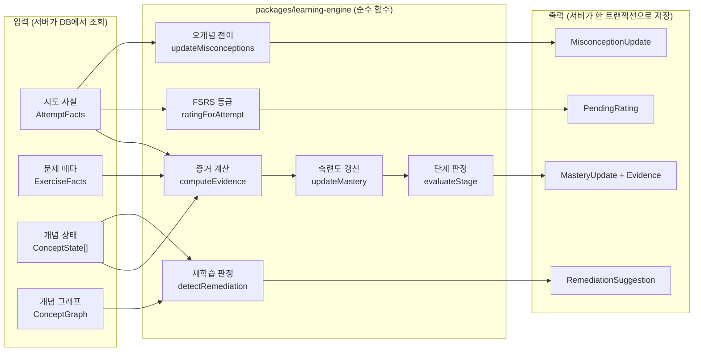
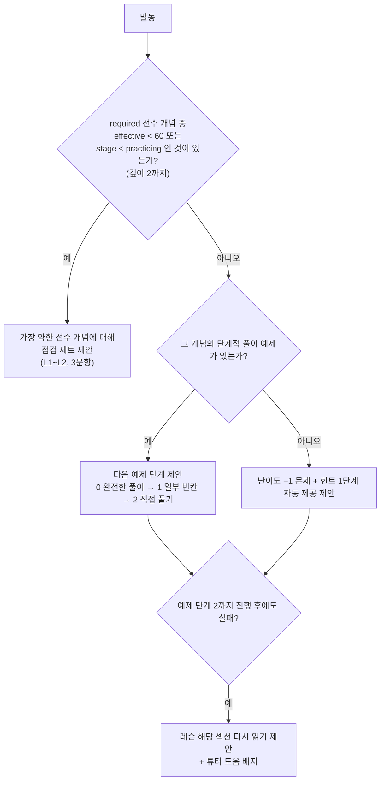
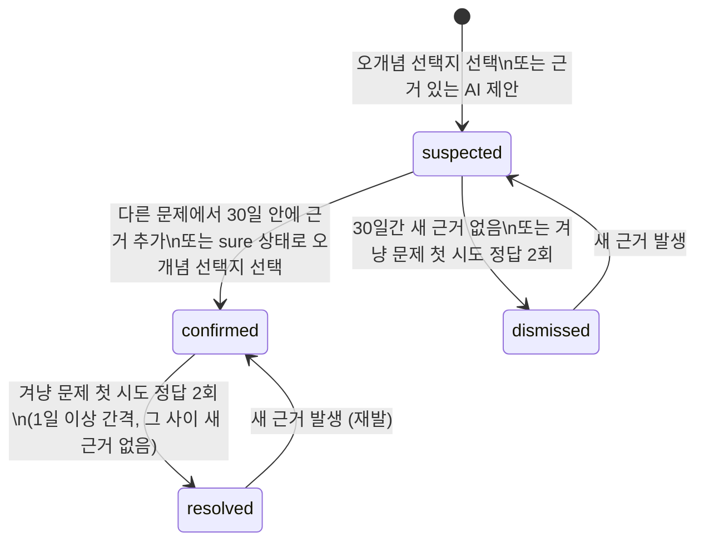

# 학습 엔진 설계

`packages/learning-engine`의 설계입니다. 숙련도 계산, 개념 단위 간격 반복(FSRS), 연습 세트 구성, 재학습 규칙, 오개념 상태 전이, 오늘의 학습과 목표 페이스 계산을 정의합니다.
모든 기능은 I/O가 없는 순수 함수이며, 모든 판단은 근거와 함께 기록되어 학습자에게 설명할 수 있어야 합니다.

- 상태: 승인됨 (2026-11-14)
- 작성: ProgInOne 팀
- 최종 수정: 2026-11-15
- 관련 문서: [PRD](/docs/product/prd.md), [결정 기록](/docs/decisions.md), [용어집](/docs/glossary.md), [시스템 아키텍처 설계](/docs/design/system-architecture.md), [데이터 모델 설계](/docs/design/data-model.md), [콘텐츠·문제 시스템 설계](/docs/design/content-and-exercises.md), [UI/UX 설계](/docs/design/ui-ux.md)

## 배경과 범위

ProgInOne의 핵심 철학은 "학습 상태와 교육 과정의 관리 책임은 애플리케이션이 진다"입니다([PRD](/docs/product/prd.md#핵심-철학)).
학습 엔진은 그 책임을 실제로 수행하는 모듈입니다.
AI는 학습 엔진의 결정을 설명하거나 제안할 수 있지만, 진도·숙련도·복습 일정·재학습 경로를 결정하지 않습니다.

이 문서가 다루는 범위:

- 시도(`Attempt`)에서 숙련도(`mastery`)와 숙련 단계(`MasteryStage`)를 계산하는 공식
- 개념 단위 FSRS 적용 방식과 시도 → 평가 등급 매핑
- 연습 세트(단원, 복습, 약점 집중, 단원 평가, 재학습) 구성과 문제 선택
- 재학습 규칙과 오개념 상태 전이
- 오늘의 학습(`DailyPlan`) 구성, 목표 페이스 계산, 학습 시간 측정 규칙
- 공개 API(TypeScript 시그니처)와 테스트 시나리오

이 문서가 다루지 않는 범위:

- 테이블 구조: [데이터 모델 설계](/docs/design/data-model.md)
- 문제 유형별 채점 방법과 `score` 산출: [콘텐츠·문제 시스템 설계](/docs/design/content-and-exercises.md)
- AI가 학습 엔진 결과를 설명하는 방식: [AI 시스템 설계](/docs/design/ai-system.md)
- 화면 표현: [UI/UX 설계](/docs/design/ui-ux.md)

## 목표와 비목표

### 학습 엔진 목표

- **설명 가능성**: 모든 숙련도 변화와 추천에는 사람이 읽을 수 있는 근거가 있어야 합니다. 학습자는 "왜 이 개념이 72점인지", "왜 오늘 이 개념을 복습하는지" 볼 수 있어야 합니다.
- **맞혔다고 이해한 것은 아님**: 정답률 하나로 숙달을 판정하지 않습니다. 난이도, 유형, 힌트, 확신도, 시간 간격을 둔 복습을 함께 봅니다([PRD 제품 원칙](/docs/product/prd.md#제품-원칙)).
- **결정론**: 같은 입력에는 같은 출력을 냅니다. 무작위 요소는 시드를 입력으로 받습니다. 그래야 재계산과 테스트가 가능합니다.
- **재계산 가능성**: 원본 이벤트(`attempts`, `hint_events`)를 시간순으로 재생하면 파생 상태를 다시 만들 수 있습니다([데이터 모델 설계](/docs/design/data-model.md#재계산)).
- **조정 가능성**: 모든 계수는 하나의 설정 객체(`EngineConfig`)에 모여 있고 버전이 붙습니다.
- **부담 없는 복습**: 복습량이 학습 의욕을 꺾지 않도록 일일 예산 안에서 우선순위를 정합니다.

### 학습 엔진 비목표

- **통계적으로 학습된 지식 추적 모델**(BKT, IRT, DKT): 단일 사용자 데이터로는 파라미터를 추정할 수 없습니다. [검토한 대안](#검토한-대안) 참고.
- **문제 단위 간격 반복**: 같은 문제를 반복하면 답을 외우게 됩니다. 간격 반복은 개념 단위로 하고, 매번 다른 문제를 냅니다([D-009](/docs/decisions.md)).
- **학습 잠금**: 숙련도가 낮아도 다음 단원을 막지 않습니다. 경고와 제안만 합니다(FR-CUR-05).
- **AI 기반 판단**: 학습 엔진 안에서 AI를 호출하지 않습니다.
- **FSRS 파라미터 개인 최적화**(MVP): 기본 파라미터로 시작합니다. 최적화는 [미결 사항](#미결-사항)에서 다룹니다.

## 설계

### 개요



엔진은 세 묶음의 함수를 제공합니다.

1. **이벤트 반영**: 시도 하나를 받아 숙련도·FSRS·오개념·재학습 결과를 계산합니다(`applyAttempt`).
1. **세트 구성**: 연습 세트를 만들고, 진행 중에 다음 항목을 조정합니다(`buildPracticeSet`, `nextAdaptiveStep`).
1. **계획**: 복습 큐, 오늘의 학습, 목표 페이스를 계산합니다(`buildReviewQueue`, `buildDailyPlan`, `computePace`).

서버 서비스 계층은 DB에서 입력을 조회하고, 엔진 함수를 호출하고, 결과를 한 트랜잭션으로 저장합니다([데이터 모델 설계](/docs/design/data-model.md#트랜잭션-경계)).

### 숙련도 모델

#### 두 가지 상태 축

| 축 | 질문 | 저장 위치 | 계산 |
|---|---|---|---|
| 숙련도 `score` (0~100) | 얼마나 잘 아는가 | `concept_mastery.score` | 시도 증거의 가중 지수 이동 평균 |
| 기억 상태 | 지금 얼마나 기억하고 있고, 언제 복습할까 | `concept_memory` (FSRS 카드) | FSRS |

두 축은 서로 다른 질문에 답하므로 계산을 섞지 않습니다.
숙련도 모델은 FSRS 카드를 바꾸지 않고, FSRS는 `score`를 바꾸지 않습니다.
세 번째 구성 요소인 **추천**(연습 세트 구성, 복습 큐, 오늘의 학습)은 두 축을 읽기만 합니다.
그래서 FSRS 설정이나 버전을 바꿔도 숙련도 모델은 영향을 받지 않습니다.
두 축이 만나는 곳은 표시용 유효 숙련도와 `mastered` 게이트(복습 성공 조건) 두 군데뿐입니다.

두 축은 화면에서 **유효 숙련도** 로 합쳐 보여줍니다.
`score`는 학습자가 도달한 이해 수준이고, 유효 숙련도는 오늘 시점에 망각을 반영한 값입니다.

#### 관측값

시도 하나의 관측값 `o`(0~1)는 채점 결과에서 얻습니다.

| `outcome` | `o` |
|---|---|
| `correct` | 1 |
| `partial` | `attempt.score` (0~1, 채점기가 산출) |
| `incorrect` | 0 |
| `error` (학습자 코드의 런타임 오류, 시간 초과 `timeout`, 루프 한도 `loop_limit`) | 0 |

- 샌드박스 자체 문제로 실행이 끝나지 못한 경우(`RunResult.status`가 `crashed` 또는 `aborted`)는 시도로 기록하되 `engine_applied = 0`으로 두고 **숙련도·FSRS에 반영하지 않습니다**. 학습자 책임이 아닌 실패이기 때문입니다([코드 실행 샌드박스 설계](/docs/design/code-execution-sandbox.md)).

#### 증거 가중치

시도 하나가 개념 `c`에 주는 증거 가중치 `w`는 요소의 곱입니다.

```text
w = W_concept × W_type × W_diff × W_try × W_hint × W_conf × W_time × W_rep × W_ctx
```

모든 요소는 `EngineConfig`에 있으며, 아래는 초기값입니다.

**W_concept: 개념 태깅 가중치** (`exercise_concepts.weight`)

| 태깅 | 값 |
|---|---|
| 주 개념 (`is_primary`) | 1.0 |
| 부 개념 | 콘텐츠가 정한 0.3~0.5 |

**W_type: 문제 유형 범주**

| 범주 | 유형 예시 | 값 | 이유 |
|---|---|---|---|
| 재인(recognition) | `mcq_single`, `mcq_multi`, `matching`, `find_false_statement` | 0.7 | 찍어서 맞힐 수 있고, 알아보는 것과 떠올리는 것은 다름 |
| 재인(recognition), 이지선다 | `true_false` | 0.5 | 추측 정답 확률이 50%라 신호가 가장 약함 |
| 회상·이해(recall) | `fill_blank`, `predict_output`, `parsons`, `find_bug_line`, `trace_variables`, `order_execution`, `explain_code` | 1.0 | 기준 |
| 생성(production) | `implement_function`, `fix_bug`, `web_task`, `refactor` | 1.3 | 실제로 코드를 만드는 능력의 직접 증거 |

유형 → 범주 매핑은 `exercise-kit`의 유형 정의(`ExerciseTypeDef.category`, [콘텐츠·문제 시스템 설계](/docs/design/content-and-exercises.md#문제-유형-레지스트리))가 원천이며, 위 표는 그 값을 옮긴 것입니다. `true_false`의 0.5는 범주 기본값을 유형별로 덮어쓴 값(`ExerciseTypeDef.weightOverride`)입니다.

레슨 본문의 `RunnableExample` 예측(예측 후 실행)은 숙련도 증거로 쓰지 않습니다. 본문의 `InlineExercise`는 일반 문제와 같은 증거로 반영합니다(`setKind` 없음. `W_try`의 시도 번호는 연습 세트 밖에서 같은 문제를 푼 횟수로 셉니다). 다만 설명을 읽은 직후의 확인이라 간격 반복 인출이 아니므로 FSRS 평가는 만들지 않습니다.

**W_diff: 난이도**

| 난이도 | L1 | L2 | L3 | L4 | L5 |
|---|---|---|---|---|---|
| 값 | 0.6 | 0.8 | 1.0 | 1.2 | 1.4 |

**W_try, W_hint, W_conf: 정답일 때와 오답일 때 다르게 적용**

정답의 신뢰도를 깎는 요소(힌트, 재시도, 찍음)는 정답 증거를 약하게 만듭니다.
오답은 대부분 그대로 강한 증거이지만, 확신했는데 틀린 경우는 더 강한 신호로 다룹니다.

| 요소 | 조건 | 정답(`o ≥ 0.5`)일 때 | 오답(`o < 0.5`)일 때 |
|---|---|---|---|
| `W_try` (같은 세트 항목 안 시도 번호) | 1번째 | 1.0 | 1.0 |
| | 2번째 | 0.7 | 0.6 |
| | 3번째 이상 | 0.5 | 0.4 |
| `W_hint` (시도 전 최고 힌트 단계) | 0 | 1.0 | 1.0 |
| | 1 | 0.8 | 1.0 |
| | 2 | 0.55 | 1.0 |
| | 3 | 0.3 | 1.0 |
| | 정답 열람 후 | 0.1 | 0.5 |
| | 튜터 대화 후(`tutor_assisted`) | × 0.8 추가 | 1.0 |
| `W_conf` (확신도) | `sure` | 1.0 | 1.2 |
| | `unsure` | 0.85 | 1.0 |
| | `guess` | 0.5 | 0.7 |
| | 입력 안 함 (중립: 설정에서 끔, 또는 실습 문제의 두 번째 이후 제출) | 0.9 | 1.0 |

- 오답에서 재시도 가중치를 낮추는 이유: 같은 문제의 반복 오답은 독립적인 증거가 아닙니다. 첫 오답이 이미 정보를 반영했습니다.
- 정답 열람 후 오답 가중치 0.5: 정답을 보고도 틀렸다면 의미 있는 신호이지만, 조작 실수일 가능성도 큽니다.

**W_time: 풀이 시간** (생성 범주에만 적용)

| 조건 | 값 |
|---|---|
| `active_ms ≤ 3 × estimated_seconds` | 1.0 |
| 그 이상 | 0.85 (정답일 때만) |

풀이가 빠르다고 가산하지 않습니다. 빠른 정답이 숙달을 뜻하는지, 우연인지 구분할 수 없기 때문입니다.

**W_rep: 변형 그룹 반복 감쇠** (정답일 때만 적용)

`console.log("5" + 2)`와 `console.log("7" + 3)`은 값만 다른 같은 문제입니다.
같은 변형 그룹의 정답을 독립 증거로 세면 숙련도가 부풀려집니다.

- **변형 그룹 키**: 문제의 `variant_group`. 없으면 템플릿 변형은 템플릿 ID, 그 외 문제는 문제 ID입니다.
- 이 개념에 대해 최근 14일 안에 같은 그룹 키로 낸 정답 증거 수를 `k`라고 합니다(이번 시도 제외).

| `k` | 0 | 1 | 2 이상 |
|---|---|---|---|
| `W_rep` | 1.0 | 0.5 | 0.25 |

- 오답에는 적용하지 않습니다(`W_rep = 1.0`). 같은 유형을 또 틀렸다면 그 자체가 정보입니다.
- 14일이 지나면 다시 1.0입니다. 시간 간격을 둔 같은 형태의 정답은 기억 유지의 증거이기 때문입니다.
- 단계 게이트의 "서로 다른 변형 그룹" 조건은 이 그룹 키로 셉니다.

**W_ctx: 학습 맥락** (PRD [학습 맥락별 규칙](/docs/product/prd.md#학습-맥락별-규칙))

| 맥락 (세트 종류) | 정답 | 오답 | 이유 |
|---|---|---|---|
| 평가 (`assessment`) | 1.2 | 1.0 | 힌트·튜터 없이 처음 보는 문제를 푼 독립 증거 |
| 그 외 (`lesson`, `review`, `weakness`, `remedial`, `extra`, `custom`) | 1.0 | 1.0 | 기본 |

평가 맥락의 정답은 단계 게이트에서 **독립 정답 증거** 로 따로 셉니다([숙련 단계와 게이트](#숙련-단계와-게이트)).

#### 숙련도 갱신 공식

가중 지수 이동 평균을 씁니다.

```text
target   = 100 × o
step     = min(α × w, STEP_MAX)
score'   = score + step × (target − score)
```

| 상수 | 초기값 | 의미 |
|---|---|---|
| `α` | 0.25 | 기본 학습률 |
| `STEP_MAX` | 0.5 | 한 시도가 움직일 수 있는 최대 비율 |

- 정답이면 100 쪽으로, 오답이면 0 쪽으로 움직입니다. 가중치가 클수록 크게 움직입니다.
- 최근 시도일수록 영향이 크고(지수 이동 평균의 성질), 오래된 시도의 영향은 점점 줄어듭니다. 이것이 "최근성" 반영입니다.
- `w = 1`인 정답이 연속되면 `score = 100 × (1 − 0.75ⁿ)`입니다: 3회 58, 5회 76, 8회 90.

#### 숙련도 계산 예시

개념 `js.fn.arrow-this`, 시작 `score = 0`.

| # | 시도 | `w` 계산 | `step` | `score` 변화 |
|---|---|---|---|---|
| 1 | L1 `mcq_single`, 정답, 첫 시도, 힌트 없음, `sure` | 1.0 × 0.7 × 0.6 × 1 × 1 × 1.0 = 0.42 | 0.105 | 0 → 10.5 |
| 2 | L2 `predict_output`, 정답, 첫 시도, `unsure` | 1.0 × 1.0 × 0.8 × 1 × 1 × 0.85 = 0.68 | 0.17 | 10.5 → 25.7 |
| 3 | L3 `predict_output`, 오답, `sure` (오개념 선택) | 1.0 × 1.0 × 1.0 × 1 × 1 × 1.2 = 1.2 | 0.30 | 25.7 → 18.0 |
| 4 | 같은 문제 2번째 시도, 힌트 1, 정답, `unsure` | 1.0 × 1.0 × 1.0 × 0.7 × 0.8 × 0.85 = 0.476 | 0.119 | 18.0 → 27.8 |
| 5 | L3 `fix_bug`, 정답, 첫 시도, `sure` | 1.0 × 1.3 × 1.0 × 1 × 1 × 1.0 = 1.3 | 0.325 | 27.8 → 51.3 |
| 6 | L2 부 개념 태깅 문제(weight 0.4), 정답 | 0.4 × 1.0 × 0.8 × 1 × 1 × 1.0 = 0.32 | 0.08 | 51.3 → 55.2 |

3번 시도는 "확신했는데 틀림"이므로 숙련도를 크게 낮추고, 동시에 오개념 관측을 만듭니다([오개념 상태 전이](#오개념-상태-전이)).

#### 유효 숙련도 (망각 반영)

`score`는 시도가 있을 때만 바뀝니다. 오래 복습하지 않으면 실제 기억은 줄어듭니다.
화면에 보여줄 때는 FSRS 회상 확률 `R`(지금 기억해낼 확률)로 보정합니다.

```text
decay         = clamp(0.6 + 0.4 × R / desiredRetention, 0.6, 1.0)
effective     = score × decay
```

| `R` (desiredRetention 0.9 기준) | `decay` |
|---|---|
| 0.9 이상 | 1.0 |
| 0.72 | 0.92 |
| 0.45 | 0.8 |
| 0 | 0.6 |

- 하한 0.6: 오래 쉬었어도 한 번 숙련한 개념은 처음보다 빨리 회복됩니다. 0까지 떨어뜨리지 않습니다.
- FSRS 카드가 아직 없는 개념(`not_started`, `introduced`)은 `decay = 1`입니다.
- 유효 숙련도는 **조회 시 계산** 하고 저장하지 않습니다. 저장값 `score`는 시도로만 바뀝니다.

#### 숙련 단계와 게이트

단계는 점수 구간만으로 정하지 않습니다. 각 단계에 "다양성"과 "시간" 게이트가 있습니다(FR-LRN-03).

| 단계 | 진입 조건 (모두 만족) |
|---|---|
| `not_started` | 기본값 |
| `introduced` | 이 개념을 소개하는 단원(`lesson_concepts.role = 'introduces'`)의 본문을 끝까지 읽었거나, 이 개념의 시도가 1건 이상 |
| `practicing` | 이 개념의 시도 증거 가중치 합 `evidence_weight_sum ≥ 1.0` |
| `proficient` | `effective ≥ 70` · **서로 다른 유형 2개 이상**에서 정답 증거(정답이면서 `W_hint × W_conf × W_try ≥ 0.5`) · 정답 증거의 **서로 다른 변형 그룹 3개 이상** · **L3 이상** 정답 증거 1건 이상 · `evidence_weight_sum ≥ 3.0` |
| `mastered` | `proficient` 조건 유지 · `effective ≥ 85` · **기억 유지**: 이 개념의 FSRS 평가 중 이전 평가로부터 **7일 이상** 지난 시점의 `good`/`easy` 평가 2건 이상, 두 평가의 근거 시도는 서로 다른 변형 그룹 · **독립 응용**: 평가 맥락 정답 또는 L4 이상 정답 중 힌트 없음·첫 시도인 증거 1건 이상 · 최근 FSRS 평가 3건에 `again` 없음 |

`mastered` 게이트가 이렇게 엄격한 이유는, 이 단계가 "몇 주 뒤에도 처음 보는 형태의 문제를 혼자 푼다"는 뜻이어야 하기 때문입니다.
같은 날의 반복이나 같은 형태의 문제로는 도달할 수 없고, 빨라도 첫 학습 후 약 3주가 걸립니다.

**강등 규칙**(진동 방지 히스테리시스):

- 시도 결과로 `effective`가 해당 단계 진입 기준보다 10점 낮아지면 한 단계 내립니다(`proficient`는 60 미만, `mastered`는 75 미만).
- `mastered`에서 FSRS `again`이 나오면 즉시 `proficient`로 내립니다.
- **시간 경과만으로는 단계를 내리지 않습니다.** 대신 `R < 0.8`이면 "복습 필요" 표시를 붙입니다. 쉬었다는 이유로 성취가 사라지는 경험은 학습 의욕을 해칩니다.

단계 변화는 `mastery_evidence.kind = 'stage_gate'`로 남기고, 어떤 게이트를 충족했거나 못 했는지 `breakdown_json`에 기록합니다.

#### 여러 개념에 태깅된 문제의 증거 분배

- 문제의 주 개념에는 `W_concept = 1.0`, 부 개념에는 태깅 가중치를 적용해 **각 개념에 독립적으로** 위 공식을 적용합니다.
- 다양성 게이트("서로 다른 유형", "L3 이상")는 **주 개념 증거만** 셉니다. 부 개념으로 태깅된 문제만으로 숙련 판정을 받지 않게 하기 위함입니다.
- 오답일 때 부 개념의 하락: 오답 원인이 주 개념일 가능성이 높으므로, 부 개념에는 오답 가중치를 추가로 0.5배 합니다. 단, 학습자가 고른 오답 선택지가 부 개념의 오개념을 가리키면 감소 없이 적용합니다.
- FSRS 평가는 주 개념에만 반영합니다([개념 단위 FSRS](#개념-단위-fsrs)).

### 개념 단위 FSRS

#### 라이브러리와 버전

- `ts-fsrs` v6을 씁니다(MIT). v6은 FSRS-3~7을 지원하고, `DefaultScheduler()`는 버전을 지정하지 않으면 **FSRS-7** 을 씁니다.
- `ts-fsrs` v6은 **Node.js ≥ 24** 를 요구합니다. 서버 런타임은 Node.js 24 LTS 이상으로 고정합니다([시스템 아키텍처 설계](/docs/design/system-architecture.md#빌드와-개발-환경)).
- 라이브러리 API를 엔진 전체에 퍼뜨리지 않고 `fsrs-adapter.ts` 한 파일에 가둡니다. 엔진의 다른 코드는 아래 `FsrsPort` 인터페이스만 압니다.

```ts
/** 엔진이 FSRS에 기대하는 최소 기능. ts-fsrs 어댑터가 구현한다. */
export interface FsrsPort {
  readonly modelVersion: string                    // 예: 'FSRS-7'
  newCard(now: number): FsrsCard
  review(card: FsrsCard, rating: FsrsRating, now: number): { card: FsrsCard; log: FsrsLog }
  retrievability(card: FsrsCard, now: number): number   // 0~1
}

export type FsrsRating = 'again' | 'hard' | 'good' | 'easy'
export type FsrsCard = { readonly raw: unknown; due: number; stability: number; difficulty: number; state: 'new' | 'learning' | 'review' | 'relearning'; lastReviewAt: number | null; reps: number; lapses: number }
```

- `DefaultScheduler()` 생성은 비동기이므로 서버 시작 시 한 번 만들어 `FsrsPort`로 엔진에 주입합니다. 주입받은 포트는 결정론적 함수이므로 엔진의 순수성은 유지됩니다.
- `retrievability`는 `scheduler.model.forgettingCurve(memoryState, elapsedDays)`를 감쌉니다. 경과 일수는 FSRS-7이 소수 일수를 유지하므로 `(now − lastReviewAt) / 86_400_000`로 계산합니다.
- 카드 원형(`raw`)은 `concept_memory.card_json`에 직렬화합니다([데이터 모델 설계](/docs/design/data-model.md#concept_memory-review_logs)).

#### 스케줄러 설정

| 설정 | 값 | 근거 |
|---|---|---|
| `version` | `'FSRS-7'` (명시) | 라이브러리 기본값이 바뀌어도 모델이 조용히 바뀌지 않게 고정 |
| `desiredRetention` | **0.9** | FSRS 공식 예제와 Anki 기본값. 높이면 복습량이 급증하고, PRD 성공 지표(복습 시점 정답률 75~90%)와 일치 |
| `maximumInterval` | **365일** | 프로그래밍 개념은 1년에 한 번은 확인할 가치가 있음. 복습 1회 부담이 작음 |
| `enableFuzz` | `true` | 같은 날 배운 개념들의 복습일이 한날에 몰리지 않도록 분산 |
| `enableShortTerm` | `false` | 분 단위 학습 단계(`1m`, `10m`)는 카드 앱용. 우리는 같은 날 반복을 연습 세트가 담당 |
| `weights` | 모델 기본 프리셋 | 개인 최적화는 데이터가 쌓인 뒤 |

설정은 `EngineConfig.fsrs`에 두고, 설정이 바뀌면 `ENGINE_VERSION`을 올립니다.

#### 카드 생성 시점

- 개념의 **첫 단원 연습 세트가 끝날 때**, 그 세트에 주 개념으로 등장한 개념마다 카드를 만들고 첫 평가를 적용합니다.
- 레슨만 읽고 문제를 풀지 않은 개념은 카드를 만들지 않습니다. 근거 없는 복습 일정을 만들지 않기 위함입니다.
- 진단 평가(P1)로 시드한 개념은 진단 결과로 첫 평가를 적용합니다.

#### 시도 → 평가 등급 매핑

시도 하나의 등급(주 개념 기준):

| 등급 | 조건 (위에서부터 먼저 맞는 것) |
|---|---|
| `again` | `o < 0.5`, 또는 정답 열람 후 정답, 또는 힌트 3단계 후 정답 |
| `hard` | 정답이지만 다음 중 하나: 힌트 1~2단계 사용, 같은 항목 2번째 이상 시도, `guess`, `0.5 ≤ o < 1` (부분 정답), 튜터 도움 후 |
| `easy` | 첫 시도·힌트 없음·`sure` · 난이도 ≥ 3 · `active_ms ≤ estimated_seconds` |
| `good` | 그 외 정답 |

#### 평가 적용 단위: "개념당 하루 한 번"

한 연습 세트 안에서 한 개념의 문제를 여러 개 풀 수 있습니다. 시도마다 FSRS를 적용하면 같은 날의 반복이 안정성(stability)을 부풀립니다.

- 시도마다 등급을 계산해 **보류 등급(`PendingRating`)** 으로 모읍니다.
- 연습 세트가 끝나거나, 세트 안에서 그 개념의 마지막 항목을 끝냈을 때 보류 등급을 하나로 합쳐 FSRS에 적용합니다.
    - 하나라도 `again`이면 `again`
    - 아니면 하나라도 `hard`면 `hard`
    - 아니면 모두 `easy`일 때만 `easy`
    - 그 외 `good`
- **같은 로컬 날짜에 이미 평가가 적용된 개념** 은 추가 평가를 적용하지 않습니다. 단 합친 등급이 `again`이면 적용합니다(그날 다시 잊었다는 신호는 중요함).
- 복습 세트가 아닌 곳(단원 연습, 더 풀기)에서 만난 개념도 위 규칙으로 평가를 적용합니다. 예정일보다 일찍 본 경우 FSRS가 경과 일수로 처리합니다.
- 적용 결과는 `review_logs`에 남기고, 근거 시도 ID를 `source_attempt_ids_json`에 기록합니다.

### 연습 세트 구성

#### 공통 원칙

- **변형 그룹 중복 금지**: 같은 `variant_group`의 문제는 한 세트에 1개만 넣습니다.
- **유형 혼합**: 같은 유형이 3개 연속 나오지 않게 배치합니다.
- **난이도 상승**: 세트 안에서 대체로 쉬운 문제에서 어려운 문제로 갑니다. 단 복습 세트는 교차가 우선입니다.
- **결정론적 무작위**: 동점 처리와 섞기에는 시드 RNG(시드 = 연습 세트 ID)를 씁니다.
- **선택 이유 기록**: 각 항목에 `reason` 코드를 남깁니다([데이터 모델 설계](/docs/design/data-model.md#practice_sets-practice_set_items)).

#### 문제 후보와 점수

후보 집합: 대상 개념이 주 개념인 문제(사전 제작) + 템플릿 변형 + `auto_verified`·`trusted` 상태의 AI 생성 문제.

후보마다 선택 점수를 계산하고 높은 순으로 뽑습니다.

```text
selectScore = 3.0 × freshness
            + 2.0 × difficultyFit
            + 1.0 × typeNovelty
            + 2.0 × misconceptionTarget
            + 0.5 × originPreference
```

| 요소 | 계산 | 범위 |
|---|---|---|
| `freshness` | 본 적 없음 1.0 · 마지막으로 본 지 30일 이상 0.7 · 7~30일 0.4 · 7일 미만 0 (대체 후보가 없을 때만 허용) | 0~1 |
| `difficultyFit` | `1 − |difficulty − targetDifficulty| / 2`, 0 미만은 0 | 0~1 |
| `typeNovelty` | 이 개념에 대해 최근 3회와 다른 유형이면 1, 아니면 0 | 0 또는 1 |
| `misconceptionTarget` | 학습자의 활성 오개념을 겨냥하는 문제(`misconceptions.remedial_exercise_ids_json` 포함 또는 오답 선택지가 그 오개념을 가리킴)면 1 | 0 또는 1 |
| `originPreference` | `authored` 1.0 · `template` 0.8 · `generated` 0.5 | 0~1 |

같은 문제를 7일 안에 다시 내지 않습니다.
템플릿 변형은 매개변수가 다르면 출제상으로는 다른 문제지만, 증거로는 같은 변형 그룹입니다([W_rep](#증거-가중치)).
그래서 `freshness`는 문제가 아니라 **변형 그룹** 기준으로 계산합니다. 같은 그룹의 다른 변형을 7일 안에 낸 경우도 0입니다.

#### 목표 난이도

개념별 목표 난이도:

```text
targetDifficulty = clamp(maxDifficultyCorrect + adjust, 1, 5)
```

| 상황 | `adjust` |
|---|---|
| 개념 첫 연습 | `maxDifficultyCorrect = 0`으로 보고 +1 → L1 |
| 최근 2개 시도가 첫 시도 정답·힌트 없음 | +1 |
| 최근 2개 시도가 오답 | −1 |
| 그 외 | 0 |

#### 단원 연습 세트

단원의 `importance`에 따라 첫 세트 크기를 정합니다. "더 풀기"로 추가 세트를 계속 만들 수 있습니다.

| `importance` | 첫 세트 문제 수 |
|---|---|
| `minor` | 8 |
| `standard` | 14 |
| `core` | 22 |

구성 절차:

1. 단원이 소개하는 개념(`role = 'introduces'`) 목록과 각 개념의 `importance`를 얻습니다.
1. 개념별 몫을 정합니다: 각 개념 최소 3문항(후보가 부족하면 가능한 만큼), 남은 자리는 개념 `importance`(`minor` 1, `standard` 2, `core` 3) 비율로 나눕니다.
1. 난이도 구간에 맞춰 개념별로 후보를 고릅니다.
    - 워밍업 L1~L2: 30%
    - 핵심 L2~L3: 50%
    - 도전 L3~L4: 20%
1. 생성 범주 문제가 후보에 있으면 세트에 최소 1개 포함합니다(코드를 직접 쓰는 경험).
1. 단원이 복습하는 개념(`role = 'reviews'`)이 있으면, 그 개념의 유효 숙련도가 70 미만일 때 1문항씩 섞습니다(교차 연습).
1. 난이도 순으로 정렬한 뒤, 같은 유형 3연속이 생기면 인접한 같은 구간 항목과 자리를 바꿉니다.

**통과 기준**(`pass_rule_json`, `PassRule`):

| 필드 | 기본값 | 판정 |
|---|---|---|
| (항상) | | 모든 항목에 답했거나 건너뜀 |
| `minCorrect` | 0.7 | 세트 신용 정답률(항목별 `o × W_hint × W_try`의 평균) 이상 |
| `minConceptScore` | 50 | 단원이 소개하는 모든 개념의 `score`가 이 값 이상 |
| `minDistinctTypes` | 2 | 정답을 낸 서로 다른 문제 유형 수 이상 |
| `minLevel3Correct` | 0 (`core` 단원은 1) | L3 이상 문제의 첫 시도 정답 수 이상 |

콘텐츠는 단원의 `lesson.yaml`의 `practice.passRule`로 필드 일부를 덮어쓸 수 있습니다([콘텐츠·문제 시스템 설계](/docs/design/content-and-exercises.md#lessonyaml)). 덮어쓰지 않은 필드는 기본값을 씁니다.

통과하면 `lesson_progress.status = 'completed'`. 통과하지 못해도 다음 단원을 막지 않고, 약점 집중 세트를 제안합니다.

#### 진행 중 적응 (`nextAdaptiveStep`)

항목마다 답이 확정되면 다음을 판정합니다.

| 조건 | 동작 |
|---|---|
| 같은 개념에서 첫 시도·힌트 없음 정답 2연속 | 그 개념의 남은 워밍업 항목 1개를 한 단계 높은 문제로 교체 (`difficulty_step_up`) |
| 같은 개념에서 오답 2연속 | [재학습 규칙](#재학습-규칙) 실행. 제안이 나오면 세트에 재학습 항목 삽입 (`remedial_*`) |
| 학습자가 정답을 열람함 | 같은 `variant_group`의 다른 변형(없으면 같은 개념·같은 유형의 다른 문제)을 세트 끝에 1개 추가 (`solution_followup`). UI의 "비슷한 문제로 다시 나와요" 안내의 근거 |
| 학습자가 항목을 건너뜀 | 같은 개념·같은 난이도의 다른 유형 문제로 교체할지 묻지 않고, 세트 끝에 1개 추가 |

교체·삽입은 항상 세트 뒤쪽에 이어 붙이고 이미 본 항목은 바꾸지 않습니다.

#### 복습 세트

**복습 큐**:

```text
due      = concept_memory.due_at ≤ 오늘 하루 끝 시각, suspended = 0
priority = overdueRatio × importanceFactor × (1 + 0.5 × activeMisconceptions)
overdueRatio     = (now − lastReviewAt) / max(scheduledInterval, 1일)
importanceFactor = 1.3 (core) · 1.0 (standard) · 0.8 (minor)
```

우선순위 순으로 정렬하고, 일일 복습 예산(오늘의 학습의 복습 시간 배분과 개념 수 상한 `maxDailyReviews`, 기본 20개 중 먼저 닿는 쪽)을 넘는 개념은 다음 날로 넘깁니다(`concept_memory.due_at`은 그대로, 큐에만 "밀림"으로 표시).

**세트 구성**:

1. 개념마다 1문항, 마지막 평가가 `again`이거나 `effective < 60`이면 2문항.
1. 목표 난이도: `clamp(maxDifficultyCorrect, 2, 4)`. 너무 쉬운 문제로는 기억을 확인할 수 없고, 너무 어려운 문제는 복습 부담이 큽니다.
1. 유형: 그 개념의 마지막 복습과 다른 유형을 우선합니다(`typeNovelty`).
1. **교차 배치**: 같은 개념이 연속되지 않게, 같은 모듈 개념이 2개 넘게 연속되지 않게 섞습니다.
1. 문항당 예상 시간: 해당 문제의 `estimated_seconds`. 세트 크기는 예산 안에서 정합니다.

복습 세트에는 통과 기준이 없습니다. 결과는 각 개념의 FSRS 평가와 숙련도에 반영됩니다.

#### 약점 집중 세트

```text
weakness = (100 − effective) × importanceFactor
         × (1 + 0.5 × confirmedMisconceptions + 0.25 × suspectedMisconceptions)
         × (1 + 0.2 × min(consecutiveFailures, 3))
```

- 대상: `introduced` 이상 개념 중 `weakness` 상위 3~5개.
- 개념당 3~4문항. 첫 문항은 `maxDifficultyCorrect − 1`(최소 L1)로 시작해 정답이면 한 단계씩 올립니다.
- 확정된 오개념이 있으면 그 오개념을 겨냥하는 문제를 첫 두 문항 안에 넣습니다.

#### 단원 평가 세트

- 문항 목록은 `assessments.exercise_ids_json` 또는 `selection_rule_json`으로 정합니다.
- 평가 중에는 힌트, 튜터, 정답 보기를 잠급니다. 각 문항은 한 번만 제출하고, 정답과 해설은 평가가 끝난 뒤 한꺼번에 공개합니다. 이 규칙을 시작 화면에 안내합니다.
- 확신도 입력은 그대로 받습니다(메타인지 보정에 중요).
- 통과 기준은 `assessments.pass_ratio`(기본 0.8)입니다.
- 평가 결과는 `W_ctx`(정답 1.2)를 적용해 숙련도에 반영하고, 정답은 `mastered` 게이트의 독립 응용 증거가 됩니다. FSRS 평가는 일반 규칙을 따릅니다.
- 평가에서 틀린 개념은 평가 종료 화면에서 약점 집중 세트를 제안합니다.

#### 자유 연습 세트 (P1)

학습자가 개념(복수), 난이도 구간, 문제 유형, 문제 수(5~30)를 골라 만드는 세트입니다(PRD FR-EX-16).

- 후보 선택은 [문제 후보와 점수](#문제-후보와-점수)를 따르되, `difficultyFit`은 학습자가 고른 난이도 구간 안에서만 계산합니다.
- 고른 조건의 후보가 부족하면 템플릿 변형으로 채우고, 그래도 부족하면 가능한 수와 함께 AI 생성(P1, FR-EX-12)을 제안합니다.
- 숙련도·FSRS 반영은 기본 규칙(`W_ctx = 1.0`)을 따릅니다. `W_rep`가 그대로 적용되므로, 같은 조건으로 반복해도 숙련도가 부풀려지지 않습니다.

### 재학습 규칙

FR-LRN-05의 규칙입니다. 결과는 **제안**(`RemediationSuggestion`)이며, 학습자는 거절할 수 있습니다.

**발동 조건** (하나라도 만족):

- 같은 연습 세트에서 같은 개념의 주 개념 문항 오답 2연속
- 최근 7일 동안 같은 개념의 `consecutive_failures ≥ 3`

`consecutive_failures`는 그 개념의 주 개념 문항에서 첫 시도·힌트 없음 정답이 나오면 0으로 초기화합니다.

**판정 절차**:



- 선수 개념 탐색은 `concept_prerequisites.strength = 'required'` 간선만 따라 깊이 2까지 넓이 우선으로 찾습니다. 같은 깊이에서는 `effective`가 낮은 개념을 고릅니다.
- 선수 개념 점검 세트를 통과하면(3문항 중 2개 이상 정답) 원래 개념으로 돌아가 단계적 풀이 예제부터 시작합니다.
- 튜터 배지는 제안일 뿐이며, 튜터 대화를 자동으로 열지 않습니다([D-010](/docs/decisions.md)).

### 오개념 상태 전이



- **근거** 는 해당 오개념을 가리키는 오답 선택지를 고른 시도, 또는 규칙 기반 패턴(예: `predict_output`에서 `"1" + 1`의 답으로 `2`를 쓴 경우처럼 문제에 정의된 오답 패턴)과 일치한 시도입니다.
- **AI 제안 오개념** (`source = 'ai'`)은 근거 시도 ID 없이 저장할 수 없습니다(FR-AI-09). AI 제안만으로는 `confirmed`가 되지 않고, 선택지·패턴 근거가 추가돼야 합니다.
- "겨냥 문제"는 `misconceptions.remedial_exercise_ids_json`의 문제 또는 오답 선택지가 그 오개념을 가리키는 문제입니다.
- 활성(`suspected`, `confirmed`) 오개념은 튜터 컨텍스트, 문제 선택 점수, 약점 점수에 반영됩니다.

### 오늘의 학습과 목표

#### 오늘의 학습 구성 (`buildDailyPlan`)

입력: 현재 목표, 오늘 이미 학습한 시간, 복습 큐, 진행 중 단원, 약점 개념, 페이스 상태.

```text
budget = max(goal.dailyMinutes − todayActiveMinutes, 10)
```

| 순서 | 블록 | 시간 배분 |
|---|---|---|
| 1 | 복습 | 예정 복습의 예상 시간, 최대 `budget × 0.5`. 밀린 복습이 3일 분량 이상이면 최대 `budget × 0.6` |
| 2 | 이어서 학습 | 진행 중 단원의 남은 읽기 시간 + 연습 예상 시간 |
| 3 | 새 단원 | 남은 예산이 10분 이상이고, 페이스가 `behind` 또는 `tight`이거나 진행 중 단원이 없을 때 다음 권장 단원 |
| 4 | 약점 집중 | 남은 예산이 8분 이상이고 `weakness` 상위 개념의 `effective < 60`일 때 |

- 각 블록에는 예상 시간과 선택 이유(`reason`)가 붙습니다. 예: "복습 6개 개념, 약 9분 — 3개는 예정일이 지났어요".
- 예산을 넘는 항목은 "시간이 남으면" 영역으로 보냅니다. 계획은 강제가 아니라 제안입니다.
- 오늘 목표를 이미 달성했으면 "추가 학습" 형태로 같은 구성을 보여줍니다.

#### 목표 페이스 계산 (`computePace`)

FR-GOAL-02. 목표 과정과 목표일이 있을 때만 계산합니다.

```text
remainingMinutes   = 목표 과정의 미완료 단원 estimated_minutes 합
                     + 진행 중 단원은 남은 비율만큼
studyDaysLeft      = 오늘(오늘 목표 미달성 시 포함)부터 목표일까지 날짜 수 × goal.weeklyDays / 7  (내림, 최소 1)
requiredPerDay     = remainingMinutes / studyDaysLeft
newLearningBudget  = goal.dailyMinutes × 0.6        (나머지 40%는 복습·약점에 쓰인다고 가정)
```

| 상태 | 조건 | 표시 |
|---|---|---|
| `on_track` | `requiredPerDay ≤ newLearningBudget × 0.85` | "이 페이스면 목표일 전에 끝나요" |
| `tight` | `≤ newLearningBudget × 1.0` | "빠듯해요" |
| `behind` | 그 이상 | "하루 목표를 X분으로 늘리거나, 목표일을 YYYY-MM-DD로 옮기면 맞출 수 있어요" |
| `overdue` | 목표일이 지남 | "목표일이 지났어요. 새 목표일을 정할까요?" |

- 제안 하루 목표: `ceil(requiredPerDay / 0.6 / 5) × 5`분(5분 단위).
- 제안 목표일: 현재 `newLearningBudget`로 계산한 완료 예상일.
- 단원의 `estimated_minutes`는 콘텐츠 기본값으로 시작합니다. 완료한 단원이 5개 이상이면 학습자의 실제 소요 시간 / 예상 시간 비율의 중앙값으로 보정합니다(0.5~2.0 범위로 제한).

#### 주간 달성과 연속 기록

- **학습한 날**: `daily_activity.active_ms ≥ 5분`.
- **목표 달성일**: `active_ms ≥ 그날 적용 목표의 dailyMinutes`.
- **주간 달성**: 그 주(월~일)의 학습한 날 수 ≥ `weeklyDays`.
- **연속 기록**: 연속 학습일이 아니라 **연속 주간 달성 주 수** 를 보여줍니다. 주 5일 목표에서 쉬는 날이 연속 기록을 끊지 않게 하기 위함입니다(FR-GOAL-04, 벌칙 없음).

### 학습 시간 측정

FR-GOAL-05: 비활성 2분 이상은 학습 시간에서 뺍니다.

- 클라이언트는 사용자 입력(키, 포인터 이동·클릭, 스크롤, 에디터 변경)마다 `lastInputAt`을 갱신하고, 30초마다 하트비트 `{ at, lastInputAt, visible, focused }`를 보냅니다.
- 서버의 `accumulateActiveTime`은 직전 하트비트와 현재 하트비트 사이 구간을 다음 규칙으로 셉니다.

```text
구간 [prev.at, cur.at]에서
  활동 끝 = min(cur.at, cur.lastInputAt + IDLE_THRESHOLD)
  active += max(0, 활동 끝 − max(prev.at, 직전 활동 시작))
  단, cur.visible = false 인 구간은 0
IDLE_THRESHOLD = 2분
```

- 읽기 모드에서도 같은 2분 기준을 씁니다. 스크롤·선택·마우스 이동이 입력으로 잡히므로 읽는 중에도 대체로 끊기지 않습니다. 실제 사용 데이터로 확인할 항목입니다([미결 사항](#미결-사항)).
- 하트비트가 90초 넘게 없으면 그 사이 구간은 0으로 봅니다(앱 종료·절전).
- 비활성 10분이면 학습 세션을 닫습니다(`end_reason = 'idle'`).
- 하루 경계는 학습자 시간대와 `day_start_hour`(기본 04:00)로 계산합니다. 경계를 걸친 구간은 나눠서 양쪽 날짜에 더합니다.
- 문제별 `active_ms`도 같은 규칙으로, 문제 화면이 활성인 구간만 셉니다.

### 설명 가능성

모든 숙련도 변화는 `mastery_evidence.breakdown_json`에 아래 형식으로 남깁니다.

```json
{
  "v": 1,
  "engineVersion": "1.0.0",
  "formula": "ewma-v1",
  "observation": { "outcome": "correct", "o": 1 },
  "factors": {
    "concept": { "value": 1.0, "why": "primary" },
    "type": { "value": 1.3, "why": "production:fix_bug" },
    "difficulty": { "value": 1.0, "why": "L3" },
    "try": { "value": 1.0, "why": "attempt 1" },
    "hint": { "value": 1.0, "why": "no hint" },
    "confidence": { "value": 1.0, "why": "sure" },
    "time": { "value": 1.0, "why": "within 3x estimate" }
  },
  "weight": 1.3,
  "step": 0.325,
  "scoreBefore": 27.8,
  "scoreAfter": 51.3,
  "gates": {
    "proficient": {
      "met": false,
      "missing": ["effective>=70 (now 51.3)", "evidenceWeightSum>=3.0 (now 2.9)"]
    }
  }
}
```

- UI는 이 구조를 문장으로 바꿉니다. 예: "L3 버그 수정 문제를 힌트 없이 확신을 갖고 풀어서 +23.5점. '숙련'까지: 점수 70점 이상, 추가 연습 약간".
- 엔진은 문장을 만들지 않습니다(표현은 UI 책임). 대신 `why` 코드와 `missing` 항목을 안정적인 형식으로 제공합니다.
- 연습 세트 항목의 `reason`, 복습 큐 우선순위 요소, 재학습 제안의 판정 경로, 오늘의 학습 블록의 선택 이유도 같은 방식으로 구조화된 근거를 반환합니다.

### 공개 API

```ts
// packages/learning-engine/src/index.ts (스케치)

export const ENGINE_VERSION = '1.0.0'
export const defaultEngineConfig: EngineConfig

export interface EngineDeps {
  config: EngineConfig
  fsrs: FsrsPort
}

// ── 이벤트 반영 ─────────────────────────────────────────────
export function applyAttempt(deps: EngineDeps, input: {
  attempt: AttemptFacts            // outcome, o, confidence, hintLevelMax, solutionViewed,
                                   // tutorAssisted, attemptInItem, activeMs, isReview,
                                   // selectedMisconceptionIds, matchedPatternIds, submittedAt
  exercise: ExerciseFacts          // id, type, category, difficulty, estimatedSeconds,
                                   // concepts: { conceptId, weight, isPrimary }[]
  concepts: ConceptState[]         // 태깅된 개념들의 현재 mastery·memory·오개념 상태
  graph: ConceptGraph              // 선수 관계 (재학습 판정용)
  setContext?: PracticeSetContext  // 같은 세트의 이전 항목 결과 (연속 실패 판정용)
  now: number
}): AttemptEffects

export interface AttemptEffects {
  mastery: MasteryUpdate[]               // 개념별 score/stage 변화
  evidence: MasteryEvidenceRecord[]      // 저장할 근거
  pendingRatings: PendingRating[]        // 세트 종료 시 FSRS에 합쳐 적용할 등급
  misconceptions: MisconceptionUpdate[]
  remediation: RemediationSuggestion | null
}

export function flushPendingRatings(deps: EngineDeps, input: {
  pending: PendingRating[]
  memories: ConceptMemoryState[]
  lastAppliedDates: Record<ConceptId, LocalDate>
  now: number
  dayBoundary: DayBoundary
}): { memoryUpdates: ConceptMemoryUpdate[]; reviewLogs: ReviewLogRecord[]; stageUpdates: MasteryUpdate[] }

export function effectiveMastery(deps: EngineDeps, state: ConceptState, now: number): {
  effective: number; decay: number; retrievability: number | null; needsReview: boolean
}

export function applyLessonRead(deps: EngineDeps, input: { lessonId: LessonId; concepts: ConceptState[]; now: number }): MasteryUpdate[]

// ── 세트 구성 ───────────────────────────────────────────────
export function buildPracticeSet(deps: EngineDeps, input: PracticeSetRequest & {
  candidates: ExerciseCandidate[]        // 서버가 대상 개념으로 미리 조회한 후보
  concepts: ConceptState[]
  stats: ExerciseStatsLookup
  seed: string
  now: number
}): { items: PlannedItem[]; passRule: PassRule | null; rationale: SetRationale }

export function nextAdaptiveStep(deps: EngineDeps, input: {
  set: PracticeSetSnapshot; lastAttempt: AttemptFacts; concepts: ConceptState[]
  candidates: ExerciseCandidate[]; graph: ConceptGraph; seed: string; now: number
}): AdaptiveAction[]                     // replace / append / suggestRemediation

export function evaluatePassRule(rule: PassRule, set: PracticeSetSnapshot, concepts: ConceptState[]): PassResult

// ── 계획 ───────────────────────────────────────────────────
export function buildReviewQueue(deps: EngineDeps, input: {
  memories: ConceptMemoryState[]; concepts: ConceptState[]; budgetMinutes: number; now: number; dayBoundary: DayBoundary
}): { due: ReviewQueueEntry[]; deferred: ReviewQueueEntry[] }

export function rankWeakConcepts(deps: EngineDeps, concepts: ConceptState[], now: number): WeakConceptEntry[]

export function computePace(deps: EngineDeps, input: {
  goal: Goal; remainingLessons: LessonEstimate[]; completedLessonTimings: LessonTiming[]; today: LocalDate
}): PaceResult | null

export function buildDailyPlan(deps: EngineDeps, input: {
  goal: Goal; todayActiveMs: number; reviewQueue: ReviewQueueEntry[]
  inProgressLessons: LessonEstimate[]; nextLesson: LessonEstimate | null
  weakConcepts: WeakConceptEntry[]; pace: PaceResult | null; now: number
}): DailyPlan

export function summarizeWeek(input: { days: DailyActivity[]; goals: GoalHistory; weekStart: LocalDate }): WeekSummary

// ── 시간 측정 ───────────────────────────────────────────────
export function accumulateActiveTime(config: EngineConfig, prev: Heartbeat | null, cur: Heartbeat, dayBoundary: DayBoundary): ActiveTimeDelta[]  // 날짜별 분할

// ── 재계산 ─────────────────────────────────────────────────
export function replay(deps: EngineDeps, events: Iterable<EngineEvent>): ReplayResult
```

구현 규칙:

- 모든 함수는 입력을 변경하지 않고 새 객체를 반환합니다.
- 시간은 `now` 인자로만 받습니다. `Date.now()`를 호출하지 않습니다(ESLint 규칙으로 금지).
- 무작위는 `seed`로 만든 RNG만 씁니다(`Math.random` 금지).
- 입력 타입은 `packages/shared`의 zod 스키마에서 파생합니다. 엔진은 입력을 다시 검증하지 않습니다(서버 경계에서 검증 완료).
- 계수를 바꾸면 `ENGINE_VERSION`을 올리고 `CHANGELOG.md`에 기록합니다. 저장된 결과에는 계산한 엔진 버전이 남습니다.

### 패키지 구조

```text
packages/learning-engine/src/
├── index.ts
├── config.ts               # EngineConfig, defaultEngineConfig, ENGINE_VERSION
├── mastery/
│   ├── evidence.ts         # computeEvidence (가중치 요소)
│   ├── update.ts           # updateMastery (EWMA)
│   ├── stage.ts            # evaluateStage (게이트, 강등)
│   └── effective.ts        # effectiveMastery (망각 보정)
├── memory/
│   ├── fsrs-port.ts        # FsrsPort 인터페이스
│   ├── fsrs-adapter.ts     # ts-fsrs 구현 (유일하게 ts-fsrs를 import)
│   ├── rating.ts           # ratingForAttempt, aggregateRatings
│   └── review-queue.ts
├── practice/
│   ├── candidates.ts       # selectScore
│   ├── lesson-set.ts
│   ├── review-set.ts
│   ├── weakness-set.ts
│   ├── assessment-set.ts
│   ├── adaptive.ts         # nextAdaptiveStep
│   └── pass-rule.ts
├── remediation/
│   └── detect.ts
├── misconception/
│   └── transitions.ts
├── planning/
│   ├── daily-plan.ts
│   ├── pace.ts
│   └── week.ts
├── time/
│   └── active-time.ts
├── replay.ts
└── util/ (rng.ts, dates.ts)
```

### 구현 메모 (v0.1)

v0.1(M4)에서 구현하면서 위 스케치를 구체화하거나 바꾼 점입니다. 계수는 바꾸지 않았습니다. 공개 API 목록은 [패키지 README](/packages/learning-engine/README.md)에 있습니다.

**범위**: 증거 가중치, 숙련도 갱신, 단계 게이트, FSRS 연동, 단원 연습 세트(통과 기준 포함), 복습 큐·복습 세트만 구현했습니다. 오개념 전이, 재학습 판정, 약점·평가·자유 연습 세트, 진행 중 적응(`nextAdaptiveStep`), 오늘의 학습, 페이스, 활동 시간, `replay`는 v0.2 이후입니다. 그래서 `AttemptEffects`에는 `misconceptions`, `remediation`이 아직 없습니다.

**게이트 입력**: 게이트와 `W_rep`는 과거 증거가 필요합니다. 엔진은 시도마다 `EvidenceFact`(변형 그룹 키, 유형, 난이도, 정답 여부, 신용도, 독립 여부, 세트 종류, 가중치)를 만들어 `breakdown_json.fact`에 담아 돌려줍니다. 서버는 저장된 `fact`를 `ConceptState.history`로, `review_logs`와 근거 시도의 변형 그룹 키를 `ConceptState.reviews`로 다시 넘깁니다. 시도 원본을 다시 읽지 않아도 게이트를 판정할 수 있습니다.

**명확히 한 규칙**:

| 항목 | 구현 |
|---|---|
| `W_rep`의 14일 | 경과 밀리초 기준. `now − at < 14일`인 정답(`o ≥ 0.5`)만 셉니다. 정확히 14일 전 정답은 세지 않습니다. 이 개념의 부 개념 증거도 셉니다 |
| `mastered`의 "7일 이상" | 학습자 **로컬 날짜** 차이(하루 시작 04:00 반영)로 셉니다. FSRS 예정일이 날짜 단위라 오전에 복습하면 24시간 × 7에 몇 시간 모자라는 문제를 피합니다 |
| "두 평가의 근거 시도는 서로 다른 변형 그룹" | 조건을 만족하는 평가가 2건 이상이고, 그 평가들의 근거 변형 그룹 합집합이 2개 이상이면 충족입니다(서로 다른 그룹으로 두 평가를 고를 수 있는 조건과 같음) |
| 독립 응용 증거 | 주 개념, 정답, 첫 시도, 힌트·정답 열람·튜터 없음, 그리고 평가 맥락 또는 L4 이상 |
| 강등 | `effective` 기준 강등은 **그 시도가 `score`를 낮췄을 때만** 합니다. 오래 쉬어 `effective`가 낮아진 상태에서 정답을 내도 강등되지 않습니다. 시도 없이 다시 판정할 때(FSRS 평가 뒤)는 승급만 합니다 |
| `missing` 형식 | 문자열 대신 `{ gate, required, actual }` 객체입니다. `gate`는 `GateCode` 열거형입니다 |
| 가중치 요소 | `breakdown_json.factors`에 `repetition`(`W_rep`), `context`(`W_ctx`), `secondary`(부 개념 오답 0.5배)를 추가했습니다 |
| `FsrsPort` | `newCard(cardId, now)`로 개념 ID를 받습니다. ts-fsrs v6은 `cardId`로 퍼즈를 시드하며, 주지 않으면 무작위 UUID를 만들어 결정론이 깨집니다. `fromRaw(raw)`로 `card_json`에서 카드를 복원합니다. 필드 이름은 `due` 대신 `dueAt`입니다 |
| 보류 등급 적용 `flushPendingRatings` | "같은 날 이미 평가함"은 `concept_memory.last_review_at`의 로컬 날짜로 판정하므로 `lastAppliedDates` 입력이 없습니다. 단계 재판정을 위해 `ConceptState`를 받고, 적용하지 않은 등급(`skipped`)과 단계 변화(`mastery`, `evidence`)도 돌려줍니다 |
| 복습 큐 예산 | 문항 예상 시간은 서버가 개념별로 줄 수 있고(`estimatedSecondsPerItem`), 없으면 `EngineConfig.review.defaultItemSeconds`(90초)입니다. 우선순위 순서를 지키기 위해 예산을 처음 넘는 개념부터 모두 `deferred`로 보내고, 예산이 0보다 크면 첫 개념은 항상 포함합니다 |
| 단원 연습 세트 크기 | 개념별 최소 3문항이 세트 크기보다 우선합니다(예: `minor` 단원에 개념이 4개면 12문항). 남은 자리는 개념 `importance` 가중치로 최대 평균(D'Hondt) 방식으로 나누고, 후보 변형 그룹 수를 넘지 않게 합니다. 동점은 단원의 개념 순서입니다 |
| 교차 연습 항목 | 복습 개념(유효 숙련도 70 미만) 항목은 세트 크기 안에서 차지하되, 소개 개념의 최소 문항은 줄이지 않습니다 |
| 난이도 구간 | 개념별 몫을 30/50/20%로 최대 나머지 방식으로 나누고, 각 구간의 `difficultyFit` 목표는 구간 중앙값(1.5, 2.5, 3.5)입니다. 후보 우선순위는 신선한 구간 안 → 신선한 구간 밖 → 7일 안에 낸 구간 안 → 7일 안에 낸 구간 밖입니다. [목표 난이도](#목표-난이도) 공식은 v0.1의 세트(단원·복습)에서는 쓰지 않습니다 |
| 생성 문제 최소 1개 | 구간 채우기 뒤 생성 범주가 없으면, 같은 개념의 선택 점수가 가장 낮은 항목을 가장 좋은 생성 범주 후보로 바꾸고 `reason = 'production_required'`로 표시합니다 |
| `typeNovelty` | 그 개념의 최근 주 개념 증거 3건의 유형과, 이 세트에서 이미 고른 유형을 함께 봅니다 |
| 신선도 입력 | 서버가 변형 그룹별 마지막 출제 시각(`lastSeenAtByGroup`, 그룹에 속한 문제의 `exercise_stats.last_seen_at` 최댓값)을 넘깁니다 |
| 복습 세트 교차 | 남은 항목이 많은 개념(다음으로 모듈)부터 고르는 탐욕 배치입니다. 제약을 모두 지킬 수 없는 입력에서만 그 자리의 제약을 풉니다. 개념의 모듈은 서버가 넘깁니다 |
| 항목 `reason` 코드 | `lesson_practice`, `production_required`, `interleave_review`, `review_due`, `review_reinforce`(복습 2번째 문항) |
| 통과 기준 신용 정답률 | 항목의 마지막 시도로 `o × W_hint × W_try`(정답 쪽 값, 튜터 0.8배 포함)를 계산하고, 건너뛴 항목은 0으로 평균에 넣습니다. 서로 다른 유형은 `o ≥ 0.5`로 답한 항목의 유형을 셉니다 |
| 카드 생성 시점 | 이 문서(첫 단원 연습 세트에서 그 개념의 보류 등급을 처음 적용할 때)를 따릅니다. [데이터 모델 설계](/docs/design/data-model.md#concept_memory-review_logs)의 "`introduced` 도달 시 행 생성"과 다르며, 레슨만 읽은 개념에는 카드가 없습니다 |

**ts-fsrs v6 확인 결과** ([미결 사항](#미결-사항)의 첫 항목 해소):

- `DefaultScheduler()` 생성만 비동기이고 `review`, `newCard`, `model.forgettingCurve`는 동기입니다. `review`는 입력 카드를 바꾸지 않습니다.
- 카드 필드는 `stability`, `stabilityFast`, `difficulty`, `state`(숫자), `scheduleStatus`, `dueAt`, `lastReviewAt`(Date), `cardId`, `reps`, `lapses`, `scheduledDays`, `learningStep`입니다. `card_json`에는 이 필드를 그대로 두고 날짜만 epoch ms로 바꿔 저장합니다.
- `forgettingCurve`에는 카드 전체(FSRS-7은 `stabilityFast` 포함)를 넘깁니다.
- `enableShortTerm: false`여도 새 카드의 `again`·`hard`와 복습 카드의 `again`은 하루 미만 간격(`learning`·`relearning`)이 됩니다. 그날 안에 다시 예정되므로 복습 큐에 오늘 항목으로 나타납니다. `good`·`easy`는 날짜 단위 간격입니다.

### 구현 메모 (v0.2)

v0.2(M5)에서 [구현 메모 (v0.1)](#구현-메모-v01)의 "v0.2 이후" 항목을 구현하면서 구체화한 점입니다. 계수는 바꾸지 않았고, 새 규칙이 생겨 `ENGINE_VERSION`을 `1.1.0`으로 올렸습니다. 해석이 필요했던 결정은 [D-033](/docs/decisions.md)에 모았습니다.

**오개념 상태 전이** (`misconception/transitions.ts`, `updateMisconceptions`):

| 항목 | 구현 |
|---|---|
| 상태 | 표의 네 가지(`suspected`, `confirmed`, `resolved`, `dismissed`)만 씁니다. "해소 중"은 상태가 아니라 진행도(`resolution`: 마지막 근거 이후 겨냥 문제를 첫 시도·도움 없이 맞힌 시도)로 표현합니다 |
| 근거 | 오답(`o < 0.5`)이면서 채점기가 돌려준 `misconceptionIds`에 든 오개념. 재인 유형은 `distractor`, 그 밖의 유형은 `pattern`으로 기록합니다 |
| 겨냥 문제 | `misconceptions.remedial_exercise_ids_json`에 있거나, 오답 선택지·패턴이 그 오개념을 가리키는 문제(`exercises.misconception_ids_json`) |
| `suspected → confirmed` | `sure`로 오답, 또는 이전 근거와 **다른 문제**에서 이전 근거로부터 30일 안에 근거 추가. 첫 관측이 `sure`면 바로 `confirmed`(시나리오 6) |
| `suspected → dismissed` | 마지막 근거로부터 30일(경과 밀리초). 조회는 저장 없이 `misconceptionStatusAt`으로 판정하고, 그 오개념을 건드리는 다음 시도가 전이를 저장합니다. 또는 겨냥 문제 첫 시도 정답 2회(간격 조건 없음) |
| `confirmed → resolved` | 겨냥 문제 첫 시도 정답 2회. 두 번째는 첫 번째와 **로컬 날짜가 1일 이상** 달라야 하고, 같은 날의 반복은 세지 않습니다. 사이에 새 근거가 생기면 진행도를 비웁니다 |
| 재발·재개 | `resolved`에 새 근거 → `confirmed`(`relapsed`, `confirm_count` 증가). `dismissed`에 새 근거 → `suspected`(`reopened`, `sure`면 바로 `confirmed`) |
| 우선순위 | 같은 시도가 어떤 오개념의 근거이면서 겨냥 문제이기도 하면 근거로만 셉니다 |
| AI 제안 | `ai.` 접두사 오개념은 어떤 근거로도 `confirmed`가 되지 않습니다. 콘텐츠 오개념이 AI 제안으로 처음 관측됐다면, 선택지·패턴 근거가 붙어야 확정 조건을 봅니다 |
| 반영 | 활성 콘텐츠 오개념은 문제 선택 점수(`misconceptionTarget`)와 복습 우선순위(`activeMisconceptions`)에 들어갑니다. 튜터 컨텍스트 연결은 AI 작업에서 합니다 |

**재학습 규칙** (`remediation/detect.ts`, `remediationTrigger`, `detectRemediation`):

| 항목 | 구현 |
|---|---|
| 세트 안 발동 | 이번 시도가 오답이고, 같은 세트에서 같은 개념(`target_concept_id`)을 겨냥한 직전 항목의 마지막 시도도 오답. 항목 단위로 세므로 같은 항목을 다시 틀린 것은 "2연속"이 아닙니다 |
| 최근 7일 발동 | 주 개념 증거를 최근순으로 보며 도움 없는 정답이 나올 때까지의 오답 중 최근 7일(경과 밀리초) 안의 것이 3개 이상 |
| 발동하지 않는 곳 | 단원 평가 세트(종료 화면에서 약점 집중을 제안), 본문 확인 문제(세트 밖) |
| 중복 방지 | 같은 세트에서 같은 개념의 제안은, 앞선 제안으로 붙인 항목을 다 풀기 전(항목이 없는 제안은 그 세트가 끝날 때까지) 다시 만들지 않습니다 |
| 선수 개념 탐색 | `required` 간선을 깊이 2까지 넓이 우선으로 봅니다. 약함 = `effective < 60` 또는 `practicing` 미만. **가장 얕은 깊이**의 약한 개념 중 `effective`가 가장 낮은 것을 고릅니다. 최근 7일 안에 점검을 제안한 선수 개념은 건너뜁니다 |
| 다음 단계 | 최근 7일 제안 기록(`remediation_suggestions`)으로 정합니다. 풀이 예제는 아직 제안하지 않은 단계부터 남은 단계를 한꺼번에(0 → 1 → 2) 제안합니다. 풀이 예제가 없으면 한 단계 쉬운 문제 + 힌트 1단계 자동 열기를 한 번 제안합니다. 예제 2단계나 쉬운 문제 뒤에도 발동하면 레슨 다시 읽기 + 튜터 배지입니다 |
| 출력 | `RemediationSuggestion`: 판정 경로(검사한 선수 개념 전부와 각 `effective`·단계·약함 여부), 점검 세트 크기(3문항, L1~L2, 2개 이상 정답이면 통과) |

**진행 중 적응** (`practice/adaptive.ts`, `nextAdaptiveStep`):

| 항목 | 구현 |
|---|---|
| 적용 세트 | 단원 평가 세트는 적응하지 않습니다. 난이도 상승은 `lesson`·`weakness`·`extra`·`custom` 세트에서만 합니다(복습 세트는 난이도 범위가 정해져 있음) |
| 난이도 상승 | 같은 개념 항목의 마지막 두 결과가 모두 첫 시도·도움 없는 정답이면, 그 개념의 대기 중인 워밍업 항목(L2 이하) 중 **아직 손대지 않은**(시도·힌트·정답 열람 없음) 가장 앞 항목을 한 단계 높은 문제로 바꿉니다. 학습자가 이미 화면에 띄웠을 수 있는 **다음 대기 항목은 바꾸지 않습니다** |
| 후보 풀 | 난이도 상승과 후속 문항은 세트의 원래 풀(`usage: practice`)에서만 고릅니다. 재학습 항목은 여기에 `usage: remedial` 문제와 제안된 풀이 예제를 더합니다. 세트에 이미 있는 문제·변형 그룹은 다시 쓰지 않습니다 |
| 재학습 항목 | 선수 개념 점검은 L1~L2 3문항을 쉬운 순서로, 풀이 예제는 단계 순서로, 쉬운 문제는 1문항을 세트 끝에 붙입니다(`remedial_prereq`, `remedial_worked_example`, `remedial_easier`). 붙인 항목 ID는 제안 기록(`item_ids_json`)에 남습니다 |
| 통과 기준 | 재학습 항목(`remedial_*`)은 단원 통과 기준 계산에서 뺍니다. 다른 개념이나 비계(scaffold) 연습이 단원 정답률을 깎거나 올리지 않게 하기 위함입니다. 세트 완료에는 모든 항목이 답했거나 건너뜀이어야 하는 규칙이 그대로 적용됩니다 |
| 정답 열람 후속 | 정답을 본 뒤 처음 제출한 시도에서만 1문항을 붙입니다(같은 변형 그룹의 다른 문제 → 같은 개념·같은 유형) |
| 건너뛰기 후속 | 건너뛴 항목과 같은 개념·같은 난이도의 다른 유형 1문항. 후속·재학습 항목을 건너뛰면 더 붙이지 않습니다(끝없는 세트 방지) |

**약점 집중 세트** (`practice/weakness-set.ts`):

| 항목 | 구현 |
|---|---|
| 대상 수 "상위 3~5개" | 약점 점수 상위 3개, 그다음은 1위 점수의 50% 이상인 개념만 5개까지. 약점 점수가 0인 개념은 넣지 않습니다. 학습자가 개념을 고르면(최대 5개) 그 개념들로 만듭니다 |
| 개념당 문항 "3~4" | 확정된 오개념이 있거나 `effective < 40`이면 4문항, 아니면 3문항 |
| 난이도 | 시작 `max(1, maxDifficultyCorrect − 1)`. 세트를 만들 때 사다리(4문항: 시작, 시작, +1, +2 / 3문항: 시작, +1, +2)를 미리 정합니다. "정답이면 한 단계씩"의 즉시 조정은 진행 중 적응(난이도 상승)이 맡습니다 |
| 오개념 겨냥 | 개념의 두 번째 문항까지 확정 오개념 겨냥 문제가 없으면 두 번째 문항을 겨냥 문제로 고릅니다(`misconception_target`) |
| 배치 | 개념별 사다리 순서를 지키며 개념을 번갈아 냅니다 |
| 후보 | 개념의 `practice`·`remedial` 문제. 통과 기준은 없습니다 |
| 대상 개념 | `introduced` 이상이면서 **시도가 1건 이상** 있는 개념만 약점으로 봅니다. 레슨만 읽은 개념은 "아직 연습 전"이지 약점이 아닙니다 |

**오늘의 학습** (`planning/daily-plan.ts`, `buildDailyPlan`):

| 항목 | 구현 |
|---|---|
| 목표가 없을 때 | 기본 목표(하루 30분, 주 5일)로 계산합니다 |
| 복습 배분 | 예산 × 0.5. 밀린(예정일이 지난) 복습의 예상 시간 합이 "3일 분량"(`dailyMinutes × 0.5 × 3`) 이상이면 × 0.6. 우선순위 순서로 담고, 처음 넘치는 개념부터는 모두 "시간이 남으면"으로 보냅니다(첫 개념은 항상 담음) |
| 복습 큐 예산 | `GET /review-queue`·복습 세트의 기본 예산은 **목표의 복습 몫**(`dailyMinutes × 0.5`, 밀림이 많으면 0.6)입니다. 오늘 이미 공부한 시간으로 줄이지 않아 하루 동안 큐와 헤더 배지가 흔들리지 않습니다. 오늘의 학습의 복습 블록만 남은 예산으로 자릅니다 |
| 긴 단원 | 남은 예산이 단원 남은 시간보다 작아도 5분 이상이면 남은 예산만큼 계획하고(`partial`), 나머지는 "시간이 남으면"에 둡니다 |
| 새 단원 | 첫 실행(학습 기록 없음)이면 첫 단원 하나만 계획합니다. 다음 단원은 목표 과정 → 진행 중 과정 → 카탈로그 첫 과정 순서로 정한 과정에서, 아직 시작하지 않은 첫 단원입니다 |
| 약점 블록 | 약점 상위 3개 중 `effective < 60`인 개념, 개념당 3문항 × 90초로 시간을 잡습니다 |
| 선택 이유 | 블록마다 `reason` 코드(`reviews_due`, `reviews_over_budget`, `continue_lesson`, `new_lesson`(`first_lesson`/`nothing_in_progress`/`pace_behind`/`pace_tight`), `weak_concepts`, `over_budget`)와 수치를 돌려주고, 문장은 UI가 만듭니다 |

**목표 페이스·주간 달성·학습 시간** (`planning/pace.ts`, `planning/week.ts`, `time/active-time.ts`):

| 항목 | 구현 |
|---|---|
| 남은 시간 | 미완료 단원 `estimated_minutes` 합. 읽는 중이면 안 읽은 읽기 시간 + 연습 시간, 연습 중이면 연습 시간 × (1 − 진행 세트의 끝낸 항목 비율). 평가·프로젝트 단위는 넣지 않습니다 |
| `studyDaysLeft` | 오늘(오늘 목표 미달성 시)부터 목표일까지의 날짜 수 × `weeklyDays` / 7, 내림, 최소 1 |
| 제안 목표일 | 지금 예산(`dailyMinutes × 0.6`)으로 필요한 공부일 수를 주 `weeklyDays`일로 펼친 달력 날짜(오늘 미달성 시 오늘 포함) |
| 실제 시간 보정 | `paceCalibration`은 완료 단원 5개 이상에서 실제/예상 비율 중앙값(0.5~2.0)을 씁니다. v0.2 서버는 단원별 실제 소요 시간을 아직 기록하지 않아 보정 없이(1.0) 계산합니다([D-033](/docs/decisions.md)) |
| 주간 달성 | 주는 월~일. 그 주의 목표는 그 주 마지막 날(진행 중인 주는 오늘)의 목표입니다. 목표 이력(`goals.effective_from/to`)으로 날짜마다 그날의 목표를 찾습니다 |
| 연속 기록 | 이번 주가 달성되면 1부터 세고, 아직 진행 중이고 미달성이면 지난주부터 셉니다(끊지도 더하지도 않음) |
| 목표 달성일 | 하트비트로 그날 `active_ms`가 그날 목표 이상이 되면 `daily_activity.goal_met = 1`. 내리지 않습니다 |
| 학습 시간 | 하트비트 계산(`accumulateActiveTime`)을 서버에서 엔진으로 옮겼습니다. 규칙은 v0.1과 같습니다(2분 무입력·90초 간격·숨김 0, 04:00 경계 분할) |
| 이어서 학습 | 읽는 중이거나, 연습 중이면서 **열린 세트가 있는** 단원만 "이어서 학습"입니다. 마지막 세트를 통과하지 못하고 끝낸 단원은 진행 중으로 보지 않고, 다음 단원과 약점 집중으로 넘어갑니다(아래 30일 시뮬레이션에서 발견) |

**30일 시뮬레이션** (`src/simulation.test.ts`, `src/test/simulator.ts`, 서버 `routes/simulation.test.ts`):

로드맵 M5 완료 조건입니다. 엔진 시뮬레이션은 개념 20개·단원 10개 과정에서, 시드 확률 모델로 답하는 학습자가 평일마다 오늘의 학습을 그대로 따릅니다(복습 세트 → 이어서/새 단원 → 약점 집중, 주말 휴식, 실제 ts-fsrs). 서버 시뮬레이션은 같은 흐름을 HTTP API와 실제 임시 SQLite로 30일 돌립니다.

| 검증 | 내용 |
|---|---|
| 복습 일정 | 카드는 연습 뒤에만 생기고, 개념당 하루 한 번만 평가(같은 날 두 번째는 `again`뿐), 기한이 된 날 복습 블록이 있고 큐의 우선순위 순서로 담김, 잘 아는 개념의 성공 복습 간격이 늘어남(안정도 7일 초과), 그날 복습한 개념은 그날 큐에 다시 없음(D-029) |
| 숙련도 | 점수 0~100, 잘하는 개념은 `proficient` 이상, `mastered`는 첫 연습 뒤 2주 이전에는 없음, 어려워하는 개념은 `practicing` 이하이며 오개념이 확정됨 |
| 오늘의 학습 | 매일 계획 시간이 예산 안, 블록 순서 유지, 첫날은 첫 단원 하나, 통과 못 한 단원이 다음 단원을 막지 않음, 어려워하는 개념이 약점 집중으로 나옴, 페이스의 남은 시간이 줄고 목표일이 지나면 `overdue` |
| 결정론 | 같은 시드면 같은 리뷰 로그와 숙련도 |

시뮬레이션에서 확인한 점: (1) 통과하지 못한 단원을 계속 "이어서 학습"으로 두면 그 단원이 매일 예산을 차지해 과정이 멈췄습니다 → 위 "이어서 학습" 규칙. (2) 재학습 항목으로만 연습한 개념(연습 문제 없이 `remedial` 문제만 있는 선수 개념)은 카드가 생겨도 복습 세트에 문제가 없어 영원히 기한 상태였습니다 → 복습 세트 후보에 `remedial` 문제를 포함. (3) 새 단원을 매일 하는 주에는 하루 복습 몫(15분)이 모자라 우선순위가 낮은 복습이 최대 약 일주일 밀리고, 새 단원이 끝나면 2주 안에 해소됩니다. 계수 보정 때 참고합니다([미결 사항](#미결-사항)).

## 검토한 대안

### 숙련도 모델

| 대안 | 방식 | 장점 | 단점 | 결론 |
|---|---|---|---|---|
| **규칙 기반 가중 EWMA + 게이트** (채택) | 위 공식 | 설명 가능, 데이터 없이 동작, 계수 조정 쉬움 | 계수가 경험적, 통계적 최적이 아님 | 채택. PRD 성공 지표로 보정 |
| BKT (Bayesian Knowledge Tracing) | 숨은 이진 상태(앎/모름)와 추측·실수 확률 | 이론적 기반, 확률 해석 | 개념마다 4개 파라미터를 다수 학습자 데이터로 추정해야 함. 힌트·난이도·확신도를 넣으려면 확장 필요 | 미채택 |
| IRT (문항반응이론) | 문항 난이도·변별도와 능력치 동시 추정 | 문항 난이도 보정에 강함 | 문항 보정에 많은 응답자 필요. 단일 사용자로 불가 | 미채택 |
| Elo 계열 | 학습자 레이팅과 문항 레이팅을 시도마다 갱신 | 단순, 온라인 갱신, 문항 난이도도 함께 학습 | 문항 레이팅이 안정되려면 문항당 여러 번의 시도 필요. 설명은 가능하나 "레이팅"이 학습자에게 직관적이지 않음 | 문항 경험적 난이도 보정(FR-LRN-08, P2) 후보 |
| DKT (딥러닝 지식 추적) | 시퀀스 모델 | 패턴 포착 | 대규모 데이터 필요, 설명 불가 | 미채택 |
| 단순 정답률 | 정답 수 / 시도 수 | 가장 단순 | 난이도·힌트·최근성 무시, PRD가 명시적으로 금지 | 미채택 |

### 간격 반복 알고리즘

| 대안 | 장점 | 단점 | 결론 |
|---|---|---|---|
| **FSRS (ts-fsrs, FSRS-7)** (채택) | 현재 공개 알고리즘 중 예측 정확도가 높음, Anki 기본, 회상 확률 `R`을 직접 제공해 유효 숙련도에 활용, MIT | 라이브러리가 빠르게 발전(v6에서 API 변경), Node 24 요구 | 채택. 어댑터로 격리 |
| SM-2 | 단순, 널리 알려짐 | 간격이 고정 비율로 늘어나 "ease hell"(어려운 카드가 계속 짧은 간격에 갇힘), 회상 확률 없음 | 미채택 |
| Leitner 상자 | 아주 단순, 설명 쉬움 | 간격이 거침, 개념별 차이 반영 부족 | 미채택 |
| 자체 고정 간격(1·3·7·14·30일) | 단순 | 개인차·개념차 무시 | 미채택 |

### 간격 반복 단위

| 대안 | 장점 | 단점 | 결론 |
|---|---|---|---|
| **개념 단위 + 매번 새 문제** (채택) | 답 암기 방지, 복습 대상 수가 적어 부담 감소 | 문제마다 난이도가 달라 FSRS 신호가 거칠어짐 | 채택. 난이도 범위를 L2~L4로 제한해 잡음 완화 |
| 문제 단위 | FSRS 원래 사용 방식에 가까움 | 같은 문제 반복 → 답 암기, 복습 카드 수 폭증 | 미채택 |

### 평가 적용 빈도

| 대안 | 장점 | 단점 | 결론 |
|---|---|---|---|
| **개념당 하루 한 번(`again`만 예외)** (채택) | 같은 날 반복이 안정성을 부풀리지 않음 | 같은 날 개선이 반영되지 않음(숙련도에는 반영됨) | 채택 |
| 시도마다 적용 | 단순 | 단원 연습 중 같은 개념 5문제가 5번의 복습처럼 계산됨 | 미채택 |
| `enableShortTerm` 학습 단계 사용 | FSRS 본래 단기 처리 | 분 단위 재노출이 우리 화면 흐름과 맞지 않음 | 미채택 |

## 교차 관심사

### 테스트

학습 엔진은 순수 함수이므로 단위 테스트가 주된 검증 수단입니다. `FsrsPort`는 실제 ts-fsrs 어댑터와 결정론적 가짜 구현 둘 다로 테스트합니다.

| # | 시나리오 | 검증 |
|---|---|---|
| 1 | 같은 개념 L2 첫 시도 정답(힌트 없음, `sure`) 5연속 | `score` ≈ 1 − (1 − 0.2)⁵ 공식값, 단계 `practicing`, `proficient` 미달(L3·유형 다양성 부족) |
| 2 | 위 상태에서 L3 생성 문제 정답 + 다른 유형 정답 | `proficient` 진입, 게이트 근거 기록 |
| 3 | `guess`로 정답 3회 | `sure` 대비 가중치 0.5, FSRS 등급 `hard` |
| 4 | 힌트 3단계 후 정답 | 정답 가중치 0.3, FSRS 등급 `again` |
| 5 | 정답 열람 후 정답 | 가중치 0.1, 등급 `again` |
| 6 | `sure` 상태로 오개념 선택지 선택 | 오답 가중치 1.2, 오개념 `confirmed`로 바로 진입 |
| 7 | 같은 세트에서 같은 개념 오답 2연속, 선수 개념 약함 | 재학습 제안 = 선수 개념 점검 세트, 가장 약한 선수 개념 선택 |
| 8 | 7과 같지만 선수 개념 정상, 풀이 예제 있음 | 제안 = 풀이 예제 단계 0 |
| 9 | 같은 날 같은 개념 보류 등급 `good`, `good`, `hard` | 합친 등급 `hard`, FSRS 1회만 적용 |
| 10 | 같은 날 이미 평가된 개념에 `again` 발생 | `again` 추가 적용 |
| 11 | 60일 미복습 (`R` 낮음) | `effective` 감소, 단계 유지, `needsReview = true` |
| 12 | `mastered` 개념에 복습 `again` | 즉시 `proficient`로 강등 |
| 13 | 부 개념 태깅 문제만으로 정답 다수 | 부 개념 `score`는 오르지만 `proficient` 게이트 미충족 |
| 13a | 같은 템플릿 변형으로 하루에 정답 5회 | `W_rep` 1.0, 0.5, 0.25, 0.25, 0.25 적용, 변형 그룹 1개로 `proficient` 미충족 |
| 13b | 같은 템플릿 변형 정답, 15일 간격 | 두 번째 정답의 `W_rep = 1.0` |
| 13c | 단원 평가에서 L3 정답, 첫 시도 | `W_ctx = 1.2`, 독립 응용 증거로 기록 |
| 13d | `proficient` 상태에서 7일 간격 복습 `good` 1회만 | `mastered` 미충족(`missing`에 기억 유지 2회 조건) |
| 13e | 7일 이상 간격 복습 `good` 2회(서로 다른 변형 그룹) + 평가 정답 | `mastered` 진입 |
| 14 | 단원 연습 세트 구성 (`core` 단원, 개념 4개) | 22문항, 개념별 최소 3, 난이도 구간 비율, 같은 유형 3연속 없음, 변형 그룹 중복 없음 |
| 15 | 후보 부족(개념당 문제 2개) | 가능한 만큼 넣고 근거에 `insufficientCandidates` 기록 |
| 16 | 복습 큐: 예산 10분, 예정 개념 12개 | 우선순위 상위만 포함, 나머지 `deferred` |
| 17 | 복습 세트 교차 배치 | 같은 개념 연속 없음, 같은 모듈 3연속 없음 |
| 18 | 페이스: 남은 600분, 목표일 30일 후, 주 5일, 하루 30분 | `requiredPerDay` 계산, 상태 판정, 제안 목표 5분 단위 |
| 19 | 하트비트: 3분 무입력 구간 | 2분까지만 활동으로 계산 |
| 20 | 하루 경계(04:00)를 걸친 활동 | 두 날짜로 나뉘어 집계 |
| 21 | 연속 주간 달성: 주 5일 목표, 주말 이틀 쉼 | 연속 기록 유지 |
| 22 | 재생(replay)과 실시간 계산 결과 일치 | 같은 시도 스트림에서 같은 `score`, `stage`, 카드 상태 |
| 23 | 결정론 | 같은 입력·시드에서 연습 세트 항목 순서 동일 |

속성 기반 테스트(fast-check)로 다음 불변식을 검사합니다.

- `0 ≤ score ≤ 100`
- 정답 시도는 `score`를 낮추지 않고, 오답 시도는 `score`를 높이지 않는다
- 단계는 한 번의 시도로 두 단계 이상 오르지 않는다
- `decay`는 항상 0.6~1.0

### 성능

- `applyAttempt`는 개념 수 k(보통 1~3)에 비례하며 1ms 이내여야 합니다.
- `buildPracticeSet`은 후보 수 n에 대해 O(n log n)이며, 후보 500개에서 10ms 이내를 목표로 합니다.
- `replay`는 시도 3만 건에서 5초 이내를 목표로 합니다(관리 명령).

### 관측성

- 서버는 엔진 결과 중 단계 변화, 재학습 제안, 페이스 상태 변화를 `info` 로그로 남깁니다.
- 엔진 버전과 설정 해시를 진단 화면(FR-SET-08)에 표시합니다.

### 개인정보와 보안

- 엔진은 I/O가 없으므로 보안 경계가 아닙니다. 입력 검증은 서버 경계(zod)에서 끝냅니다.
- 엔진 출력의 근거 데이터는 AI 컨텍스트로 전달될 수 있습니다. 근거에는 코드 원문이 아니라 ID와 요약 값만 들어갑니다.

### 접근성과 UX 연계

- 엔진의 `why` 코드와 `missing` 항목은 UI가 문장과 진행 표시로 바꿀 수 있게 안정적인 열거형으로 정의합니다([UI/UX 설계](/docs/design/ui-ux.md)).
- 숫자 점수는 보조 정보로 쓰고, 화면의 주 표현은 단계와 "다음 단계까지 필요한 것"으로 할 것을 권장합니다.

## 미결 사항

- ~~**ts-fsrs v6 세부 API 확인**~~: v0.1 구현에서 확인했습니다. [구현 메모](#구현-메모-v01)의 "ts-fsrs v6 확인 결과" 참고.
- **FSRS 파라미터 최적화**: 개념 단위 평가는 문제 단위보다 데이터가 적게 쌓입니다. `review_logs`가 수백 건을 넘으면 `@open-spaced-repetition/binding`으로 최적화를 시도할지, 그 경우 개념 단위 평가의 잡음이 최적화를 왜곡하지 않는지 검토합니다.
- **계수 보정**: `α`, 가중치 표, `W_rep`·`W_ctx` 값과 14일 창, 게이트 기준(70/85, 7일 간격 2회)은 초기 추정입니다. v0.1~v0.3 사용 데이터와 PRD 성공 지표(숙달 전이율, 장기 유지율)로 조정합니다.
- **읽기 모드 비활성 기준**: 2분 기준이 긴 설명을 읽는 동안 활동 시간을 과소 집계하는지 실제 사용으로 확인합니다.
- **진단 평가 시드 방식(P1)**: 진단 결과를 `score` 초기값과 FSRS 첫 평가로 어떻게 넣을지는 진단 평가 구현 시 정합니다.
- **AI 생성 문제의 가중치**: `generated` 문제 시도를 사전 제작 문제와 같은 가중치로 반영할지. 현재 제안은 같게 반영하되, 그 문제가 이후 `quarantined`되면 재계산에서 제외하는 것입니다.

## 참고 자료

- [ts-fsrs 저장소][ts-fsrs]
- [FSRS 알고리즘 설명 (open-spaced-repetition wiki)][fsrs-wiki]
- [데이터 모델 설계](/docs/design/data-model.md)
- [콘텐츠·문제 시스템 설계](/docs/design/content-and-exercises.md)

[ts-fsrs]: https://github.com/open-spaced-repetition/ts-fsrs
[fsrs-wiki]: https://github.com/open-spaced-repetition/fsrs4anki/wiki
