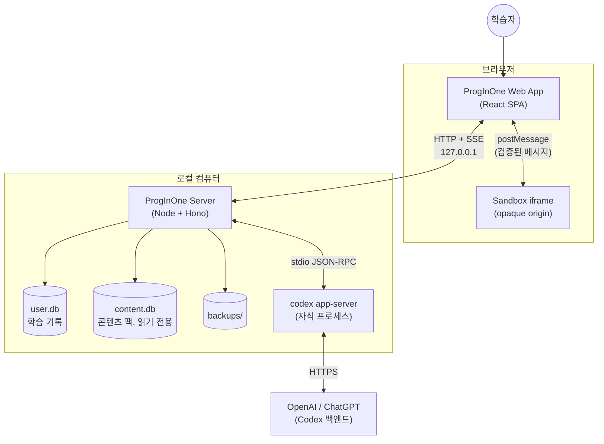
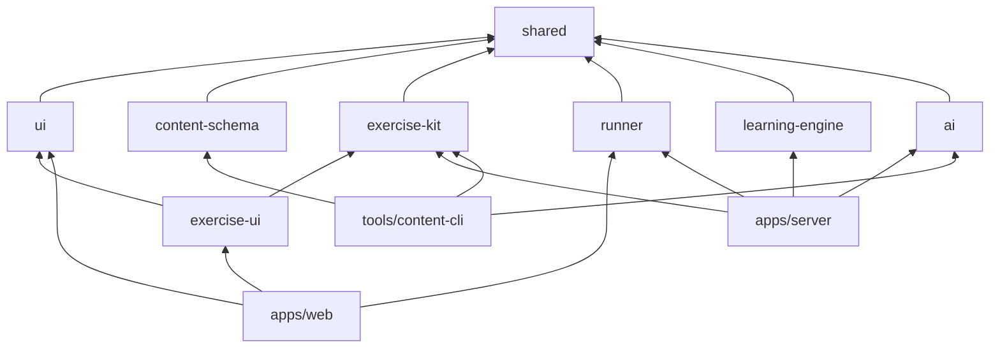
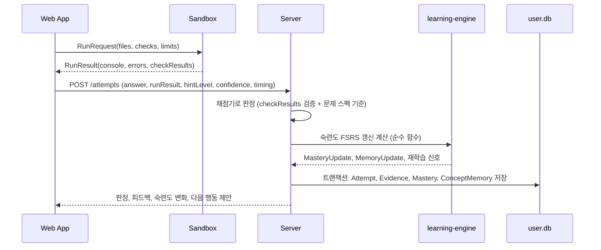
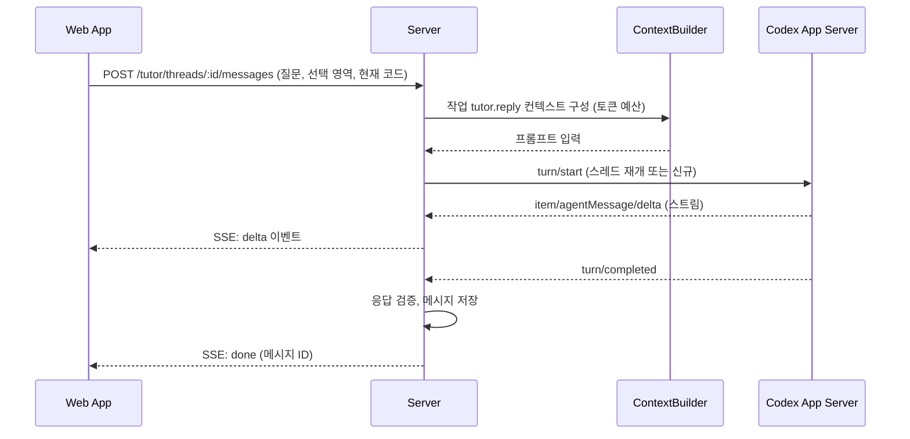

# 시스템 아키텍처 설계

ProgInOne의 전체 구조를 정의합니다. 실행 형태, 프로세스, 모듈 경계, 저장소 구조, API 규약, 설정, 보안 경계, 빌드·배포 방식을 다룹니다.
각 하위 시스템의 상세 설계는 별도 문서에 있으며, 이 문서는 그 문서들이 공유하는 뼈대입니다.

- 상태: 승인됨 (2026-11-14)
- 작성: ProgInOne 팀
- 최종 수정: 2026-11-15 (튜터·AI API v0.1 반영)
- 관련 문서: [PRD](/docs/product/prd.md), [결정 기록](/docs/decisions.md), [용어집](/docs/glossary.md)

## 배경과 범위

ProgInOne은 단일 사용자가 자신의 컴퓨터에서 실행하는 학습 플랫폼입니다([D-005](/docs/decisions.md)).
브라우저에서 접속하는 웹 UI, 학습 데이터를 관리하는 로컬 서버, 학습자 코드를 실행하는 브라우저 샌드박스, 그리고 AI 제공자(Codex App Server) 자식 프로세스로 구성됩니다.

이 문서가 다루는 범위:

- 런타임 구성 요소와 그 사이의 통신
- 모노레포 패키지 구조와 의존 방향
- 서버 API 규약, 오류 모델, 설정, 로깅
- 데이터 저장 위치와 데이터베이스 분리 원칙
- 보안 경계 요약
- 빌드, 테스트, CI, 릴리스, 설치·업그레이드 절차

이 문서가 다루지 않는 범위 (각 설계 문서 참고):

- 테이블 상세: [데이터 모델 설계](/docs/design/data-model.md)
- 숙련도·복습 알고리즘: [학습 엔진 설계](/docs/design/learning-engine.md)
- 콘텐츠 형식·문제 유형·제작 파이프라인: [콘텐츠·문제 시스템 설계](/docs/design/content-and-exercises.md)
- 샌드박스 상세: [코드 실행 샌드박스 설계](/docs/design/code-execution-sandbox.md)
- AI 통합 상세: [AI 시스템 설계](/docs/design/ai-system.md)
- 화면·디자인 시스템: [UI/UX 설계](/docs/design/ui-ux.md)

## 목표와 비목표

### 아키텍처 목표

- **명령 하나로 실행**: `pnpm start` 한 번으로 서버가 뜨고 브라우저가 열립니다.
- **AI 독립성**: AI 제공자가 없거나 실패해도 AI 이외의 모든 기능이 동작합니다.
- **신뢰 경계 명확화**: 학습자 코드, AI 출력, 외부 웹페이지를 모두 신뢰할 수 없는 입력으로 다루고, 경계마다 검증 지점을 둡니다.
- **학습 기록 보존**: 콘텐츠 업데이트, 앱 업그레이드, 스키마 마이그레이션에서 학습 기록을 잃지 않습니다.
- **테스트 가능성**: 학습 엔진, 채점기, 컨텍스트 빌더는 순수 함수 또는 의존성 주입으로 만들어 단위 테스트할 수 있어야 합니다.
- **확장 가능한 경계**: 새 문제 유형, 새 AI 제공자, 새 과정을 기존 코드 수정 없이(또는 등록 코드 한 줄로) 추가할 수 있습니다.

### 아키텍처 비목표

- 수평 확장, 다중 사용자 동시성, 원격 접속. 서버는 로컬 단일 사용자 전용입니다.
- 마이크로서비스 분리. 서버는 하나의 Node 프로세스입니다.
- 서버 측 코드 실행 환경(컨테이너 등). 학습자 코드는 브라우저 샌드박스에서만 실행합니다.
- 실시간 협업, 클라우드 동기화.
- 데스크톱 앱 패키징(Electron, Tauri). 필요해지면 현재 구조를 감싸는 방식으로 추가할 수 있게만 둡니다.

## 설계

### 시스템 컨텍스트



### 런타임 구성 요소

| 구성 요소 | 실행 위치 | 책임 |
|---|---|---|
| Web App | 브라우저 (메인 origin) | 모든 화면, 에디터, 러너 호스트, 클라이언트 측 상태 |
| Sandbox | 브라우저 (opaque origin iframe) | 학습자 코드와 테스트 하네스 실행. 결과를 postMessage로 반환 |
| Server | Node.js 프로세스 | API, 학습 엔진 호출, 채점 기록, AI 오케스트레이션, 백업, 정적 파일 제공(프로덕션) |
| user.db | SQLite 파일 | 학습 기록, 설정, AI 대화, AI 생성 문제 |
| content.db | SQLite 파일 (읽기 전용) | 빌드된 콘텐츠 팩: 커리큘럼, 레슨, 사전 제작 문제, 템플릿 |
| Codex App Server | 서버의 자식 프로세스 | ChatGPT 인증, 모델 호출, 스레드 관리 |

### 포트와 origin

| 모드 | 웹 | API | 비고 |
|---|---|---|---|
| 개발 | `http://127.0.0.1:5173` (Vite) | `http://127.0.0.1:4310` | Vite가 `/api`를 4310으로 프록시 |
| 프로덕션 | `http://127.0.0.1:4310` | 같은 origin | 서버가 빌드된 정적 파일과 API를 함께 제공 |

- 포트는 설정으로 바꿀 수 있습니다. 사용 중이면 시작을 실패시키고 명확한 메시지를 출력합니다(조용히 다른 포트로 바꾸지 않음).
- 샌드박스는 별도 포트를 쓰지 않습니다. 서버가 `/sandbox/runner.html`(러너 셸)을 **전용 CSP 응답 헤더** 와 함께 제공하고, 앱은 이를 `sandbox="allow-scripts allow-forms"` iframe으로 삽입해 opaque origin을 얻습니다.
  앱 문서에서 `srcdoc` iframe을 직접 만들지 않는 이유는 `srcdoc` 문서가 부모의 CSP를 상속해 러너 전용 정책을 줄 수 없기 때문입니다.
  개발 모드에서는 Vite가 같은 경로를 같은 헤더로 제공합니다. 상세와 대안은 [코드 실행 샌드박스 설계](/docs/design/code-execution-sandbox.md)에 있습니다.
- **셸 서브도메인 (D-018, M1-B 반영)**: 러너 셸은 실행 환경마다 다른 서브도메인 `http://<shellId>.localhost:<port>/sandbox/runner.html`에서 엽니다. 멈춘 셸 프로세스를 다음 실행이 재사용하지 않고, 브라우저가 셸을 앱과 다른 프로세스에 둘 수 있게 하기 위해서입니다. 3초 안에 `shell-hello`가 오지 않으면 같은 사이트 경로 `/sandbox/runner.html`로 대체합니다.
- 서버는 `Host`가 `<shellId>.localhost:<port>`인 요청에 **`/sandbox/runner.html`과 러너 자산만** 제공하고, 그 밖의 경로(특히 `/api`)는 404로 거부합니다. `shellId`는 영숫자 짧은 ID만 허용합니다.
- 앱 문서의 CSP에는 `frame-src 'self' http://*.localhost:<port>`를 두어 러너 셸 외의 iframe을 막습니다.
- **앱 문서 CSP 전체** (M3 구현, `apps/server/src/http/web.ts`): `default-src 'self'; script-src 'self'; style-src 'self' 'unsafe-inline'; img-src 'self' data:; font-src 'self' data:; connect-src 'self'; frame-src 'self' http://*.localhost:<port>; worker-src 'self' blob:; object-src 'none'; base-uri 'none'; form-action 'self'; frame-ancestors 'none'`. `style-src 'unsafe-inline'`은 Radix와 CodeMirror가 인라인 `style` 속성을 쓰기 때문입니다. 스크립트 인라인은 허용하지 않습니다.
- **세션 토큰 전달**: 프로덕션에서는 서버가 `index.html`을 내려줄 때 `<meta name="proginone-token">`으로 토큰을 넣습니다(`Cache-Control: no-store`). 다른 출처는 동일 출처 정책 때문에 이 HTML을 읽을 수 없고, DNS 리바인딩은 `Host` 검사로 막힙니다. 개발 모드에서는 Vite가 `index.html`을 제공하므로, 서버가 `<dataDir>/dev-session.json`(권한 0600)에 토큰을 쓰고 Vite 플러그인이 같은 메타 태그를 넣습니다. 서버가 끝나면 파일을 지웁니다.

### 모노레포 구조

pnpm workspaces 기반 모노레포입니다([D-006](/docs/decisions.md)).

```text
ProgInOne/
├── apps/
│   ├── web/                 # React SPA (Vite)
│   └── server/              # Node 로컬 서버 (Hono)
├── packages/
│   ├── shared/              # 공용 타입, zod 스키마, API 계약, ID 유틸
│   ├── ui/                  # 디자인 시스템: 토큰, 기본 컴포넌트
│   ├── content-schema/      # 콘텐츠 원본(MDX/YAML)의 zod 스키마
│   ├── exercise-kit/        # 문제 유형 레지스트리: 스펙 스키마, 채점기, 템플릿 엔진
│   ├── exercise-ui/         # 문제 유형별 React 렌더러
│   ├── runner/              # 샌드박스 런타임(하네스)과 호스트 프로토콜
│   ├── learning-engine/     # 숙련도, FSRS, 연습 세트 구성, 재학습 규칙 (순수 함수)
│   └── ai/                  # 제공자 어댑터, AI 작업 정의, 컨텍스트 빌더 인터페이스
├── content/                 # 콘텐츠 원본 (과정/모듈/단원/문제)
├── tools/
│   └── content-cli/         # 콘텐츠 검증, content.db 빌드, AI 초안 생성 도구
├── e2e/                     # Playwright E2E, 시각 회귀, 접근성 테스트
├── docs/                    # 설계 문서, 가이드
└── .github/workflows/       # CI, 릴리스
```

#### 의존 방향 규칙



- 화살표는 "의존한다"입니다. 순환 의존은 금지하며 CI에서 검사합니다.
- `learning-engine`과 `exercise-kit`의 채점기는 **I/O 없는 순수 함수** 입니다. DB와 네트워크 접근은 `apps/server`의 서비스 계층이 담당합니다.
- `apps/server`는 러너 셸 문서(`/sandbox/runner.html`)를 만들어 제공하려고 `runner`의 셸 빌드(`@proginone/runner/shell-build`)를 씁니다. 샌드박스 결과 검증은 `packages/shared`의 계약(`parseRunResult`)으로 합니다.
- `apps/web`은 `learning-engine`에 의존하지 않습니다. 학습 판단은 서버가 합니다.
- `packages/ai`는 제공자 프로토콜과 작업 정의만 갖고, DB 조회는 `apps/server`가 구현하는 `ContextSource` 인터페이스로 주입받습니다.

### 서버 내부 구조

```text
apps/server/src/
├── main.ts                 # 진입점: 설정 로드 → 백업 → 마이그레이션 → 서버 시작
├── config/                 # 설정 스키마와 로더
├── http/
│   ├── app.ts              # Hono 앱, 미들웨어(보안, 로깅, 오류)
│   └── routes/             # 리소스별 라우트 (얇게: 검증 → 서비스 호출 → 응답)
├── services/               # 유스케이스 단위 비즈니스 로직
│   ├── curriculum/
│   ├── practice/           # 연습 세트 구성, 시도 기록, 채점 결과 반영
│   ├── review/
│   ├── goals/
│   ├── tutor/
│   ├── generation/         # AI 문제 생성과 검증 파이프라인
│   ├── backup/
│   └── settings/
├── db/
│   ├── user/               # Drizzle 스키마, 마이그레이션, 리포지토리
│   └── content/            # content.db 읽기 전용 리포지토리
├── ai/
│   ├── codex/              # Codex App Server 프로세스 관리, JSON-RPC 클라이언트
│   └── context-source.ts   # ContextSource 구현 (DB 조회)
└── observability/          # 로거, AI 호출 기록
```

계층 규칙:

- `routes`는 입력 검증(zod)과 응답 변환만 합니다. 비즈니스 로직을 넣지 않습니다.
- `services`는 트랜잭션 경계입니다. 하나의 유스케이스(예: "시도 제출")는 하나의 서비스 메서드와 하나의 DB 트랜잭션으로 처리합니다.
- `db` 리포지토리 밖에서 SQL을 쓰지 않습니다.

### 웹 앱 내부 구조

```text
apps/web/src/
├── main.tsx
├── routes/                 # TanStack Router 파일 기반 라우트
│   ├── index.tsx           # 대시보드
│   ├── learn/$lessonId.tsx # 학습 화면 (읽기/실습 모드)
│   ├── review/
│   ├── stats/
│   └── settings/
├── features/               # 기능 단위 모듈 (컴포넌트 + 훅 + API 호출)
│   ├── lesson-reader/
│   ├── practice/
│   ├── tutor/
│   ├── editor/
│   ├── concept-map/
│   └── goals/
├── runner-host/            # 샌드박스 생성·통신·워치독
├── api/                    # zod 검증 API 클라이언트, TanStack Query 훅
└── lib/
```

상태 관리 원칙:

- **서버 상태**(진도, 문제, 시도)는 TanStack Query 캐시가 유일한 클라이언트 측 원천입니다. 별도 전역 스토어에 복사하지 않습니다.
- **UI 상태**(패널 크기, 모드, 열린 드로어)는 컴포넌트 상태 또는 작은 스토어(Zustand)에 두고, 기억할 값만 `localStorage`에 저장합니다.
- **편집 중인 코드**는 IndexedDB에 즉시 저장하고 서버에 디바운스(2초)로 동기화합니다. 서버가 원천이며, 충돌 시 최신 수정 시각이 이깁니다(단일 사용자이므로 충분).

### 주요 데이터 흐름

#### 문제 제출 흐름 (코드 실습)



- 정답 키(정답 선택지, 참조 구현, 체크 기대값)는 **기본적으로 클라이언트에 보내지 않습니다**. 서버가 판정합니다.
  보안 목적이 아니라(단일 사용자 앱) 힌트 정책([D-010](/docs/decisions.md))을 UI 실수로 우회하지 않기 위한 설계 원칙입니다.
- 코드 실행이 필요한 체크는 브라우저 샌드박스에서 실행하고, 그 결과를 서버가 문제 스펙과 대조합니다.
  체크 기대값이 필요한 테스트 하네스는 서버가 실행용 번들로 내려주며, 하네스는 결과만 반환합니다.
  상세는 [콘텐츠·문제 시스템 설계](/docs/design/content-and-exercises.md)와 [샌드박스 설계](/docs/design/code-execution-sandbox.md)에 있습니다.

#### 튜터 질문 흐름



### API 규약

- 기본 경로: `/api/v1`. 모든 응답은 JSON이며, 스트리밍만 SSE(`text/event-stream`)를 씁니다.
- 리소스 지향 경로를 쓰고, 상태를 바꾸는 동작은 `POST`/`PUT`/`PATCH`/`DELETE`를 씁니다.
- 요청·응답 스키마는 `packages/shared`의 zod 스키마가 원천입니다. 웹은 같은 스키마로 **응답을 런타임 검증하는** 작은 fetch 클라이언트(`apps/web/src/api/client.ts`)를 씁니다. Hono RPC 클라이언트는 웹이 서버 소스의 타입(Node 타입 포함)을 끌어와야 하고 응답을 검증하지 않아서 쓰지 않습니다(M3 결정).
- 페이지네이션은 커서 기반(`?cursor=&limit=`)입니다.

오류 응답 형식:

```json
{
  "error": {
    "code": "AI_RATE_LIMITED",
    "message": "AI 사용량 한도에 도달했습니다. 14:30 이후 다시 시도할 수 있습니다.",
    "retryable": true,
    "details": { "resetsAt": "2026-11-13T14:30:00Z" }
  }
}
```

- `code`는 대문자 스네이크 케이스의 안정적 식별자입니다. 웹은 `code`로 분기하고 `message`는 표시용입니다.
- 오류 코드는 영역 접두사를 씁니다: `VALIDATION_*`, `NOT_FOUND`, `CONTENT_*`, `EXERCISE_*`(문제·힌트·정답 열람), `PRACTICE_*`(연습 세트·시도), `RUNNER_*`, `AI_*`, `BACKUP_*`(백업·백업 위치), `RESTORE_FAILED`, `RESET_FAILED`, `MAINTENANCE`, `INTERNAL`.
- 단원 평가(v0.3): 평가 중인 문항의 힌트·정답·본문 확인 시도는 `403 EXERCISE_LOCKED_IN_ASSESSMENT`, 튜터·AI 힌트·오답 분석은 `403 AI_LOCKED_IN_ASSESSMENT`, 같은 문항의 두 번째 제출은 `409 PRACTICE_ITEM_DONE`, 단원 종류와 맞지 않는 세트 요청은 `409 PRACTICE_KIND_MISMATCH`입니다([학습 엔진 설계 구현 메모 (v0.3)](/docs/design/learning-engine.md#구현-메모-v03)).
- 힌트 정책 "먼저 풀어 보기"(`settings.hints.policy = 'after-attempt'`)에서 그 문항에 제출하기 전 첫 힌트 요청은 `409 EXERCISE_TRY_FIRST`입니다(D-047).
- 서버는 예상하지 못한 예외를 `INTERNAL`로 감싸고, 스택은 로그에만 남깁니다.
- 백업 복원이나 데이터 재계산 중에는 서버가 유지보수 모드가 되어 `/api` 요청에 `503`과 `MAINTENANCE`를 반환합니다. 웹은 전체 화면 안내를 표시합니다.
- AI 관련 오류 코드(`AI_*`)의 전체 목록은 [AI 시스템 설계](/docs/design/ai-system.md)가 원천입니다.

주요 리소스(초안, 상세는 각 설계 문서):

| 리소스 | 예시 |
|---|---|
| 커리큘럼 | `GET /courses`, `GET /lessons/:lessonId` |
| 연습 | `POST /practice-sets` (단원·복습·약점 집중·단원 평가 `kind: 'assessment'`·오답 노트의 "다시 풀기" `kind: 'extra'`(v0.3). 평가 중 시도 응답은 결과를 감춘 `withheld` 형태이고 마지막 제출이 전체 결과를 돌려줌, v0.3), `POST /practice-sets/:id/items/:itemId/skip` (건너뛰기), `GET /weak-concepts` (약점 개념과 이유), `GET /exercises/:id` (공개 스펙), `POST /exercises/:id/run-plan` (샌드박스 실행 계획), `POST /attempts` (채점 결과와 해설), `POST /exercises/:id/inline-attempts` (레슨 본문 확인 문제: 연습 세트 밖 시도. 실행 없이 채점하는 유형만, 숙련도는 반영하고 FSRS 일정은 바꾸지 않음) |
| 힌트·정답 | `POST /exercises/:id/hints` (다음 단계 요청), `POST /exercises/:id/solution` |
| 학습 상태 | `GET /mastery` (과정 진도와 개념 지도), `GET /concepts/:id`, `GET /review-queue`, `GET /daily-plan` |
| 복습 화면 | `GET /mistakes` (오답 노트: 과정·모듈·개념·상태 필터, 확신 오답 우선 정렬, 필터 선택지), `GET /mistakes/:exerciseId` (내 답·피드백·해설, 본 적 있는 정답만), `GET /mastery-changes` (숙련 단계 상승·하락과 주별 요약). v0.3, [D-044](/docs/decisions.md) |
| 활동 | `POST /activity/heartbeat` (30초 간격, 학습 시간 측정) |
| 목표 | `GET/PUT /goals` |
| 학습자 | `GET/PATCH /learner` (온보딩: 경험 수준, 완료 시각, 온보딩 필요 여부) |
| 튜터 | `POST /tutor/threads`, `GET /tutor/threads`, `GET /tutor/threads/:id/messages`, `POST /tutor/threads/:id/messages` (SSE), `POST /tutor/threads/:id/messages/:messageId/cancel`, `POST /exercises/:id/ai-hint` (`tutor.hint`) |
| AI | `GET /ai/status`, `POST /ai/login`, `POST /ai/login/cancel`, `POST /ai/logout`, `POST /ai/reconnect`, `GET /ai/models`, `GET /ai/events` (SSE: 연결 상태·사용량·로그인 완료) |
| 튜터 | `POST /tutor/threads`, `GET /tutor/threads`, `GET /tutor/threads/:id/messages`, `POST /tutor/threads/:id/messages` (SSE), `POST /tutor/threads/:id/messages/:messageId/cancel`, `GET`·`POST /tutor/threads/:id/summary` (`session.summarize`, v0.2), `POST /exercises/:id/ai-hint` (`tutor.hint`), `POST /attempts/:id/explanation` (`evaluator.explainMistake`, v0.2. 맞힌 시도는 `409 ATTEMPT_CORRECT`) |
| AI | `GET /ai/status`, `POST /ai/login`, `POST /ai/login/cancel`, `POST /ai/logout`, `POST /ai/reconnect`, `GET /ai/models`, `GET /ai/events` (SSE: 연결 상태·사용량·로그인 완료), `GET /ai/calls` (AI 호출 기록, 프롬프트 없음. v0.2) |
| 코드 초안 | `PUT /code-drafts/:exerciseId` (자동 저장 동기화) |
| 문제 신고 | `POST /exercises/:id/reports` |
| 문제 생성 | `POST /generation-jobs`, `GET /generation-jobs/:id` |
| 백업 | `GET /backups`, `POST /backups`, `GET /backups/:id/check` (복원 전 검사: 체크섬·무결성·스키마 호환, 마이그레이션 필요 여부. v0.3), `POST /backups/:id/restore`, `GET`·`PUT /backups/location` (백업 위치. 잘못된 경로는 `400 BACKUP_LOCATION_INVALID`, 환경 변수로 고정되면 `409 BACKUP_LOCATION_LOCKED`. v0.3) |
| 데이터 | `POST /data/reset` (학습 데이터 초기화, 본문 `{ "confirm": "초기화" }`. `pre-reset` 백업 후 학습 기록 삭제, 실패 시 `RESET_FAILED`. v0.3) |
| 클라이언트 오류 | `POST /client-errors` |
| 설정 | `GET/PATCH /settings` |
| 진단 | `GET /diagnostics` |

### 데이터 저장

#### 데이터 디렉터리

학습 데이터는 저장소 밖, OS 표준 사용자 데이터 위치에 둡니다(`env-paths` 규칙).

| OS | 기본 위치 |
|---|---|
| macOS | `~/Library/Application Support/ProgInOne/` |
| Linux | `~/.local/share/ProgInOne/` |
| Windows | `%APPDATA%\ProgInOne\` |

환경 변수 `PROGINONE_DATA_DIR`로 바꿀 수 있습니다. 개발 모드 기본값은 저장소 안의 `.data/`(git 무시)입니다.

```text
<dataDir>/
├── user.db               # 학습 기록 (WAL 모드)
├── config.json           # 사용자 설정 중 파일로 관리하는 값 (포트, 백업 위치 등)
├── backups/
│   ├── daily/
│   ├── weekly/
│   └── pre-migration/
├── logs/                 # 구조화 로그 (일 단위 회전, 14일 보존)
└── codex-workspace/      # Codex 스레드의 빈 작업 디렉터리 (읽기 전용 샌드박스용)
```

#### 데이터베이스 분리 원칙

- **content.db** 는 빌드 산출물이며 앱과 함께 배포됩니다. 서버는 읽기 전용으로 엽니다.
- **user.db** 는 학습자 데이터의 유일한 원천입니다. 콘텐츠를 slug ID(예: `js.fn.arrow-this`)로만 참조합니다.
- 두 DB 사이에 외래 키는 없습니다. 콘텐츠에서 사라진 ID를 참조하는 기록은 "보관됨"으로 표시하고 삭제하지 않습니다.
- AI가 생성한 문제는 user.db에 저장합니다(학습자 고유 데이터이기 때문).
- 스키마 상세는 [데이터 모델 설계](/docs/design/data-model.md)에 있습니다.

### 앱 시작 절차

1.  설정 로드 및 검증(zod). 실패하면 어떤 값이 잘못됐는지 출력하고 종료합니다.
1.  데이터 디렉터리 준비, 단일 인스턴스 잠금 파일 확인(이미 실행 중이면 기존 인스턴스의 URL을 열고 종료).
1.  user.db의 대기 중인 마이그레이션 확인. 있으면 `pre-migration` 백업 후 실행합니다. 실패하면 백업에서 자동 복구하고 종료합니다.
1.  시작 백업 정책 실행(하루 1회 기준 충족 시 daily 백업).
1.  content.db 열기, 콘텐츠 팩 버전 기록. 콘텐츠 팩이 바뀌었으면 slug 별칭(rename/merge/split)을 적용하고, 영향받은 개념의 파생 상태를 재계산하며, 고아 참조 검사를 수행합니다.
1.  이전 실행에서 비정상 종료로 남은 `streaming` 상태의 튜터 메시지를 `interrupted`로 정리합니다.
1.  HTTP 서버 시작 (`127.0.0.1`).
1.  Codex는 **지연 시작** 합니다. AI 기능을 처음 쓸 때 자식 프로세스를 띄웁니다.
1.  브라우저 열기 (`--no-open` 옵션으로 끔).

종료 시: 진행 중 AI 턴 중단(`turn/interrupt`), Codex 자식 프로세스 종료, DB WAL 체크포인트, 잠금 해제.

### 설정

설정 우선순위: **환경 변수 > `config.json` > 기본값**.
학습 방식이나 테마처럼 UI에서 바꾸는 설정은 user.db의 `settings` 테이블에 저장하고, 프로세스 수준 설정만 파일·환경 변수로 관리합니다.

| 키 | 환경 변수 | 기본값 | 설명 |
|---|---|---|---|
| `port` | `PROGINONE_PORT` | `4310` | 서버 포트 |
| `dataDir` | `PROGINONE_DATA_DIR` | OS 표준 위치 | 데이터 디렉터리 |
| `backupDir` | `PROGINONE_BACKUP_DIR` | `<dataDir>/backups` | 백업 위치. 설정 > 데이터에서 바꾸면 `config.json`에 저장합니다. 환경 변수로 정하면 화면에서 바꿀 수 없습니다(D-045) |
| `codexPath` | `PROGINONE_CODEX_PATH` | `PATH`의 `codex` | Codex CLI 실행 파일 |
| `logLevel` | `PROGINONE_LOG_LEVEL` | `info` | `debug`/`info`/`warn`/`error` |
| `openBrowser` | `PROGINONE_OPEN_BROWSER` | `true` | 시작 시 브라우저 열기 |
| `aiProvider` | `PROGINONE_AI_PROVIDER` | `codex` | `codex` 또는 `mock`(E2E·개발용 결정론적 응답) |

### 보안 경계 요약

| 경계 | 위협 | 통제 |
|---|---|---|
| 외부 웹페이지 → 로컬 서버 | CSRF, DNS 리바인딩으로 학습 데이터 조회·조작, Codex 호출 | `127.0.0.1` 바인딩, `Host` 헤더 허용 목록(`127.0.0.1:<port>`, `localhost:<port>`, 셸 전용 `<shellId>.localhost:<port>`는 러너 경로만), `Origin` 검사(`Origin: null` 거부, 샌드박스 요청 차단 목적), 시작 시 생성하는 세션 토큰을 **GET을 포함한 모든 `/api` 요청** 의 커스텀 헤더로 요구, CORS 미허용 |
| 학습자 코드 → 앱 | 부모 DOM·저장소 접근, 로컬 서버 호출, 네트워크 요청, 무한 루프 | opaque origin 샌드박스, CSP `connect-src 'none'`, postMessage 출처·스키마 검증, 워치독. 상세는 [샌드박스 설계](/docs/design/code-execution-sandbox.md) |
| AI 출력 → 앱 | 잘못된 구조, 악성 마크업, 잘못된 정답, 프롬프트 인젝션에 따른 이상 행동 | 출력 스키마 검증, 마크다운 렌더러 원시 HTML 비활성화·sanitize, 생성 문제 실행 검증, AI는 학습 상태에 직접 쓰기 불가 |
| Codex 프로세스 → 호스트 | 에이전트가 셸·파일·웹·커넥터 도구 사용 | 튜터 전용 `CODEX_HOME`과 `[features]` 도구 기능 비활성, 빈 작업 디렉터리, 읽기 전용 샌드박스 정책, 승인 요청 자동 거부, 도구 항목 감지 시 턴 중단. 상세는 [AI 시스템 설계](/docs/design/ai-system.md) |
| 콘텐츠 원본 → 빌드 | 잘못된 콘텐츠로 인한 오류 | 빌드 시 스키마·링크·실행 검증 |

- 비밀값: 앱은 ChatGPT 자격 증명을 저장하지 않습니다. 인증은 Codex가 관리합니다([D-002](/docs/decisions.md)).
- 의존성: lockfile 고정, Renovate(또는 Dependabot)로 주기적 업데이트, CI에서 `pnpm audit`(높음 이상 실패).

### 관측성

- **서버 로그**: `pino` 구조화 JSON 로그. 요청 ID를 모든 로그에 포함합니다. 개발 모드는 pretty 출력.
- **AI 호출 기록**: 작업 이름, 제공자, 모델, 프롬프트 템플릿 버전, 입력·출력 토큰(제공되는 경우), 지연 시간, 결과 상태, 오류 코드를 `ai_calls` 테이블에 저장합니다. 프롬프트 원문은 DB에 저장하지 않고, 디버그 설정일 때만 `<dataDir>/logs/ai/`에 파일로 7일간 보관합니다.
- **클라이언트 오류**: React 오류 경계와 `window.onerror`로 잡은 오류를 `/api/v1/client-errors`로 보내 서버 로그에 남깁니다.
- **진단 화면**: 앱·콘텐츠·스키마 버전, 데이터 위치, 최근 오류, AI 연결 상태(설정 화면, P1).

### 빌드와 개발 환경

| 명령 | 동작 |
|---|---|
| `pnpm install` | 의존성 설치 |
| `pnpm dev` | 서버(watch) + Vite 개발 서버 동시 실행, 개발용 데이터 디렉터리 사용 |
| `pnpm build` | 콘텐츠 빌드(content.db) → 패키지 빌드 → 웹 빌드 → 서버 번들 |
| `pnpm start` | 프로덕션 빌드 실행 (단일 포트) |
| `pnpm test` | Vitest 단위·통합 테스트 |
| `pnpm test:e2e` | Playwright E2E, 시각 회귀, 접근성 |
| `pnpm content:check` | 콘텐츠 스키마·링크·실행 검증 |
| `pnpm lint` / `pnpm typecheck` | ESLint, `tsc --noEmit` (모든 패키지) |
| `pnpm ai:codex-types` | 설치된 Codex 버전으로 App Server 프로토콜 타입 재생성 (`codex app-server generate-ts`) |
| `pnpm ai:eval` | 실제 Codex로 프롬프트 골든 세트 평가 (수동 실행 전용) |

필수 도구:

- Node.js **24 LTS 이상** (`.nvmrc`와 `package.json#engines`로 고정). `ts-fsrs` v6가 Node 24 이상을 요구합니다.
- Playwright Chromium: E2E 테스트와 **콘텐츠 빌드의 실행 검증** 에 필요합니다(`pnpm exec playwright install chromium`).
- pnpm (`packageManager` 필드로 고정, Corepack 사용)
- Codex CLI (AI 기능 사용 시). 최소 지원 버전을 서버가 시작 시 확인합니다.

### 테스트 전략

| 계층 | 도구 | 대상 |
|---|---|---|
| 단위 | Vitest | learning-engine, exercise-kit 채점기, 템플릿 엔진, 컨텍스트 빌더, zod 스키마 |
| 통합 | Vitest + 임시 SQLite | 서비스 계층(트랜잭션 포함), 마이그레이션, 백업·복원 |
| 계약 | Vitest | Codex JSON-RPC 클라이언트(녹화된 메시지 재생), API 스키마 |
| 샌드박스 보안 | Playwright | 탈출 시도, 네트워크 차단, 무한 루프, 메모리 폭주 |
| 콘텐츠 | content-cli | 모든 문제의 참조 정답이 자신의 체크를 통과하는지, 오답 선택지가 실제로 오답인지 |
| E2E | Playwright | 핵심 학습 흐름 |
| 시각 회귀 | Playwright 스크린샷 | 주요 화면 × 테마 × 뷰포트 × 상태 |
| 접근성 | Playwright + axe-core | 주요 화면 |

- AI가 관여하는 테스트는 **모의 제공자(`MockProvider`, `PROGINONE_AI_PROVIDER=mock`)** 로 결정론적으로 실행합니다. 실제 Codex를 쓰는 평가는 수동 실행 전용(`pnpm ai:eval`)입니다.
- 시각 회귀 기준 이미지는 OS별 렌더링 차이를 피하기 위해 CI와 같은 Playwright 공식 Docker 이미지에서 생성합니다.

### CI (GitHub Actions)

`pull_request`와 `main` 푸시에서 실행합니다.

1.  설치 (pnpm 캐시)
1.  `lint`, `typecheck`, 순환 의존 검사
1.  `test` (단위·통합·계약)
1.  `content:check`
1.  `build`
1.  `test:e2e` (Playwright Docker 이미지, 시각 회귀·접근성 포함). 실패 시 리포트와 차이 이미지를 아티팩트로 업로드
1.  문서 링크 검사 (`docs/**`, `README.md`)

`main` 브랜치는 보호하며, CI 통과를 병합 조건으로 둡니다.

### 버전 관리와 릴리스

| 대상 | 버전 체계 | 원천 |
|---|---|---|
| 앱 | SemVer (`MAJOR.MINOR.PATCH`) | 루트 `package.json`, git 태그 `v*` |
| 콘텐츠 팩 | `YYYY.MM.DD.N` | `content/pack.yaml` |
| user.db 스키마 | 마이그레이션 일련번호 | Drizzle 마이그레이션 폴더 |
| AI 프롬프트 템플릿 | 작업별 정수 버전 | `packages/ai/src/tasks/*` |

- 커밋 메시지는 [Conventional Commits][conventional-commits]를 따릅니다(`feat:`, `fix:`, `docs:`, `content:` 등).
- 변경 이력은 [Keep a Changelog][keep-a-changelog] 형식의 `CHANGELOG.md`로 관리합니다.
- 1.0 이전(`0.x`)에는 MINOR가 호환성 깨짐을 포함할 수 있습니다. 단, user.db 마이그레이션은 항상 전진 호환을 보장합니다.

릴리스 절차 (`v*` 태그 푸시 시 릴리스 워크플로가 실행):

1.  CI 전체 통과 확인
1.  `pnpm build`로 배포 번들 생성: 서버 번들, 웹 정적 파일, `content.db`, `package.json`(런타임 의존성만)
1.  `proginone-<version>.tar.gz`와 SHA-256 체크섬 생성
1.  GitHub Release 생성, `CHANGELOG.md`의 해당 버전 섹션을 본문으로 사용

[conventional-commits]: https://www.conventionalcommits.org/ko/v1.0.0/
[keep-a-changelog]: https://keepachangelog.com/ko/1.1.0/

### 설치와 업그레이드

학습자(본인)를 위한 두 가지 설치 경로를 지원합니다.

1.  **소스에서 실행** (기본): 저장소를 클론하고 `pnpm install && pnpm build && pnpm start`.
1.  **릴리스 번들**: Release의 tar.gz를 받아 압축을 풀고 `pnpm install --prod && pnpm start`.

업그레이드 시 보장 사항:

- 데이터 디렉터리는 앱 디렉터리 밖에 있으므로 앱 교체로 학습 기록이 사라지지 않습니다.
- 새 버전이 처음 시작될 때 마이그레이션 전 백업을 만들고, 실패하면 자동 복구합니다.
- 다운그레이드는 지원하지 않습니다. 대신 업그레이드 직전 백업으로 복원하는 방법을 가이드에 문서화합니다.

설치, 업그레이드, 문제 해결 절차는 구현 단계에서 `docs/guides/`에 작성합니다.

## 검토한 대안

### 앱 형태

| 대안 | 장점 | 단점 | 결론 |
|---|---|---|---|
| **로컬 웹앱** (채택) | 패키징·서명 불필요, Playwright로 그대로 테스트, 개발 속도 | 사용자가 터미널에서 실행해야 함, 로컬 서버 보안 설계 필요 | 채택 ([D-005](/docs/decisions.md)) |
| Electron | 설치형 앱 경험, 네이티브 메뉴 | 배포 크기, 보안 설정 복잡, 업데이트 체계 필요 | 지금 이점이 비용보다 작음 |
| Tauri | 가벼움, 보안 모델 우수 | Rust 툴체인, Node 자식 프로세스(Codex) 관리를 사이드카로 해야 함 | 후속 패키징 후보로 보류 |

### 프론트엔드 프레임워크

| 대안 | 장점 | 단점 | 결론 |
|---|---|---|---|
| **Vite + React SPA** (채택) | 단순, 빠른 HMR, 서버와 독립적 | 라우팅·데이터 로딩을 직접 구성 | 채택 |
| Next.js | 라우팅·서버 기능 통합 | SSR·RSC 이점이 로컬 단일 사용자에게 없음, 장기 실행 자식 프로세스와 SSE 관리가 프레임워크 규칙과 충돌 | 미채택 |

### 서버 프레임워크

| 대안 | 장점 | 단점 | 결론 |
|---|---|---|---|
| **Hono** (채택) | 가벼움, 타입 안전 RPC 클라이언트, SSE 헬퍼, Web 표준 API | 플러그인 생태계가 Fastify보다 작음 | 채택 |
| Fastify | 성숙한 생태계, 성능 | RPC 타입 공유를 위해 추가 도구 필요 | 대안으로 유효 |
| tRPC | 종단 간 타입 | SSE·스트리밍과 파일 응답에서 추가 구성, REST 경로 가독성 저하 | 미채택 |

### 데이터베이스 배치

| 대안 | 장점 | 단점 | 결론 |
|---|---|---|---|
| **content.db + user.db 분리** (채택) | 콘텐츠 교체가 학습 기록에 영향 없음, 콘텐츠를 git 원본에서 재생성 가능 | 두 DB 간 조인 불가(앱 계층에서 결합) | 채택 |
| 단일 DB | 조인 편리 | 콘텐츠 업데이트마다 데이터 마이그레이션 필요, 사용자 데이터와 빌드 산출물 혼재 | 미채택 |
| 콘텐츠를 메모리에 적재 (JSON) | DB 불필요 | 콘텐츠가 수천 문제로 커지면 시작 시간·메모리 증가, 검색 불편 | 미채택 |

### SQLite 드라이버

| 대안 | 장점 | 단점 | 결론 |
|---|---|---|---|
| **better-sqlite3** (채택) | 성숙, 동기 API로 빠르고 단순, online backup API 제공 | 네이티브 모듈(Node 버전 변경 시 재빌드) | 채택 |
| `node:sqlite` | 내장, 설치 문제 없음 | 안정화 진행 중, Drizzle 지원 성숙도 확인 필요 | 안정화 후 전환 검토 |
| libSQL | 원격 동기화 등 확장 | 로컬 단일 사용자에게 불필요 | 미채택 |

### 채점 위치

| 대안 | 장점 | 단점 | 결론 |
|---|---|---|---|
| **서버 판정 + 브라우저 실행** (채택) | 정답 키를 UI에서 분리, 판정 로직 단일화 | 실행 결과를 서버로 보내는 왕복 1회 | 채택 |
| 브라우저 단독 채점 | 왕복 없음 | 힌트 정책 우회가 쉬움, 판정 로직이 두 곳에 흩어짐 | 미채택 |

## 교차 관심사

### 보안

위 [보안 경계 요약](#보안-경계-요약)을 참고합니다. 샌드박스와 AI 경계는 각 설계 문서에서 위협 모델을 상세히 다룹니다.

### 개인정보

- 모든 학습 데이터는 로컬에만 저장합니다. 텔레메트리를 외부로 보내지 않습니다.
- AI 제공자에게 보내는 데이터는 컨텍스트 빌더가 정한 최소 범위입니다. 설정 화면에서 "AI에 전송되는 정보" 미리보기를 제공합니다(P1).
- 백업 파일에는 AI 대화 원문이 포함됩니다. 백업 위치를 클라우드 동기화 폴더로 지정할 때 이 사실을 안내합니다.

### 성능

- SQLite WAL 모드, 자주 쓰는 조회에 인덱스(데이터 모델 설계 참고).
- 웹 번들은 라우트 단위 코드 분할. 에디터(CodeMirror 언어 팩), 마크다운 렌더러, 차트는 지연 로드합니다.
- 레슨 MDX는 빌드 시 컴파일해 content.db에 저장하고, 런타임 컴파일을 하지 않습니다.

### 접근성

[UI/UX 설계](/docs/design/ui-ux.md)의 접근성 기준을 따릅니다. 아키텍처 수준에서는 라우트 변경 시 포커스 관리와 라이브 영역(채점 결과 알림)을 공통 컴포넌트로 제공합니다.

### 확장성

- **새 과정**: `content/`에 원본 추가 → 콘텐츠 빌드. 코드 변경 없음.
- **새 문제 유형**: `exercise-kit`에 스펙·채점기, `exercise-ui`에 렌더러를 등록.
- **새 실행 환경**(예: TypeScript 트랜스파일): 러너의 "전처리기" 확장 지점에 추가. 서버 측 언어는 별도 설계가 필요합니다.
- **새 AI 제공자**: `packages/ai`에 `ProviderAdapter` 구현 추가.

## 미결 사항

- Codex App Server의 스레드 시작 시 개발자 지침 주입 방식과 도구 비활성화 범위는 PoC로 확인합니다([AI 시스템 설계](/docs/design/ai-system.md)).
- Windows 지원 수준(P1). 경로 처리와 better-sqlite3 사전 빌드 바이너리 확인이 필요합니다.
- 프로덕션 실행 시 `pnpm`을 요구할지, 번들에 `node_modules`를 포함할지(네이티브 모듈 때문에 플랫폼별 번들이 필요해짐).

## 참고 자료

- [Hono][hono], [Vite][vite], [Drizzle ORM][drizzle], [better-sqlite3][better-sqlite3], [TanStack Router][tanstack-router]
- [Codex App Server 문서][codex-app-server]

[hono]: https://hono.dev/
[vite]: https://vite.dev/
[drizzle]: https://orm.drizzle.team/
[better-sqlite3]: https://github.com/WiseLibs/better-sqlite3
[tanstack-router]: https://tanstack.com/router
[codex-app-server]: https://learn.chatgpt.com/docs/app-server
