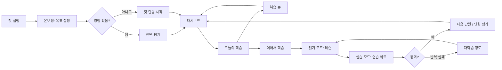

# ProgInOne 제품 요구사항 (PRD)

ProgInOne이 무엇을, 누구를 위해, 왜 만드는지 정의합니다.
어떻게 만드는지는 [시스템 아키텍처 설계](/docs/design/system-architecture.md)와 각 설계 문서가 다룹니다.

- 상태: 초안
- 작성: ProgInOne 팀
- 최종 수정: 2026-11-13
- 관련 문서: [결정 기록](/docs/decisions.md), [용어집](/docs/glossary.md)

## 배경과 문제 정의

범용 AI 채팅으로 프로그래밍을 공부하면 다음 문제가 반복됩니다.

- 대화가 길어지면 이전 학습 내용을 잊습니다. 새 대화에서는 처음부터 다시 설명해야 합니다.
- 진도와 이해 수준을 아무도 체계적으로 관리하지 않습니다.
- 문제 수와 유형이 부족하고, 같은 형태의 문제가 반복됩니다.
- AI가 난이도를 일관성 없이 조정합니다.
- 코드 작성, 실행, 테스트, 피드백이 서로 다른 도구에 흩어져 있습니다.
- 틀린 문제와 약한 개념을 다시 공부하는 체계가 없습니다.
- 대화형 UI는 수개월에 걸친 장기 학습에 적합하지 않습니다.

반대로 상용 교육 플랫폼은 커리큘럼과 실습 환경은 좋지만, 학습자 한 사람에게 맞춘 설명과 즉각적인 질의응답이 부족합니다.

ProgInOne은 **교육 플랫폼의 체계(커리큘럼, 문제은행, 실습 환경, 학습 기록)** 와 **AI 튜터의 유연성** 을 결합합니다.

### 핵심 철학

> AI는 학습을 돕고, 학습 상태와 교육 과정의 관리 책임은 애플리케이션이 진다.

- 학습 기록의 원천은 로컬 데이터베이스입니다. AI의 대화 컨텍스트가 아닙니다.
- 진도, 숙련도, 복습 일정, 정답 공개 여부는 애플리케이션의 규칙이 결정합니다.
- AI는 설명하고, 힌트를 주고, 피드백하고, 문제를 제안합니다. AI의 제안은 검증을 거쳐 반영됩니다.
- AI를 사용할 수 없어도 레슨, 문제 풀이, 채점, 복습, 통계는 모두 동작합니다.

## 대상 사용자

### 주 사용자: 웹 개발 입문자 겸 자기주도 학습자

- 웹 개발 경험이 거의 없거나, 일부 독학했지만 기초가 불안정합니다.
- 혼자 공부하며, 장기간(수개월) 꾸준히 학습할 의지가 있습니다.
- ChatGPT 구독을 보유하고 있고, 이를 학습에 활용하고 싶어 합니다.
- 데스크톱(macOS) 브라우저에서 주로 학습합니다.

### 사용 환경 가정

- 사용자는 1명이며, 자신의 컴퓨터에서 앱을 실행합니다.
- 인터넷 연결이 없어도 AI를 제외한 기능은 동작해야 합니다.
- 클라우드 서버나 유료 호스팅을 쓰지 않습니다.

## 제품 원칙

1.  **학습 효과가 기능 수보다 중요합니다.**
    기능은 학습과학 근거(인출 연습, 간격 반복, 교차 연습, 단계적 풀이 예제, 메타인지)로 정당화되어야 합니다.
1.  **맞혔다고 이해한 것은 아닙니다.**
    숙달 판정에는 다른 유형의 문제, 응용 문제, 시간 간격을 둔 복습 성공이 필요합니다.
1.  **정답보다 사고 과정을 먼저 돕습니다.**
    힌트는 단계적으로 제공하고, 정답은 학습자가 명시적으로 요청할 때만 공개합니다.
1.  **모든 판단은 설명 가능해야 합니다.**
    숙련도와 추천이 왜 그렇게 나왔는지 학습자가 볼 수 있어야 합니다.
1.  **UI/UX는 핵심 요구사항입니다.**
    상용 교육 플랫폼과 비교해도 손색없는 완성도를 목표로 합니다.
1.  **확장 가능한 구조, 필요한 만큼의 구현.**
    다른 언어·과정을 추가할 수 있는 구조로 설계하되, 지금 필요하지 않은 기능은 구현하지 않습니다.

## 목표와 비목표

### 제품 목표

- 입문자가 HTML/CSS 핵심과 JavaScript 전체를 체계적으로 학습해, 브라우저에서 동작하는 인터랙티브 웹페이지를 스스로 만들 수 있게 합니다.
- 앱을 껐다 켜도, AI 대화가 바뀌어도 학습 맥락이 이어집니다.
- 개념마다 충분한 양과 다양한 유형의 문제를 제공합니다.
- 약한 개념을 자동으로 찾아 적절한 시점에 복습시킵니다.
- 레슨, 실습, AI 튜터를 한 화면에서 자연스럽게 오갑니다.

### 비목표

- **다중 사용자, 계정, 클라우드 동기화.** 단일 로컬 사용자를 전제로 합니다. 스키마는 `learnerId`를 갖지만 인증 시스템은 만들지 않습니다.
- **모바일 최적화.** 데스크톱 브라우저(최소 폭 1024px)를 대상으로 합니다. 좁은 화면에서는 깨지지 않는 수준만 보장합니다.
- **동영상 강의.** 텍스트·인터랙티브 콘텐츠에 집중합니다.
- **서버 측 언어(Node.js, Python 등) 실행 환경.** 브라우저에서 실행 가능한 HTML/CSS/JS만 지원합니다. 구조는 확장 가능하게 둡니다.
- **여러 AI 제공자 동시 지원.** MVP는 Codex App Server 하나만 구현합니다. 어댑터 계층은 설계에 포함합니다.
- **과한 게임화.** 경험치, 리그, 캐릭터, 화려한 축하 효과는 넣지 않습니다. 진도와 성취의 시각화는 절제된 방식으로 합니다.
- **콘텐츠 배포·마켓플레이스.** 콘텐츠는 저장소 안에서 관리합니다.

## 핵심 사용자 경험

### 사용자 여정 개요

### 주요 흐름 1: 첫 실행과 온보딩

1.  앱을 처음 실행하면 짧은 환영 화면에서 ProgInOne의 학습 방식(레슨 → 연습 → 복습)을 소개합니다.
1.  학습자는 학습 목표를 정합니다: 하루 학습 시간(기본 30분), 주간 학습 일수(기본 5일), 선택적으로 과정 완료 목표일.
1.  경험 수준을 묻습니다: "처음이에요" / "조금 해봤어요" / "기초는 알아요".
    "처음이에요"가 아니면 진단 평가(10~15분)를 제안합니다. 건너뛸 수 있습니다.
1.  AI 연결은 선택 사항입니다. 온보딩 마지막에 ChatGPT 로그인으로 Codex를 연결할 수 있고, 나중에 설정에서 연결해도 됩니다.
1.  대시보드로 이동하고 "오늘의 학습"을 제안합니다.

### 주요 흐름 2: 단원 학습 (읽기 → 실습)

1.  "이어서 학습"을 누르면 **읽기 모드** 로 단원이 열립니다.
1.  레슨 본문은 학습 목표, 선수 개념 확인, 개념 소개, 원리, 예제, 실행 결과 해설, 흔한 실수, 실전 사례, 요약, 다음 학습 연결 순서로 구성됩니다.
1.  본문 중간에 **인라인 확인 문제** 와 **실행 가능한 예제** 가 있습니다. 예제는 실행 전에 결과를 먼저 예측하도록 유도합니다(예측 후 실행).
1.  이해가 안 되는 부분은 텍스트나 코드를 선택해 "튜터에게 질문"할 수 있습니다. 튜터는 현재 단원과 학습자의 숙련도를 알고 답합니다.
1.  본문을 마치면 **연습 세트** 로 넘어가며 **실습 모드** 로 전환됩니다.
1.  연습 세트는 쉬운 문제에서 어려운 문제로, 여러 유형을 섞어 진행합니다(10~30문제, 단원 중요도에 따라 다름).
1.  각 문제는 답을 제출하기 전에 확신도(확실함 / 애매함 / 찍음)를 고릅니다.
1.  틀리면 즉시 피드백을 받고, 힌트를 단계별로 열거나 재도전합니다. 오답이 특정 오개념에 해당하면 그 오개념을 설명합니다.
1.  연습 세트 통과 기준을 만족하면 단원이 완료되고, 개념들이 복습 스케줄에 들어갑니다.

### 주요 흐름 3: 막혔을 때 (재학습 경로)

1.  같은 개념의 문제를 연속으로 틀리면, 시스템은 선수 개념의 숙련도를 확인합니다.
1.  선수 개념이 약하면 "먼저 ○○를 짧게 복습해볼까요?"를 제안합니다(짧은 확인 문제 3~5개).
1.  선수 개념에 문제가 없으면 **단계적 풀이 예제** 로 난이도를 낮춥니다: 완전한 풀이 → 일부 빈칸 → 직접 풀기.
1.  튜터는 이 상황에서 "도움이 필요하신가요?" 배지를 표시하지만, 대화를 강제로 열지는 않습니다.

### 주요 흐름 4: 복습

1.  대시보드의 "오늘의 복습"에 복습할 개념 수와 예상 소요 시간이 표시됩니다.
1.  복습 세트는 여러 개념을 섞어(교차 연습) 구성하고, 같은 문제가 아닌 **새 변형 문제** 를 출제합니다.
1.  복습 결과에 따라 각 개념의 다음 복습일과 숙련도가 갱신됩니다.
1.  복습 화면에서는 오답 노트, 개념별 숙련도 변화, 과거 풀이와 현재 풀이 비교를 볼 수 있습니다.

### 주요 흐름 5: 더 풀고 싶을 때

1.  연습 세트를 마친 뒤 "더 풀기"를 누르면 문제은행의 미사용 문제나 파라메트릭 변형이 먼저 제공됩니다.
1.  더 원하면 원하는 유형과 난이도를 골라 AI 문제 생성을 요청합니다.
1.  생성된 문제는 자동 검증(스키마, 실행 결과, 중복)을 통과한 경우에만 제시되며, "AI 생성" 표시가 붙습니다.
1.  문제가 이상하면 "문제 신고"로 격리할 수 있습니다.

## 기능 요구사항

요구사항 ID는 `FR-<영역>-<번호>` 형식입니다.
우선순위: **P0** = MVP 필수, **P1** = MVP 이후 첫 확장(v1.x), **P2** = 후속.

### 커리큘럼과 콘텐츠 (CUR)

| ID | 요구사항 | 우선순위 |
|---|---|---|
| FR-CUR-01 | 과정 → 모듈 → 단원 → 개념의 계층 구조를 제공해야 한다 | P0 |
| FR-CUR-02 | 개념 간 선수 관계(DAG)를 관리하고, 단원 화면에서 선수 개념과 그 숙련도를 보여줘야 한다 | P0 |
| FR-CUR-03 | 레슨 본문은 표준 섹션 구조(학습 목표 ~ 다음 학습 연결)를 따르고, 섹션 일부는 개념 중요도에 따라 생략할 수 있다 | P0 |
| FR-CUR-04 | 레슨 본문에 실행 가능한 코드 예제, 인라인 확인 문제, 알림 상자(주의, 팁), 비교 표를 넣을 수 있어야 한다 | P0 |
| FR-CUR-05 | 단원 순서는 권장 순서를 제시하되, 학습자가 잠금 없이 원하는 단원을 열 수 있어야 한다. 선수 개념이 부족하면 경고만 표시한다 | P0 |
| FR-CUR-06 | 콘텐츠 업데이트 시 학습 기록이 보존되어야 한다 (안정적 slug ID) | P0 |
| FR-CUR-07 | 모듈 종료 시 단원 평가를, 주요 모듈에 응용 프로젝트를 제공해야 한다 | P0 (JS 기초) / P1 (그 외) |
| FR-CUR-08 | 레슨 본문에서 관련 MDN 문서로 링크한다 | P1 |

**완료 기준**: MVP 콘텐츠 범위(§MVP 콘텐츠 범위)의 모든 단원이 표준 섹션 구조를 갖추고, 콘텐츠 빌드의 스키마·링크·실행 검증을 통과한다.

### 문제 시스템 (EX)

| ID | 요구사항 | 우선순위 |
|---|---|---|
| FR-EX-01 | 문제 유형은 플러그인 구조로 등록되며, 유형별 전용 UI와 채점기를 가져야 한다 | P0 |
| FR-EX-02 | MVP 문제 유형: 단일/복수 선택, 참/거짓, 빈칸 채우기, 실행 결과 예측, 코드 순서 배열(파슨스), 오류 줄 찾기, 함수 구현, 버그 수정, **기본 웹 실습**(단일 HTML 문서에서 HTML 구조·CSS 스타일/레이아웃·DOM 이벤트 구현) | P0 |
| FR-EX-03 | v1.x 문제 유형: 연결하기, 변수 값 추적, 오류 있는 설명 찾기, 여러 파일 웹 실습, 마일스톤형 단계 실습 | P1 |
| FR-EX-04 | 후속 문제 유형: 코드 동작 서술(AI 루브릭 채점), 리팩터링, 미니 프로젝트 | P2 |
| FR-EX-05 | 모든 문제는 1~5 난이도, 하나 이상의 관련 개념(주/부 가중치), 힌트 3단계, 해설을 가져야 한다 | P0 |
| FR-EX-06 | 객관식 오답 선택지는 오개념 ID와 연결할 수 있어야 한다 | P0 |
| FR-EX-07 | 실행 결과 예측 문제의 정답은 저장된 값이 아니라 실제 실행 결과로 판정해야 한다 | P0 |
| FR-EX-08 | 파라메트릭 템플릿으로 변형 문제를 생성하고, 정답을 실행으로 계산해야 한다 | P0 |
| FR-EX-09 | 개념별 문제 수 목표: 소규모 개념 5~10, 일반 단원 10~20, 핵심 단원 20~30 이상, 단원 평가 10~20. 템플릿 변형은 포함하되 "사실상 같은 문제"는 1개로 센다 | P0 (JS) |
| FR-EX-10 | 문제마다 풀이 통계(시도 수, 1차 정답률, 평균 소요 시간, 힌트 사용률)를 관리해야 한다 | P0 |
| FR-EX-11 | 학습자가 문제를 신고할 수 있고, 신고된 AI 생성 문제는 즉시 격리되어야 한다 | P0 |
| FR-EX-12 | 학습자 요청 시 AI가 조건(개념, 유형, 난이도, 약점)에 맞는 문제를 생성하고, 자동 검증 통과 시에만 제시해야 한다 | P1 |
| FR-EX-13 | 연습 세트는 난이도 상승 순서와 유형 혼합을 기본으로 구성해야 한다 | P0 |

**완료 기준**: MVP 문제 유형 9종이 각각 렌더링·채점·피드백·힌트·해설·재도전 흐름을 갖고, 키보드만으로 풀 수 있으며, 유형별 채점 단위 테스트가 있다.

### 코드 실습 (CODE)

| ID | 요구사항 | 우선순위 |
|---|---|---|
| FR-CODE-01 | 구문 강조, 자동 들여쓰기, 괄호 짝 맞춤, 자동 완성(설정으로 켜고 끔)을 지원하는 에디터를 제공해야 한다 | P0 |
| FR-CODE-02 | 코드를 실행해 console 출력(값의 구조 포함)과 런타임 오류(줄 번호 포함)를 보여줘야 한다 | P0 |
| FR-CODE-03 | 문제의 테스트 케이스를 실행하고 케이스별 통과/실패와 기대값·실제값을 보여줘야 한다 | P0 |
| FR-CODE-04 | 학습자 코드는 격리된 샌드박스에서 실행되어야 하며, 앱 데이터·로컬 서버·네트워크에 접근할 수 없어야 한다 | P0 |
| FR-CODE-05 | 무한 루프나 과도한 실행은 시간 제한(기본 3초)으로 중단되고, UI는 멈추지 않아야 한다 | P0 |
| FR-CODE-06 | 문제별 작성 중인 코드는 자동 저장되고, 제출 기록은 모두 보관되어야 한다 | P0 |
| FR-CODE-07 | 코드 포맷팅(Prettier)을 지원해야 한다 | P0 |
| FR-CODE-08 | HTML/CSS 실시간 미리보기, 반응형 뷰포트 전환(375/768/1280)을 지원해야 한다 | P0 (기본 미리보기) / P1 (뷰포트) |
| FR-CODE-09 | 미리보기에서 요소를 선택하면 박스 모델(margin/border/padding/content)을 오버레이로 보여줘야 한다 | P1 |
| FR-CODE-10 | 여러 파일(html/css/js) 편집을 지원해야 한다 | P1 |
| FR-CODE-11 | AI 코드 리뷰를 요청할 수 있어야 한다 | P1 |
| FR-CODE-12 | 실행 단계 시각화(변수, 콜스택, 이벤트 루프) | P2 |

**완료 기준**: 보안 테스트 스위트(샌드박스 탈출 시도, 네트워크 요청, 부모 창 접근, 무한 루프, 메모리 폭주)가 모두 차단되고, 무한 루프 실행 중에도 UI가 응답한다.

### 학습 엔진 (LRN)

| ID | 요구사항 | 우선순위 |
|---|---|---|
| FR-LRN-01 | 모든 시도(답안, 정오, 소요 시간, 힌트 단계, 정답 열람 여부, 확신도)를 영구 저장해야 한다 | P0 |
| FR-LRN-02 | 개념별 숙련도(0~100)와 숙련 단계를 규칙 기반으로 계산하고, 변화의 근거를 저장해야 한다 | P0 |
| FR-LRN-03 | 숙련 단계 상승에는 게이트 조건이 있어야 한다: `proficient`는 서로 다른 유형 2개 이상 + L3 이상 1문제, `mastered`는 1일 이상 간격의 복습 성공 | P0 |
| FR-LRN-04 | 개념 단위 FSRS로 복습 일정을 계산하고, 복습 시 새 변형 문제를 출제해야 한다 | P0 |
| FR-LRN-05 | 반복 실패 시 재학습 경로(선수 개념 점검 → 단계적 풀이 예제)를 제안해야 한다 | P0 |
| FR-LRN-06 | 오개념 관측을 기록하고 `suspected` → `confirmed` → `resolved`로 관리해야 한다 | P0 |
| FR-LRN-07 | 진단 평가로 초기 숙련도를 추정할 수 있어야 한다 | P1 |
| FR-LRN-08 | 문제의 경험적 난이도를 풀이 통계로 보정해야 한다 | P2 |

**완료 기준**: 학습 엔진은 순수 함수 패키지로 분리되고, 대표 시나리오(연속 정답, 찍어서 정답, 힌트 사용, 반복 실패, 장기 미복습)별 단위 테스트가 숙련도·단계·다음 복습일을 검증한다.

### 학습 목표와 오늘의 학습 (GOAL)

| ID | 요구사항 | 우선순위 |
|---|---|---|
| FR-GOAL-01 | 일일 학습 시간 목표, 주간 학습 일수 목표를 설정할 수 있어야 한다 | P0 |
| FR-GOAL-02 | 과정 완료 목표일을 설정하면 남은 콘텐츠 양으로 필요한 페이스(일일 단원 수)를 계산해 보여줘야 한다 | P0 |
| FR-GOAL-03 | "오늘의 학습"은 복습 큐 → 이어서 학습 → 약점 집중 순서로 일일 목표 시간에 맞춰 구성되어야 한다 | P0 |
| FR-GOAL-04 | 주간 달성 현황(학습한 날, 학습 시간)을 보여줘야 한다. 연속 학습일은 표시하되 끊김에 벌칙을 주지 않는다 | P0 |
| FR-GOAL-05 | 학습 시간은 실제 활동 시간만 센다 (비활성 2분 이상은 제외) | P0 |

### AI 튜터 (AI)

| ID | 요구사항 | 우선순위 |
|---|---|---|
| FR-AI-01 | ChatGPT 로그인으로 Codex App Server에 연결하고, 연결 상태와 남은 사용량을 표시해야 한다 | P0 |
| FR-AI-02 | 튜터는 현재 단원·문제·코드·테스트 결과·관련 개념 숙련도·활성 오개념을 컨텍스트로 받아야 한다 | P0 |
| FR-AI-03 | 텍스트·코드 선택 후 "튜터에게 질문", 테스트 실패 시 "왜 실패했나요?" 같은 맥락 진입점을 제공해야 한다 | P0 |
| FR-AI-04 | 튜터 응답은 스트리밍으로 표시하고, 중단할 수 있어야 한다 | P0 |
| FR-AI-05 | 정답 공개는 힌트 정책(결정 D-010)에 따라 애플리케이션이 통제해야 한다 | P0 |
| FR-AI-06 | 오답 해설: 학습자의 오답을 분석해 왜 틀렸는지 설명해야 한다 | P0 |
| FR-AI-07 | 튜터 대화는 단원·문제 단위 스레드로 원문 전체를 보관하고, 스레드 종료 시 구조화된 요약을 생성해야 한다 | P0 |
| FR-AI-08 | 앱 재시작이나 제공자 세션 유실 후에도 DB의 학습 기록으로 튜터 맥락을 복원해야 한다 | P0 |
| FR-AI-09 | AI가 제안한 오개념은 근거 시도가 있을 때만 `suspected`로 기록해야 한다 | P0 |
| FR-AI-10 | AI가 연결되지 않았거나 사용량 한도에 도달하면, AI 기능만 비활성 상태로 표시하고 나머지 기능은 정상 동작해야 한다 | P0 |
| FR-AI-11 | 대화 기록을 검색하고 내보낼 수 있어야 한다 | P1 |
| FR-AI-12 | 다음 학습 계획에 대한 자연어 설명(학습 엔진이 결정한 추천의 이유 설명) | P1 |
| FR-AI-13 | 추가 AI 제공자 어댑터 (OpenAI 호환 API, Ollama 등) | P2 |

**완료 기준**: AI 기능 각각에 대해 제공자 모킹 기반 통합 테스트가 있고, 오프라인·인증 만료·한도 초과·응답 스키마 오류 상황에서 정해진 오류 UI가 표시된다.

### 대시보드와 통계 (DASH)

| ID | 요구사항 | 우선순위 |
|---|---|---|
| FR-DASH-01 | 대시보드: 이어서 학습, 오늘의 학습, 복습 필요 개념, 과정 진도, 학습 목표 달성, 최근 활동, 개념 지도 | P0 |
| FR-DASH-02 | 개념 지도: 모듈별 개념 타일을 숙련 단계로 표현하고, 클릭하면 개념 상세(숙련도 근거, 관련 문제, 다음 복습일)를 보여준다 | P0 |
| FR-DASH-03 | 통계: 단원별 진도, 정답률, 난이도별 성적, 개념별 숙련도, 학습 시간 추세, 반복 오답 개념 | P1 |
| FR-DASH-04 | 복습 화면: 오답 노트, 숙련도 변화, 과거와 현재 풀이 비교, 약점 집중 학습 | P0 (오답 노트·약점 집중) / P1 (비교) |

### 설정과 데이터 (SET)

| ID | 요구사항 | 우선순위 |
|---|---|---|
| FR-SET-01 | AI 연결/해제, 모델 선택(`model/list` 기반), 연결 상태, 사용량 표시 | P0 |
| FR-SET-02 | 학습 방식: 에디터 자동 완성, 확신도 입력, 튜터 선제 제안, 힌트 정책 강도 | P0 |
| FR-SET-03 | 테마: 라이트 / 다크 / 시스템 | P0 |
| FR-SET-04 | 자동 백업: 앱 시작 시, 하루 1회, 마이그레이션 직전. 보존: 일일 14개 + 주간 8개 | P0 |
| FR-SET-05 | 백업 목록 조회, 복원, 수동 백업, 백업 위치 변경 | P0 |
| FR-SET-06 | 학습 데이터 JSON 내보내기/가져오기 | P1 |
| FR-SET-07 | 학습 데이터 초기화(확인 절차 포함) | P0 |
| FR-SET-08 | 진단 정보: 앱 버전, 콘텐츠 팩 버전, DB 스키마 버전, 로그 위치, AI 호출 로그 | P1 |

### 전역 UI (UI)

| ID | 요구사항 | 우선순위 |
|---|---|---|
| FR-UI-01 | 학습 화면은 읽기 모드와 실습 모드를 전환하며, 패널 크기 조절과 접기를 지원하고 상태를 기억해야 한다 | P0 |
| FR-UI-02 | 주요 동작에 단축키를 제공해야 한다: 실행/제출(⌘Enter), 튜터(⌘J), 힌트(⌘.), 커맨드 팔레트(⌘K) | P0 (⌘K 제외) / P1 (⌘K) |
| FR-UI-03 | 모든 화면은 빈 상태, 로딩 상태, 오류 상태 디자인을 가져야 한다 | P0 |
| FR-UI-04 | WCAG 2.2 AA를 목표로 한다: 대비, 포커스 표시, 키보드 조작, 스크린 리더 레이블, `prefers-reduced-motion` | P0 |
| FR-UI-05 | 노트, 북마크, 하이라이트 | P2 |

## 비기능 요구사항

| ID | 범주 | 요구사항 |
|---|---|---|
| NFR-01 | 성능 | 앱 첫 화면 표시 2초 이내(로컬), 화면 전환 200ms 이내, 결정론적 채점 결과 표시 300ms 이내 |
| NFR-02 | 성능 | 코드 실행 시작부터 콘솔 첫 출력까지 500ms 이내(일반 예제 기준) |
| NFR-03 | 응답성 | 학습자 코드가 무한 루프여도 메인 UI는 계속 응답해야 한다 |
| NFR-04 | 신뢰성 | 앱이 비정상 종료돼도 마지막 자동 저장 이후 최대 5초 분량의 코드 입력만 잃는다 |
| NFR-05 | 데이터 | 스키마 변경은 마이그레이션으로만 하며, 마이그레이션 전에 반드시 자동 백업한다 |
| NFR-06 | 보안 | 로컬 서버는 `127.0.0.1`에만 바인딩하고, Origin/Host 검사와 세션 토큰으로 외부 웹페이지의 요청을 차단한다 |
| NFR-07 | 보안 | AI 생성 콘텐츠와 학습자 코드는 신뢰할 수 없는 입력으로 취급한다. AI 응답 마크다운은 원시 HTML을 렌더링하지 않는다 |
| NFR-08 | 개인정보 | 학습 데이터는 로컬에만 저장된다. AI 제공자로 전송되는 데이터는 학습 맥락에 필요한 최소한으로 제한하고, 설정에서 전송 범위를 확인할 수 있다 |
| NFR-09 | 오프라인 | AI를 제외한 모든 기능은 네트워크 없이 동작한다. 폰트 등 정적 자원은 번들에 포함한다 |
| NFR-10 | 호환성 | 최신 Chrome, Edge, Safari, Firefox 최신 2개 버전. Node.js 24 LTS 이상. macOS 우선, Windows·Linux 동작 보장은 P1 |
| NFR-11 | 품질 | TypeScript strict, 린트·타입 검사·테스트가 CI에서 통과해야 병합 |
| NFR-12 | 관측성 | 서버 구조화 로그(JSON), AI 호출 로그(작업 이름, 지연 시간, 토큰 수, 결과 상태), 클라이언트 오류 보고 |
| NFR-13 | 접근성 | 자동 axe 검사에서 심각(critical)·중대(serious) 위반 0건 |
| NFR-14 | UI 품질 | 주요 화면은 라이트/다크 × 1280/1440/1920 뷰포트의 시각 회귀 테스트 기준 이미지를 가진다 |

## MVP 범위

### MVP 콘텐츠 범위

결정 [D-003](/docs/decisions.md)에 따라 JavaScript는 완전한 품질로, HTML/CSS는 핵심 위주로 다룹니다.

| 과정 | MVP | v1.x |
|---|---|---|
| HTML 핵심 | 문서 구조, 텍스트·링크·이미지, 목록·표, 폼 기초, 시맨틱 태그 (짧게, 단원당 5~10문제) | 접근성 기초, 폼 심화 |
| CSS 핵심 | 선택자·명시도·상속, 박스 모델, 색·단위·타이포그래피, Flexbox, 반응형 기초 (짧게) | Grid, 위치 지정, 전환·애니메이션 |
| JavaScript 기초 | **전체를 완전한 품질로**: 값과 변수, 자료형, 연산자, 형 변환, 조건문, 반복문, 함수, 배열, 객체, 문자열, 오류 처리 기초 | — |
| JavaScript 심화 | — (구조만 준비) | **완전한 품질로**: 스코프, 클로저, `this`, 프로토타입·클래스, 비동기, Promise, async/await, 이벤트 루프, 모듈 |
| 브라우저 JavaScript | DOM 기초, 이벤트 기초 (HTML/CSS와 연결하는 최소 범위) | **완전한 품질로**: DOM 심화, 이벤트 위임, Fetch API, Web Storage, 쿠키, 브라우저 보안 기초 |

정확한 단원 목록과 개념 그래프는 [콘텐츠·문제 시스템 설계](/docs/design/content-and-exercises.md)에서 정의합니다.
현재 초안 기준 규모는 다음과 같습니다.

| 범위 | 모듈 | 단원 | 개념 | 목표 문제 수 |
|---|---|---|---|---|
| HTML 핵심 | 3 | 8 | 24 | 약 70 |
| CSS 핵심 | 4 | 10 | 30 | 약 90 |
| JavaScript 기초 (브라우저 JS 입문 모듈 포함) | 10 | 45 | 118 | 약 860 |
| **MVP 합계** | **17** | **63** | **172** | **약 1,020** |
| v1.x 추가 (JS 심화, 브라우저 JS) | 13 | 46 | 약 125 | 약 1,100 |

### MVP 기능 범위 요약

- **포함**: P0 요구사항 전부.
- **제외**: P1, P2 요구사항.

### MVP 완료 정의

1.  P0 기능 요구사항이 모두 각 영역의 완료 기준을 만족한다.
1.  MVP 콘텐츠가 콘텐츠 빌드 검증을 통과하고, JS 기초 각 단원이 FR-EX-09의 문제 수 목표를 만족한다.
1.  주요 화면(대시보드, 학습 읽기/실습, 복습, 설정)이 시각 회귀 기준과 접근성 검사를 통과한다.
1.  실제 학습 흐름 E2E 테스트(온보딩 → 단원 학습 → 연습 → 복습 → 백업 복원)가 통과한다.
1.  실제 사용자 검증: 개발자가 아닌 시선으로 JS 기초 첫 3개 모듈을 직접 학습하며 발견한 사용성 문제를 정리하고 해결한다.

## 성공 지표

단일 사용자 앱이므로 로컬 데이터로 측정하고 통계 화면에서 확인합니다.

| 지표 | 목표 | 의미 |
|---|---|---|
| 주간 목표 달성률 | 4주 이동 평균 70% 이상 | 학습 습관이 유지되는가 |
| 복습 이행률 | 예정 복습의 80% 이상을 기한 내 수행 | 복습 시스템이 부담스럽지 않은가 |
| 장기 유지율 | 복습 시점 1차 정답률 75~90% | FSRS 목표 유지율 근처인가 (너무 높으면 간격이 짧음) |
| 숙달 전이율 | `proficient` 개념의 L3+ 신규 문제 정답률 70% 이상 | 숙련도 판정이 실제 실력을 반영하는가 |
| 힌트 후 해결률 | 힌트 1~2단계 사용 후 정답률 60% 이상 | 힌트가 정답 공개 없이 도움이 되는가 |
| AI 생성 문제 신고율 | 5% 미만 | 생성·검증 파이프라인의 품질 |

## 위험과 대응

| 위험 | 영향 | 대응 |
|---|---|---|
| 콘텐츠 제작량이 예상보다 큼 | 일정 지연, 빈 플랫폼 | 콘텐츠 파이프라인을 초기에 구축, JS 기초 우선, 파라메트릭 템플릿으로 수량 확보 |
| Codex App Server가 튜터 용도에 부적합 (지연, 코딩 에이전트 성향) | AI 경험 저하 | 첫 마일스톤에서 PoC로 검증. 부적합 시 OpenAI 호환 API 어댑터로 대체 (D-002 잠정) |
| 구독 사용량 한도 | AI 기능 일시 중단 | 사용량 표시, 작업별 우선순위, AI 없는 핵심 경로 |
| 숙련도 모델이 실제 실력과 어긋남 | 잘못된 복습·추천 | 설명 가능한 규칙, 근거 저장, 성공 지표로 보정 |
| 샌드박스 보안 결함 | 로컬 데이터 노출 | 보안 테스트 스위트, 네트워크·부모 접근 차단, 정기 점검 |
| 과도한 범위 확장 | MVP 미완성 | P0/P1/P2 엄격 적용, 변경은 결정 기록으로 관리 |

## 미결 사항

- JS 기초 이후 v1.x 콘텐츠 순서. 두 가지 안이 있습니다.
  - **A. 브라우저 JS 먼저**: 화면을 다루는 경험을 일찍 제공해 동기를 유지합니다.
  - **B. JS 심화 먼저**: 클로저·비동기·이벤트 루프를 알고 나서 Fetch·이벤트 위임을 배우는 편이 개념적으로 자연스럽습니다. [콘텐츠·문제 시스템 설계](/docs/design/content-and-exercises.md)의 커리큘럼 초안은 이 순서를 가정합니다.
  - MVP의 JS 기초 끝에 "브라우저 JS 입문"(DOM·이벤트 기초)이 포함되므로, 두 안 모두 MVP에서 화면 조작 경험은 제공됩니다.
- 진단 평가를 MVP에 포함할지. 현재는 P1입니다. 사용자가 완전 초보라면 MVP에서 불필요합니다.

## 참고 자료

- [결정 기록](/docs/decisions.md)
- [시스템 아키텍처 설계](/docs/design/system-architecture.md)
- [학습 엔진 설계](/docs/design/learning-engine.md)
- [콘텐츠·문제 시스템 설계](/docs/design/content-and-exercises.md)
- [UI/UX 설계](/docs/design/ui-ux.md)
