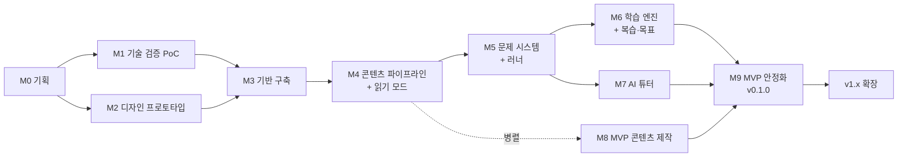

# 구현 로드맵

ProgInOne을 어떤 순서로 만들지 마일스톤 단위로 정의합니다.
각 마일스톤은 목표, 범위, 의존성, 세부 작업, 테스트, 완료 조건을 갖습니다.

- 상태: 초안
- 최종 수정: 2026-11-13
- 관련 문서: [PRD](/docs/product/prd.md), [시스템 아키텍처 설계](/docs/design/system-architecture.md), [결정 기록](/docs/decisions.md)

## 로드맵 원칙

- **위험한 것부터 검증합니다.** Codex 튜터 적합성과 샌드박스 격리는 구현 초기에 PoC로 확인합니다.
- **디자인 시스템은 처음부터 함께 만듭니다.** UI는 마지막에 덧붙이지 않습니다. 기반 구축 마일스톤에서 토큰과 기본 컴포넌트를 먼저 만듭니다.
- **수직 슬라이스로 진행합니다.** 각 마일스톤 끝에는 실제로 써볼 수 있는 학습 흐름이 있어야 합니다.
- **콘텐츠 제작은 병렬 트랙입니다.** 콘텐츠 파이프라인이 준비되는 시점부터 기능 개발과 함께 진행합니다.
- **마일스톤마다 승인을 받습니다.** 다음 마일스톤 구현은 사용자 승인 후 시작합니다([기여 가이드](/CONTRIBUTING.md#협업-원칙-사람--ai-에이전트)).
- **완료 기준은 "렌더링됨"이 아닙니다.** 모든 UI 마일스톤은 브라우저 시각 검증과 사용성 점검을 포함합니다.

## 마일스톤 개요

| 마일스톤 | 핵심 산출물 | 선행 조건 |
|---|---|---|
| M0 기획 | 승인된 PRD·설계 문서 | — |
| M1 기술 검증 PoC | Codex 튜터 PoC 보고서, 샌드박스 PoC 보고서, D-002 확정 | M0 |
| M2 디자인 프로토타입 | 정적 HTML 프로토타입 2~3안, 선택된 디자인 방향, 디자인 토큰 v1 | M0 |
| M3 기반 구축 | 모노레포, CI, 디자인 시스템 기본 컴포넌트, 앱 셸, 서버 골격, DB·마이그레이션·자동 백업 | M1, M2 |
| M4 콘텐츠 파이프라인 + 읽기 모드 | content-cli, content.db 빌드, 과정 상세, 읽기 모드 레슨 화면 | M3 |
| M5 문제 시스템 + 러너 | MVP 문제 유형 9종(기본 웹 실습 포함), 샌드박스 러너, 실습 모드, 힌트·정답 정책 | M4 |
| M6 학습 엔진 | 숙련도, FSRS 복습, 연습 세트, 재학습, 목표·오늘의 학습, 대시보드 | M5 |
| M7 AI 튜터 | Codex 어댑터, 로그인·사용량 UI, 튜터 드로어, 힌트·오답 해설, 대화 보관·요약 | M5 (M1 결과) |
| M8 MVP 콘텐츠 제작 | JS 기초 전체 + HTML/CSS 핵심 콘텐츠 | M4 (M5에서 문제 유형 확정) |
| M9 MVP 안정화 | E2E, 시각 회귀, 접근성, 사용성 점검, 설치 가이드, v0.1.0 | M6, M7, M8 |

## M0. 기획

**목표**: 무엇을 어떻게 만들지 합의합니다.

**작업**

- [x] 1차 요구사항 분석과 핵심 결정 합의 (D-001 ~ D-017)
- [x] PRD 초안
- [x] 설계 문서 초안: 시스템 아키텍처, 데이터 모델, 학습 엔진, 콘텐츠·문제, 샌드박스, AI, UI/UX
- [ ] 사용자 검토와 수정
- [ ] 설계 문서 상태를 `승인됨`으로 변경

**완료 조건**: 사용자가 PRD와 설계 문서를 승인합니다.

## M1. 기술 검증 PoC

**목표**: 가장 불확실한 두 가지를 실제로 확인해, 설계를 확정하거나 수정합니다.
PoC 코드는 버리는 것을 전제로 `poc/` 디렉터리(또는 별도 브랜치)에 작성하고, 결과는 문서로 남깁니다.

**의존성**: M0 승인. 로컬에 Codex CLI 설치와 ChatGPT 로그인.

### M1-A. Codex App Server 튜터 PoC

| 작업 | 확인할 것 | 합격 기준 |
|---|---|---|
| stdio JSON-RPC 클라이언트 최소 구현 | `initialize` → `thread/start` → `turn/start` → 스트림 수신 | 스트리밍 표시 성공 |
| 인증 흐름 | `account/login/start`(chatgpt), `account/read`, 로그아웃 | 앱에서 로그인 완료 감지 |
| 튜터 지침 주입 | 스레드·턴 수준 지침 주입 방식, 한국어·교수법 준수 | 골든 질문 20개 중 18개 이상이 지침 준수(정답 비노출, 단계적 설명) |
| 도구 비활성화 | 빈 cwd + readOnly + 승인 자동 거부에서 셸·파일 접근 시도 없음 또는 차단 | 차단 확인 |
| 구조화 출력 | `outputSchema`로 문제 생성·세션 요약 스키마 출력 | 스키마 검증 통과율 95% 이상 (20회) |
| 지연 시간 | 첫 토큰 시간, 전체 응답 시간 | 튜터 첫 토큰 p50 3초 이하 목표 (미달 시 대안 검토) |
| 사용량 | `account/rateLimits/read`, 업데이트 알림 | 값 표시 가능 |

**산출물**: `docs/design/ai-system.md`의 미결 사항 갱신, PoC 보고서(같은 문서의 부록 또는 결정 기록 항목), D-002 `확정` 또는 대안 결정.

### M1-B. 샌드박스 PoC

| 작업 | 합격 기준 |
|---|---|
| opaque origin iframe + CSP에서 JS 실행, console 캡처 | 출력 정상 표시 |
| 무한 루프 (`while(true){}`) — Worker 모드 / DOM 모드 | 메인 UI 계속 응답, 3초 내 중단 |
| 네트워크 요청 (`fetch`, `img`, `WebSocket`) → `127.0.0.1:4310` 및 외부 | 모두 차단 |
| 부모 접근 (`parent.document`, `top.location`, `localStorage`) | 모두 차단 또는 예외 |
| CSS computed style·레이아웃 체크 | 뷰포트별 판정 성공 |

**산출물**: 샌드박스 설계 문서 미결 사항 갱신.

**완료 조건**: 두 PoC 결과가 문서화되고, 설계 변경이 필요하면 결정 기록에 반영되어 사용자 승인을 받습니다.

## M2. 디자인 프로토타입

**목표**: 구현 전에 시각적 방향을 확정합니다.

**의존성**: M0. M1과 병렬로 진행할 수 있습니다.

**작업**

- 대시보드와 학습 화면(읽기·실습 모드)의 정적 HTML 프로토타입 2~3안 제작 ([UI/UX 설계](/docs/design/ui-ux.md)의 콘셉트 기반)
- 라이트/다크 각각 제작, 실제 한국어 레슨 문장과 코드로 채움(로렘 입숨 금지)
- 사용자 리뷰 후 1안 선택, 피드백 반영
- 디자인 토큰 v1 확정(색, 타이포그래피, 간격, 반경, 그림자, 모션)

**완료 조건**: 선택된 안과 디자인 토큰 v1이 UI/UX 설계 문서에 반영되고 사용자가 승인합니다.

## M3. 기반 구축

**목표**: 모든 기능이 올라갈 토대를 만듭니다. 빈 앱이지만 품질 체계는 완성되어 있어야 합니다.

**의존성**: M1(기술 확정), M2(디자인 토큰).

**세부 작업**

1.  모노레포 초기화: pnpm workspaces, TypeScript project references, `strict`, ESLint, Prettier, `.nvmrc`, `packageManager`
1.  패키지 골격: `apps/web`, `apps/server`, `packages/shared`, `packages/ui` (나머지 패키지는 해당 마일스톤에서 생성)
1.  CI: lint, typecheck, test, build, 순환 의존 검사, 문서 링크 검사
1.  `packages/ui`: 디자인 토큰(CSS 변수, 라이트/다크), 기본 컴포넌트(Button, IconButton, Input, Select, Checkbox, Radio, Tabs, Dialog, Drawer, Tooltip, Toast, Badge, Progress, Skeleton, EmptyState, ErrorState)
1.  앱 셸: 전역 내비게이션, 라우팅, 테마 전환, 패널 리사이즈 레이아웃 골격, 오류 경계
1.  서버 골격: Hono 앱, 보안 미들웨어(Host/Origin 검사, 세션 토큰), 오류 모델, 구조화 로그, 설정 로더, 단일 인스턴스 잠금
1.  user.db: Drizzle 설정, 첫 마이그레이션(설정, 학습자, 메타), 마이그레이션 전 자동 백업, 시작·일일 백업, 보존 정책, 복원 API
1.  설정 화면 v0: 테마, 백업 목록·수동 백업·복원
1.  Playwright 설정: E2E, 시각 회귀(Docker), axe
1.  가이드 작성: `docs/guides/getting-started.md`, `docs/guides/testing.md`

**테스트**

- 마이그레이션 실패 시 자동 복구 통합 테스트
- 백업 보존 정책 단위 테스트(날짜 경계)
- 보안 미들웨어: 잘못된 Host/Origin/토큰 요청 거부 테스트
- 앱 셸 시각 회귀, 컴포넌트 상태별 스냅샷, axe 검사

**완료 조건**: `pnpm dev`, `pnpm build && pnpm start`가 동작하고, CI가 녹색이며, 설정 화면에서 백업과 복원이 실제로 동작합니다.

## M4. 콘텐츠 파이프라인 + 읽기 모드

**목표**: 콘텐츠를 작성·검증·빌드하고, 학습자가 과정을 둘러보고 레슨을 읽을 수 있습니다.

**의존성**: M3.

**세부 작업**

1.  `packages/content-schema`: pack, course, module, lesson, concept, misconception 스키마
1.  `tools/content-cli`: `check`(스키마, slug 고유성, 선수 관계 순환, 링크), `build`(MDX 컴파일, content.db 생성)
1.  content.db 읽기 리포지토리, 커리큘럼 API
1.  MDX 커스텀 컴포넌트: Callout, CompareTable, ConceptLink, CodeBlock(정적), RunnableExample(실행은 M5에서 연결)
1.  화면: 과정 목록, 과정 상세(커리큘럼 아코디언, 진도 표시 자리), 학습 화면 읽기 모드
1.  샘플 콘텐츠: JS 기초 첫 모듈 1개를 표준 섹션 구조로 완성
1.  `docs/guides/content-authoring.md` 작성

**테스트**: 콘텐츠 스키마 단위 테스트, content-cli 통합 테스트(잘못된 콘텐츠 픽스처), 읽기 모드 E2E·시각 회귀·접근성.

**완료 조건**: 샘플 모듈을 브라우저에서 처음부터 끝까지 읽을 수 있고, 콘텐츠 오류가 빌드에서 잡힙니다.

## M5. 문제 시스템 + 러너

**목표**: 학습자가 레슨 안팎에서 문제를 풀고, 채점·피드백·힌트·해설·재도전을 경험합니다.

**의존성**: M4. M1-B 결과.

**세부 작업**

1.  `packages/runner`: 러너 셸(`/sandbox/runner.html`, 전용 CSP), 관측 전용 하네스, 호스트 프로토콜, 워치독, 루프 가드, console 직렬화
1.  `packages/exercise-kit`: 유형 레지스트리, MVP 9종 스펙·채점기(정답 키 제거 포함), 선언형 체크 명세, 파라메트릭 템플릿 엔진
1.  HTML/CSS 미리보기(단일 문서, 라이브 갱신)와 기본 웹 실습 체크(DOM·CSS·이벤트 관측)
1.  `packages/exercise-ui`: 유형별 렌더러, 확신도 선택, 힌트 사다리, 피드백 배너
1.  CodeMirror 6 에디터 통합(인라인 에디터, 실습 에디터), Prettier 포맷, 코드 자동 저장(IndexedDB + 서버 동기화)
1.  실습 모드 레이아웃(문제 | 에디터 | 콘솔·테스트 결과), 모드 전환
1.  서버: 연습 세트(단원 연습 단순 버전), 시도 제출·판정, 힌트·정답 열람 기록, 문제 신고
1.  content-cli에 문제 실행 검증 추가: Playwright 헤드리스 Chromium에서 같은 러너로 참조 정답 통과, 오답 선택지 검증, 예측 문제 기대값 확정
1.  RunnableExample의 예측 후 실행 연결

**테스트**: 채점기 단위 테스트(유형별), 템플릿 결정론 테스트, 샌드박스 보안 스위트, 실습 E2E, 키보드만으로 풀기 테스트.

**완료 조건**: 샘플 모듈의 연습 세트를 9종 문제 유형으로 끝까지 풀 수 있고, 보안 스위트(샌드박스 설계의 S1~S44)가 통과합니다.

## M6. 학습 엔진 + 복습·목표·대시보드

**목표**: 학습 기록이 숙련도와 복습 일정으로 이어지고, 대시보드가 다음 행동을 안내합니다.

**의존성**: M5.

**세부 작업**

1.  `packages/learning-engine`: 숙련도 계산, 단계 게이트, FSRS 연동, 연습 세트 구성(단원·복습·약점 집중), 문제 선택, 재학습 규칙, 오개념 상태 전이, 오늘의 학습, 목표 페이스 계산
1.  서버: 학습 상태 API, 시도 제출 시 엔진 연동(트랜잭션), 학습 세션·활동 시간 측정
1.  화면: 대시보드(이어서 학습, 오늘의 학습, 복습 필요 개념, 진도, 목표, 개념 지도), 개념 상세(숙련도 근거), 복습 화면, 오답 노트, 약점 집중
1.  온보딩: 환영, 목표 설정, 경험 수준
1.  단원 완료 경험, 재학습 유도 UI

**테스트**: 학습 엔진 시나리오 테스트([학습 엔진 설계](/docs/design/learning-engine.md)의 시나리오 표 전부), 시간 경과 시뮬레이션 테스트(가짜 시계), 대시보드 빈 상태·신규 사용자·장기 사용자 시각 회귀.

**완료 조건**: 가짜 시계로 30일 학습을 시뮬레이션했을 때 복습 일정, 숙련도, 오늘의 학습이 설계대로 나오고, 첫 실행부터 복습까지 E2E가 통과합니다.

## M7. AI 튜터

**목표**: Codex로 맥락 기반 튜터, 단계별 힌트, 오답 해설을 제공하고 대화를 영구 보관합니다.

**의존성**: M5(문제·실습 맥락). M1-A 결과. M6과 병렬 가능하지만, 컨텍스트 빌더의 학습 상태 부분은 M6 이후 연결합니다.

**세부 작업**

1.  `packages/ai`: ProviderAdapter 인터페이스, AITask 정의 체계, 출력 검증, MockProvider
1.  Codex 어댑터: 프로세스 수명주기, JSON-RPC 클라이언트, 스레드 매핑, 오류·재시도, 생성 타입 버전 고정
1.  설정: AI 연결(로그인), 상태, 모델 선택, 사용량 표시
1.  컨텍스트 빌더와 ContextSource(DB 조회), 토큰 예산
1.  작업: `tutor.reply`, `tutor.hint`, `evaluator.explainMistake`, `session.summarize`, `misconception.propose`
1.  튜터 드로어, 선택해서 질문하기, "왜 실패했나요?", 스트리밍·취소, 안전한 마크다운 렌더링
1.  대화 저장, 스레드 종료 시 요약 생성, 앱 재시작 후 맥락 복원
1.  AI 비가용 상태(미연결, 만료, 한도, 오류) UI
1.  AI 호출 로그(`ai_calls`)
1.  `docs/guides/debugging.md` 작성

**테스트**: MockProvider 기반 통합 테스트, Codex 프로토콜 계약 테스트(녹화 재생), 정답 비노출 규칙 테스트(힌트 단계별 컨텍스트 검사), 프롬프트 골든 세트 수동 평가(`pnpm test:ai-smoke`).

**완료 조건**: 실제 Codex로 샘플 모듈을 학습하며 튜터·힌트·오답 해설이 동작하고, Codex를 끈 상태에서도 나머지 기능이 정상 동작합니다.

## M8. MVP 콘텐츠 제작 (병렬 트랙)

**목표**: MVP 콘텐츠 범위를 완전한 품질로 채웁니다.

**의존성**: M4(파이프라인). 문제 유형은 M5에서 확정되므로, M5 이전에는 레슨 본문 위주로 작성합니다.

**작업**

- 콘텐츠 초안 생성 도구(`content-cli draft`, Codex 사용)
- JS 기초 전체 10개 모듈 45개 단원(브라우저 JS 입문 포함): 레슨 본문, 개념별 문제(약 860문제), 템플릿, 오개념, 단원 평가, 응용 프로젝트
- HTML 핵심(8단원, 약 70문제), CSS 핵심(10단원, 약 90문제)
- MVP 합계 목표: 63단원, 172개념, 약 1,020문제
- 품질 검토: 모든 문제 실행 검증 통과, 단원별 샘플 수동 검토(최소 20%), 난이도 분포 점검

**완료 조건**: MVP 콘텐츠 범위 전체가 `content:check`를 통과하고, 단원별 문제 수 목표와 난이도 분포 목표를 만족합니다.
상세 커리큘럼과 수량은 [콘텐츠·문제 시스템 설계](/docs/design/content-and-exercises.md)를 따릅니다.

## M9. MVP 안정화와 v0.1.0 릴리스

**목표**: 실제로 매일 쓸 수 있는 품질로 다듬고 첫 릴리스를 만듭니다.

**작업**

1.  전체 학습 흐름 E2E: 온보딩 → 단원 학습 → 연습 → 복습 → 목표 → 백업 복원
1.  주요 화면 시각 회귀 매트릭스 완성(라이트/다크 × 1280/1440/1920 × 상태)
1.  접근성 점검: axe 자동 검사 + 키보드·스크린 리더 수동 점검
1.  사용성 점검: JS 기초 첫 3개 모듈을 실제로 학습하며 문제 목록 작성 → 수정
1.  성능 점검: NFR-01~03 측정
1.  릴리스 워크플로, `docs/guides/install-and-upgrade.md`, `docs/guides/release.md`
1.  `CHANGELOG.md` 정리, `v0.1.0` 태그

**완료 조건**: [PRD의 MVP 완료 정의](/docs/product/prd.md#mvp-완료-정의)를 모두 만족합니다.

## v1.x 이후 (MVP 이후)

우선순위는 MVP 사용 경험을 바탕으로 다시 정합니다. 현재 제안 순서는 다음과 같습니다.

| 순서 | 내용 | 관련 요구사항 |
|---|---|---|
| v1.1 | 여러 파일 웹 실습, 마일스톤형 실습, 뷰포트 전환, 연결하기·변수 추적·오류 설명 찾기 유형 | FR-EX-03, FR-CODE-08/10 |
| v1.2 | JavaScript 심화 또는 브라우저 JavaScript 전체 콘텐츠 (순서는 [PRD 미결 사항](/docs/product/prd.md#미결-사항)) | PRD MVP 콘텐츠 범위 표 |
| v1.3 | AI 문제 생성 + 검증 파이프라인, 대화 검색·내보내기, AI 코드 리뷰 | FR-EX-12, FR-AI-11, FR-CODE-11 |
| v1.4 | v1.2에서 하지 않은 나머지 JavaScript 과정 콘텐츠 | PRD MVP 콘텐츠 범위 표 |
| v1.5 | 통계 화면, 커맨드 팔레트, 진단 평가, 박스 모델 인스펙터, JSON 내보내기 | FR-DASH-03, FR-UI-02, FR-LRN-07, FR-CODE-09, FR-SET-06 |
| v2 | 실행 시각화, 서술형 루브릭 채점, 추가 AI 제공자, 노트·하이라이트, 난이도 자동 보정 | P2 요구사항 |

## 로드맵 관리

- 마일스톤이 끝나면 이 문서의 체크 상태와 다음 마일스톤 계획을 갱신합니다.
- 범위 변경은 결정 기록에 추가하고 이 문서에 반영합니다.
- 작업 항목은 GitHub Issues와 Milestones로도 관리할 수 있습니다. 이 경우 이 문서는 개요만 유지하고 세부 작업은 Issues에 둡니다.
