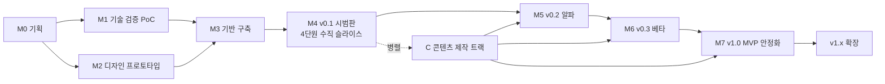

# 구현 로드맵

ProgInOne을 어떤 순서로 만들지 마일스톤 단위로 정의합니다.
각 마일스톤은 목표, 범위, 의존성, 세부 작업, 테스트, 완료 조건을 갖습니다.

- 상태: 승인됨 (2026-11-14)
- 최종 수정: 2026-11-14 (외부 검토 반영: 층별 순서 → 단계별 출시 순서로 재구성)
- 관련 문서: [PRD](/docs/product/prd.md), [시스템 아키텍처 설계](/docs/design/system-architecture.md), [결정 기록](/docs/decisions.md)

## 로드맵 원칙

- **위험한 것부터 검증합니다.** Codex 튜터 적합성과 샌드박스 격리는 구현 초기에 PoC로 확인합니다.
- **작은 완성본부터 씁니다.** 기능을 층별로 하나씩 완성하지 않습니다. 읽기 → 풀이 → 채점 → 숙련도 → 복습 → 튜터가 4개 단원에서 끝까지 이어지는 v0.1 시범판을 먼저 만들고, 그 뒤 콘텐츠와 기능을 넓힙니다([PRD 단계별 출시](/docs/product/prd.md#단계별-출시), [D-022](/docs/decisions.md)).
- **출시마다 직접 학습합니다.** v0.1부터 학습자가 실제로 공부하며 사용성 문제를 기록하고, 다음 단계 계획에 반영합니다.
- **디자인 시스템은 처음부터 함께 만듭니다.** UI는 마지막에 덧붙이지 않습니다. 기반 구축 마일스톤에서 토큰과 기본 컴포넌트를 먼저 만듭니다.
- **콘텐츠 제작은 병렬 트랙입니다.** 콘텐츠 파이프라인이 준비되는 시점부터 기능 개발과 함께 진행합니다.
- **마일스톤마다 승인을 받습니다.** 다음 마일스톤 구현은 사용자 승인 후 시작합니다([기여 가이드](/CONTRIBUTING.md#협업-원칙-사람--ai-에이전트)).
- **완료 기준은 "렌더링됨"이 아닙니다.** 모든 UI 마일스톤은 브라우저 시각 검증과 사용성 점검을 포함합니다.

## 마일스톤 개요

| 마일스톤 | 핵심 산출물 | 선행 조건 |
|---|---|---|
| M0 기획 | 승인된 PRD·설계 문서 | — |
| M1 기술 검증 PoC | Codex 튜터 PoC 보고서, 샌드박스 PoC 보고서, D-002·D-018 확정 | M0 |
| M2 디자인 프로토타입 | 정적 HTML 프로토타입 2~3안, 선택된 디자인 방향, 디자인 토큰 v1 | M0 |
| M3 기반 구축 | 모노레포, CI, 디자인 시스템 기본 컴포넌트, 앱 셸, 서버 골격, DB·마이그레이션·자동 백업 | M1, M2 |
| M4 v0.1 시범판 | 4단원으로 읽기·풀이·채점·숙련도·복습·튜터 전체 흐름, 문제 유형 6종, `v0.1.0` | M3 |
| M5 v0.2 알파 | 문제 유형 9종 완성, 재학습·약점·오개념·목표·페이스, 대화 요약, HTML/CSS 핵심 + JS 기초 모듈 1~5, `v0.2.0` | M4, C |
| M6 v0.3 베타 | JS 기초 전체, 단원 평가·응용 프로젝트, 평가 맥락 규칙, 나머지 P0, `v0.3.0` | M5, C |
| M7 v1.0 MVP 안정화 | 수량·분포 기준 충족, 시각 회귀 매트릭스, 접근성·성능 점검, 설치 가이드, `v1.0.0` | M6, C |
| C 콘텐츠 제작 트랙 | 단계별 콘텐츠 범위를 파이프라인으로 제작·검증 | M4의 파이프라인 |

## M0. 기획

**목표**: 무엇을 어떻게 만들지 합의합니다.

**작업**

- [x] 1차 요구사항 분석과 핵심 결정 합의 (D-001 ~ D-017)
- [x] PRD 초안
- [x] 설계 문서 초안: 시스템 아키텍처, 데이터 모델, 학습 엔진, 콘텐츠·문제, 샌드박스, AI, UI/UX
- [x] 사용자 검토: 작성 중 결정(D-018 ~ D-020) 승인, v1.x 콘텐츠 순서 결정(D-021)
- [x] 외부 검토 반영: 단계별 출시(D-022), 숙련도 모델 보강(D-023), 문제 수량 기준, 노트·인터랙티브 컴포넌트 P1
- [x] 수정본 최종 승인, 설계 문서 상태를 `승인됨`으로 변경 (2026-11-14)

**완료 조건**: 사용자가 PRD와 설계 문서를 승인합니다.

## M1. 기술 검증 PoC

**목표**: 가장 불확실한 두 가지를 실제로 확인해, 설계를 확정하거나 수정합니다.
PoC 코드는 버리는 것을 전제로 `poc/` 디렉터리(또는 별도 브랜치)에 작성하고, 결과는 문서로 남깁니다.

**의존성**: M0 승인. 로컬에 Codex CLI 설치와 ChatGPT 로그인.

### M1-A. Codex App Server 튜터 PoC

| 작업 | 확인할 것 | 합격 기준 |
|---|---|---|
| stdio JSON-RPC 클라이언트 최소 구현 | `initialize` → `thread/start` → `turn/start` → 스트림 수신 | 스트리밍 표시 성공 |
| 인증 흐름 | `account/login/start`(chatgpt), `account/read`, 로그아웃 | 앱에서 로그인 완료 감지 |
| 튜터 지침 주입 | 스레드·턴 수준 지침 주입 방식, 한국어·교수법 준수 | 골든 질문 20개 중 18개 이상이 지침 준수(정답 비노출, 단계적 설명) |
| 도구 비활성화 | 빈 cwd + readOnly + 승인 자동 거부에서 셸·파일 접근 시도 없음 또는 차단 | 차단 확인 |
| 구조화 출력 | `outputSchema`로 문제 생성·세션 요약 스키마 출력 | 스키마 검증 통과율 95% 이상 (20회) |
| 지연 시간 | 첫 토큰 시간, 전체 응답 시간 | 튜터 첫 토큰 p50 3초 이하 목표 (미달 시 대안 검토) |
| 사용량 | `account/rateLimits/read`, 업데이트 알림 | 값 표시 가능 |

**산출물**: `docs/design/ai-system.md`의 미결 사항 갱신, PoC 보고서(같은 문서의 부록 또는 결정 기록 항목), D-002 `확정` 또는 대안 결정.

### M1-B. 샌드박스 PoC

| 작업 | 합격 기준 |
|---|---|
| opaque origin iframe + CSP에서 JS 실행, console 캡처 | 출력 정상 표시 |
| 무한 루프 (`while(true){}`) — Worker 모드 / DOM 모드 | 메인 UI 계속 응답, 3초 내 중단 |
| 네트워크 요청 (`fetch`, `img`, `WebSocket`) → `127.0.0.1:4310` 및 외부 | 모두 차단 |
| 부모 접근 (`parent.document`, `top.location`, `localStorage`) | 모두 차단 또는 예외 |
| CSS computed style·레이아웃 체크 | 뷰포트별 판정 성공 |

**산출물**: 샌드박스 설계 문서 미결 사항 갱신.

**완료 조건**: 두 PoC 결과가 문서화되고, 설계 변경이 필요하면 결정 기록에 반영되어 사용자 승인을 받습니다.

**결과 (2026-11-14 완료)**

- [x] M1-A: 골든 질문 20/20, 구조화 출력 20/20, 중단 정상, 첫 토큰 p50 3.1~3.7초(목표 4초로 조정). 전용 `CODEX_HOME`과 `[features]` 도구 비활성화를 필수로 추가. D-002 `확정`. 보고서: [poc/codex-tutor](/poc/codex-tutor/README.md)
- [x] M1-B: 4개 브라우저 프로젝트에서 보완 구조 180/180 통과. 셸 서브도메인 방식으로 보완해 D-018 `확정`. 결과: [샌드박스 설계 PoC 결과](/docs/design/code-execution-sandbox.md)

## M2. 디자인 프로토타입

**목표**: 구현 전에 시각적 방향을 확정합니다.

**의존성**: M0. M1과 병렬로 진행할 수 있습니다.

**작업**

- 대시보드와 학습 화면(읽기·실습 모드)의 정적 HTML 프로토타입 2~3안 제작 ([UI/UX 설계](/docs/design/ui-ux.md)의 콘셉트 기반)
- 라이트/다크 각각 제작, 실제 한국어 레슨 문장과 코드로 채움(로렘 입숨 금지)
- 사용자 리뷰 후 1안 선택, 피드백 반영
- 디자인 토큰 v1 확정(색, 타이포그래피, 간격, 반경, 그림자, 모션)

**완료 조건**: 선택된 안과 디자인 토큰 v1이 UI/UX 설계 문서에 반영되고 사용자가 승인합니다.

**결과 (2026-11-14 완료)**

- [x] 3안 × 4화면 × 라이트/다크 프로토타입, axe-core 위반 0건. 프로토타입: [design/prototypes](/design/prototypes/README.md)
- [x] C 차분한 교실, 라이트 에디터 기본(어두운 작업대는 설정), 로고 1안, 토큰 수정 3건, 레슨 제목 28px 채택. [D-024](/docs/decisions.md)

## M3. 기반 구축

**목표**: 모든 기능이 올라갈 토대를 만듭니다. 빈 앱이지만 품질 체계는 완성되어 있어야 합니다.

**의존성**: M1(기술 확정), M2(디자인 토큰).

**세부 작업**

1.  모노레포 초기화: pnpm workspaces, TypeScript project references, `strict`, ESLint, Prettier, `.nvmrc`, `packageManager`
1.  패키지 골격: `apps/web`, `apps/server`, `packages/shared`, `packages/ui` (나머지 패키지는 해당 마일스톤에서 생성)
1.  CI: lint, typecheck, test, build, 순환 의존 검사, 문서 링크 검사
1.  `packages/ui`: 디자인 토큰(CSS 변수, 라이트/다크), 기본 컴포넌트(Button, IconButton, Input, Select, Checkbox, Radio, Tabs, Dialog, Drawer, Tooltip, Toast, Badge, Progress, Skeleton, EmptyState, ErrorState)
1.  앱 셸: 전역 내비게이션, 라우팅, 테마 전환, 패널 리사이즈 레이아웃 골격, 오류 경계
1.  서버 골격: Hono 앱, 보안 미들웨어(Host/Origin 검사, 세션 토큰), 오류 모델, 구조화 로그, 설정 로더, 단일 인스턴스 잠금
1.  user.db: Drizzle 설정, 첫 마이그레이션(설정, 학습자, 메타), 마이그레이션 전 자동 백업, 시작·일일 백업, 보존 정책, 복원 API
1.  설정 화면 v0: 테마, 백업 목록·수동 백업·복원
1.  Playwright 설정: E2E, 시각 회귀(Docker), axe
1.  가이드 작성: `docs/guides/getting-started.md`, `docs/guides/testing.md`

**테스트**

- 마이그레이션 실패 시 자동 복구 통합 테스트
- 백업 보존 정책 단위 테스트(날짜 경계)
- 보안 미들웨어: 잘못된 Host/Origin/토큰 요청 거부 테스트
- 앱 셸 시각 회귀, 컴포넌트 상태별 스냅샷, axe 검사

**완료 조건**: `pnpm dev`, `pnpm build && pnpm start`가 동작하고, CI가 녹색이며, 설정 화면에서 백업과 복원이 실제로 동작합니다.

**진행 (2026-11-14)**

- [x] 모노레포·CI (#2), Dependabot 제외 규칙 (#7)
- [x] 서버 골격과 보안 미들웨어 (#4)
- [x] user.db 마이그레이션·자동 백업·복원 (#6)
- [x] 설정 API·웹 앱 제공·세션 토큰 (#8)
- [x] 디자인 토큰·대비 검사 (#5), 기본 컴포넌트 (#9)
- [x] 웹 앱 셸과 설정 화면 v0 (#10)
- [x] E2E·접근성·시각 회귀 (#11)
- [x] 가이드: 시작하기, 테스트
- [x] M3 완료 (2026-11-14 사용자 확인), Tailwind 도입(D-025)

M3는 v0.1 시범판의 토대이므로, 여기서 만든 컴포넌트와 서버 골격은 M4에서 바로 학습 화면에 쓰입니다. 미리 일반화하지 않고 v0.1에 필요한 것만 만듭니다.

## M4. v0.1 시범판 (수직 슬라이스)

**목표**: 4개 단원에서 학습 흐름 전체가 동작하는 작은 완성본을 만들고, 학습자가 실제로 공부를 시작합니다.
기능은 각 층의 최소 버전만 만들되, 만든 것은 v1.0 품질 기준(테스트, 접근성, 시각 검증)을 지킵니다.

**의존성**: M3. M1 결과(Codex, 샌드박스).

**콘텐츠 범위** (C 트랙과 함께 제작)

- CSS `css.box` 박스 모델 (10문제, 기본 웹 실습 채점 검증)
- JS 기초 모듈 1: `first-program`, `reading-errors` (각 12문제, 콘솔 출력·오류 읽기 검증)
- JS 기초 `variables` 핵심 단원 (22문제, 핵심 단원 크기의 세트 구성·오개념 검증)

**세부 작업**

1.  콘텐츠 파이프라인: `packages/content-schema`, `tools/content-cli`의 `check`·`build`, content.db 읽기 리포지토리, 커리큘럼 API
1.  MDX 컴포넌트: Callout, CompareTable, ConceptLink, CodeBlock, RunnableExample(예측 후 실행), InlineExercise
1.  `packages/runner`: 러너 셸(`/sandbox/runner.html`, 전용 CSP), 관측 전용 하네스, 호스트 프로토콜, 워치독, 루프 가드, console 직렬화
1.  `packages/exercise-kit`: 유형 레지스트리, 6종 스펙·채점기(`mcq_single`, `fill_blank`, `predict_output`, `implement_function`, `fix_bug`, `web_task` 기본형), 정답 키 제거, 체크 가중 부분 점수, 파라메트릭 템플릿 엔진
1.  `packages/exercise-ui`: 6종 렌더러, 확신도 선택, 힌트 사다리, 피드백 배너
1.  CodeMirror 6 에디터, Prettier 포맷, 코드 자동 저장, HTML/CSS 미리보기(단일 문서)
1.  화면: 과정 상세(커리큘럼 아코디언), 학습 화면 읽기 모드·실습 모드와 전환, 최소 대시보드(이어서 학습, 오늘의 복습)
1.  `packages/learning-engine` 핵심: 증거 가중치(`W_rep` 포함), 숙련도 갱신, 단계 게이트, FSRS 연동, 단원 연습 세트, 복습 큐·복습 세트
1.  서버: 연습 세트, 시도 제출·판정·엔진 반영(트랜잭션), 힌트·정답 열람 기록, 문제 신고, 활동 시간 측정
1.  `packages/ai` 최소: ProviderAdapter, Codex 어댑터, MockProvider, 로그인·연결 상태, `tutor.reply`·`tutor.hint`(정답 비노출 규칙 포함), 튜터 드로어·선택해서 질문하기, 대화 원문 저장
1.  content-cli 실행 검증: 헤드리스 Chromium에서 같은 러너로 참조 정답 통과, 오답 선택지 검증, 예측 기대값 확정
1.  가이드: `docs/guides/content-authoring.md`

**테스트**: 6종 채점기 단위 테스트, 템플릿 결정론, 샌드박스 보안 스위트(S1~S44), 학습 엔진 시나리오 중 v0.1 범위 전부, MockProvider 기반 튜터 통합 테스트, 정답 비노출 규칙 테스트, 4단원 학습 흐름 E2E, 읽기·실습 화면 시각 회귀와 axe.

**완료 조건**

- 4개 단원을 읽기부터 연습 세트 통과, 다음 날 복습까지 브라우저에서 끝까지 진행할 수 있습니다(가짜 시계 E2E와 실제 사용 모두).
- Codex를 끈 상태에서도 튜터를 뺀 모든 흐름이 동작합니다.
- 학습자가 1~2주 동안 실제로 사용하며 사용성 문제 목록을 만들고, 심각한 문제를 해결합니다.
- 4단원 저작에 든 시간을 기록해 C 트랙 일정과 템플릿 비중을 재조정합니다.
- `v0.1.0` 태그.

**진행 (2026-11-15)**

- [x] 콘텐츠 파이프라인(#14–#16, #25, #38), MDX 렌더러(#20, #33), 러너(#24, #26, #47), exercise-kit(#18, #22, #23, #41), exercise-ui·에디터(#29, #32), 학습 엔진(#17, #19, #21), 서버 연습 흐름(#28, #31, #34, #36, #46), 실습·복습·대시보드 화면(#40, #43, #44), AI 튜터(#37, #39, #42, #48, #54), 4개 단원 콘텐츠와 AI 교차 검토(#27, #30, #35, #45)
- [x] 읽기 → 연습 세트 통과 → 다음 복습 예정일의 복습까지 브라우저 E2E로 검증(픽스처 단원, 가짜 시계, D-029). 실제 4개 단원은 실행 검증(`content:check:run`)과 수동 풀이로 확인
- [x] Codex를 끈 상태(모의 제공자 포함)에서 튜터를 뺀 모든 흐름 동작
- [x] 4단원 저작 시간 기록: AI 초안 약 31분 + AI 교차 검토(#27, #45 PR 본문)
- [x] `v0.1.0` 태그
- [ ] 학습자의 1~2주 실제 사용과 사용성 문제 목록(사용자 진행 대기). 결과는 M5·M6 작업에 반영합니다

## M5. v0.2 알파

**목표**: 문제 유형과 학습 엔진 기능을 MVP 수준으로 넓히고, 콘텐츠를 HTML/CSS 핵심과 JS 기초 절반으로 늘립니다.

**의존성**: M4, v0.1 사용성 점검 결과. C 트랙(콘텐츠).

**세부 작업**

1.  나머지 문제 유형: `mcq_multi`, `true_false`, `parsons`, `find_bug_line`
1.  학습 엔진: 재학습 규칙, 약점 집중 세트, 오개념 상태 전이, 진행 중 적응, 오늘의 학습, 목표 페이스(`estimatedMinutes` 기반)
1.  화면: 온보딩(환영, 목표 설정, 경험 수준), 대시보드 완성(진도, 목표, 개념 지도), 개념 상세(숙련도 근거), 재학습 유도 UI
1.  AI: `evaluator.explainMistake`, `session.summarize`, `misconception.propose`, 컨텍스트 빌더의 학습 상태 연결, 앱 재시작 후 맥락 복원, AI 비가용 상태 UI, 사용량 표시(제공 범위 안에서), `ai_calls` 로그
1.  `docs/guides/debugging.md`

**테스트**: 학습 엔진 시나리오 표 전부, 30일 가짜 시계 시뮬레이션, Codex 프로토콜 계약 테스트(녹화 재생), 대시보드 빈 상태·신규·장기 사용자 시각 회귀.

**완료 조건**: v0.2 콘텐츠 범위가 `content:check`를 통과하고, 30일 시뮬레이션에서 복습 일정·숙련도·오늘의 학습이 설계대로 나오며, 학습자의 실제 사용 점검 결과가 반영됩니다. `v0.2.0` 태그.

**진행 (2026-11-15)**

- [x] 문제 유형 `mcq_multi`·`true_false`(#49), `parsons`(#51, D-031), `find_bug_line`(#53, D-032)
- [x] 학습 엔진 v0.2: 오개념 전이·재학습(#50), 진행 중 적응·약점 집중·건너뛰기(#52), 오늘의 학습·목표 페이스·개념 상세(#55), 30일 가짜 시계 시뮬레이션(#56). D-033
- [x] 화면: 온보딩·목표(#61, D-034), 대시보드·개념 지도(#66, D-037), 개념 상세(#67, D-038), 재학습 유도 UI(#68, D-039)
- [x] AI: 녹화 재생 계약 테스트(#59), 장기 학습 기억(#63, D-035), 오답 분석·오개념 제안(#64, D-036), AI 비가용 E2E·호출 기록·`docs/guides/debugging.md`(#65)
- [x] 콘텐츠: HTML 핵심 7단원(#70, #78), CSS 핵심 9단원(#76, #81), JS 기초 모듈 2~5(#58, #62, #69, #79, #74, #75, #82). 35단원, 문제 485개 모두 AI 교차 검토 승인, `content:check` 오류·경고 0. 단원 평가 단원은 M6으로(D-040)
- [x] 사용성 수정: dom `order` 단독 체크, 미리보기 이동 안내(#73), 코드 언어 표시·390px 넘침(#80), 마크다운 표·좁은 화면 헤더(#83)
- [x] `v0.2.0` 태그
- [ ] 학습자의 실제 사용 점검 결과 반영(사용자 진행 대기). v0.1 사용 점검과 함께 M6·M7 작업에 반영합니다

## M6. v0.3 베타

**목표**: JS 기초 과정을 처음부터 끝까지 학습할 수 있게 합니다.

**의존성**: M5. C 트랙.

**세부 작업**

1.  단원 평가 세트와 평가 맥락 규칙(힌트·튜터 잠금, `W_ctx`, 평가 종료 후 해설), 응용 프로젝트 단원
1.  복습 화면 완성: 오답 노트, 약점 집중, 숙련도 변화
1.  설정 완성: 백업 목록·복원·위치 변경, 학습 방식 설정, 학습 데이터 초기화
1.  나머지 P0 요구사항 점검과 구현

**테스트**: 평가 맥락 E2E(힌트 잠금, 종료 후 공개), 백업 복원 E2E, `mastered` 게이트 시나리오(가짜 시계 3주).

**완료 조건**: JS 기초 전체가 `content:check`를 통과하고, 학습자가 베타로 학습하며 정리한 문제 목록이 v1.0 작업으로 분류됩니다. `v0.3.0` 태그.

**진행 (2026-11-15)**

- [x] 단원 평가: 콘텐츠 형식·문항 선택(#72, D-041), 평가 맥락 잠금 API(#77, D-042), 평가 화면(#86, D-043). 평가 단원 6개(#88, #102, D-054)와 AI 교차 검토(#96, #106)
- [x] 응용 프로젝트 단원: 서버(#99, D-048), 화면과 E2E(#100, D-049). 최종 프로젝트 "할 일 목록"(#98, #105)
- [x] 복습 화면: 오답 노트·숙련도 변화 API(#87, D-044), 복습 허브 화면(#92, D-046)
- [x] 설정: 데이터(백업 위치 변경·복원 전 검사·초기화, #91, D-045), 학습 방식과 화면(#93, D-047)
- [x] P0 요구사항 점검과 빈틈 보완(#107, D-051), 필수 수정(선수 개념 경고·채점 폼 제출 결정론, #109, D-052~D-054)
- [x] 콘텐츠: JS 기초 모듈 6~10(#90, #89, #97, #95, #98)과 AI 교차 검토(#94, #96, #103, #104, #105). 63단원, 문제 1,035개 모두 승인, `content:check` 오류·경고 0
- [x] 테스트: 평가 맥락 E2E(#86), 백업 복원 E2E(#91), `mastered` 게이트 3주 시나리오(#108)
- [x] 사용성 수정: 다이어그램 렌더링·인라인 코드 공백·리거처(#101), 시각 기준 이미지 워크플로(#84)
- [x] `v0.3.0` 태그
- [ ] 시각 회귀 기준 이미지 재생성: Actions 사용량 소진·로컬 Docker 장애로 미실행(복구 후)
- [ ] 학습자가 베타로 학습하며 정리한 문제 목록을 v1.0 작업으로 분류(사용자 진행 대기)

## M7. v1.0 MVP 안정화

**목표**: 실제로 매일 쓸 수 있는 품질로 다듬고 MVP를 출시합니다.

**작업**

1.  콘텐츠 품질 완성: 수량·유형 구성비·난이도 분포 기준 충족, 단원별 샘플 수동 검토(최소 20%, `core` 레슨 전수)
1.  전체 학습 흐름 E2E: 온보딩 → 단원 학습 → 연습 → 평가 → 복습 → 목표 → 백업 복원
1.  주요 화면 시각 회귀 매트릭스 완성(라이트/다크 × 1280/1440/1920 × 상태)
1.  접근성 점검: axe 자동 검사 + 키보드·스크린 리더 수동 점검
1.  호환성 점검: NFR-10의 점검 범위 브라우저 수동 점검
1.  성능 점검: NFR-01~03 측정
1.  릴리스 워크플로, `docs/guides/install-and-upgrade.md`, `docs/guides/release.md`
1.  `CHANGELOG.md` 정리, `v1.0.0` 태그

**완료 조건**: [PRD의 MVP 완료 정의](/docs/product/prd.md#mvp-완료-정의)를 모두 만족합니다.

## C. 콘텐츠 제작 트랙 (병렬)

**목표**: 단계별 출시 범위에 맞춰 콘텐츠를 완전한 품질로 채웁니다.

**의존성**: M4의 콘텐츠 파이프라인. 문제 유형은 출시 단계마다 늘어나므로, 아직 없는 유형의 문제는 다음 단계에서 추가합니다.

| 단계 | 범위 | 규모(목표) |
|---|---|---|
| v0.1 | CSS `css.box`, JS 모듈 1, `variables` | 4단원, 약 55문제 |
| v0.2 | HTML 핵심 전체, CSS 핵심 전체, JS 기초 모듈 1~5 | 누적 약 40단원 |
| v0.3 | JS 기초 모듈 6~10(브라우저 JS 입문 포함), 단원 평가, 응용 프로젝트 | 누적 63단원, 172개념 |
| v1.0 | 수량·분포 기준 충족과 검토 완료 | 약 1,020문제 |

**작업**

- 콘텐츠 초안 생성 도구(`content-cli draft`, Codex 사용) — v0.1은 수작업 비중이 높아도 되며, 도구는 v0.2 전에 완성
- 품질 검토: 모든 문제 실행 검증 통과, 단원별 샘플 수동 검토, 난이도·유형 구성비 점검
- 단계마다 저작 속도를 측정해 다음 단계 범위를 조정합니다. 범위 조정은 결정 기록에 남깁니다.

상세 커리큘럼과 수량은 [콘텐츠·문제 시스템 설계](/docs/design/content-and-exercises.md)와 PRD [문제 수량 기준](/docs/product/prd.md#문제-수량-기준)을 따릅니다.

## v1.x 이후 (MVP 이후)

우선순위는 MVP 사용 경험을 바탕으로 다시 정합니다. 현재 제안 순서는 다음과 같습니다.

| 순서 | 내용 | 관련 요구사항 |
|---|---|---|
| v1.1 | 개인 노트(튜터 답변 저장 포함), 자유 연습, 인터랙티브 개념 컴포넌트(박스 모델·Flexbox 놀이터), 여러 파일 웹 실습, 뷰포트 전환, 연결하기·변수 추적·오류 설명 찾기 유형 | FR-UI-05, FR-AI-14, FR-EX-16, FR-CUR-09, FR-EX-03, FR-CODE-08/10 |
| v1.2 | JavaScript 심화 전체 콘텐츠 ([D-021](/docs/decisions.md)) | PRD MVP 콘텐츠 범위 표 |
| v1.3 | AI 문제 생성 + 검증 파이프라인, 대화 검색·내보내기, AI 코드 리뷰 | FR-EX-12, FR-AI-11, FR-CODE-11 |
| v1.4 | 브라우저 JavaScript 전체 콘텐츠 | PRD MVP 콘텐츠 범위 표 |
| v1.5 | 통계 화면, 커맨드 팔레트, 진단 평가, 박스 모델 인스펙터, JSON 내보내기 | FR-DASH-03, FR-UI-02, FR-LRN-07, FR-CODE-09, FR-SET-06 |
| v2 | 실행 시각화, 서술형 루브릭 채점, 추가 AI 제공자, 하이라이트·북마크, 난이도 자동 보정 | P2 요구사항 |

## 로드맵 관리

- 마일스톤이 끝나면 이 문서의 체크 상태와 다음 마일스톤 계획을 갱신합니다.
- 범위 변경은 결정 기록에 추가하고 이 문서에 반영합니다.
- 작업 항목은 GitHub Issues와 Milestones로도 관리할 수 있습니다. 이 경우 이 문서는 개요만 유지하고 세부 작업은 Issues에 둡니다.
